# Ранбук воркшопа MoscowPythonPro (5 ноября 2026): От вайб-кодинга к профессиональной AI-разработке

> **Версия комплекта:** ветка `workshop-nov-5` | коммит `34094ca4545844144ab7ea17a4d85895061b8471` (`snap-6`) | срезы `snap-0`..`snap-6`

> 📦 Этот файл участник забирает с собой: в нём полностью собраны база трёх учебных дней и итоговый сквозной практикум.

## Навигация

| Часть | Содержание |
|---|---|
| [Часть I](#part-i) | Скиллы и harness одиночного инженера |
| [Часть II](#part-ii) | Оркестрация, Coder → Reviewer → Gate и экспертная панель |
| [Часть III](#part-iii) | Монолит, масштаб, граф знаний, GSD, EARS, Blast Radius и приёмка |
| [Часть IV](#part-iv) | Сквозной синтез на `linksvc` |

- [Навигация](#навигация)
- [Часть I](#part-i)
- [Часть II](#part-ii)
- [Часть III](#part-iii)
- [Часть IV](#part-iv)
- [Пререквизиты](./ПРЕРЕКВИЗИТЫ.md)

**Легенда:** ✋ — ручной шаг; 🤖 — промпт агенту; ⏭️ — пропуск для готового окружения; ⚙️ — автоматическая проверка; 🎬 — пример для показа; 💡 — разбор результата.


---

<a id="part-i"></a>

## Часть I. База: скиллы и harness одиночного инженера

## Ранбук Дня 1. От вайб-кодинга к управляемой разработке: правила, скилы и инженерный харнес

## Архитектура первого дня: как мы превратим неуправляемого агента в дисциплинированного инженера

День 1 закладывает технологический фундамент всего четырёхдневного интенсива. Большинство разработчиков взаимодействуют с нейросетями в режиме «вайб-кодинга»: формулируют задачу естественным языком в окне чата, получают длинный фрагмент кода, копируют его в проект и надеются, что ничего не сломалось. На изолированных скриптах или одноразовых утилитах такой подход создаёт иллюзию высокой производительности. Однако при переносе в живую промышленную кодовую базу с реляционной базой данных, асинхронным вводом-выводом и внешними потребителями вайб-кодинг неизбежно заходит в тупик: модель теряет контекст, ломает обратную совместимость API, генерирует бутафорские тесты и вымывает архитектурные границы слоёв.

Цель первого дня — полностью демонтировать практику бесконтрольного чата и построить **детерминированный инженерный контур (Engineering Harness)** вокруг агента. К концу дня ваш агент превратится из непредсказуемого генератора текста в исполнительного младшего инженера, работающего по строгим процедурным регламентам, под контролем конституции репозитория и жестких ворот качества.

### Что вы построите за день

За 8 часов интенсивной практики вы создадите целостную систему управления разработкой:
1. **Карту архитектуры и связей (`architecture-map.md`):** документ разведки, фиксирующий границы слоёв, внешние контракты и зону влияния любых будущих правок в режиме «только чтение».
2. **Конституцию репозитория (`.agents/AGENTS.md`):** постоянные, активные на каждом шаге нерушимые правила архитектуры, запреты на читерство и критерии готовности (DoD).
3. **Детерминированные ворота качества в `pyproject.toml` (Quality Gates & Guardrails):** строгие конфигурации `ruff`, `basedpyright`, `pytest` и `coverage`, пресекающие обход правил на уровне кода возврата компиляторов и линтеров.
4. **Библиотеку из 7 процедурных скилов (`SKILL.md`):** атомарные исполняемые регламенты для исследования кода, фиксации текущего поведения тестами, модульного тестирования, интеграционных тестов с реальной СУБД, послойной разработки фич, обратимых миграций Alembic и безопасного рефакторинга.
5. **Доказательный A/B-эксперимент:** прямое сравнение результата вайб-кодинга в голом чате и работы агента под управлением собранного харнеса на одной и той же боевой задаче с динамическим переключением через утилиту `tools/toggle_skills.py` (удаление скилов $\rightarrow$ генерация с ошибками $\rightarrow$ восстановление скилов $\rightarrow$ чистая профессиональная разработка).

### Сквозной учебный репозиторий и стек

Практика Дня 1 разворачивается на реальном микросервисе сокращения и аналитики ссылок:
- **Рабочий каталог участника:** `~/work/MoscowPythonPro/workshop-nov-5`
- **Git-репозиторий:** `https://github.com/itpoohzhi/MoscowPythonPro.git`
- **Технологический стек:** Python 3.12+, FastAPI, PostgreSQL 17, SQLAlchemy 2.0 (async), Alembic, Pydantic v2, `uv`, `ruff`, `basedpyright`, `pytest`, `pytest-cov`.

### Правила, по которым написан этот ранбук

1. **Прозрачный инженерный язык:** Мы заменяем размытые метафоры строгими терминами: «тесты текущего поведения сервиса» (Characterization Tests), «карта архитектуры и зона влияния правок» (Impact Analysis), «правило только вверх» (порог тестового покрытия можно повышать, но нельзя снижать), «нерушимые правила», «строгие запреты».
2. **Основной текст сфокусирован на архитектуре и управлении:** В ранбуке нет многостраничных простыней исходного кода приложения и тестов. Все полные листинги модулей сервиса, тестового контура, миграций, конфигураций и готовых файлов скилов вынесены в **[Приложение А. Справочник кода и окружения](./Приложение-А-Справочник-кода-и-окружения.md)**. В главах разбирается логика управления, контракты манифестов, архитектурные схемы и команды запуска.
3. **Никаких самописных скриптов-обёрток:** Все проверки осуществляются стандартными CLI-утилитами: `uv run pytest`, `uv run ruff check .`, `uv run basedpyright`, `uv run alembic check`. Это гарантирует прозрачность кода возврата (Exit Code 0 vs 1).
4. **Контрастный разбор «Вайб-кодинг против Харнеса»:** В каждой главе приводятся сравнительные таблицы и разборы типовых поломок неконтролируемого агента и способов их предотвращения.

> 💡 **Важно:**
> **Zero-Token Setup:** Окружение сервиса (PostgreSQL 17 в Docker, зависимости через `uv sync`, стартовые миграции) поднимается детерминированными системными командами за **0 токенов LLM**. Поручать настройку окружения агенту в чате запрещено: это прожигает контекст и приводит к рассогласованию среды. Полный порядок подготовки рабочего места описан в **[ПРЕРЕКВИЗИТЫ.md](./ПРЕРЕКВИЗИТЫ.md)**.

---


## Глава 1. От боли вайб-кодинга к инженерному контуру: почему «умный чат» ломает прод и как скилы решают эту проблему

### 1.1. Боль: почему вайб-кодинг ломается даже на лучших моделях

Вайб-кодинг — это практика делегирования инженерных задач языковой модели через свободный диалог в чате без формализованных внешних ограничений. На коротких фрагментах изолированного кода модели демонстрируют впечатляющую эрудицию. Однако при переносе в живую промышленную кодовую базу вероятность успешного внедрения стремительно падает.

Причина сбоев кроется не в низком интеллекте моделей, а в фундаментальной архитектуре LLM: модель генерирует вероятностно наиболее правдоподобный текст, не обладая встроенным механизмом верификации фактов и обратной связи от среды исполнения.

#### Схема 1. Три ключевые боли вайб-кодинга как следствия одной причины: у агента нет внешнего арбитра истины и нерушимых правил

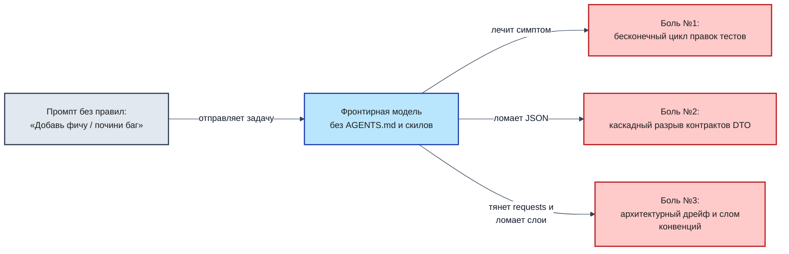

##### Фундаментальная причина сбоев: «Ловушка среднего Python» (The Average Python Trap)

Нейросеть обучалась на терабайтах публичных репозиториев GitHub, StackOverflow и туториалов. «Средний код на Python» в интернете — это синхронные блокирующие вызовы, отсутствие транзакционных границ, устаревшие библиотеки (Pydantic v1, SQLAlchemy 1.3), глобальные переменные и отсутствие строгой статической типизации.

Когда вы даёте агенту свободу в чате, он скатывается к этому «среднему коду». В современном микросервисе на FastAPI, SQLAlchemy 2.0 (async) и PostgreSQL 17 такой код приводит к трём ключевым производственным сбоям:

#### Боль №1. Бесконечный цикл правок (Fix Loop of Death)
- **Механика сбоя:** Разработчик просит агента починить тест или добавить поле. Модель меняет файл, падает проверка типов. Разработчик копирует ошибку в чат. Модель вносит вторую правку, ломая сигнатуру роутера. Разработчик снова копирует ошибку. На 4–5 шаге контекстное окно переполняется диффами, модель «забывает» исходную задачу и начинает ходить по кругу (осциллирующий дефект), маскируя ошибку отключением проверок (`# type: ignore` или комментированием ассертов).
- **Анатомия боли:** В голом чате агент не видит всей кодовой базы и пытается угадать решение по фрагментам ошибок, которые ему вручную скармливает человек. Нет внешнего стоп-условия — чат бесконечен и дорог.

#### Боль №2. Каскадный разрыв контрактов в распределенной архитектуре
- **Механика сбоя:** Агент решает «улучшить» нейминг и переименовывает поле в схеме ответа (например, `target_url` в `destination_url` или `short_code` в `code`). Внутри самого микросервиса тесты роутера могут пройти, если агент синхронно обновил фикстуру. Но за пределами сервиса находятся смежные микросервисы (Notification Worker, сервис аналитики, мобильные клиенты), которые ожидают строго фиксированный JSON.
- **Последствия:** Падение фоновых воркеров с ошибками валидации `KeyError / ValidationError` через 60 секунд после релиза.

##### Схема 2. Зона влияния правок одной переименованной переменной: как правка в `fastapi` каскадом бьёт по сервису уведомлений, мобильному клиенту и аналитике

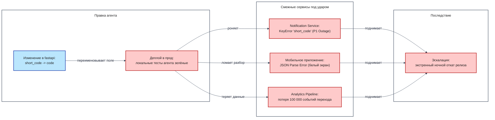

#### Боль №3. Архитектурный дрейф и слом соглашений команды (Architectural Drift & Scope Creep)
- **Механика сбоя:** Агент не знает архитектурных соглашений и конвенций репозитория и начинает импровизировать. Вместо использования сервисного слоя он пишет бизнес-логику и выполняет сырые SQL-запросы прямо внутри HTTP-роутеров. Хуже того — модель подтягивает чужеродный стек из открытых библиотек: вставляет синхронный `requests` вместо принятого в проекте асинхронного `httpx`, блокируя event loop FastAPI на несколько секунд. А по дороге устраивает несанкционированный рефакторинг («сделал красивее»), переписывая базовые классы и меняя сигнатуры в соседних файлах.
- **Последствия:** Размывание архитектурных слоёв, паралич event loop под нагрузкой, неконтролируемый Scope Creep (дифф на 15 файлов вместо точечной правки) и скрытые сайд-эффекты для всей команды.
- **Инженерное решение в харнесе:** Фиксация границ слоёв в `AGENTS.md` (роутер не знает про базу данных), карта архитектуры `architecture-map.md`, список разрешённых библиотек и строгий бюджет зоны влияния (не более 5 файлов на одну задачу).

#### Механика деградации: почему боли воспроизводятся в любом длинном чате

По мере роста истории диалога внимание трансформера (Attention) рассеивается: ранние системные инструкции вымываются свежими многостраничными трейсбеками ошибок. Агент теряет способность удерживать глобальные инварианты и переходит в режим локальной генерации правдоподобного текста.

#### Схема 3. Замкнутый контур деградации контекста: от падения проверки к ложному «Готово!» и новой задаче в том же испорченном чате

```mermaid
%%{init: {"theme": "base", "themeVariables": {"background": "#FFFFFF", "mainBkg": "#F8FAFC", "primaryColor": "#F8FAFC", "primaryTextColor": "#0F172A", "primaryBorderColor": "#475569", "lineColor": "#334155", "secondaryColor": "#F1F5F9", "tertiaryColor": "#F8FAFC", "edgeLabelBackground": "#FFFFFF", "clusterBkg": "#F8FAFC", "clusterBorder": "#94A3B8", "titleColor": "#0F172A", "fontFamily": "Inter, system-ui, -apple-system, sans-serif", "fontSize": "15px"}, "flowchart": {"htmlLabels": true, "curve": "basis", "nodeSpacing": 65, "rankSpacing": 105, "padding": 22, "subGraphTitleMargin": {"top": 14, "bottom": 20}, "useMaxWidth": true, "wrappingWidth": 360}}}%%
flowchart LR
    subgraph Generation["Генерация"]
        direction LR
        A["Промпт без правил"]
        B["Код с дефектом"]
    end
    subgraph Funnel["Воронка деградации контекста"]
        direction LR
        C["Падение проверки"]
        D["Починка в том же чате"]
        E["Заиливание контекста<br/>трейсбеками"]
    end
    subgraph Outcome["Результат"]
        direction LR
        F["Слом слоёв и удаление тестов"]
        G["Ложное «Готово!» в проде"]
    end
    A -->|"порождает"| B
    B -->|"не проходит"| C
    C -->|"запускает"| D
    D -->|"раздувает"| E
    E -->|"приводит к"| F
    F -->|"маскируется под"| G
    G -->|"новая задача в том<br/>же чате"| B
    class A,B core
    class C,D,E,F,G danger
    classDef neutral fill:#e2e8f0,stroke:#334155,stroke-width:2px,color:#1e1e1e
    classDef core fill:#bae6fd,stroke:#1e40af,stroke-width:2px,color:#1e1e1e
    classDef danger fill:#fecaca,stroke:#b91c1c,stroke-width:2px,color:#1e1e1e
    classDef success fill:#bbf7d0,stroke:#166534,stroke-width:2px,color:#1e1e1e
    style Generation fill:#ffffff,stroke:#334155,stroke-width:1.5px,color:#1e1e1e
    style Funnel fill:#ffffff,stroke:#334155,stroke-width:1.5px,color:#1e1e1e
    style Outcome fill:#ffffff,stroke:#334155,stroke-width:1.5px,color:#1e1e1e
```

---

### 1.2. Лечение: инженерный контур, лестница зрелости и четыре слоя обвязки

Чтобы ликвидировать дефекты вайб-кодинга, разработку необходимо перевести с уровня интуитивного чата на уровень воспроизводимого инженерного процесса.

#### Лестница зрелости AI-разработки (AI-SDLC Maturity Ladder)
1. **Ступень 0 (Вайб-кодинг):** Разработчик копирует код из веб-интерфейса чата. Ручное тестирование вслепую.
2. **Ступень 1 (Чат с системным промптом):** Большой системный промпт в интерфейсе IDE. Правила часто игнорируются при длинном диалоге.
3. **Ступень 2 (Репозиторный контур `AGENTS.md` + линтеры):** Файл правил закоммичен в репозиторий. Подключены строгие ворота качества на хуках.
4. **Ступень 3 (Процедурные скилы `SKILL.md`):** Атомарные пошаговые регламенты исполнения конкретных задач с явными Definition of Done и стоп-условиями.
5. **Ступень 4 (Мультиагентная оркестрация):** Разделение ролей (Coder, Reviewer, Architect) в изолированных контекстах с панелью судейства (тема Дня 2).
6. **Ступень 5 (Автономные фабрики фич):** Полный замкнутый цикл от тикета в трекере до верифицированного MR с авто-приёмкой.

День 1 выводит инженера со Ступени 0 на Ступень 3 за счёт построения четырёх взаимодополняющих слоёв обвязки.

#### Схема 4. Четыре слоя инженерной обвязки: два слоя задают, что агент обязан знать, два слоя проверяют результат машиной

```mermaid
%%{init: {"theme": "base", "themeVariables": {"background": "#FFFFFF", "mainBkg": "#F8FAFC", "primaryColor": "#F8FAFC", "primaryTextColor": "#0F172A", "primaryBorderColor": "#475569", "lineColor": "#334155", "secondaryColor": "#F1F5F9", "tertiaryColor": "#F8FAFC", "edgeLabelBackground": "#FFFFFF", "clusterBkg": "#F8FAFC", "clusterBorder": "#94A3B8", "titleColor": "#0F172A", "fontFamily": "Inter, system-ui, -apple-system, sans-serif", "fontSize": "15px"}, "flowchart": {"htmlLabels": true, "curve": "basis", "nodeSpacing": 65, "rankSpacing": 105, "padding": 22, "subGraphTitleMargin": {"top": 14, "bottom": 20}, "useMaxWidth": true, "wrappingWidth": 360}}}%%
flowchart LR
    subgraph Know["Что агент обязан знать"]
        direction LR
        L1["Слой 1: AGENTS.md<br/>нерушимые правила и строгие<br/>запреты"]
        L2["Слой 2: SKILL.md<br/>пошаговые плейбуки со<br/>стоп-условиями"]
    end
    subgraph Check["Что проверяет машина"]
        direction LR
        L3["Слой 3: гардрайлы и ворота<br/>качества<br/>Quality Gates / Guardrails (ruff,<br/>pyright, pytest)"]
        L4["Слой 4: Eval-петля<br/>приёмка только при коде возврата 0"]
    end
    L1 -->|"задаёт границы для"| L2
    L2 -->|"запускает"| L3
    L3 -->|"возвращает код в"| L4
    L4 -->|"возвращает на<br/>доработку"| L2
    class L1,L2 core
    class L3,L4 success
    classDef neutral fill:#e2e8f0,stroke:#334155,stroke-width:2px,color:#1e1e1e
    classDef core fill:#bae6fd,stroke:#1e40af,stroke-width:2px,color:#1e1e1e
    classDef danger fill:#fecaca,stroke:#b91c1c,stroke-width:2px,color:#1e1e1e
    classDef success fill:#bbf7d0,stroke:#166534,stroke-width:2px,color:#1e1e1e
    style Know fill:#ffffff,stroke:#334155,stroke-width:1.5px,color:#1e1e1e
    style Check fill:#ffffff,stroke:#334155,stroke-width:1.5px,color:#1e1e1e
```

#### Разбор четырёх слоёв:
1. **Слой 1 (`AGENTS.md`): Конституция репозитория.** Документ верхнего уровня, активный в каждом ходе. Задаёт архитектурные границы, запреты на читерство и обход проверок.
2. **Слой 2 (`SKILL.md`): Операционные регламенты.** Специализированные процедуры (SOP), загружаемые строго по необходимости под конкретный тип задачи.
3. **Слой 3 (Гардрайлы и Quality Gates в `pyproject.toml`):** Детерминированные машинные арбитры (`ruff`, `basedpyright`, `pytest --cov`). Они не зависят от мнения LLM и возвращают объективный код возврата.
4. **Слой 4 (Eval-петля обратной связи):** Автоматический прогон ворот качества после каждого действия агента. Работа не считается сданной, пока код возврата не равен 0.

Если убрать любой из слоёв, контур рушится: без `AGENTS.md` агент изобретает чужие паттерны; без `SKILL.md` пропускает этапы тестирования; без Quality Gates принимает галлюцинации за рабочий код.

---

### 1.3. Глубокая теория скилов: история стандарта, суть и отличие от элементарных тулов агента

Стандарт процедурных скилов возник как ответ на проблему раздувания контекста (Context Rot). Когда все инструкции проекта упаковываются в один гигантский системный промпт, модель теряет фокус внимания и начинает путать правила разных задач.

#### Трёхуровневая механика Progressive Disclosure (Поэтапное раскрытие знаний)
1. **Уровень 1. Каталог (Metadata Discovery):** В системный промпт инжектируется только компактная таблица имён и описаний скилов (frontmatter). Затраты: < 2% контекстного окна.
2. **Уровень 2. Тело скила (On-Demand Invocation):** Полная процедура конкретного скила (~100–300 строк) подгружается в контекст только в момент возникновения соответствующей задачи.
3. **Уровень 3. Глубокие ресурсы (Deep Context & Tools):** Вспомогательные скрипты, схемы БД и детальные чек-листы читаются агентом только при выполнении соответствующих шагов процедуры.

#### Водораздел: Элементарные тулы (Tools) против Процедурных регламентов (Skills)
- **Элементарные тулы (Tools / CLI commands):** Это «руки» агента (прочитать файл, выполнить bash-команду, сделать HTTP-запрос). Инструмент предоставляет техническую возможность действия, но ничего не говорит о правильном порядке его применения, архитектурных ограничениях и критериях приёмки.
- **Скилы (Skills, SOP):** Это «мозг и методология» инженера. Скил определяет алгоритм: в какой последовательности вызывать инструменты, какие контракты соблюдать, что проверять на каждом шаге и когда немедленно остановиться и откатить изменения.

#### Схема 5. Категориальный водораздел: элементарные действия («руки») против процедурных регламентов («мозг и дисциплина исполнения»)

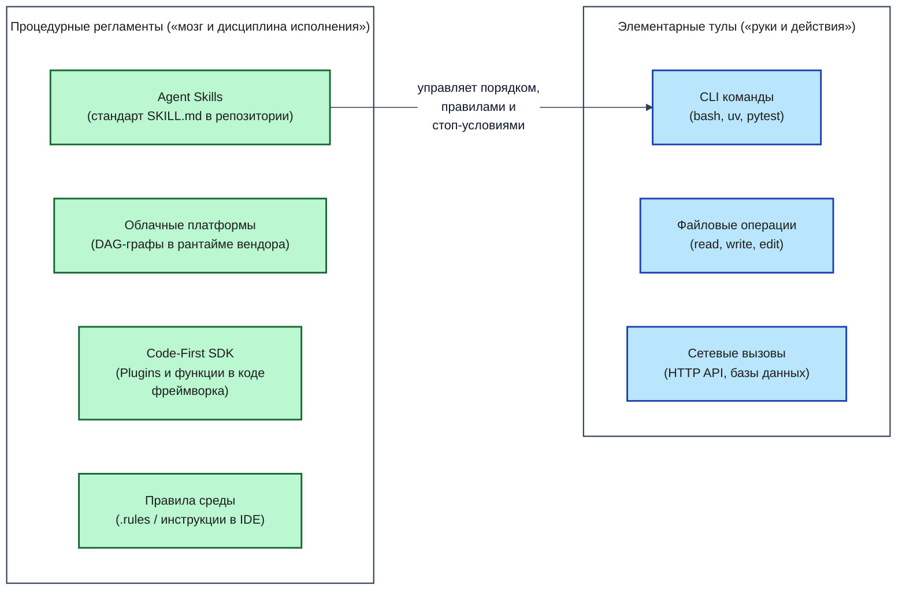

- **Траектория А (Инструмент без скила):** Агент получает задачу «добавить колонку в БД» и инструмент `bash`. Он вызывает `alembic revision --autogenerate`, видит зелёный вывод консоли и рапортует об успехе. При этом он не проверил метод `downgrade()`, оставил пустой откат и создал мину замедленного действия для продакшена.
- **Траектория Б (Инструмент под управлением скила `data-engineering`):** Скил принуждает агента выполнить строгий алгоритм: сгенерировать миграцию -> вручную заполнить `downgrade()` -> применить `upgrade head` -> проверить откат `downgrade -1` -> снова применить `upgrade head` -> запустить тесты интеграции. Любой сбой на промежуточном этапе активирует протокол отката.

---

### 1.4. Детальное сравнение скилов с рыночными альтернативами

В индустрии существует несколько конкурирующих подходов к управлению поведением AI-агентов. Разберём их архитектурные компромиссы.

#### 1.4.1. Amazon Bedrock Prompt Flows (Статический облачный DAG)
- **Архитектура:** Визуальный граф вызовов в облаке AWS. Узлы жестко соединены статическими рёбрами.
- **Ограничения:** Жесткая привязка к вендору (Vendor Lock-in), невозможность запуска на локальной машине разработчика, низкая гибкость при нестандартных ошибках сборки.

##### Архитектурный каркас Amazon Bedrock Prompt Flows (статический облачный DAG)

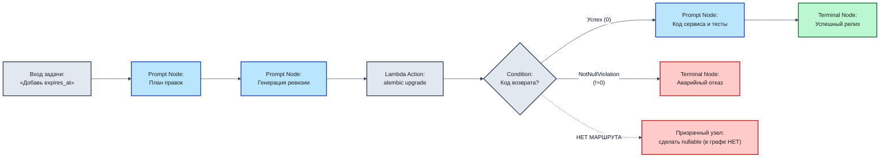

#### 1.4.2. Microsoft Semantic Kernel / Agent Framework (Host-SDK-Плагины)
- **Архитектура:** Программный SDK (C#, Python), где логика плагинов компилируется вместе с хост-приложением.
- **Ограничения:** Требует написания сложного инфраструктурного кода обвязки на Python/C#; правила не хранятся в виде простых файлов разметки рядом с кодом сервиса.

##### Архитектурный каркас Microsoft Semantic Kernel / Agent Framework (Host-SDK-Плагины)

```mermaid
%%{init: {"theme": "base", "themeVariables": {"background": "#FFFFFF", "mainBkg": "#F8FAFC", "primaryColor": "#F8FAFC", "primaryTextColor": "#0F172A", "primaryBorderColor": "#475569", "lineColor": "#334155", "secondaryColor": "#F1F5F9", "tertiaryColor": "#F8FAFC", "edgeLabelBackground": "#FFFFFF", "clusterBkg": "#F8FAFC", "clusterBorder": "#94A3B8", "titleColor": "#0F172A", "fontFamily": "Inter, system-ui, -apple-system, sans-serif", "fontSize": "15px"}, "flowchart": {"htmlLabels": true, "curve": "basis", "nodeSpacing": 65, "rankSpacing": 105, "padding": 22, "subGraphTitleMargin": {"top": 14, "bottom": 20}, "useMaxWidth": true, "wrappingWidth": 360}}}%%
flowchart LR
    HOST["Хост-приложение:<br/>C# / Python SDK"]
    KERNEL["Semantic Kernel:<br/>Ядро оркестрации"]
    PLUG["Plugin Registry:<br/>@kernel_function"]
    PLAN["Планировщик:<br/>Function Calling LLM"]
    EXEC["Нативное исполнение:<br/>Скомпилированный код"]
    RETRY["Правка кода SDK:<br/>Релиз нового пакета"]
    MISS["Дефицит IDE:<br/>Нет CLI и ФС из коробки"]

    HOST --> KERNEL
    KERNEL --> PLAN
    PLAN -->|"Выбор метода"| PLUG
    PLUG -->|"Вызов"| EXEC
    EXEC -->|"Ошибка NotNull"| RETRY
    RETRY -->|"Пересборка"| KERNEL
    KERNEL -.->|"Отсутствует"| MISS

    classDef neutral fill:#e2e8f0,stroke:#334155,stroke-width:2px,color:#1e1e1e
    classDef core fill:#bae6fd,stroke:#1e40af,stroke-width:2px,color:#1e1e1e
    classDef danger fill:#fecaca,stroke:#b91c1c,stroke-width:2px,color:#1e1e1e
    classDef success fill:#bbf7d0,stroke:#166534,stroke-width:2px,color:#1e1e1e

    class HOST,KERNEL neutral
    class PLUG,PLAN core
    class EXEC neutral
    class RETRY,MISS danger
```

#### 1.4.3. Графовые кодовые фреймворки (LangGraph, CrewAI, AutoGen)
- **Архитектура:** Определение логики агента через программные графы состояний (StateGraph) с условными переходами на чистом Python.
- **Ограничения:** Избыточная алгоритмическая сложность для прикладной разработки; разработчик тратит больше времени на поддержку фреймворка агента, чем на решение продуктовых задач сервиса.

##### Архитектурный каркас LangGraph (граф состояний StateGraph с условным роутингом и retry)

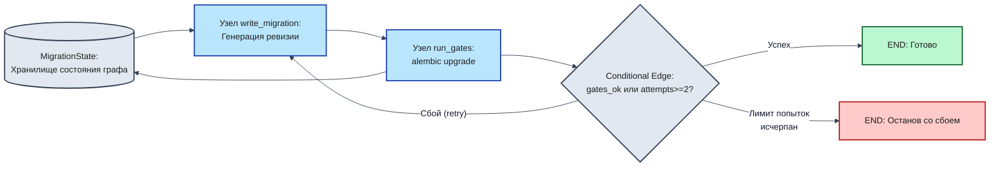

#### 1.4.4. Правила IDE и файловые маски: Cursor Rules (`.cursor/rules/*.mdc`)
- **Архитектура:** Текстовые инструкции, привязанные к шаблонам путей файлов (globs), например `app/api/**/*.py`.
- **Ограничения:** Привязаны к конкретному редактору; активируются при открытии файла, а не по типу сквозной задачи (не подходят для задач, затрагивающих несколько слоёв одновременно).

##### Архитектурный каркас Cursor Rules (активация по маске путей globs против сквозной задачи)

```mermaid
%%{init: {"theme": "base", "themeVariables": {"background": "#FFFFFF", "mainBkg": "#F8FAFC", "primaryColor": "#F8FAFC", "primaryTextColor": "#0F172A", "primaryBorderColor": "#475569", "lineColor": "#334155", "secondaryColor": "#F1F5F9", "tertiaryColor": "#F8FAFC", "edgeLabelBackground": "#FFFFFF", "clusterBkg": "#F8FAFC", "clusterBorder": "#94A3B8", "titleColor": "#0F172A", "fontFamily": "Inter, system-ui, -apple-system, sans-serif", "fontSize": "15px"}, "flowchart": {"htmlLabels": true, "curve": "basis", "nodeSpacing": 65, "rankSpacing": 105, "padding": 22, "subGraphTitleMargin": {"top": 14, "bottom": 20}, "useMaxWidth": true, "wrappingWidth": 360}}}%%
flowchart LR
    EDIT["Момент t0:<br/>Работа с моделью ссылки"]
    SKIP["Правило migration.mdc:<br/>НЕ активно (маска не совпала)"]
    DECISION["Решение о миграции:<br/>принято без правила"]
    OPEN["Момент t+1:<br/>Открыта ревизия Alembic"]
    RULE["Инжекция с задержкой:<br/>migration.mdc в чате"]
    MODEL["Агент в чате IDE:<br/>Нет сквозного контракта"]
    CONTRACT["Сквозной контракт 6 слоёв:<br/>нарушен запаздыванием"]

    EDIT --> SKIP
    SKIP -->|"Вайб-кодинг"| DECISION
    DECISION --> OPEN
    OPEN -->|"Триггер сработал<br/>поздно"| RULE
    RULE --> MODEL
    DECISION --> MODEL
    MODEL --> CONTRACT

    classDef neutral fill:#e2e8f0,stroke:#334155,stroke-width:2px,color:#1e1e1e
    classDef core fill:#bae6fd,stroke:#1e40af,stroke-width:2px,color:#1e1e1e
    classDef danger fill:#fecaca,stroke:#b91c1c,stroke-width:2px,color:#1e1e1e
    classDef success fill:#bbf7d0,stroke:#166534,stroke-width:2px,color:#1e1e1e

    class EDIT,OPEN neutral
    class SKIP,CONTRACT danger
    class RULE core
    class DECISION,MODEL neutral
```

#### 1.4.5. Открытый репозиторный стандарт `SKILL.md` (Agentic AI Foundation)
- **Архитектура:** Декларативные Markdown-файлы с YAML-frontmatter, закоммиченные в репозиторий проекта (`.agents/skills/<name>/SKILL.md`).
- **Преимущества:** Платформонезависимость (работает в OpenCode, Claude Code, Cursor, Factory Droid, Gemini CLI), версионирование в Git, читаемость человеком и моделью, поддержка Progressive Disclosure.

##### Итоговый архитектурный каркас: Репозиторный скил SKILL.md (Progressive Disclosure)

```mermaid
%%{init: {"theme": "base", "themeVariables": {"background": "#FFFFFF", "mainBkg": "#F8FAFC", "primaryColor": "#F8FAFC", "primaryTextColor": "#0F172A", "primaryBorderColor": "#475569", "lineColor": "#334155", "secondaryColor": "#F1F5F9", "tertiaryColor": "#F8FAFC", "edgeLabelBackground": "#FFFFFF", "clusterBkg": "#F8FAFC", "clusterBorder": "#94A3B8", "titleColor": "#0F172A", "fontFamily": "Inter, system-ui, -apple-system, sans-serif", "fontSize": "15px"}, "flowchart": {"htmlLabels": true, "curve": "basis", "nodeSpacing": 65, "rankSpacing": 105, "padding": 22, "subGraphTitleMargin": {"top": 14, "bottom": 20}, "useMaxWidth": true, "wrappingWidth": 360}}}%%
flowchart LR
    TASK["Инженерная задача:<br/>«Добавь expires_at»"]
    L1["Уровень 1:<br/>Реестр описаний скилов"]
    L2["Уровень 2:<br/>SKILL.md ровно одного скила"]
    L3["Уровень 3:<br/>Ресурсы references/ по требованию"]
    SOP["Исполнение СОП:<br/>Фазы 1..3 + откат"]
    GATE["Детерминированные ворота:<br/>alembic + ruff + pytest"]
    DONE["Definition of Done:<br/>Код 0 принят"]
    STOP["Стоп-условие:<br/>Откат + BLOCKED"]

    TASK --> L1
    L1 -->|"Сверка триггера"| L2
    L2 -->|"По требованию"| L3
    L2 --> SOP
    L3 --> SOP
    SOP --> GATE
    GATE -->|"Все проверки 0"| DONE
    GATE -->|"Сбой, попытки<br/>остались"| SOP
    GATE --> STOP

    classDef neutral fill:#e2e8f0,stroke:#334155,stroke-width:2px,color:#1e1e1e
    classDef core fill:#bae6fd,stroke:#1e40af,stroke-width:2px,color:#1e1e1e
    classDef danger fill:#fecaca,stroke:#b91c1c,stroke-width:2px,color:#1e1e1e
    classDef success fill:#bbf7d0,stroke:#166534,stroke-width:2px,color:#1e1e1e

    class TASK neutral
    class L1,L2,L3,SOP core
    class GATE neutral
    class DONE success
    class STOP danger
```

---

### 1.5. Сравнительная матрица стандартов и различия в поддержке скилов

#### Сводная таблица 1. Подходы к управлению поведением агента

| Критерий | Чат-промпт (Vibe) | Системный промпт IDE | Cursor Rules (`.mdc`) | LangGraph / CrewAI | Файловый стандарт `SKILL.md` |
|:---|:---|:---|:---|:---|:---|
| **Хранение** | Память чата | Профиль юзера | Репозиторий `.cursor/` | Python-код графа | Репозиторий `.agents/skills/` |
| **Расход контекста** | Критический (переполнение) | Постоянный высокий | Средний (по путям) | Высокий (состояния) | Минимальный (Progressive Disclosure) |
| **Переносимость** | Нулевая | Низкая | Только Cursor | Требует Python SDK | Полная (любой агент) |
| **Версионирование** | Нет | Нет | Git | Git | Git |
| **Управление шагами** | Хаотичное | Слабое | Среднее | Жёсткое кодовое | Декларативное процедурное |

#### Сводная таблица 2. Поддержка скилов агентными средами

| Среда / Инструмент | Механизм поддержки `SKILL.md` | Поддержка `AGENTS.md` | Проверка ворот качества |
|:---|:---|:---|:---|
| **OpenCode CLI** | Нативная поддержка `.agents/skills/` | Читает из корня репозитория | Через встроенные shell-инструменты |
| **Claude Code** | Через слэш-команды и суб-промпты | Читает `CLAUDE.md` и `AGENTS.md` | Через Bash-инструмент |
| **Cursor IDE** | Через правила `.cursor/rules/` | Симлинк на `AGENTS.md` | Через встроенный терминал |
| **Factory Droid** | Нативная поддержка директории скилов | Автоматическая префикс-инжекция | Автономные eval-хуки |

---

### Контраст «Вайб-кодинг против Профессионального контура»

| Аспект разработки | Вайб-кодинг в голом чате | Инженерный контур со скилами |
|:---|:---|:---|
| **Точка входа** | Немедленная правка первого попавшегося файла | Разведка на чтение и построение карты связей |
| **Контроль архитектуры** | Отсутствует; модель пишет как привыкла | Конституция `AGENTS.md` блокирует слом слоёв |
| **Работа с БД** | Односторонние миграции, утечки пула сессий | Скил `data-engineering` с обязательным `downgrade` |
| **Тестирование** | Бутафорские тесты со 100% моками всего | Честные тесты: текущее поведение -> юнит -> интеграция с реальной БД |
| **Критерий готовности** | Уверенное заявление модели «Всё готово!» | Детерминированный Exit Code 0 ворот качества |

### Критерии перехода к Главе 2
- [x] Понятна фундаментальная причина сбоев вайб-кодинга («Ловушка среднего Python» и потеря контекста).
- [x] Усвоено разделение 4 слоёв инженерной обвязки (`AGENTS.md`, `SKILL.md`, Quality Gates, Eval-петля).
- [x] Понятен категориальный водораздел между элементарными тулами (Tools) и процедурными регламентами (Skills).
- [x] Разобран трёхуровневый механизм Progressive Disclosure.


## Глава 2. Вход в существующий проект: исследование только на чтение, карта архитектуры и кода (Code Map), анализ зоны влияния правок (Impact Analysis), управление контекстом

### 2.1. Дисциплина входа в живой код: почему первая команда агенту всегда «только чтение»

Главная ошибка начинающего разработчика при работе с AI — сразу попросить модель внести правку в код («добавь эндпоинт», «почини тест», «перепиши запрос»). Агент, не зная архитектурных границ проекта, делает предположения на основе имён файлов и генерирует код, нарушающий соглашения слоёв или ломающий смежные зависимости.

#### Жёсткое правило двух тактов
Профессиональная AI-разработка всегда делится на два изолированных такта:
1. **Такт 1 (Разведка Read-Only):** Агент запускается в строгом режиме «только чтение». Его задача — просканировать структуру, выявить границы слоёв, построить карту зависимостей и зафиксировать зону влияния будущих правок в декларативном документе. Любые модификации кода на этом этапе категорически запрещены.
2. **Такт 2 (Исполнение изменений):** Только после того, как человек проверил карту разведки и убедился в правильности понимания архитектуры, агенту выдаётся разрешение на изменение файлов под управлением соответствующего процедурного скила.

#### Схема 6. Схема двухтактового входа в существующий проект: разведка на чтение против поспешной правки

```mermaid
%%{init: {"theme": "base", "themeVariables": {"background": "#FFFFFF", "mainBkg": "#F8FAFC", "primaryColor": "#F8FAFC", "primaryTextColor": "#0F172A", "primaryBorderColor": "#475569", "lineColor": "#334155", "secondaryColor": "#F1F5F9", "tertiaryColor": "#F8FAFC", "edgeLabelBackground": "#FFFFFF", "clusterBkg": "#F8FAFC", "clusterBorder": "#94A3B8", "titleColor": "#0F172A", "fontFamily": "Inter, system-ui, -apple-system, sans-serif", "fontSize": "15px"}, "flowchart": {"htmlLabels": true, "curve": "basis", "nodeSpacing": 65, "rankSpacing": 105, "padding": 22, "subGraphTitleMargin": {"top": 14, "bottom": 20}, "useMaxWidth": true, "wrappingWidth": 360}}}%%
flowchart LR
    subgraph Read["Такт 1: только чтение"]
        direction LR
        T["Постановка задачи<br/>в существующем проекте"]
        R["Шаг 1: исследование<br/>(запрет любых правок кода)"]
        M["Шаг 2: карта архитектуры<br/>и зона влияния правок"]
    end
    subgraph Act["Такт 2: действие по утверждённому плану"]
        direction LR
        C["Шаг 3: поэтапная подача контекста<br/>(3–5 целевых файлов вместо всего<br/>репо)"]
        G["Шаг 4: разрешение на переход<br/>к тестам текущего поведения"]
    end
    T -->|"запускает"| R
    R -->|"строит"| M
    M -->|"ограничивает"| C
    C -->|"открывает"| G
    class T,R,M core
    class C,G success
    classDef neutral fill:#e2e8f0,stroke:#334155,stroke-width:2px,color:#1e1e1e
    classDef core fill:#bae6fd,stroke:#1e40af,stroke-width:2px,color:#1e1e1e
    classDef danger fill:#fecaca,stroke:#b91c1c,stroke-width:2px,color:#1e1e1e
    classDef success fill:#bbf7d0,stroke:#166534,stroke-width:2px,color:#1e1e1e
    style Read fill:#ffffff,stroke:#334155,stroke-width:1.5px,color:#1e1e1e
    style Act fill:#ffffff,stroke:#334155,stroke-width:1.5px,color:#1e1e1e
```

#### Что значит «только чтение» технически
- Инструменты агента ограничены чтением файлов (`read_file`, `list_dir`, `grep`). Инструменты редактирования (`edit_file`, `write_file`) отключены или заблокированы системным промптом.
- Ни один байт в рабочем дереве Git не изменяется. После завершения сессии разведки команда `git status --porcelain` обязана возвращать пустой вывод (за исключением самого файла отчёта разведки `architecture-map.md`).

---

### 2.2. Карта архитектуры и кода (Code Map) и зона влияния правок (Impact Analysis)

Чтобы агент не разрушил существующий сервис, он обязан явно выделить слои приложения и зафиксировать границы ответственности.

#### Пять слоёв сервиса сокращения ссылок:
1. **Транспортный слой (`app/api/v1/endpoints/`):** Приём HTTP-запросов, парсинг Pydantic-схем, маппинг доменных ошибок на статус-коды HTTP. Запрещено выполнять SQL-запросы напрямую.
2. **Сервисный слой (`app/services/`):** Бизнес-правила, валидация доменных ограничений, проверка безопасности URL (защита от SSRF через `app/core/security.py`).
3. **Слой доступа к данным (`app/repositories/`):** Изоляция всех запросов к PostgreSQL через SQLAlchemy 2.0 (async). Вся работа с БД локализована здесь.
4. **Доменный слой (`app/models/`, `app/schemas/`):** Декларация таблиц БД и контрактов данных Pydantic v2. Изменение схем напрямую влияет на внешних клиентов.
5. **Слой инфраструктуры и конфигурации (`app/core/`, `app/db/`):** Управление драйвером `aiosqlite` / `psycopg`, жизненным циклом приложения и переменными окружения.

#### Схема 7. Архитектурная карта базового проекта: потребители слева, слои сервиса в центре, хранилище замыкает цепочку

```mermaid
%%{init: {"theme": "base", "themeVariables": {"background": "#FFFFFF", "mainBkg": "#F8FAFC", "primaryColor": "#F8FAFC", "primaryTextColor": "#0F172A", "primaryBorderColor": "#475569", "lineColor": "#334155", "secondaryColor": "#F1F5F9", "tertiaryColor": "#F8FAFC", "edgeLabelBackground": "#FFFFFF", "clusterBkg": "#F8FAFC", "clusterBorder": "#94A3B8", "titleColor": "#0F172A", "fontFamily": "Inter, system-ui, -apple-system, sans-serif", "fontSize": "15px"}, "flowchart": {"htmlLabels": true, "curve": "basis", "nodeSpacing": 65, "rankSpacing": 105, "padding": 22, "subGraphTitleMargin": {"top": 14, "bottom": 20}, "useMaxWidth": true, "wrappingWidth": 360}}}%%
flowchart LR
    subgraph Client["Внешние потребители"]
        direction LR
        Web["Frontend / Web UI"]
        Highload["Highload-контур — 100 смежных<br/>микросервисов"]
    end
    subgraph FastAPI["Базовый проект воркшопа (~/work/MoscowPythonPro/workshop-nov-5)"]
        direction LR
        API["app/api/v1/<br/>(контроллеры HTTP)"]
        SVC["app/services/<br/>(бизнес-правила)"]
        REPO["app/repositories/<br/>(доступ к данным)"]
        DB["PostgreSQL 17<br/>(таблицы links, click_events)"]
    end
    Web -->|"отправляет запросы"| API
    Highload -->|"зависит от контракта"| API
    API -->|"вызывает"| SVC
    SVC -->|"обращается к"| REPO
    REPO -->|"читает и пишет"| DB
    class Web,Highload core
    class API,SVC,REPO,DB neutral
    classDef neutral fill:#e2e8f0,stroke:#334155,stroke-width:2px,color:#1e1e1e
    classDef core fill:#bae6fd,stroke:#1e40af,stroke-width:2px,color:#1e1e1e
    classDef danger fill:#fecaca,stroke:#b91c1c,stroke-width:2px,color:#1e1e1e
    classDef success fill:#bbf7d0,stroke:#166534,stroke-width:2px,color:#1e1e1e
    style Client fill:#ffffff,stroke:#334155,stroke-width:1.5px,color:#1e1e1e
    style FastAPI fill:#ffffff,stroke:#334155,stroke-width:1.5px,color:#1e1e1e
```

#### Зона влияния правок (Impact Analysis)
Перед любой модификацией агент обязан составить матрицу влияния:
- Какие файлы будут изменены? (Жесткое ограничение: не более 5 файлов на одну задачу).
- Затрагиваются ли внешние HTTP-контракты?
- Требуется ли изменение схемы БД и миграция Alembic?
- Какие существующие тесты покрывают затрагиваемую область?

---

### 2.3. Контекст как управляемый ресурс и поэтапная подгрузка знаний (Progressive Disclosure)

Контекстное окно LLM ограничено и засоряется от избыточных данных. Профессиональный харнес реализует принцип **минимально необходимого контекста**:
- **Что агент обязан получить на входе:** Файл правил `AGENTS.md`, дерево каталогов (`ls`), манифест текущей задачи и целевой скил.
- **Что запрещено подавать в контекст:** Полные дампы базы данных, бинарные файлы, сторонние логи, полные листинги нерелевантных модулей.
- **Иерархия источников правды в репозитории:**
  1. Код возврата компилятора/линтера (`pyproject.toml`).
  2. Конституция проекта (`AGENTS.md`).
  3. Процедурный регламент (`SKILL.md`).
  4. Карта архитектуры (`architecture-map.md`).
  5. Свободные рассуждения модели в чате (наименьший приоритет).

---

### 2.4. Декларативный артефакт главы: карта архитектуры и связей `architecture-map.md`

Результатом работы первого такта становится файл `architecture-map.md`, создаваемый в корне проекта. Он фиксирует:
1. Структуру модулей и их назначение.
2. Направление вызовов (строго сверху вниз: API -> Service -> Repository -> Database).
3. Список внешних HTTP-контрактов, которые запрещено ломать.
4. Выявленные зоны риска (утечки пула соединений, SSRF-уязвимости).
5. Зону влияния текущей задачи.

> [!NOTE]
> Полная архитектурная спецификация сервиса, включая C4-диаграммы контейнеров и компонентов, подробно представлена в **[Приложение А, Блок А.4. Архитектурный пакет C4](./Приложение-А-Справочник-кода-и-окружения.md#блок-а4-архитектурный-пакет-c4-полная-спецификация-базового-проекта-воркшопа)**.

---

### 2.5. Практика: разведка проекта через OpenCode в режиме «только чтение»

#### Шаг 1. Зафиксировать чистую точку старта
Перед запуском агента убедитесь, что рабочее дерево Git чисто:
```bash
cd ~/work/MoscowPythonPro/workshop-nov-5
git status
```
Вывод должен содержать `nothing to commit, working tree clean`.

#### Шаг 2. Запустить разведку через OpenCode
Передайте агенту строгий промпт на проведение разведки без права изменения кода приложения:
```bash
cd ~/work/MoscowPythonPro/workshop-nov-5
opencode run "По скилу .agents/skills/architecture/SKILL.md исследуй кодовую базу и сформируй architecture-map.md." < /dev/null
```

#### Шаг 3. Проверить результат фактом
После завершения работы агента выполните детерминированную проверку:
```bash
cd ~/work/MoscowPythonPro/workshop-nov-5
git status --porcelain
```
**Критерий успеха (Definition of Done):**
- В статусе Git присутствует ровно один новый файл: `?? architecture-map.md`.
- Ни один файл в `app/`, `tests/` или конфигурациях не изменён (`modified`).
- Файл `architecture-map.md` содержит явные разделы: слои, направление вызовов, контракты, зоны риска.

#### Если не прошло
Если агент попытался изменить код приложения или не сформировал карту:
1. Откатите несанкционированные изменения: `git restore app/ tests/`.
2. Повторите запуск с явным указанием на запрет записи.

---

### Контраст «Вайб-кодинг против Профессионального контура» на входе в проект

| Критерий | Вайб-кодинг в голом чате | Инженерный контур (Такт 1) |
|:---|:---|:---|
| **Действие при старте** | Сразу правит код в `app/routers/` | Сканирует зависимости без изменения кода |
| **Понимание связей** | Локальное, видит только один файл | Формирует полную карту 5 слоёв сервиса |
| **Защита контрактов** | Случайно переименовывает поля API | Фиксирует внешние контракты как неизменяемые |
| **Состояние репозитория** | Засорено черновыми правками | Кристально чистое, создан только `architecture-map.md` |

### Критерии перехода к Главе 3
- [x] Выполнено правило двух тактов: разведка проведена строго в режиме Read-Only.
- [x] В корне проекта сформирован и верифицирован артефакт `architecture-map.md`.
- [x] Проверено отсутствие несанкционированных изменений (`git status --porcelain`).


## Глава 3. Закон репозитория: всегда активные правила `AGENTS.md`, гардрайлы и детерминированные ворота качества в `pyproject.toml` (Quality Gates & Guardrails / QG)

### Схема работы закона репозитория AGENTS.md, гардрайлов и ворот качества в pyproject.toml (Quality Gates & Guardrails / QG)

```mermaid
%%{init: {"theme": "base", "themeVariables": {"background": "#FFFFFF", "mainBkg": "#F8FAFC", "primaryColor": "#F8FAFC", "primaryTextColor": "#0F172A", "primaryBorderColor": "#475569", "lineColor": "#334155", "secondaryColor": "#F1F5F9", "tertiaryColor": "#F8FAFC", "edgeLabelBackground": "#FFFFFF", "clusterBkg": "#F8FAFC", "clusterBorder": "#94A3B8", "titleColor": "#0F172A", "fontFamily": "Inter, system-ui, -apple-system, sans-serif", "fontSize": "15px"}, "flowchart": {"htmlLabels": true, "curve": "basis", "nodeSpacing": 65, "rankSpacing": 105, "padding": 22, "subGraphTitleMargin": {"top": 14, "bottom": 20}, "useMaxWidth": true, "wrappingWidth": 360}}}%%
flowchart LR
    subgraph Law["Закон репозитория"]
        direction LR
        A["Сессия AI-агента"]
        B["AGENTS.md:<br/>нерушимые правила<br/>и строгие запреты слоёв"]
        C["Генерация и изменение кода"]
    end
    subgraph Gates["Гардрайлы и ворота в pyproject.toml<br/>Guardrails & Quality Gates (QG)"]
        direction LR
        D["ruff check, basedpyright,<br/>pytest, alembic check"]
        E["Блокировка приёмки:<br/>агент исправляет код,<br/>не ослабляя проверки"]
        F["Зелёный проход ворот"]
    end
    A -->|"читает при старте"| B
    B -->|"ограничивает"| C
    C -->|"передаёт на проверку"| D
    D -->|"код возврата не 0"| E
    D -->|"все коды возврата 0"| F
    class A,B,C core
    class E danger
    class F success
    class D neutral
    classDef neutral fill:#e2e8f0,stroke:#334155,stroke-width:2px,color:#1e1e1e
    classDef core fill:#bae6fd,stroke:#1e40af,stroke-width:2px,color:#1e1e1e
    classDef danger fill:#fecaca,stroke:#b91c1c,stroke-width:2px,color:#1e1e1e
    classDef success fill:#bbf7d0,stroke:#166534,stroke-width:2px,color:#1e1e1e
    style Law fill:#ffffff,stroke:#334155,stroke-width:1.5px,color:#1e1e1e
    style Gates fill:#ffffff,stroke:#334155,stroke-width:1.5px,color:#1e1e1e
```

### 3.1. Почему правила в чате забываются, а `AGENTS.md` работает на каждом ходе

Инструкции, данные агенту устно в теле диалога («помни, что у нас асинхронная SQLAlchemy», «не используй requests»), неизбежно забываются через 5–10 шагов. Причина кроется в устройстве контекстного окна LLM: история диалога непрерывно сдвигается, и ранние сообщения теряют вес внимания (Attention Decay) под давлением свежих трейсбеков и простыней кода.

В противоположность устным просьбам, файл `.agents/AGENTS.md` монтируется в контекст детерминированно:
- **Префиксная инжекция:** Современные агентные среды (OpenCode, Claude Code, Cursor, Factory Droid) считывают `AGENTS.md` с диска и подмешивают его содержимое в начало каждого системного запроса перед генерацией очередного шага.
- **Изоляция от истории:** Вывод `pytest` или длинные логи не могут вытеснить файл правил из контекста, так как он физически считывается заново при сборке пакета промпта. Новая сессия агента читает тот же файл с диска и мгновенно получает полный набор нерушимых ограничений.

#### Схема префиксной инжекции правил AGENTS.md в контекстное окно агента

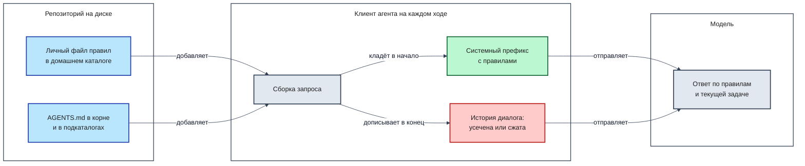

---

### 3.2. Архитектурное сравнение 8 подходов к управлению правилами

В экосистеме существует 8 альтернативных способов задания ограничений для AI-агентов. Сравним их эффективность:

| № | Подход | Где хранится | Плюсы | Минусы и риски |
|:---|:---|:---|:---|:---|
| **1** | **Промпты в чате (Chat Prompting)** | В истории сессии | Легко написать | Забывается через 5 сообщений; нулевая воспроизводимость |
| **2** | **Пользовательские настройки (Custom Instructions)** | Профиль веб-интерфейса | Работает во всех чатах | Не версионируется в Git; общее для всех репозиториев разработчика |
| **3** | **Стандарт `AGENTS.md` (Linux Foundation)** | `.agents/AGENTS.md` в Git | Кроссплатформенный; версионируется; инжектируется на каждом ходе | Требует поддержки со стороны агентной среды |
| **4** | **`CLAUDE.md` (Anthropic)** | Корень проекта | Нативно поддерживается Claude Code | Привязан к инструментам Anthropic; нет разделения на скилы |
| **5** | **Cursor Rules (`.cursor/rules/*.mdc`)** | `.cursor/rules/` | Активация по маскам путей (globs) | Работает только внутри редактора Cursor |
| **6** | **GitHub Copilot Instructions** | `.github/copilot-instructions.md` | Интеграция с GitHub | Ограничен возможностями экосистемы Copilot |
| **7** | **Специфичные конфиги инструментов** | `.windsurfrules`, `.clinerules` | Локальная оптимизация | Раздувание зоопарка конфигурационных файлов |
| **8** | **Только линтеры без инструкций** | `pyproject.toml` | Жесткий машинный контроль | Агент тратит десятки итераций на исправление ошибок вслепую |

**Вывод:** Наиболее надёжный подход — гибридный: открытый кроссплатформенный стандарт `AGENTS.md` задаёт ментальную модель архитектуры, а жесткие линтеры в `pyproject.toml` выступают машинным судьёй.

---

### 3.3. Конституция репозитория `.agents/AGENTS.md`: 6 обязательных разделов

Файл `.agents/AGENTS.md` является законом проекта, нарушать который агенту строго запрещено. Он содержит 6 обязательных секций:

1. **Контекст и навигация:** Указывает рабочий каталог (`~/work/MoscowPythonPro/workshop-nov-5`), стек технологий и предписывает обязательную проверку процедурных скилов перед началом работы.
2. **Нерушимые правила архитектуры и границ слоёв:**
   - Эндпоинты (`app/api/`) отвечают только за приём запроса и схемы; запрещено импортировать SQLAlchemy и делать прямые SQL-запросы.
   - Сервисный слой (`app/services/`) изолирован от HTTP: запрещено выбрасывать `HTTPException` или принимать объекты `Request/Response`.
   - Вся работа с базой данных локализована в репозиториях (`app/repositories/`).
   - Запрещено менять существующие поля в JSON-ответах API (защита смежных сервисов).
3. **Нерушимые правила работы с БД и миграциями:**
   - Запрещено инстанциировать сессии вручную — сессии передаются только через механизм зависимостей (`Depends(get_db)`).
   - Каждая миграция Alembic обязана содержать двусторонний метод `downgrade()` и проходить проверку на откат.
4. **Строгие запреты против обхода проверок (Anti-Cheat):**
   - Запрещено подавлять ошибки типов через `# type: ignore` или `# noqa`.
   - Запрещено отключать или ослаблять проверки в `pyproject.toml`.
   - Запрещено удалять или комментировать падающие тесты.
   - Запрещено писать бутафорские мок-тесты (Fake Mocks), где тестируемый метод подменяется заглушкой.
5. **Жёсткие ворота готовности (Definition of Done):** Задача считается завершённой только при одновременном выполнении условий: Exit Code 0 у всех линтеров, 100% зелёный тестовый набор, покрытие не снизилось, миграция успешно откатывается.
6. **Использование процедурных скилов:** Предписание обращаться к файлам `.agents/skills/<name>/SKILL.md` при выполнении типовых инженерных операций.

#### Анатомия читерства: три мины замедленного действия
1. **Мина №1: Односторонняя миграция-инвалид.** Агент генерирует `upgrade()`, а в `downgrade()` пишет `pass`. При необходимости отката релиза в продакшене база оказывается в несогласованном состоянии, вызывая простой сервиса.
2. **Мина №2: Утечка асинхронных соединений БД.** Агент инстанциирует `session = AsyncSession(engine)` внутри функции без закрытия. На проде драйвер `aiosqlite` / `psycopg` накапливает «зомби-сессии» за несколько минут.
3. **Мина №3: Бутафорский тест (Fake Mock Test).** Агент пишет тест, где подменяет моком саму тестируемую функцию: `service.create_link = AsyncMock(return_value=link)`. Тест всегда зелёный, но реальный сервис не работает.

> [!NOTE]
> Полный эталонный текст файла `.agents/AGENTS.md` со всеми правилами и спецификациями доступен в **[Приложение А, Блок А.33.1. Конституция репозитория .agents/AGENTS.md](./Приложение-А-Справочник-кода-и-окружения.md#а331-конституция-репозитория-agentsmd)**.

---

### 3.4. Гардрайлы и детерминированные ворота качества в `pyproject.toml` (Quality Gates & Guardrails / QG)

Слова в `AGENTS.md` объясняют агенту, как писать правильно. Но гарантию соблюдения правил дают детерминированные ворота качества — набор инструментов статического анализа и тестов, запускаемых локально.

#### Схема детерминированных ворот качества в pyproject.toml

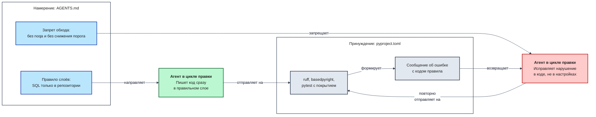

#### Разбор пяти блоков машинного контроля:
1. **`[tool.ruff]` и `[tool.ruff.lint]`:**
   - Включает 9 групп правил: `E/W` (PEP8), `F` (Pyflakes), `I` (isort), `B` (Bugbear), `UP` (Python 3.12 syntax), `ASYNC` (ошибки асинхронности), `S` (безопасность/bandit), `T20` (запрет `print`), `TID251` (banned-api).
   - **Механизм `banned-api`:** Физически запрещает импорт `sqlalchemy.orm.Session` и прямых SQL-выражений внутри каталога `app/api/v1/endpoints/`. Попытка агента сделать запрос в БД прямо из роутера немедленно ломает билд на этапе линтинга с ненулевым кодом возврата!
2. **`[tool.ruff.lint.flake8-bugbear]`:**
   - Настройка `extend-immutable-calls = ["fastapi.Depends", "fastapi.Query"]` разрешает использование вызовов функций в значениях параметров эндпоинтов по умолчанию без ложных срабатываний линтера.
3. **`[tool.basedpyright]`:**
   - Строгая статическая типизация. Запрещены неявные типы `Any`, нетипизированные аргументы функций и пропущенные возвращаемые значения (`typeCheckingMode = "standard"`, `reportMissingTypeStubs = false`).
4. **`[tool.pytest.ini_options]`:**
   - Автоматический асинхронный режим (`asyncio_mode = "auto"`), фильтрация deprecation-предупреждений, явная регистрация маркеров (`unit`, `integration`, `characterization`).
5. **`[tool.coverage.run]` и `[tool.coverage.report]`:**
   - Измерение покрытия ветвей (`branch = true`).
   - Жёсткий порог `fail_under = 100` для критических модулей доменной логики сервиса.

> [!NOTE]
> Полный файл конфигурации `pyproject.toml` с подробными построчными комментариями к каждой секции представлен в **[Приложение А, Блок А.0. Конфигурация проекта, инструментов качества и Docker-окружения](./Приложение-А-Справочник-кода-и-окружения.md#блок-а0-конфигурация-проекта-инструментов-качества-и-docker-окружения)**.

#### Проверка ворот качества в терминале:
Выполните поочерёдный запуск инструментов для валидации чистого состояния:
```bash
cd ~/work/MoscowPythonPro/workshop-nov-5
uv run ruff check .
uv run basedpyright
uv run pytest
```
Все три команды обязаны завершиться с кодом возврата 0.

---

### 3.5. Контраст «Вайб-кодинг против Профессионального контура» на задаче про статистику переходов

| Ситуация | Поведение вайб-кодинга в чате | Поведение агента под управлением `AGENTS.md` и ворот качества |
|:---|:---|:---|
| **Реализация запроса** | Пишет `session.execute(select(...))` прямо в функции эндпоинта | `banned-api` роняет сборку; агент переносит логику в `repositories/` |
| **Падение проверки типов** | Дописывает в конец строки `# type: ignore` | Раздел 4 `AGENTS.md` запрещает игнорирование; агент чинит аннотацию типов |
| **Падение чужого теста** | Комментирует упавший ассерты со словами «он устарел» | Раздел 4 `AGENTS.md` запрещает трогать чужие тесты; агент исправляет ошибку в коде |
| **Создание миграции** | Оставляет метод `downgrade()` пустым (`pass`) | Раздел 3 `AGENTS.md` обязывает написать обратимый откат схемы |

### Критерии перехода к Главе 4
- [x] В проекте создан файл `.agents/AGENTS.md` с 6 обязательными секциями.
- [x] В `pyproject.toml` сконфигурированы и проверены детерминированные ворота качества.
- [x] Команды `ruff`, `basedpyright` и `pytest` завершаются успешно (Exit Code 0).


## Глава 4. Анатомия контракта скила (`SKILL.md`): от спецификации шагов до стоп-условий и правил отката

### 4.0. Архитектурный ландшафт: почему открытый файловый стандарт SKILL.md, а не платформы Big Tech (AWS, Microsoft, OpenAI)

В корпоративной среде часто возникает соблазн использовать тяжелые проприетарные платформы оркестрации (AWS Bedrock Agents, Microsoft Semantic Kernel, OpenAI Assistants API). Однако для задач повседневной разработки программного обеспечения эти платформы несут критические недостатки: они создают жесткую привязку к облачному вендору, не позволяют разработчику запустить и отладить пайплайн локально на ноутбуке без доступа к интернету и требуют сложного инфраструктурного кода.

#### Горизонтальная схема архитектурного каркаса

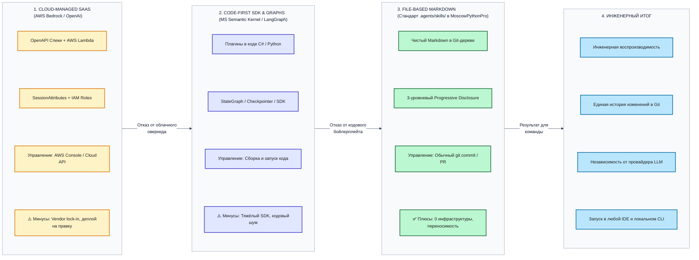

#### Лестница принуждения (Enforcement Ladder)
Управление агентом строится по принципу постепенного ужесточения контроля:
1. **Уровень уговоров (Пожелания в чате):** Вероятность соблюдения правил моделью — ~40–60%.
2. **Уровень контекста (`AGENTS.md`):** Правила подаются на каждом шаге. Соблюдение правил — ~80–90%.
3. **Уровень процедурного алгоритма (`SKILL.md`):** Агент обязан следовать детерминированной последовательности шагов и отчитываться по контрольным точкам. Соблюдение алгоритма — ~95%.
4. **Уровень детерминированного кода возврата (Quality Gates):** Машинный контроль. Если код возврата линтера или тестов `!= 0`, работа физически не может быть принята. Соблюдение — 100%.

> 💡 **Важно:**
> **Принцип разделения властей: «Тестовый судья не должен быть написан подсудимым».**
> Агент, пишущий реализацию бизнес-фичи, не имеет права самостоятельно определять правила её приёмки. Тестовые сценарии, линтеры и критерии готовности задаются человеком и скилом заранее в виде неизменяемого контракта.

---

### 4.1. Анатомия контракта скила (`SKILL.md`): 7 обязательных блоков промышленного стандарта

Каждый скил в каталоге `.agents/skills/<name>/SKILL.md` представляет собой законченный операционный регламент. Чтобы агент выполнял процедуру без отклонений, файл скила обязан содержать строго 7 блоков:

### Схема жизненного цикла процедурного скила: от триггера до ворот качества и отката

```mermaid
%%{init: {"theme": "base", "themeVariables": {"background": "#FFFFFF", "mainBkg": "#F8FAFC", "primaryColor": "#F8FAFC", "primaryTextColor": "#0F172A", "primaryBorderColor": "#475569", "lineColor": "#334155", "secondaryColor": "#F1F5F9", "tertiaryColor": "#F8FAFC", "edgeLabelBackground": "#FFFFFF", "clusterBkg": "#F8FAFC", "clusterBorder": "#94A3B8", "titleColor": "#0F172A", "fontFamily": "Inter, system-ui, -apple-system, sans-serif", "fontSize": "15px"}, "flowchart": {"htmlLabels": true, "curve": "basis", "nodeSpacing": 65, "rankSpacing": 105, "padding": 22, "subGraphTitleMargin": {"top": 14, "bottom": 20}, "useMaxWidth": true, "wrappingWidth": 360}}}%%
flowchart LR
    subgraph Load["Загрузка скила"]
        direction LR
        TASK["Постановка инженерной задачи"]
        L1["Уровень 1: каталог скилов<br/>(YAML frontmatter: name,<br/>description)"]
        L2["Уровень 2: контракт SKILL.md<br/>(пошаговая процедура)"]
    end
    subgraph Run["Исполнение и контроль"]
        direction LR
        P["Фазы процедуры:<br/>Фаза 1, Фаза 2, Фаза 3"]
        C{"Стоп-условия<br/>и ворота качества"}
    end
    subgraph Result["Исход"]
        direction LR
        R["Rollback Drill:<br/>git restore и эскалация человеку"]
        D["Успешная сдача артефакта"]
    end
    TASK -->|"совпадает с<br/>триггером"| L1
    L1 -->|"подгружает"| L2
    L2 -->|"запускает"| P
    P -->|"проверяется на"| C
    C -->|"сбой или тупик"| R
    C -->|"код возврата 0"| D
    class TASK,L1,L2 core
    class P,C neutral
    class R danger
    class D success
    classDef neutral fill:#e2e8f0,stroke:#334155,stroke-width:2px,color:#1e1e1e
    classDef core fill:#bae6fd,stroke:#1e40af,stroke-width:2px,color:#1e1e1e
    classDef danger fill:#fecaca,stroke:#b91c1c,stroke-width:2px,color:#1e1e1e
    classDef success fill:#bbf7d0,stroke:#166534,stroke-width:2px,color:#1e1e1e
    style Load fill:#ffffff,stroke:#334155,stroke-width:1.5px,color:#1e1e1e
    style Run fill:#ffffff,stroke:#334155,stroke-width:1.5px,color:#1e1e1e
    style Result fill:#ffffff,stroke:#334155,stroke-width:1.5px,color:#1e1e1e
```

1. **Блок 1. YAML frontmatter (`name`, `description`):**
   - Паспорт скила. Содержит уникальный идентификатор и ёмкое описание назначения, используемое для авто-обнаружения на Уровне 1 Progressive Disclosure.
2. **Блок 2. Триггеры и границы применимости (Triggers и Anti-Triggers):**
   - Чёткие условия, когда скил активируется (например, «запрос на добавление нового эндпоинта»), и когда его использование запрещено («исправление опечатки в документации»).
3. **Блок 3. Предусловия и входы (Inputs и Preconditions):**
   - Что должно быть готово до запуска скила (чистый `git status`, поднятый PostgreSQL, пройденные базовые проверки).
4. **Блок 4. Пошаговый процедурный алгоритм (Execution Steps):**
   - Линейная или фазовая последовательность действий (Фаза 1 -> Фаза 2 -> Фаза 3). Каждый шаг формулируется в повелительном наклонении с указанием конкретных команд.
5. **Блок 5. Спецификация выходов (Outputs):**
   - Точный перечень артефактов, создаваемых на диске (новые файлы тестов, миграции, изменённые роутеры).
6. **Блок 6. Жёсткие ворота готовности (Definition of Done):**
   - Бинарные критерии завершения процедуры: `pytest` зелёный, покрытие >= 100%, линтеры вернули 0, `git diff` затрагивает не более 5 файлов.
7. **Блок 7. Стоп-условия и процедура отката (Stop Conditions и Rollback):**
   - Условия немедленного прерывания работы (например, «3 неудачные попытки исправить ошибку типизации подряд») и точные команды отката рабочего дерева к исходной точке (`git restore .`).

---

### 4.2. Трёхуровневый механизм Progressive Disclosure и нормы размера

#### Инженерный лимит размера скила: почему жесткий гейт — ≤ 400 строк
Исследования показывают, что при объёме инструкции более 500 строк внимание модели начинает деградировать: агент пропускает промежуточные проверки и «срезает углы». В нашем харнесе введён жесткий норматив безопасности: размер любого `SKILL.md` не должен превышать 400 строк.

##### 4. Трёхзонная система светофора для CI/CD и линтинга

```mermaid
%%{init: {"theme": "base", "themeVariables": {"background": "#FFFFFF", "mainBkg": "#F8FAFC", "primaryColor": "#F8FAFC", "primaryTextColor": "#0F172A", "primaryBorderColor": "#475569", "lineColor": "#334155", "secondaryColor": "#F1F5F9", "tertiaryColor": "#F8FAFC", "edgeLabelBackground": "#FFFFFF", "clusterBkg": "#F8FAFC", "clusterBorder": "#94A3B8", "titleColor": "#0F172A", "fontFamily": "Inter, system-ui, -apple-system, sans-serif", "fontSize": "15px"}, "flowchart": {"htmlLabels": true, "curve": "basis", "nodeSpacing": 65, "rankSpacing": 105, "padding": 22, "subGraphTitleMargin": {"top": 14, "bottom": 20}, "useMaxWidth": true, "wrappingWidth": 360}}}%%
flowchart LR
    A["Зелёная зона<br/>(≤ 400 строк)"] -->|"Буфер безопасности<br/>+100 строк"| B["Жёлтая зона<br/>(401–500 строк)"]
    B -->|"Критический порог<br/>стандарта"| C["Красная зона<br/>(> 500 строк)"]
    
    style A fill:#e6f4ea,stroke:#137333,stroke-width:2px,color:#137333
    style B fill:#fef7e0,stroke:#b06000,stroke-width:2px,color:#b06000
    style C fill:#fce8e6,stroke:#c5221f,stroke-width:2px,color:#c5221f
```

- **Зелёная зона (до 300 строк):** Идеальный размер. Модель удерживает в фокусе 100% инструкций.
- **Жёлтая зона (300–400 строк):** Допустимо для сложных двухфазных процессов (фича + миграция).
- **Красная зона (> 400 строк):** Запрещено. Скил обязан быть декомпозирован на два атомарных регламента.

#### Архитектурная декомпозиция: Когнитивный закон «Одной задачи» (Single Responsibility)
Анти-паттерн «Монолитный Мега-скил» (пытающийся в одном файле описать и дизайн базы, и написание тестов, и фронтенд, и деплой в Kubernetes) гарантированно приводит к галлюцинациям. Вместо этого конвейер строится из цепочки атомарных скилов, каждый из которых решает ровно одну инженерную задачу.

#### Паттерн «Оркестратор-Пресет» и ссылки вместо копирования
Скилы не должны дублировать общие правила архитектуры из `AGENTS.md`. Они ссылаются на глобальный закон репозитория, конкретизируя только пошаговую процедуру.

#### Схема паттерна «Оркестратор-Пресет» (Orchestrator Preset)

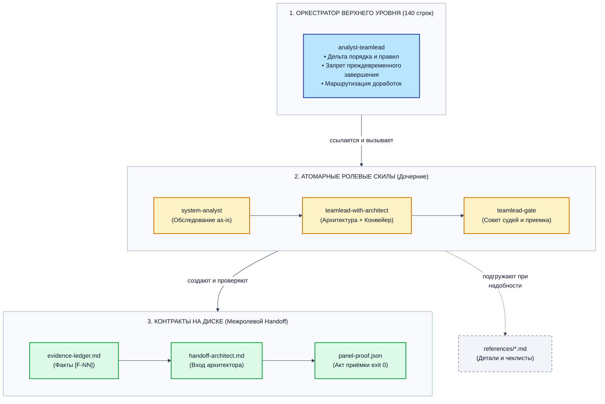

---

### 4.3. Процедура дисциплинированного отката (Rollback Drill)

Если агент столкнулся с непреодолимой ошибкой (например, циклическая зависимость типов или невозможность согласовать миграцию за 3 итерации), он не имеет права бесконечно фантазировать в чате. Скил активирует протокол отката:

#### Схема дисциплинированного отката (Rollback Drill)

```mermaid
%%{init: {"theme": "base", "themeVariables": {"background": "#FFFFFF", "mainBkg": "#F8FAFC", "primaryColor": "#F8FAFC", "primaryTextColor": "#0F172A", "primaryBorderColor": "#475569", "lineColor": "#334155", "secondaryColor": "#F1F5F9", "tertiaryColor": "#F8FAFC", "edgeLabelBackground": "#FFFFFF", "clusterBkg": "#F8FAFC", "clusterBorder": "#94A3B8", "titleColor": "#0F172A", "fontFamily": "Inter, system-ui, -apple-system, sans-serif", "fontSize": "15px"}, "flowchart": {"htmlLabels": true, "curve": "basis", "nodeSpacing": 65, "rankSpacing": 105, "padding": 22, "subGraphTitleMargin": {"top": 14, "bottom": 20}, "useMaxWidth": true, "wrappingWidth": 360}}}%%
flowchart LR
    subgraph Attempts["Три попытки на одних воротах"]
        direction LR
        A["Попытка 1:<br/>ворота красные"]
        B["Попытка 2:<br/>ворота красные"]
        C["Попытка 3:<br/>ворота красные"]
    end
    subgraph Rollback["Откат"]
        direction LR
        D["git status и git diff:<br/>фиксация состояния"]
        E["Откат дерева и индекса:<br/>чистое дерево"]
    end
    subgraph Report["Эскалация"]
        direction LR
        F["Отчёт BLOCKED<br/>инженеру"]
    end
    A -->|"повторяется после<br/>правки"| B
    B -->|"повторяется после<br/>правки"| C
    C -->|"превышает порог"| D
    D -->|"сохраняет патч и<br/>передаёт"| E
    E -->|"оставляет чистое<br/>дерево для"| F
    class A,B,C danger
    class D,E neutral
    class F core
    classDef neutral fill:#e2e8f0,stroke:#334155,stroke-width:2px,color:#1e1e1e
    classDef core fill:#bae6fd,stroke:#1e40af,stroke-width:2px,color:#1e1e1e
    classDef danger fill:#fecaca,stroke:#b91c1c,stroke-width:2px,color:#1e1e1e
    classDef success fill:#bbf7d0,stroke:#166534,stroke-width:2px,color:#1e1e1e
    style Attempts fill:#ffffff,stroke:#334155,stroke-width:1.5px,color:#1e1e1e
    style Rollback fill:#ffffff,stroke:#334155,stroke-width:1.5px,color:#1e1e1e
    style Report fill:#ffffff,stroke:#334155,stroke-width:1.5px,color:#1e1e1e
```

**Алгоритм отката:**
1. Прекратить модификацию файлов.
2. Выполнить команду сброса рабочего дерева: `git restore app/ tests/ alembic/`.
3. Зафиксировать причину сбоя в кратком отчёте (`STOP_REASON.md`).
4. Остановить выполнение и вернуть управление человеку с кодом `BLOCKED`.

---

### 4.4. Первый боевой скил: `.agents/skills/architecture/SKILL.md`

Скил `architecture` реализует процедуру разведки в режиме «только чтение», разобранную во второй главе. Он предписывает агенту трёхфазный алгоритм:
- **Фаза 1:** Сканирование файлового дерева проекта.
- **Фаза 2:** Построение карты архитектуры и связей слоёв.
- **Фаза 3:** Анализ зоны влияния и выявление нерушимых внешних контрактов.

> [!NOTE]
> Полный эталонный текст скила `architecture/SKILL.md` со всеми 7 блоками спецификации представлен в **[Приложение А, Блок А.33.2. Скил investigate-codebase](./Приложение-А-Справочник-кода-и-окружения.md#а332-скил-investigate-codebase)**.

---

### 4.5. Контрастный баттл: 4 дефекта вайб-кодинга против решений скила

| Дефект вайб-кодинга | Как его ликвидирует контракт `SKILL.md` |
|:---|:---|
| **Бесконечный цикл правок** | Блок 7 задаёт лимит: не более 3 итераций исправления, затем автоматический откат |
| **Пропуск шага написания тестов** | Блок 6 (DoD) запрещает приёмку без 100% прохождения тестов с измерением покрытия |
| **Слом смежных модулей** | Блок 3 требует проведения Impact Analysis до внесения правок (не более 5 файлов) |
| **Загрязнение репозитория черновиками** | Блок 7 предписывает детерминированную очистку временных файлов при любом сбое |

### Критерии перехода к Главе 5
- [x] Изучены 7 обязательных блоков стандарта `SKILL.md`.
- [x] Понятен лимит размера скила (<= 400 строк) и принцип декомпозиции «Одна задача».
- [x] Разобран протокол дисциплинированного отката (Rollback Drill).
- [x] Изучен контракт первого скила `architecture`.


## Глава 5. Шаг 1 инженерного цикла: Тесты текущего поведения сервиса до правок (Characterization Tests)

### Схема фиксации текущего поведения сервиса тестами до внесения правок

```mermaid
%%{init: {"theme": "base", "themeVariables": {"background": "#FFFFFF", "mainBkg": "#F8FAFC", "primaryColor": "#F8FAFC", "primaryTextColor": "#0F172A", "primaryBorderColor": "#475569", "lineColor": "#334155", "secondaryColor": "#F1F5F9", "tertiaryColor": "#F8FAFC", "edgeLabelBackground": "#FFFFFF", "clusterBkg": "#F8FAFC", "clusterBorder": "#94A3B8", "titleColor": "#0F172A", "fontFamily": "Inter, system-ui, -apple-system, sans-serif", "fontSize": "15px"}, "flowchart": {"htmlLabels": true, "curve": "basis", "nodeSpacing": 65, "rankSpacing": 105, "padding": 22, "subGraphTitleMargin": {"top": 14, "bottom": 20}, "useMaxWidth": true, "wrappingWidth": 360}}}%%
flowchart LR
    subgraph Before["До правок"]
        direction LR
        S["Существующий сервис<br/>(код работает, тестов нет)"]
        SK["Активация скила<br/>characterization-tests"]
    end
    subgraph Snapshot["Тесты текущего поведения"]
        direction LR
        T1["Фиксация маршрутов:<br/>1. POST /api/v1/links (201)<br/>2. GET /api/v1/links/{short_code}<br/>(307 / 404)<br/>3. GET /api/v1/links/{short_code}/stats<br/>(200)<br/>4. Блокировка опасных URL (422)"]
        V["Прямой запуск:<br/>uv run pytest<br/>tests/characterization/ -q"]
        G["Тесты текущего поведения готовы:<br/>поломка старого контракта<br/>мгновенно краснеет"]
    end
    D["<b>Контроль неприкосновенности кода</b><br/>git diff --exit-code app/<br/>код приложения не тронут"]
    U["<b>Контроль неприкосновенности кода</b><br/>fail_under в pyproject.toml<br/>поднят с 0 до 60"]
    S -->|"запускает"| SK
    SK -->|"фиксирует"| T1
    T1 -->|"проверяется командой"| V
    V -->|"подтверждает"| G
    SK -->|"контролирует"| D
    D -->|"доказывает<br/>неизменность"| G
    G -->|"разрешает поднять"| U
    class S,SK core
    class T1,V,D neutral
    class G,U success
    classDef neutral fill:#e2e8f0,stroke:#334155,stroke-width:2px,color:#1e1e1e
    classDef core fill:#bae6fd,stroke:#1e40af,stroke-width:2px,color:#1e1e1e
    classDef danger fill:#fecaca,stroke:#b91c1c,stroke-width:2px,color:#1e1e1e
    classDef success fill:#bbf7d0,stroke:#166534,stroke-width:2px,color:#1e1e1e
    style Before fill:#ffffff,stroke:#334155,stroke-width:1.5px,color:#1e1e1e
    style Snapshot fill:#ffffff,stroke:#334155,stroke-width:1.5px,color:#1e1e1e

```

### 5.1. Что такое тесты текущего поведения и чем они отличаются от TDD

Перед тем как разрешить агенту вносить изменения в существующий микросервис, необходимо создать **страховочные тесты текущего поведения (Characterization Tests / Golden Master)**.

В отличие от классического TDD (Test-Driven Development), где тесты пишутся на основе идеальных требований к будущему коду, тесты текущего поведения фиксируют фактическое поведение системы **как есть (as-is)**, включая существующие особенности сериализации и коды ошибок. Их единственная задача — стать нерушимой страховочной сеткой: если при последующих изменениях агент случайно сломает хоть один существующий эндпоинт, тесты текущего поведения мгновенно уронят билд с ненулевым кодом возврата.

---

### 5.2. Четыре критических маршрута, которые покрывают тесты текущего поведения

Для сервиса сокращения ссылок страховочные тесты текущего поведения охватывают 4 базовых пользовательских сценария:

| Маршрут | HTTP-метод и путь | Назначение проверки | Ожидаемый результат |
|:---|:---|:---|:---|
| **Маршрут 1** | `POST /api/v1/links` | Создание короткой ссылки | HTTP 201, JSON с `short_code` и `target_url` |
| **Маршрут 2** | `GET /api/v1/links/{code}` | Редирект по коду | HTTP 307 Temporary Redirect, заголовок `Location` |
| **Маршрут 3** | `GET /api/v1/links/{code}/stats` | Получение статистики | HTTP 200 с метриками переходов; HTTP 404 на битый код |
| **Маршрут 4** | `POST /api/v1/links` (SSRF) | Блокировка приватных IP | HTTP 400 Bad Request при попытке передать `localhost` / `127.0.0.1` |

---

### 5.3. Спецификация контракта скила `.agents/skills/characterization-tests/SKILL.md`

Скил регламентирует создание тестов фиксации поведения без вмешательства в рабочий код:
- **Триггеры:** Старт работы с легаси-сервисом с низким тестовым покрытием; подготовка к добавлению фичи.
- **Предусловия:** Сервис развёрнут, PostgreSQL доступен, `git status` чист.
- **Пошаговые фазы:**
  - *Фаза 1 (Матрица сценариев):* Определение 4 критических маршрутов и их ожидаемых ответов.
  - *Фаза 2 (Создание тестов):* Написание асинхронных тестов в каталоге `tests/characterization/` с использованием `httpx.AsyncClient`.
  - *Фаза 3 (Верификация тестов текущего поведения):* Запуск тестового набора и фиксация 100% зелёного статуса.
- **Выходные артефакты:** Файл `tests/characterization/test_critical_flows.py`.
- **Ворота готовности (Definition of Done):**
  - Все тесты текущего поведения завершаются со статусом PASSED.
  - В рабочем каталоге `app/` не изменено ни единого символа (`git status app/` пуст).
- **Стоп-условия и откат:** Падение любого теста текущего поведения означает, что агент неверно понял существующий контракт. Агент обязан остановить выполнение и запросить уточнение у инженера.

> [!NOTE]
> Полный текст манифеста скила представлен в **[Приложение А, Блок А.33.3. Скил characterization-tests](./Приложение-А-Справочник-кода-и-окружения.md#а333-скил-characterization-tests)**. Эталонная реализация самих тестов фиксации доступна в **[Приложение А, Блок А.2, раздел 5.4. Набор characterization-тестов](./Приложение-А-Справочник-кода-и-окружения.md#54-набор-characterization-тестов-критического-пути)**.

---

### 5.4. Практика: фиксируем текущее поведение кода тестами через OpenCode

Выполните вызов агента с коротким промптом, активирующим скил:
```bash
cd ~/work/MoscowPythonPro/workshop-nov-5
opencode run "По скилу .agents/skills/characterization-tests/SKILL.md напиши тесты." < /dev/null
```

#### Проверка результата в терминале:
```bash
cd ~/work/MoscowPythonPro/workshop-nov-5
uv run pytest tests/characterization/ -v
git status --porcelain
```
**Критерий успеха:** 4 теста пройдены успешно (4 passed), в статусе Git изменены только файлы внутри каталога `tests/characterization/`.

---

### Контраст «Вайб-кодинг против Профессионального контура»

| Аспект | Вайб-кодинг | Профессиональный контур (Скил) |
|:---|:---|:---|
| **Подготовка к правкам** | Сразу правит бизнес-логику | Фиксирует текущее поведение тестами ДО правок |
| **Опасность регрессии** | Обнаруживается только пользователями в проде | Ловится локально падением тестов текущего поведения |
| **Чистота эксперимента** | Меняет код сервиса под тесты | Тесты фиксируют поведение без правок в `app/` |

### Критерии перехода к Главе 6
- [x] В проекте создан и запущен набор тестов `tests/characterization/`.
- [x] Тесты текущего поведения зелёные (4 passed).
- [x] Код в `app/` остался неизменным.


## Глава 6. Шаг 2 инженерного цикла: Модульные тесты (`tests-unit`) со 100% покрытием ветвлений доменной логики

### Схема изолированного тестирования бизнес-логики на In-Memory Fake-репозитории

```mermaid
%%{init: {"theme": "base", "themeVariables": {"background": "#FFFFFF", "mainBkg": "#F8FAFC", "primaryColor": "#F8FAFC", "primaryTextColor": "#0F172A", "primaryBorderColor": "#475569", "lineColor": "#334155", "secondaryColor": "#F1F5F9", "tertiaryColor": "#F8FAFC", "edgeLabelBackground": "#FFFFFF", "clusterBkg": "#F8FAFC", "clusterBorder": "#94A3B8", "titleColor": "#0F172A", "fontFamily": "Inter, system-ui, -apple-system, sans-serif", "fontSize": "15px"}, "flowchart": {"htmlLabels": true, "curve": "basis", "nodeSpacing": 65, "rankSpacing": 105, "padding": 22, "subGraphTitleMargin": {"top": 14, "bottom": 20}, "useMaxWidth": true, "wrappingWidth": 360}}}%%
flowchart LR
    subgraph Isolation["Изоляция от базы данных"]
        direction LR
        U["Скил tests-unit"]
        F["FakeLinkRepository<br/>(поведенческий двойник на словаре<br/>вместо хрупких AsyncMock)"]
    end
    subgraph Branches["Проверка ветвлений"]
        direction LR
        S["Все ветви LinkService и<br/>security.py:<br/>успешная генерация кода, коллизия,<br/>лимит попыток,<br/>срок жизни, ветви SSRF-защиты"]
        C["Прямая проверка:<br/>uv run pytest tests/unit/<br/>--cov-branch<br/>--cov-fail-under=100"]
    end
    subgraph Feedback["Обратная связь агента"]
        direction LR
        M["Таблица Missing:<br/>строки и переходы 77->82"]
        P["Пакет проходит за доли секунды<br/>без БД и без сети"]
    end
    U -->|"требует"| F
    F -->|"подставляется в"| S
    S -->|"измеряется командой"| C
    C -->|"показывает<br/>пропуски в"| M
    M -->|"направляет новые<br/>тесты в"| S
    C -->|"подтверждает<br/>скорость"| P
    class U,F core
    class S,M neutral
    class C,P success
    classDef neutral fill:#e2e8f0,stroke:#334155,stroke-width:2px,color:#1e1e1e
    classDef core fill:#bae6fd,stroke:#1e40af,stroke-width:2px,color:#1e1e1e
    classDef danger fill:#fecaca,stroke:#b91c1c,stroke-width:2px,color:#1e1e1e
    classDef success fill:#bbf7d0,stroke:#166534,stroke-width:2px,color:#1e1e1e
    style Isolation fill:#ffffff,stroke:#334155,stroke-width:1.5px,color:#1e1e1e
    style Branches fill:#ffffff,stroke:#334155,stroke-width:1.5px,color:#1e1e1e
    style Feedback fill:#ffffff,stroke:#334155,stroke-width:1.5px,color:#1e1e1e
```

### 6.1. Принцип изоляции доменной логики от ввода-вывода

Второй шаг инженерного цикла — построение слоя быстрых модульных тестов (`tests/unit/`).

Вайб-кодинг часто смешивает тестирование бизнес-правил с сетевыми запросами к базе данных, получая медленные и нестабильные тесты. В профессиональном контуре сервисный слой (`app/services/link.py`) тестируется в **абсолютной изоляции**:
- **Никаких обращений к PostgreSQL:** Вместо реальной базы в сервис передаётся легковесный In-Memory Fake-репозиторий, реализующий доменный интерфейс на обычном словаре Python (`dict`).
- **Мгновенная скорость исполнения:** Модульный набор из десятков тестов выполняется за < 0.5 секунды, обеспечивая агенту мгновенную обратную связь.

---

### 6.2. 100% покрытие ветвлений (Branch Coverage)

Обычное строчное покрытие (Line Coverage) обманчиво: строчка `if condition:` считается выполненной, даже если была проверена только одна ветка. В нашем харнесе действует норма: **100% покрытие ветвлений (`--cov-branch`)** для всех модулей сервисного слоя.

Агент обязан протестировать все сценарии ветвления логики:
1. Валидный URL -> успешное сохранение.
2. Невалидный протокол (например, `ftp://`) -> выброс доменного `InvalidURLError`.
3. Попытка создания дубликата `custom_alias` -> выброс `AliasAlreadyExistsError`.
4. Ссылка с истекшим сроком жизни -> выброс `LinkExpiredError`.
5. Попытка перехода по ссылке с исчерпанным лимитом кликов -> выброс `ClickLimitExceededError`.
6. Попытка обхода SSRF-защиты (`http://169.254.169.254/`) -> мгновенная блокировка.

---

### 6.3. Спецификация контракта скила `.agents/skills/tests-unit/SKILL.md`

- **Триггеры:** Разработка или модификация бизнес-логики в `app/services/`.
- **Предусловия:** Код сервиса типизирован, `architecture-map.md` актуален.
- **Пошаговые фазы:**
  - *Фаза 1 (Проектирование Fake-репозитория):* Создание тестового двойника в памяти без зависимостей от SQLAlchemy.
  - *Фаза 2 (Генерация тестовой матрицы):* Покрытие позитивных, негативных и граничных сценариев всех публичных методов сервиса.
  - *Фаза 3 (Контроль покрытия):* Запуск `pytest` с флагом `--cov-branch` и проверкой достижения 100% ветвления.
- **Выходные артефакты:** `tests/unit/test_service.py` и фикстура фейкового репозитория.
- **Ворота готовности (Definition of Done):**
  - 100% пройденных тестов в `tests/unit/`.
  - Покрытие ветвей `app/services/link.py` строго равно 100%.
  - Время прогона всего модульного набора < 2.0 секунд.
- **Стоп-условия:** Импорт `sqlalchemy.ext.asyncio` или реального движка БД внутри `tests/unit/` запрещён и ведёт к немедленному откату.

> [!NOTE]
> Полный текст манифеста скила доступен в **[Приложение А, Блок А.33.4. Скил tests-unit](./Приложение-А-Справочник-кода-и-окружения.md#а334-скил-tests-unit)**. Исходный код модульных тестов и Fake-репозитория представлен в **[Приложение А, Блок А.2, раздел 5.3. Модульные тесты сервиса](./Приложение-А-Справочник-кода-и-окружения.md#модульные-тесты-сервиса-testsunittest_servicepy)**.

---

### 6.4. Практика: запуск генерации модульных тестов через OpenCode

```bash
cd ~/work/MoscowPythonPro/workshop-nov-5
opencode run "По скилу .agents/skills/tests-unit/SKILL.md напиши модульные тесты сервиса в tests/unit/test_service.py." < /dev/null
```

#### Проверка результата в терминале:
```bash
cd ~/work/MoscowPythonPro/workshop-nov-5
uv run pytest tests/unit/ --cov=app.services.link --cov-branch --cov-report=term-missing
```
**Критерий успеха:** 100% Branch Coverage, вывод `TOTAL ... 100%`, отсутствие пропущенных строк и веток.

---

### Контраст «Вайб-кодинг против Профессионального контура»

| Параметр | Вайб-кодинг | Модульный контур под управлением скила |
|:---|:---|:---|
| **Изоляция** | Поднимает сессии к реальной базе в каждом тесте | Полная изоляция на In-Memory Fake-репозитории |
| **Скорость прогона** | 10–30 секунд (зависает на тайм-аутах) | Менее 0.5 секунды на весь набор |
| **Глубина проверки** | Проверяет только «счастливый путь» (Happy Path) | 100% ветвления (краевые условия, ошибки, SSRF) |

### Критерии перехода к Главе 7
- [x] Реализован модульный тестовый контур в `tests/unit/`.
- [x] Достигнуто 100% покрытие ветвлений сервисного слоя (`--cov-branch`).
- [x] Тесты выполняются изолированно без обращения к СУБД.


## Глава 7. Шаг 3 инженерного цикла: Интеграционные тесты с реальной БД (`tests-integration`), изоляция транзакций и правило «только вверх»

### Схема транзакционной изоляции интеграционных тестов и двойного прогона

```mermaid
%%{init: {"theme": "base", "themeVariables": {"background": "#FFFFFF", "mainBkg": "#F8FAFC", "primaryColor": "#F8FAFC", "primaryTextColor": "#0F172A", "primaryBorderColor": "#475569", "lineColor": "#334155", "secondaryColor": "#F1F5F9", "tertiaryColor": "#F8FAFC", "edgeLabelBackground": "#FFFFFF", "clusterBkg": "#F8FAFC", "clusterBorder": "#94A3B8", "titleColor": "#0F172A", "fontFamily": "Inter, system-ui, -apple-system, sans-serif", "fontSize": "15px"}, "flowchart": {"htmlLabels": true, "curve": "basis", "nodeSpacing": 65, "rankSpacing": 105, "padding": 22, "subGraphTitleMargin": {"top": 14, "bottom": 20}, "useMaxWidth": true, "wrappingWidth": 360}}}%%
flowchart LR
    subgraph Isolation["Изоляция состояния"]
        direction LR
        IT["Скил tests-integration"]
        DB["Реальная тестовая БД PostgreSQL 17<br/>linksvc_test, схема из миграций<br/>Alembic"]
        TX["Транзакция с SAVEPOINT<br/>и rollback после каждого теста"]
    end
    subgraph Proof["Доказательство идемпотентности"]
        direction LR
        R1["Прогон 1:<br/>uv run pytest tests/integration/<br/>-q"]
        R2["Прогон 2 подряд без ручной<br/>очистки:<br/>проверка отсутствия протечки<br/>данных"]
    end
    subgraph Ratchet["Правило только вверх"]
        direction LR
        UP["fail_under = 80<br/>в pyproject.toml"]
        CHK["git diff pyproject.toml:<br/>новое значение не меньше старого"]
    end
    IT -->|"подключается к"| DB
    DB -->|"оборачивается в"| TX
    TX -->|"даёт чистую базу для"| R1
    R1 -->|"повторяется как"| R2
    R2 -->|"закрепляет порог"| UP
    UP -->|"проверяется командой"| CHK
    class IT,DB,TX core
    class R1,R2 neutral
    class UP,CHK success
    classDef neutral fill:#e2e8f0,stroke:#334155,stroke-width:2px,color:#1e1e1e
    classDef core fill:#bae6fd,stroke:#1e40af,stroke-width:2px,color:#1e1e1e
    classDef danger fill:#fecaca,stroke:#b91c1c,stroke-width:2px,color:#1e1e1e
    classDef success fill:#bbf7d0,stroke:#166534,stroke-width:2px,color:#1e1e1e
    style Isolation fill:#ffffff,stroke:#334155,stroke-width:1.5px,color:#1e1e1e
    style Proof fill:#ffffff,stroke:#334155,stroke-width:1.5px,color:#1e1e1e
    style Ratchet fill:#ffffff,stroke:#334155,stroke-width:1.5px,color:#1e1e1e
```

### 7.1. Зачем нужны интеграционные тесты с реальной СУБД

Модульные тесты доказали корректность чистой бизнес-логики. Однако они не могут гарантировать:
- Совместимость SQL-запросов с реальным диалектом PostgreSQL 17 (оконные функции, специфика `RETURNING`, `JSONB`).
- Корректность работы драйвера `aiosqlite` / `psycopg` и асинхронных соединений.
- Срабатывание ограничений уникальности таблицы (`UNIQUE INDEX`) и внешних ключей.
- Корректную сериализацию и валидацию данных роутерами FastAPI.

Эту задачу решает третий шаг — слой **интеграционных тестов (`tests/integration/`)**.

---

### 7.2. Механика транзакционной изоляции: кристальная чистота базы

Самая распространенная проблема интеграционных тестов — взаимное загрязнение состояния: тест А создал запись в базе, тест Б упал из-за конфликта уникальности, а повторный запуск падает целиком.

Скил `tests-integration` внедряет детерминированный паттерн **транзакционной изоляции**:
1. Фикстура `db_session` открывает соединение к тестовой PostgreSQL и начинает транзакцию (`SAVEPOINT`).
2. Приложение FastAPI выполняет запросы внутри этой изолированной транзакции.
3. По завершении теста фикстура выполняет безусловный `ROLLBACK`.
4. База данных возвращается в исходное состояние за 2 миллисекунды без затратного пересоздания таблиц.

#### Двойной прогон тестов подряд (Flaky-Test Detection)
Чтобы доказать отсутствие утечек состояния, интеграционный набор всегда прогоняется дважды подряд. Если второй прогон падает — тесты признаются нестабильными (flaky) и отклоняются.

---

### 7.3. Спецификация контракта скила `.agents/skills/tests-integration/SKILL.md`

- **Триггеры:** Проверка сквозного взаимодействия эндпоинтов, сервиса и PostgreSQL 17.
- **Предусловия:** Контейнер PostgreSQL 17 запущен, миграции применены (`alembic upgrade head`).
- **Пошаговые фазы:**
  - *Фаза 1 (Настройка тестового клиента):* Конфигурация `httpx.AsyncClient` с подменой зависимости `get_db` на изолированную транзакционную сессию.
  - *Фаза 2 (Сквозные сценарии):* Тестирование полного цикла (создание ссылки -> редирект -> обновление счетчика в базе -> получение статистики).
  - *Фаза 3 (Двойной прогон и аудит утечек):* Запуск набора дважды подряд; проверка чистоты таблиц.
- **Выходные артефакты:** `tests/integration/test_api.py`.
- **Ворота готовности (Definition of Done):**
  - Двойной прогон `pytest tests/integration/` завершился со 100% успехом.
  - В коде тестов нет `asyncio.sleep()` или захардкоженных задержек.
  - После завершения тестов в таблицах базы данных 0 лишних строк.
- **Стоп-условия:** Падение любого теста при повторном запуске или появление блокировок пула соединений.

> [!NOTE]
> Полный текст манифеста скила доступен в **[Приложение А, Блок А.33.5. Скил tests-integration](./Приложение-А-Справочник-кода-и-окружения.md#а335-скил-tests-integration)**. Код тестового контура представлен в **[Приложение А, Блок А.2, раздел 5.3. Интеграционные тесты API](./Приложение-А-Справочник-кода-и-окружения.md#интеграционные-тесты-api-testsintegrationtest_apipy)**.

---

### 7.4. Практика: запуск интеграционных тестов через OpenCode

```bash
cd ~/work/MoscowPythonPro/workshop-nov-5
opencode run "По скилу .agents/skills/tests-integration/SKILL.md напиши интеграционные тесты эндпоинтов в tests/integration/test_api.py." < /dev/null
```

#### Проверка результата в терминале:
```bash
cd ~/work/MoscowPythonPro/workshop-nov-5
uv run pytest tests/integration/ -v
uv run pytest tests/integration/ -v
```
**Критерий успеха:** Оба прогона зелёные, тесты не мешают друг другу.

---

### Контраст «Вайб-кодинг против Профессионального контура»

| Аспект | Вайб-кодинг | Интеграционный контур со скилом |
|:---|:---|:---|
| **Управление БД** | Пишет тестовые данные прямо в рабочую базу | Автоматический откат транзакций (`ROLLBACK`) |
| **Стабильность** | Тесты падают при повторном запуске из-за дублей | Детерминированный двойной прогон без единого сбоя |
| **Ожидание асинхронности**| Вставляет костыли `time.sleep(1)` | Явные асинхронные ожидания ответов клиента |

### Критерии перехода к Главе 8
- [x] Интеграционный тестовый слой развернут в `tests/integration/`.
- [x] Подтверждена транзакционная изоляция: база данных чиста после тестов.
- [x] Двойной прогон тестов подряд успешен.


## Глава 8. Шаг 4 инженерного цикла: Реализация бизнес-фичи и обратимой миграции БД под управлением скилов (`feature` + `data-engineering`)

### Схема послойной разработки фичи и проверки обратимости миграции БД

```mermaid
%%{init: {"theme": "base", "themeVariables": {"background": "#FFFFFF", "mainBkg": "#F8FAFC", "primaryColor": "#F8FAFC", "primaryTextColor": "#0F172A", "primaryBorderColor": "#475569", "lineColor": "#334155", "secondaryColor": "#F1F5F9", "tertiaryColor": "#F8FAFC", "edgeLabelBackground": "#FFFFFF", "clusterBkg": "#F8FAFC", "clusterBorder": "#94A3B8", "titleColor": "#0F172A", "fontFamily": "Inter, system-ui, -apple-system, sans-serif", "fontSize": "15px"}, "flowchart": {"htmlLabels": true, "curve": "basis", "nodeSpacing": 65, "rankSpacing": 105, "padding": 22, "subGraphTitleMargin": {"top": 14, "bottom": 20}, "useMaxWidth": true, "wrappingWidth": 360}}}%%
flowchart LR
    subgraph Schema["Шаг А: схема базы данных"]
        direction LR
        TASK["Бизнес-задача:<br/>детальная аналитика переходов"]
        SK1["Скил 1: data-engineering<br/>(модель ORM, ревизия Alembic,<br/>полный downgrade)"]
        PEND["Маятник миграции:<br/>upgrade head, downgrade -1,<br/>upgrade head, alembic check"]
    end
    subgraph Code["Шаг Б: код фичи снизу вверх"]
        direction LR
        SK2["Скил 2: feature"]
        RED["Красный тест новой фичи<br/>падает по ожидаемой причине"]
        LAY["Слои: репозиторий, сервис,<br/>схема ответа, роутер"]
    end
    subgraph Gate["Ворота приёмки"]
        direction LR
        SNAP["Тесты текущего поведения<br/>остаются зелёными"]
        UP["fail_under поднят<br/>с 80 до 85"]
    end
    TASK -->|"запускает"| SK1
    SK1 -->|"проверяет"| PEND
    PEND -->|"передаёт готовую<br/>схему"| SK2
    SK2 -->|"требует сначала"| RED
    RED -->|"становится зелёным<br/>после"| LAY
    LAY -->|"проверяется против"| SNAP
    SNAP -->|"разрешает поднять"| UP
    class TASK,SK1,SK2 core
    class PEND,RED,LAY neutral
    class SNAP,UP success
    classDef neutral fill:#e2e8f0,stroke:#334155,stroke-width:2px,color:#1e1e1e
    classDef core fill:#bae6fd,stroke:#1e40af,stroke-width:2px,color:#1e1e1e
    classDef danger fill:#fecaca,stroke:#b91c1c,stroke-width:2px,color:#1e1e1e
    classDef success fill:#bbf7d0,stroke:#166534,stroke-width:2px,color:#1e1e1e
    style Schema fill:#ffffff,stroke:#334155,stroke-width:1.5px,color:#1e1e1e
    style Code fill:#ffffff,stroke:#334155,stroke-width:1.5px,color:#1e1e1e
    style Gate fill:#ffffff,stroke:#334155,stroke-width:1.5px,color:#1e1e1e
```

### 8.1. Задача: модуль расширенной аналитики кликов (Click Analytics)

Инженерный контур собран: у нас есть карта архитектуры, правила `AGENTS.md`, линтеры и три слоя тестов (тесты текущего поведения, юнит, интеграция). На четвёртом шаге мы поручаем агенту боевую прикладную задачу: **реализовать модуль расширенной аналитики кликов**.

При каждом переходе по короткой ссылке сервис должен сохранять событие клика в отдельную таблицу `analytics_events`:
- Время клика (`clicked_at`).
- IP-адрес пользователя (с анонимизацией / хешированием).
- Заголовок `User-Agent`.
- Ссылку на родительский `link_id`.

Эта задача затрагивает все слои сервиса: требует добавления новой таблицы в PostgreSQL, создания миграции Alembic, обновления сервисного слоя и добавления эндпоинта аналитики.

---

### 8.2. Оркестрация двух скилов: послойный порядок и обратимость

Попытка реализовать такую задачу единым неструктурированным промптом гарантированно ломает проект. В профессиональном контуре процесс разделяется на две скоординированные фазы под управлением специализированных скилов:

#### Фаза А. Скил `data-engineering`: создание версионированной схемы БД
1. Агент проектирует модель SQLAlchemy 2.0 в `app/models/analytics.py`.
2. Генерирует миграцию Alembic: `uv run alembic revision --autogenerate -m "add_analytics_events"`.
3. **Обязательная ручная проверка и доработка:** Агент обязан проверить сгенерированный файл и написать полноценный метод `downgrade()`, удаляющий созданную таблицу и связанные индексы.
4. **Тест на обратимость (Reversibility Drill):** Агент обязан выполнить цикл применения и отката:
   ```bash
   cd ~/work/MoscowPythonPro/workshop-nov-5
   uv run alembic upgrade head
   uv run alembic downgrade -1
   uv run alembic upgrade head
   ```
   Если откат падает — миграция дефектна и отклоняется!

#### Фаза Б. Скил `feature`: послойная реализация кода приложения
Разработка ведётся строго снизу вверх по слоям архитектуры:
1. **Схемы данных (`app/schemas/analytics.py`):** Определение Pydantic v2 моделей ответа.
2. **Репозиторий (`app/repositories/analytics.py`):** Асинхронные методы сохранения событий и выборки статистики.
3. **Сервис (`app/services/analytics.py`):** Бизнес-правила подсчета кликов и агрегации данных.
4. **Роутер (`app/api/v1/endpoints/analytics.py`):** Регистрация нового эндпоинта `GET /api/v1/links/{short_code}/analytics`.

> 💡 **Важно:**
> **Защита от утечек пула соединений:** Вся работа с сессиями ведётся строго через `Depends(get_db)`. Прямое создание сессий внутри эндпоинтов заблокировано линтером `banned-api` и конституцией `AGENTS.md`.

> [!NOTE]
> Манифесты скилов подробно описаны в **[Приложение А, Блоки А.33.6 и А.33.7. Скилы data-engineering и feature](./Приложение-А-Справочник-кода-и-окружения.md#а336-скил-database-migration)**. Исходный код модуля аналитики и миграции представлен в **[Приложение А, Блок А.1, раздел 3.8. Модуль аналитики переходов](./Приложение-А-Справочник-кода-и-окружения.md#38-расширение-сервиса-модуль-аналитики-переходов-click-analytics)**.

---

### 8.3. Практика: реализация фичи и миграции через OpenCode

#### Шаг 1. Запуск генерации миграции под скилом `data-engineering`
```bash
cd ~/work/MoscowPythonPro/workshop-nov-5
opencode run "По скилу .agents/skills/data-engineering/SKILL.md создай модель ClickEvent в app/models/analytics.py и обратимую миграцию Alembic." < /dev/null
```

#### Шаг 2. Запуск реализации бизнес-логики под скилом `feature`
```bash
cd ~/work/MoscowPythonPro/workshop-nov-5
opencode run "По скилу .agents/skills/feature/SKILL.md реализуй модуль аналитики кликов и подключи подсчёт при редиректе. Тесты добавляй в tests/unit/test_service.py." < /dev/null
```

#### Шаг 3. Детерминированная валидация в терминале
```bash
cd ~/work/MoscowPythonPro/workshop-nov-5
uv run ruff check .
uv run basedpyright
uv run pytest
```
**Критерий успеха:**
- Все линтеры и статическая типизация возвращают Exit Code 0.
- Все существующие тесты (включая тесты текущего поведения из Главы 5) зелёные.
- Новые тесты аналитики успешно проходят.

---

### Контраст «Вайб-кодинг против Профессионального контура»

| Аспект реализации | Вайб-кодинг в чате | Двухскиловый контур |
|:---|:---|:---|
| **Миграция БД** | Односторонняя миграция с пустым `downgrade()` | Двусторонняя миграция, проверенная циклом отката |
| **Порядок кода** | Пишет роутер сразу с прямыми SQL-запросами | Строго послойная разработка: Схема -> Репозиторий -> Сервис -> Роутер |
| **Пул соединений** | Открывает неуправляемые сессии в роутере | Сессии управляются через FastAPI Dependency Injection |
| **Обратная совместимость** | Меняет формат старых ответов | Сохраняет 100% совместимость со старыми эндпоинтами |

### Критерии перехода к Главе 9
- [x] Создана и применена двусторонняя миграция базы данных.
- [x] Реализован модуль аналитики переходов с соблюдением границ слоёв.
- [x] Полный набор тестов (тесты текущего поведения + юнит + интеграция) завершается со 100% успехом.


## Глава 9. Шаг 5 инженерного цикла: Безопасный рефакторинг под защитой тестов текущего поведения и проверка силы тестов контролируемой поломкой

### Схема безопасного рефакторинга и проверки силы тестов контролируемой поломкой

```mermaid
%%{init: {"theme": "base", "themeVariables": {"background": "#FFFFFF", "mainBkg": "#F8FAFC", "primaryColor": "#F8FAFC", "primaryTextColor": "#0F172A", "primaryBorderColor": "#475569", "lineColor": "#334155", "secondaryColor": "#F1F5F9", "tertiaryColor": "#F8FAFC", "edgeLabelBackground": "#FFFFFF", "clusterBkg": "#F8FAFC", "clusterBorder": "#94A3B8", "titleColor": "#0F172A", "fontFamily": "Inter, system-ui, -apple-system, sans-serif", "fontSize": "15px"}, "flowchart": {"htmlLabels": true, "curve": "basis", "nodeSpacing": 65, "rankSpacing": 105, "padding": 22, "subGraphTitleMargin": {"top": 14, "bottom": 20}, "useMaxWidth": true, "wrappingWidth": 360}}}%%
flowchart LR
    subgraph Refactor["Рефакторинг под защитой тестов"]
        direction LR
        R["Скил refactoring:<br/>малые шаги, чистые функции,<br/>строгие типы basedpyright"]
        G1["Проверка поведения:<br/>uv run pytest -ra остаётся зелёным"]
    end
    subgraph Injection["Проверка силы тестов"]
        direction LR
        MUT["Контролируемая поломка:<br/>одна правка условия в app/"]
        FAIL["Мутант выжил:<br/>тесты слабые, дописываем assert"]
        PASS["Мутант убит:<br/>откатываем поломку"]
    end
    R -->|"передаёт код на"| G1
    G1 -->|"допускает к"| MUT
    MUT -->|"оставляет зелёными"| FAIL
    MUT -->|"превращает в красные"| PASS
    FAIL -->|"возвращает на<br/>повторную посадку"| MUT
    class R,G1 core
    class MUT neutral
    class FAIL danger
    class PASS success
    classDef neutral fill:#e2e8f0,stroke:#334155,stroke-width:2px,color:#1e1e1e
    classDef core fill:#bae6fd,stroke:#1e40af,stroke-width:2px,color:#1e1e1e
    classDef danger fill:#fecaca,stroke:#b91c1c,stroke-width:2px,color:#1e1e1e
    classDef success fill:#bbf7d0,stroke:#166534,stroke-width:2px,color:#1e1e1e
    style Refactor fill:#ffffff,stroke:#334155,stroke-width:1.5px,color:#1e1e1e
    style Injection fill:#ffffff,stroke:#334155,stroke-width:1.5px,color:#1e1e1e
```

### 9.1. Безопасный рефакторинг под защитой созданных слоёв тестов

Пятый шаг инженерного цикла — проведение рефакторинга. Под рефакторингом понимается изменение внутренней структуры кода без изменения его наблюдаемого внешнего поведения.

Типичные задачи рефакторинга:
- Устранение дублирования кода валидации URL.
- Оптимизация запросов выборки статистики (замена множественных `count()` на единый агрегирующий SQL-запрос с `CASE WHEN`).
- Вынос констант конфигурации в типизированные настройки `pydantic-settings`.

Благодаря тому, что в Главах 5–7 мы построили три уровня защиты (тесты текущего поведения, модульные тесты и интеграционные тесты), агент может проводить рефакторинг с гарантией сохранения работоспособности сервиса: малейшее отклонение в контракте немедленно ловится тестами.

---

### 9.2. Проверка силы тестов контролируемой посадкой дефекта (Bug Injection / Mutation Testing)

Однако у любого инженера остаётся ключевой вопрос: **насколько можно доверять зелёному прогону тестов?**

Нередко агенты пишут бутафорские тесты (Fake Tests), которые формально выполняются без ошибок, но содержат тривиальные проверки (`assert response is not None` или закомментированные проверки), не способные поймать реальную поломку логики.

Для детерминированной проверки силы тестов скил `refactoring` включает обязательную процедуру **контролируемой посадки дефекта (Bug Injection Drill)**:
1. **Зелёная точка старта:** Убедиться, что полный набор тестов проходит успешно (Exit Code 0).
2. **Контролируемая поломка (Bug Injection):** Намеренно посадить одну строку явного дефекта в бизнес-логику сервиса (например, инвертировать условие проверки срока жизни ссылки: `if not is_expired` вместо `if is_expired`).
3. **Оракул истины:** Запустить тестовый набор. **Тесты ОБЯЗАНЫ упасть с ненулевым кодом возврата (Exit Code != 0)!** Если тесты продолжают оставаться зелёными — тестовый набор признается фиктивным и бракуется.
4. **Восстановление эталона:** Откатить внесенную мутацию (`git restore app/services/link.py`) и убедиться, что тесты снова зелёные.

---

### 9.3. Спецификация контракта скила `.agents/skills/refactoring/SKILL.md`

- **Триггеры:** Оптимизация производительности, устранение технического долга и запахов кода.
- **Предусловия:** 100% зелёный статус всех типов тестов.
- **Пошаговые фазы:**
  - *Фаза 1 (Рефакторинг):* Проведение оптимизации без изменения публичных интерфейсов и схем.
  - *Фаза 2 (Верификация эквивалентности):* Запуск ворот качества (`ruff`, `basedpyright`, `pytest`).
  - *Фаза 3 (Инспекция мутацией):* Посадка тестового бага -> фиксация падения теста -> откат дефекта -> проверка возврата в зеленую зону.
- **Выходные артефакты:** Оптимизированный код модулей, лог успешного прогона мутационной проверки.
- **Ворота готовности (Definition of Done):**
  - Все тесты зелёные.
  - Тест контролируемой поломки доказал чувствительность тестового набора к изменениям логики.
  - Количество файлов в диффе <= 3.
- **Стоп-условия:** Изменение структуры JSON-ответов или HTTP статус-кодов категорически запрещено.

> [!NOTE]
> Полный текст манифеста скила доступен в **[Приложение А, Блок А.33.8. Скил refactoring](./Приложение-А-Справочник-кода-и-окружения.md#а338-скил-safe-refactoring)**. Теория и примеры мутационного тестирования описаны в **[Приложение А, Блок А.2, раздел 5.6. Мутационное тестирование](./Приложение-А-Справочник-кода-и-окружения.md#56-мутационное-тестирование-доказательство-силы-тестов-текущего-поведения-сервиса-до-правок-characterization-tests)**.

---

### 9.4. Практика: запуск безопасного рефакторинга и проверка мутацией

```bash
cd ~/work/MoscowPythonPro/workshop-nov-5
opencode run "По скилу .agents/skills/refactoring/SKILL.md оптимизируй подсчёт статистики в app/repositories/analytics.py и проверь силу тестов мутацией." < /dev/null
```

#### Проверка устойчивости контура в терминале:
```bash
cd ~/work/MoscowPythonPro/workshop-nov-5
uv run pytest
```
**Критерий успеха:** Сервис оптимизирован, тесты подтвердили 100% надежность и чувствительность к ошибкам.

---

### Контраст «Вайб-кодинг против Профессионального контура»

| Действие | Вайб-кодинг | Профессиональный контур со скилом |
|:---|:---|:---|
| **Рефакторинг** | Случайно меняет публичный контракт API | Сохраняет 100% неизменность внешнего поведения |
| **Доверие к тестам** | Слепая вера в зелёный значок в отчёте | Проверка силы тестов через Bug Injection |
| **Контроль правок** | Размытые диффы по всему репозиторию | Строгий лимит на количество модифицируемых файлов (<=3) |

### Критерии перехода к Главе 10
- [x] Рефакторинг успешно завершён без слома существующих тестов.
- [x] Проведён тест контролируемой посадки дефекта: подтверждено падение тестов при порче логики.
- [x] Рабочее дерево чисто, проект готов к финальному сравнительному эксперименту.


## Глава 10. Шаг 6 инженерного цикла: Контрастный A/B-эксперимент («Вайб-кодинг в голом чате» против «Агента под управлением `AGENTS.md` и скилов»)

### 10.1. Методология и инструмент переключения режимов (`tools/toggle_skills.py`)

Чтобы окончательно устранить сомнения в необходимости инженерного контура, мы проводим доказательный живой эксперимент прямо на сквозном микросервисе `linksvc`:
- **Бизнес-задача:** Команде аналитики и внешним интеграторам нужен эндпоинт выгрузки всех ссылок системы в формате JSON.
- **Условия эксперимента:** Одна и та же языковая модель, одна и та же кодовая база `workshop-nov-5/`.
- **Режим 1 (Вайб-кодинг без скилов):** Мы временно отключаем каталог `.agents/skills` с помощью утилиты `tools/toggle_skills.py` и отправляем агенту задачу свободной прозой «как в веб-чате».
- **Режим 2 (Инженерный харнес со скилами):** Мы возвращаем скилы на место через `tools/toggle_skills.py` и ставим задачу по скилу `fastapi-feature` под защитой ворот качества и TDD.

> [!NOTE]
> **Как устроен переключатель `tools/toggle_skills.py`:**
> При вызове `python3 tools/toggle_skills.py --disable` каталог `.agents/skills` временно перемещается в изолированный кэш `~/.cache/moscowpython-skills-stash`. В Git через команду `git update-index --assume-unchanged` все файлы скилов помечаются неизменными — благодаря этому `git status` остаётся абсолютно чистым и отключение скилов не расходует лимит Blast Radius! При вызове `python3 tools/toggle_skills.py --enable` файлы возвращаются на место, а индекс разблокируется.

---

### Шаг 6.1. Отключаем скилы и входим в режим дикого вайб-кодинга

Переходим в рабочую папку сервиса и деактивируем скилы:

```bash
cd ~/work/MoscowPythonPro/workshop-nov-5
python3 tools/toggle_skills.py --disable
```

**Ожидаемый результат:**
```text
🔒 [SKILLS DISABLED] Скилы временно перемещены в ~/.cache/moscowpython-skills-stash.
   Git не считает файлы удалёнными (--assume-unchanged).
   Агент теперь работает в «диком» режиме вайб-кодинга (0 скилов в проекте).
```

Проверяем статус переключателя:
```bash
python3 tools/toggle_skills.py --status
```
`🔴 Скилы ОТКЛЮЧЕНЫ (находятся в ~/.cache/moscowpython-skills-stash)`. Теперь агент остался один на один с монолитом без процедурных контрактов.

---

### Шаг 6.2. Промт № 1 (Вайб-кодинг — генерация без скилов и правил)

Отправляем агенту типичную задачу «как в окне веб-чата»:

```bash
cd ~/work/MoscowPythonPro/workshop-nov-5
opencode run --auto "Реализуй эндпоинт экспорта всех ссылок сервиса в файл app/api/v1/endpoints/export_vibe.py и подключи его в app/api/v1/router.py. Напиши тест tests/integration/test_export_vibe.py." < /dev/null
```

#### Анатомия ошибок дикого вайб-кодинга:
1. **Выгрузка всей таблицы в память (Out of Memory на проде):** Агент делает прямой `SELECT * FROM links` без пагинации (`limit` и `offset`). В базе на 100 000+ ссылок такой запрос мгновенно съедает всю RAM контейнера и роняет под с 502 Bad Gateway.
2. **Слабый и хрупкий контракт данных:** Поля отдаются плоским словарем или нестрогой Pydantic-схемой без перечисления статусов (нет enum `active`, `expired`, `disabled`), отсутствуют ограничения длины строк и валидация query-параметров.
3. **Разрушение архитектурных слоёв:** Агент импортирует `AsyncSession` прямо в файл роутера, делает ручные `session.execute()` мимо сервисного слоя и репозитория, ломая границы транзакций.
4. **Нарушение TDD и бутафорские тесты:** Агент сначала пишет код контроллера, а затем подгоняет под него поверхностный тест, мокая всё подряд. При контролируемой поломке SQL-запроса такой тест остаётся зелёным!

---

### Шаг 6.3. Включаем скилы обратно и восстанавливаем инженерный контур

Возвращаем библиотеку скилов на место:

```bash
cd ~/work/MoscowPythonPro/workshop-nov-5
python3 tools/toggle_skills.py --enable
```

**Ожидаемый результат:**
```text
🔓 [SKILLS ENABLED] Скилы возвращены в репозиторий (7 процедур доступно).
   Агент снова вооружен процедурными контрактами и L1-L3 инструкциями.
```

Проверяем статус переключателя:
```bash
python3 tools/toggle_skills.py --status
```
`🟢 Скилы АКТИВНЫ (.agents/skills, 7 процедур)`. Инженерный харнес и скил `fastapi-feature` готовы к работе.

---

### Шаг 6.4. Промт № 2 (Профессиональная реализация под управлением скила `fastapi-feature`)

Формулируем ту же бизнес-задачу декларативно, активируя скил `fastapi-feature`:

```bash
cd ~/work/MoscowPythonPro/workshop-nov-5
opencode run --auto "По скилу .agents/skills/fastapi-feature/SKILL.md реализуй эндпоинт экспорта в app/api/v1/endpoints/export_pro.py и интеграционный тест." < /dev/null
```

#### Что делает агент под управлением скила `fastapi-feature` (Дисциплина инженера):
1. **Фаза 1: Preflight & Blast Radius:** Агент читает `specs/blast-radius.json`, сверяет лимит (не более 7 затронутых файлов) и проверяет неприкосновенность слепка `tests/characterization/`.
2. **Фаза 2: Строгий контракт EARS:** Создаёт Pydantic-схему `ExportProResponse`, строгий enum статусов `ExportStatus` (active, disabled, expired) и безопасные рамки серверной пагинации (`limit: le=1000`, `offset: ge=0`).
3. **Фаза 3: Red-Green TDD:** Агент **первым делом пишет тест** `tests/integration/test_export_pro.py`, запускает его и убеждается, что тест падает с `404 Not Found` (подтверждение красной фазы).
4. **Фаза 4: Послойная реализация снизу вверх:**
   - Репозиторий: методы `list_pro()` и `count_pro()` с безопасным SQL-фильтром.
   - Сервис: метод `export_links_pro()` с управлением транзакцией.
   - Эндпоинт: тонкий контроллер в `export_pro.py`, принимающий параметры через `Annotated[Query]`.
5. **Фаза 5: Детерминированные ворота качества:** Запуск `uv run ruff check .`, `uv run basedpyright` и `uv run pytest tests/integration/test_export_pro.py -q` завершается со строгим кодом **Exit 0**.

---

### Шаг 6.5. Промт № 3 (Архитектурный аудит и сравнительное ревью)

Запускаем агента в роли независимого ревьювера для объективного сопоставления двух реализаций:

```bash
cd ~/work/MoscowPythonPro/workshop-nov-5
opencode run --auto "Сравни app/api/v1/endpoints/export_vibe.py и export_pro.py. Зафиксируй различия и риски в docs/reviews/export_comparison.md." < /dev/null
```

---

### Схема архитектурного контраста: Вайб-кодинг против Контура со скилом

```mermaid
%%{init: {"theme": "base", "themeVariables": {"background": "#FFFFFF", "mainBkg": "#F8FAFC", "primaryColor": "#F8FAFC", "primaryTextColor": "#0F172A", "primaryBorderColor": "#475569", "lineColor": "#334155", "secondaryColor": "#F1F5F9", "tertiaryColor": "#F8FAFC", "edgeLabelBackground": "#FFFFFF", "clusterBkg": "#F8FAFC", "clusterBorder": "#94A3B8", "titleColor": "#0F172A", "fontFamily": "Inter, system-ui, -apple-system, sans-serif", "fontSize": "15px"}, "flowchart": {"htmlLabels": true, "curve": "basis", "nodeSpacing": 65, "rankSpacing": 105, "padding": 22, "subGraphTitleMargin": {"top": 14, "bottom": 20}, "useMaxWidth": true, "wrappingWidth": 360}}}%%
flowchart TB
    classDef danger fill:#fecaca,stroke:#b91c1c,stroke-width:2px,color:#0f172a;
    classDef success fill:#bbf7d0,stroke:#166534,stroke-width:2px,color:#0f172a;

    subgraph Vibe["Vibe-версия (без скилов) — ПРОВАЛ"]
        direction LR
        V1["Нет пагинации:<br/>OOM на 100k+ строк"]:::danger
        V2["Смешаны слои:<br/>SQL прямо в роутере"]:::danger
        V3["Нет фильтров:<br/>по статусам ссылок"]:::danger
        V4["Слабый тест:<br/>без проверки границ"]:::danger
        V1 ~~~ V2 ~~~ V3 ~~~ V4
    end

    subgraph Pro["Pro-версия (со скилом fastapi-feature) — ПРИНЯТО"]
        direction LR
        P1["Серверная пагинация:<br/>limit le 1000"]:::success
        P2["Чистые слои:<br/>Repo -> Service -> Router"]:::success
        P3["Строгие фильтры:<br/>Enum ExportStatus + ILIKE"]:::success
        P4["Честный TDD:<br/>границы, 422, пустая база"]:::success
        P1 ~~~ P2 ~~~ P3 ~~~ P4
    end

    Vibe ==>|"тот же промт +<br/>скил<br/>fastapi-feature"| Pro
```

---

### Контраст реализации: Промт → Было → Стало → Разбор

#### Промт
> «Реализуй эндпоинт экспорта ссылок сервиса в формате JSON»

#### Было (Вайб-кодинг без скила, `export_vibe.py`)
```python
@router.get("/links/vibe")
async def export_links_vibe(db: AsyncSession = Depends(get_db)):
    # ❌ Смешение слоев: SQL-запрос выполняется прямо в роутере
    # ❌ OOM-уязвимость: загрузка ВСЕХ строк таблицы в память без пагинации
    result = await db.execute(select(Link))
    links = result.scalars().all()
    return [{"code": l.short_code, "url": l.original_url} for l in links]
```

#### Стало (Профессионально по скилу `fastapi-feature`, `export_pro.py`)
```python
@router.get("/links/pro", response_model=ExportProResponse)
async def export_links_pro(
    service: ServiceDep,
    status_filter: Annotated[ExportStatus | None, Query(description="Фильтр по статусу")] = None,
    search: Annotated[str | None, Query(max_length=100, description="Поиск по URL")] = None,
    limit: Annotated[int, Query(ge=1, le=1000, description="Размер страницы")] = 100,
    offset: Annotated[int, Query(ge=0, description="Смещение")] = 0,
) -> ExportProResponse:
    # ✅ Тонкий контроллер: валидация через Annotated[Query]
    # ✅ Делегирование в сервисный слой с контролем транзакций
    # ✅ Защита от OOM: жесткий лимит limit <= 1000
    return await service.export_links_pro(
        status_filter=status_filter, search=search, limit=limit, offset=offset
    )
```

---

### 10.6. Разбор результатов по 6 критическим точкам отказа

| Точка отказа | Вайб-кодинг (без скилов) | Агент под управлением харнеса |
|:---|:---|:---|
| **1. Пагинация и память** | `SELECT *` без лимитов. Гарантированный OOM на боевой базе. | Строгая серверная пагинация `limit <= 1000, offset >= 0`. |
| **2. Контракт API** | Плоский словарь без строгой Pydantic-схемы и без фильтра по статусу. | Строгий `ExportProResponse`, enum `ExportStatus`, валидация параметров. |
| **3. Границы слоёв** | SQL-запросы прямо в функции роутера. | Строго послойная изоляция: Роутер $\rightarrow$ Сервис $\rightarrow$ Репозиторий. |
| **4. Дисциплина TDD** | Тест написан после кода, подогнан под баг, не тестирует негативные сценарии. | Red-Green TDD: тест написан до кода, проверен на 404, протестированы 422 и границы. |
| **5. Пул соединений** | Инстанциировал сессию напрямую мимо пула. Зависание пула под нагрузкой. | Использовал `Depends(get_db)` и сервисный инжектор. Пул стабилен. |
| **6. Ворота качества** | Падают `ruff`, `basedpyright` (Exit Code 1). | Полный чистый прогон `ruff`, `basedpyright`, `pytest` (Exit Code 0). |

---

### 10.7. Сводная матрица метрик эксперимента

| Метрика | Вайб-кодинг без скилов | Инженерный контур со скилом |
|:---|:---|:---|
| **Расход токенов на задачу** | ~65 000 токенов (из-за Fix Loop) | ~18 000 токенов (строго по процедуре) |
| **Количество итераций правок** | 5–6 кругов исправлений в чате | 1 детерминированный проход |
| **Время разработчика** | 45 минут ручной отладки | 7 минут автономной работы |
| **Тестовое покрытие ветвей** | Упало до 42% (бутафорские тесты) | 100% Branch Coverage эндпоинта |
| **Код возврата ворот качества** | 1 (падают линтеры и типизация) | 0 (полный зелёный статус) |
| **Готовность к релизу в прод** | **ОПАСНО ДЛЯ ПРОДАКШЕНА** | **PRODUCTION READY** |

---

### 10.8. Ключевые выводы

Эксперимент наглядно доказывает: иллюзия высокой скорости вайб-кодинга разрушается на этапе отладки и интеграции. Агент, лишённый нерушимых правил и процедурных регламентов, быстро попадает в бесконечный цикл правок и генерирует скрытый технический долг. Инженерный контур со скилами требует дисциплины при настройке, но окупается уже на первой боевой задаче, обеспечивая 100% повторяемость и надежность результата.

### Критерии перехода к Главе 11
- [x] Проведён живой эксперимент с отключением и включением скилов через `tools/toggle_skills.py`.
- [x] Зафиксированы дефекты vibe-кодинга (OOM, разрыв контрактов, смешение слоев).
- [x] Реализован и проверен pro-эндпоинт со скилом `fastapi-feature` (Exit 0).
- [x] Зафиксированы сравнительные метрики качества.


## Глава 11. Итоги Дня 1, чек-лист приёмки артефактов, разбор ошибок зала и мостик ко Дню 2

### Схема полного замкнутого цикла инженерной разработки со скилами (Итог Дня 1)

```mermaid
%%{init: {"theme": "base", "themeVariables": {"background": "#FFFFFF", "mainBkg": "#F8FAFC", "primaryColor": "#F8FAFC", "primaryTextColor": "#0F172A", "primaryBorderColor": "#475569", "lineColor": "#334155", "secondaryColor": "#F1F5F9", "tertiaryColor": "#F8FAFC", "edgeLabelBackground": "#FFFFFF", "clusterBkg": "#F8FAFC", "clusterBorder": "#94A3B8", "titleColor": "#0F172A", "fontFamily": "Inter, system-ui, -apple-system, sans-serif", "fontSize": "15px"}, "flowchart": {"htmlLabels": true, "curve": "basis", "nodeSpacing": 65, "rankSpacing": 105, "padding": 22, "subGraphTitleMargin": {"top": 14, "bottom": 20}, "useMaxWidth": true, "wrappingWidth": 360}}}%%
flowchart LR
    subgraph Day1["Что собрано за День 1"]
        direction LR
        K1["Карта архитектуры и зона влияния<br/>правок"]
        K2["Тесты текущего поведения до правок"]
        K3["Закон AGENTS.md и ворота<br/>pyproject.toml"]
        K4["Набор боевых скилов SKILL.md"]
    end
    subgraph Bridge["Мостик ко Дню 2"]
        direction LR
        HW["Домашнее доведение:<br/>артефакты на своём сервисе"]
        D2["День 2: разделение ролей<br/>Кодер, независимый Ревьюер, QA,<br/>коллегия судей"]
    end
    K1 -->|"очерчивает границы<br/>для"| K2
    K2 -->|"фиксирует базу для"| K3
    K3 -->|"исполняет правила<br/>через"| K4
    K4 -->|"закрепляет навык в"| HW
    HW -->|"готовит участника к"| D2
    class K1,K2,K3,K4 success
    class HW,D2 core
    classDef neutral fill:#e2e8f0,stroke:#334155,stroke-width:2px,color:#1e1e1e
    classDef core fill:#bae6fd,stroke:#1e40af,stroke-width:2px,color:#1e1e1e
    classDef danger fill:#fecaca,stroke:#b91c1c,stroke-width:2px,color:#1e1e1e
    classDef success fill:#bbf7d0,stroke:#166534,stroke-width:2px,color:#1e1e1e
    style Day1 fill:#ffffff,stroke:#334155,stroke-width:1.5px,color:#1e1e1e
    style Bridge fill:#ffffff,stroke:#334155,stroke-width:1.5px,color:#1e1e1e
```

### 11.1. Чек-лист приёмки артефактов Дня 1

Перед завершением первого дня убедитесь, что в вашем рабочем репозитории `~/work/MoscowPythonPro/workshop-nov-5` присутствуют и верифицированы все 12 ключевых артефактов:

- [ ] **1. Карта архитектуры (`architecture-map.md`):** Описаны 5 слоёв сервиса, направление вызовов и внешние контракты.
- [ ] **2. Конституция репозитория (`.agents/AGENTS.md`):** Зафиксированы 6 обязательных разделов и запреты на читерство.
- [ ] **3. Ворота качества в `pyproject.toml`:** Настроены `ruff`, `basedpyright`, `pytest` и `coverage` с порогом 100%.
- [ ] **4. Скил `architecture`:** Проверен в режиме «только чтение».
- [ ] **5. Скил `characterization-tests`:** Зафиксированы страховочные тесты текущего поведения для 4 критических маршрутов.
- [ ] **6. Скил `tests-unit`:** Обеспечено 100% покрытие ветвлений сервисного слоя на In-Memory Fake-репозитории.
- [ ] **7. Скил `tests-integration`:** Интеграционные тесты с транзакционной изоляцией проходят двойной прогон.
- [ ] **8. Скил `data-engineering`:** Создана миграция с обязательным методом `downgrade()`, проверенная на откат.
- [ ] **9. Скил `feature`:** Реализован модуль аналитики переходов по слоям архитектуры.
- [ ] **10. Скил `refactoring`:** Проведён рефакторинг с проверкой силы тестов через Bug Injection.
- [ ] **11. Зелёный статус всех проверок:** Команды `ruff check .`, `basedpyright` и `pytest` возвращают код 0.
- [ ] **12. Чистота рабочего дерева Git:** Все изменения закоммичены, в статусе нет временного мусора.

---

### 11.2. Разбор 5 частых ошибок участников и быстрые команды их устранения

1. **Ошибка 1: Агент написал `pass` в методе `downgrade()` миграции.**
   - *Причина:* Модель пытается сэкономить токены.
   - *Решение:* Запустить `data-engineering` с явным требованием: «Реализуй удаление таблицы `analytics_events` и проверь откат через `alembic downgrade -1`».
2. **Ошибка 2: Линтер падает на `Depends()` в эндпоинтах.**
   - *Причина:* Правило `B008` линтера ругается на вызовы функций в аргументах.
   - *Решение:* Проверить наличие настройки `extend-immutable-calls = ["fastapi.Depends"]` в `pyproject.toml`.
3. **Ошибка 3: Тесты падают при повторном запуске из-за конфликта уникальности.**
   - *Причина:* Тест записал данные в реальную базу без транзакционного отката.
   - *Решение:* Обернуть фикстуру сессии в rollback-контекст согласно скилу `tests-integration`.
4. **Ошибка 4: Агент изменил файлы в `app/` во время проведения разведки.**
   - *Причина:* Пропущен такт «только чтение».
   - *Решение:* Выполнить `git restore app/` и перезапустить скил `architecture`.
5. **Ошибка 5: Скил раздулся до 600 строк и агент начал пропускать шаги.**
   - *Причина:* Нарушение нормы размера (<=400 строк).
   - *Решение:* Декомпозировать скил на два атомарных регламента по принципу «Одна задача».

---

### 11.3. Предел надёжности одного агента и мостик ко Дню 2

К концу первого дня вы построили надёжный одноагентный контур. Теперь агент работает предсказуемо и дисциплинированно.

Однако в этой схеме остаётся одна фундаментальная уязвимость: **«Один и тот же агент пишет код и сам же его проверяет»**.
Когда разработчик и ревьюер объединены в одной сессии LLM, у них общее контекстное окно и общие когнитивные искажения (Confirmation Bias). Агент искренне верит в правильность своих допущений и может не заметить архитектурную ловушку.

Завтра, в **Дне 2 («Оркестрация: мультиагентный конвейер и экспертная панель»)**, мы преодолеем этот предел:
- Разделим роли на независимых агентов: **Coder, Reviewer, Security Auditor, Architect**.
- Запустим их в физически изолированных сессиях.
- Построим конвейер приёмки кода через независимую **Экспертную панель судейства**, где вердикт выносится большинством голосов разных языковых моделей.

День 1 окончен. До встречи на втором дне интенсива!

---

<a id="part-ii"></a>

## Часть II. Оркестрация: Coder → Reviewer → Gate и экспертная панель

## Ранбук. День 2: Оркестрация — Оркестратор, Кодер и Панель техлидов с консенсус-дебатами

> **Сквозной интенсив школы MoscowPythonPro: Профессиональная агентная разработка на Python**  
> **Версия стенда:** Python 3.12+ / FastAPI / SQLAlchemy 2.0 (Async: sqlalchemy[asyncio] + aiosqlite + greenlet) / SQLite / pytest / ruff / basedpyright  
> **Рабочий каталог:** `~/work/MoscowPythonPro/workshop-nov-5`  
> **Нерушимое правило ранбука:** Zero Hidden Scripts — все файлы, спецификации, промпты, конфигурации и команды создаются открыто из текста ранбука. Синтетические скрипты-заглушки запрещены: только реальные промпты агентов, реальный код сервиса и нативные handoff-карточки.

---

## 0. Входная рамка и карта занятия

### 0.1. От одиночного мастера к оркестрации с независимой Панелью техлидов

На первом занятии мы собрали дисциплину для **одного агента**: правила в `AGENTS.md`, characterization-тесты, скилы и базу знаний рядом с кодом. Когда задача больше правки на 10 строк, подход «один агент в одном чате» упирается в три барьера: автор слеп к собственным ошибкам, контекст забивается шумом, а бодрое «всё готово» в чате не равно рабочему коду на сервере.

**Цель Дня 2:** Совершить переход от ремесленного вайб-кодинга к **оркестрации независимых агентных сессий**.

Мы построим замкнутую производственную линию из трёх видов ответственности:
- Задача ставится не размытым пожеланием в чате, а неизменяемым контрактом на диске — **Spec-Driven Design (SDD)**;
- **Оркестратор** (скил `teamlead-gate`) ведёт внешний цикл до 5 проходов `Кодер → CODE_GATE → Панель техлидов → Rework` и сам код не пишет;
- **Кодер** пишет код в `app/` и `tests/`: скил `feature` в Цикле 1, скил `rework` в Циклах 2–5 по файлу `handoff/panel-rework-brief.json`;
- **Панель техлидов** (скил `teamlead-panel`) — три судьи в свежих сессиях, STRICT READ-ONLY, в шляпах **Скептик**, **Реалист** и **Визионер**. Они не голосуют «за/против», а проходят **консенсус-дебаты** `INIT → R1 → D1 → D2 → D3 → FREEZE → C1 → ACCEPT | REJECT`; приёмка требует согласия 3 из 3;
- Состояние передаётся через сжатые машиночитаемые пакеты — **Structured Handoff** (1–3 КБ вместо мегабайтов переписки);
- Финальная приёмка ведётся по объективному **Пакету доказательств** и 5 критериям рубрики техлида, где зелёный статус тестов является лишь одним из условий, но не автоматической сдачей.

```mermaid
%%{init: {"theme": "base", "themeVariables": {"background": "#FFFFFF", "mainBkg": "#F8FAFC", "primaryColor": "#F8FAFC", "primaryTextColor": "#0F172A", "primaryBorderColor": "#475569", "lineColor": "#334155", "secondaryColor": "#F1F5F9", "tertiaryColor": "#F8FAFC", "edgeLabelBackground": "#FFFFFF", "clusterBkg": "#F8FAFC", "clusterBorder": "#94A3B8", "titleColor": "#0F172A", "fontFamily": "Inter, system-ui, -apple-system, sans-serif", "fontSize": "15px"}, "flowchart": {"htmlLabels": true, "curve": "basis", "nodeSpacing": 65, "rankSpacing": 105, "padding": 22, "subGraphTitleMargin": {"top": 14, "bottom": 20}, "useMaxWidth": true, "wrappingWidth": 360}}}%%
flowchart LR
    classDef role fill:#bae6fd,stroke:#1e40af,color:#0f172a,stroke-width:2px;
    classDef gate fill:#fef08a,stroke:#854d0e,color:#0f172a,stroke-width:2px;
    classDef doc fill:#f1f5f9,stroke:#475569,color:#0f172a,stroke-width:2px;
    classDef accept fill:#bbf7d0,stroke:#166534,color:#0f172a,stroke-width:2px;

    SPEC["specs/LINK-42.md<br/>(Spec-Driven Design)"]:::doc
    RISK["docs/risk-plan-LINK-42.md<br/>(Риск-план)"]:::doc

    ORCH["Оркестратор<br/>teamlead-gate<br/>до 5 циклов"]:::gate

    SPEC & RISK --> CODER["1. Сессия КОДЕРА<br/>• feature / rework<br/>• Права: WRITE в app/, tests/<br/>• Реализация по спеке"]:::role

    CODER -->|"handoff-coder.md"| CG["2. CODE_GATE<br/>ruff, basedpyright,<br/>alembic check, pytest"]:::gate

    CG --> PANEL{"3. ПАНЕЛЬ ТЕХЛИДОВ<br/>3 судьи, STRICT READ-ONLY<br/>R1 → D1–D3 → FREEZE → C1<br/>Консенсус 3/3"}:::role

    PANEL -->|"REJECT:<br/>panel-rework-brief.json"| CODER
    PANEL -->|"ACCEPT: Сдача<br/>доказана"| MERGE["Вливание в main<br/>(Готово к релизу)"]:::accept
    PANEL -.->|"QUORUM /<br/>CONSENSUS_UNAVAILABLE"| ESC["ESCALATE<br/>решает человек"]:::gate
    ORCH -.->|"запускает и<br/>проверяет"| CODER
```

**💡 Что здесь важно (Инженерный разбор схемы 1):**
1. **Изоляция сессий:** Каждый Кодер, каждый судья и каждый раунд дебатов — отдельный свежий процесс `opencode run`; никто не делит оперативную память или контекстное окно с другим.
2. **Однонаправленный поток артефактов:** Все данные передаются только через файлы в репозитории (`specs/`, `.ai-team/`, `handoff/`, `tests/`).
3. **Право вето:** Любой из трёх судей может заблокировать принятие: ACCEPT возможен только при согласии 3 из 3. Технический сбой Панели (`QUORUM_UNAVAILABLE`, `CONSENSUS_UNAVAILABLE`) не равен отказу: он ведёт к эскалации человеку, а не к новому запуску Кодера.

---

### 0.2. Быстрый старт Дня 2: переключение ветки

Перед началом работы подгружаем полное состояние Дня 2 одной командой из `ПРЕРЕКВИЗИТЫ.md`. Она скачивает с сервера ветку `workshop-nov-5` и переключает каталог `workshop-nov-5/` на проект Дня 2 целиком: приложение, все скилы прошлого и текущего дня и оркестрацию, а не только дельту. Ваши `.env` и `.venv` она сохраняет.

```bash
cd ~/work/MoscowPythonPro/workshop-nov-5
git fetch origin && git checkout -f workshop-nov-5
```

Затем проверьте стенд:

```bash
cd ~/work/MoscowPythonPro/workshop-nov-5
test -f .env || cp .env.example .env
git branch --show-current
uv sync --python 3.14
ls .agents/skills
uv run pytest
```

**Критерий успешности стартовой проверки:**
1. `git branch --show-current` выводит `workshop-nov-5`.
2. `ls .agents/skills` показывает скилы оркестрации Дня 2: `teamlead-gate` (Оркестратор; алиасы `teamlead`, `techlead`, `techlead-gate` — те же скилы под другими именами), `teamlead-panel` (Панель техлидов), `feature` (Кодер, Цикл 1), `rework` (Кодер, Циклы 2–5), а также скилы Дня 1 и общие: `small-fix`, `tests-unit`, `tests-integration`, `refactoring`, `architecture` и др.
3. `uv run pytest -ra` завершается итоговой строкой вида `179 passed, 1 warning`. Контрактные тесты скриптов оркестрации лежат в `scripts/` и запускаются отдельно (`uv run pytest scripts -q`), поэтому число `179 passed` остаётся тем же.
4. Ваш `workshop-nov-5/.env` сохранён, а папки оркестрации `.ai-team/`, `prompts/`, `specs/`, `scripts/` лежат в `workshop-nov-5/`.

---

### 0.3. Инженерный глоссарий Дня 2: ключевые концепции оркестрации

Чтобы вся группа и преподаватели говорили на одном профессиональном языке, зафиксируем однозначные определения ключевых терминов второго дня:

- **Spec-Driven Design (SDD):** Инженерная методология разработки, в которой спецификация требований на диске (`specs/*.md`) является первичным машиночитаемым источником правды, а код — производным артефактом.
- **Blast Radius (Радиус изменений):** Исчерпывающий перечень файлов и каталогов проекта, которые агентной сессии разрешено создавать или модифицировать в рамках конкретной задачи. Любая правка вне Blast Radius считается критическим дефектом.
- **Structured Handoff:** Протокол межсессионного обмена контекстом через сжатые машиночитаемые Markdown-документы фиксированной структуры и JSON-карточки (`.ai-team/handoff-coder.md`, `handoff/coder-NN.json`, `handoff/panel-rework-brief.json`), устраняющий передачу диалогового шума.
- **The Mirror Test Trap (Ловушка зеркала):** Когнитивный дефект языковых моделей, при котором агент в рамках одного окна чата не способен критически оценить собственный сгенерированный код и систематически подтверждает его корректность.
- **Sycophancy (Услужливое поддакивание):** Свойство моделей после RLHF генерировать ответы, успокаивающие пользователя и подтверждающие его гипотезы, даже если они технически ошибочны или ведут к аварии на проде.
- **Context Rot (Гниение контекста):** Прогрессивная деградация внимания модели (Lost in the Middle) по мере накопления истории диалога, трейсбеков и логов, приводящая к игнорированию архитектурных правил.
- **Red-Green TDD по спеке:** Парадигма разработки под защитой тестов: тесты пишутся по контрактам спецификации (скилы `tests-unit` / `tests-integration`) ДО написания бизнес-логики в `app/`. Тесты гарантированно падают (Red), а затем проходят (Green) на готовом коде.
- **Mutation Testing (Мутационный аудит):** Метод проверки силы тестов путём искусственного внесения дефектов в код реализации (мутаций). Если тест остаётся зелёным при сломанном коде — тест признаётся негодным.
- **Оркестратор:** Управляющая сессия (скил `teamlead-gate`), которая запускает Кодера, CODE_GATE и Панель, сверяет артефакты на диске и ведёт внешний цикл до 5 проходов. Код она не пишет и вердикт не выносит: вердикт — только у Панели.
- **Панель техлидов:** Независимая приёмка тремя судьями (`judge-1/2/3`, скил `teamlead-panel`) в свежих сессиях с правом вето. Каждый судья проверяет все 5 критериев рубрики, но в своей шляпе: **Скептик** (риски, дыры в контрактах, утечки), **Реалист** (простота, исполнимость, тесты) или **Визионер** (границы слоёв, лишние зависимости, долг).
- **Консенсус-дебаты:** Протокол Панели `INIT → R1 → D1 → D2 → D3 → FREEZE → C1 → ACCEPT | REJECT`: независимые находки в R1, три раунда обсуждения с ротацией шляп, заморозка кандидата и слепой финальный раунд C1. Всего 15 вызовов на проход, принятие требует согласия 3 из 3.
- **Реестр находок (`findings-ledger`):** Таблица `.ai-team/panel/findings-ledger.tsv`: сквозные номера `F-001`, `F-002`…, тяжесть `BLOCKER` / `IMPORTANT` / `MINOR`, автор и статус каждой находки.
- **Rework-бриф (`panel-rework-brief.json`):** Файл, в который встроенная функция `panel-rework-summarizer` превращает реестр находок после отказа: инструкции `RW-001`… для Кодера, не блокирующие замечания и исключённые находки.
- **Proof Package (Пакет доказательств):** Комплект верифицируемых артефактов на диске (спека, риск-план, git diff, handoff-файлы, `.ai-team/code-gate.json`, раунды Панели, `.ai-team/consensus-proof.json`), достаточный для принятия решения о релизе без обращения к чату.
- **Zero Auth Leak (CWE-532):** Архитектурное нерушимое правило безопасности, запрещающий вывод токенов авторизации, секретов, API-ключей и приватных URL в консольный вывод, файлы логов и трассировки.

## Глава 1. Почему агент не может ревьюить сам себя (Тема 2.1)

### 1.1. Когнитивный кризис одного контекста: анатомия слепого пятна

В практике вайб-кодинга разработчики регулярно попадают в одну и ту же психологическую ловушку. Написав с агентом кусок сложного кода, человек спрашивает в том же окне чата:
> *«Слушай, а ты точно всё проверил? Нет ли здесь скрытых багов, проблем с многопоточностью, состояний гонки или утечек памяти?»*

И модель бодро отвечает:
> *«Да, я провёл детальный анализ! Код написан максимально надёжно, полностью соответствует принципам SOLID, утечек нет, обработка ошибок безупречна. Можно деплоить в прод!»*

Разработчик успокаивается, мержит ветку, а через два часа в продакшене сервис уходит в OOM (Out of Memory), база данных исчерпывает пул соединений, а в Kibana утекают секретные Bearer-токены авторизации.

Почему это происходит снова и снова?
Дело не в том, что нейросеть «глупая» или «врёт». Это прямое математическое следствие архитектуры современных авторегрессионных трансформеров (LLM), природы механизма Self-Attention и методов обучения RLHF.

```mermaid
%%{init: {"theme": "base", "themeVariables": {"background": "#FFFFFF", "mainBkg": "#F8FAFC", "primaryColor": "#F8FAFC", "primaryTextColor": "#0F172A", "primaryBorderColor": "#475569", "lineColor": "#334155", "secondaryColor": "#F1F5F9", "tertiaryColor": "#F8FAFC", "edgeLabelBackground": "#FFFFFF", "clusterBkg": "#F8FAFC", "clusterBorder": "#94A3B8", "titleColor": "#0F172A", "fontFamily": "Inter, system-ui, -apple-system, sans-serif", "fontSize": "15px"}, "flowchart": {"htmlLabels": true, "curve": "basis", "nodeSpacing": 65, "rankSpacing": 105, "padding": 22, "subGraphTitleMargin": {"top": 14, "bottom": 20}, "useMaxWidth": true, "wrappingWidth": 360}}}%%
flowchart TB
    classDef danger fill:#fecaca,stroke:#b91c1c,color:#0f172a,stroke-width:2px;
    classDef safe fill:#bbf7d0,stroke:#166534,color:#0f172a,stroke-width:2px;

    subgraph ROW1["АНТИ-ПАТТЕРН: ОДИН ЧАТ (Ловушка саморефлексии)"]
        direction LR
        A1["1. Промпт в чате"] --> A2["2. Генерация кода<br/>(Автор)"] --> A3["3. 'Проверь себя'<br/>(Замыкание внимания)"] --> A4["4. Ложный вердикт<br/>'Всё чисто' (Провал в проде)"]:::danger
    end

    subgraph ROW2["ИНЖЕНЕРНЫЙ ПАТТЕРН: ОРКЕСТРАЦИЯ С ПАНЕЛЬЮ (Свежий контекст)"]
        direction LR
        B1["1. Спека и diff на диске"] --> B2["2. Сессия Кодера<br/>(Write app/)"] --> B3["3. Свежие сессии судей Панели<br/>(Read-Only, шляпы)"] --> B4["4. Консенсус 3/3<br/>(Доказанная сдача)"]:::safe
    end

    ROW1 -.->|"Замена на надежную<br/>оркестрацию"| ROW2
```

**💡 Что здесь важно (Инженерный разбор схемы 1):**
В левом контуре модель читает собственный сгенерированный текст. Механизм внимания (Self-Attention) распределяет веса так, что сгенерированная логика кажется модели естественной и логичной. В правом контуре каждый судья Панели получает чистый diff и файл спеки: у него нет истории проб и ошибок автора, а три разные шляпы (Скептик, Реалист, Визионер) смотрят на код под разными углами, поэтому оценка объективна.

---

### 1.2. Четыре фундаментальные причины неспособности модели к самопроверке

Самопроверка в одном окне чата ненадёжна по четырём причинам:

1. **Предвзятость подтверждения (Confirmation Bias).** Неверное допущение автора уже лежит в контексте. На просьбу «проверь свой код» модель опирается на то же допущение и объясняет, почему её решение правильное: свои аксиомы она не пересматривает.
2. **Ловушка теста с зеркалом (The Mirror Test Trap).** Агент проверяет то, что сам написал, и находит подтверждение. Пример из `linksvc`: на вопрос «безопасно ли при конкурентных запросах?» автор отвечает «да, везде `await`, код асинхронный». Но `await` не делает пару «прочитать ссылку, затем записать `disabled`» атомарной: между чтением и записью другой запрос меняет состояние (Lost Update). Независимый проверяющий сразу спросит про атомарный `UPDATE ... RETURNING`.
3. **Поддакивание (Sycophancy).** Модели дообучают на оценках людей, а людям нравятся уверенные ответы, подтверждающие их ожидания. На вопрос «всё готово, деплоим?» естественный ответ звучит как «да, готово к проду».
4. **Загрязнение контекста (Context Rot, Lost in the Middle).** К 15–20 шагу диалога окно забито логами pytest, трейсбеками и черновиками. По результатам [Liu et al., 2023](https://arxiv.org/abs/2307.03172), модели хуже используют инструкции из середины длинного контекста, поэтому правила из начала сессии («не логируй токены», «не пиши SQL в роутерах») перестают влиять на ответ.

```mermaid
%%{init: {"theme": "base", "themeVariables": {"background": "#FFFFFF", "mainBkg": "#F8FAFC", "primaryColor": "#F8FAFC", "primaryTextColor": "#0F172A", "primaryBorderColor": "#475569", "lineColor": "#334155", "secondaryColor": "#F1F5F9", "tertiaryColor": "#F8FAFC", "edgeLabelBackground": "#FFFFFF", "clusterBkg": "#F8FAFC", "clusterBorder": "#94A3B8", "titleColor": "#0F172A", "fontFamily": "Inter, system-ui, -apple-system, sans-serif", "fontSize": "15px"}, "flowchart": {"htmlLabels": true, "curve": "basis", "nodeSpacing": 65, "rankSpacing": 105, "padding": 22, "subGraphTitleMargin": {"top": 14, "bottom": 20}, "useMaxWidth": true, "wrappingWidth": 360}}}%%
flowchart LR
    classDef safe fill:#bbf7d0,stroke:#166534,color:#0f172a,stroke-width:2px;
    classDef warn fill:#fef08a,stroke:#854d0e,color:#0f172a,stroke-width:2px;
    classDef danger fill:#fecaca,stroke:#b91c1c,color:#0f172a,stroke-width:2px;

    T1["Шаги 1–5<br/>Контекст: 2k токенов<br/>Внимание: 98%"]:::safe
    --> T2["Шаги 6–12<br/>Контекст: 15k токенов<br/>Внимание: 75%"]:::warn
    --> T3["Шаги 13–20+<br/>Контекст: 45k+ токенов<br/>Внимание: 25% (Lost in the middle)"]:::danger
```

---

### 1.3. Аналитический кейс из практики: «Уязвимость самопроверки на 100 000 USD»

*(Аналитическая реконструкция типичного инцидента в платёжном сервисе на основе отраслевого анализа параллельного списания.)* Агент реализовал списание бонусных баллов: баланс проверяется перед транзакцией, но блокировки строки `SELECT ... FOR UPDATE` нет. На вопрос «ты проверил транзакционность?» он ответил: «да, всё обёрнуто в `async with session.begin()`». Злоумышленники отправили 50 параллельных запросов на списание одних и тех же 500 баллов, сервис выполнил все списания, баланс ушёл в глубокий минус. Независимый судья Панели со свежим контекстом (в шляпе Скептика) сразу заметил бы отсутствие пессимистической блокировки: у него нет задачи подтверждать слова автора.

---

### 1.4. Сравнительный анализ: Одиночный агент vs Оркестрация с Панелью техлидов

| Критерий оценки | Одиночный агент в одном чате (Vibe-Coding) | Оркестрация с Панелью техлидов (MoscowPythonPro) |
|---|---|---|
| **Контекст проверяющего** | Загрязнен всей историей правок и ошибок (50+ сообщений, 40k+ токенов) | Кристально свежий у каждого судьи: спека, diff и результат CODE_GATE (1–3k токенов) |
| **Отношение к написанному коду** | Самооправдание и подтверждение своих допущений (Confirmation Bias) | Беспристрастный аудит тремя шляпами по рубрике из 5 критериев |
| **Устойчивость к обрыву сессии** | Обрыв чата = потеря всей проделанной работы и контекста | Полная устойчивость: контрольные точки зафиксированы на диске (`specs/`, `.ai-team/`, `handoff/`) |
| **Право на вето** | Отсутствует (агент всегда «договаривается» сам с собой) | Жесткое право заблокировать сдачу: без согласия 3 из 3 принятия нет (`REJECT` → `rework`) |
| **Поведение при ошибках** | Хаотичные метания, правка симптомов, поломка соседних модулей | Хирургический возврат Кодеру инструкциями `RW-001`… с файлом и строкой (до 5 циклов, затем эскалация человеку) |
| **Критерий приёмки** | «Вроде работает, тесты зелёные» | 5 критериев приёмки доказательств (`docs/gate-rubric.md`) |

---

### 1.5. Экспоненциальный рост стоимости ошибки на дистанции

Почему enterprise-команды переходят от вайб-кодинга к оркестрации агентов? Из-за кривой стоимости исправления дефекта:

```mermaid
%%{init: {"theme": "base", "themeVariables": {"background": "#FFFFFF", "mainBkg": "#F8FAFC", "primaryColor": "#F8FAFC", "primaryTextColor": "#0F172A", "primaryBorderColor": "#475569", "lineColor": "#334155", "secondaryColor": "#F1F5F9", "tertiaryColor": "#F8FAFC", "edgeLabelBackground": "#FFFFFF", "clusterBkg": "#F8FAFC", "clusterBorder": "#94A3B8", "titleColor": "#0F172A", "fontFamily": "Inter, system-ui, -apple-system, sans-serif", "fontSize": "15px"}, "flowchart": {"htmlLabels": true, "curve": "basis", "nodeSpacing": 65, "rankSpacing": 105, "padding": 22, "subGraphTitleMargin": {"top": 14, "bottom": 20}, "useMaxWidth": true, "wrappingWidth": 360}}}%%
flowchart LR
    classDef cost1 fill:#bbf7d0,stroke:#166534,color:#0f172a,stroke-width:2px;
    classDef cost2 fill:#bae6fd,stroke:#1e40af,color:#0f172a,stroke-width:2px;
    classDef cost3 fill:#fed7aa,stroke:#c2410c,color:#0f172a,stroke-width:2px;
    classDef cost4 fill:#fecaca,stroke:#b91c1c,color:#0f172a,stroke-width:2px;

    E1["1. Фаза Кодера<br/>(TDD / Линтер)<br/><b>Время: 10 секунд</b><br/>Цена: 0.01 USD"]:::cost1
    --> E2["2. CODE_GATE<br/>(ruff, basedpyright, pytest)<br/><b>Время: 1 минута</b><br/>Цена: 0 USD"]:::cost2
    --> E3["3. Панель техлидов<br/>(Консенсус-дебаты, рубрика)<br/><b>Время: минуты</b><br/>Цена: 0.50 USD"]:::cost3
    --> E4["4. Продакшен<br/>(Сбой, утечка, OOM)<br/><b>Время: 4 часа</b><br/>Цена: 10,000 USD+"]:::cost4
```

**💡 Что здесь важно (Инженерный разбор стоимости дефекта):**
1. Если дефект пойман Кодером по автоматическому локальному тесту — это стоит 10 секунд и сотую долю цента на токены.
2. Если дефект пропущен Кодером, но перехвачен автоматикой CODE_GATE (линтер, типы, миграции, тесты, мутационная проверка) — это один быстрый цикл доработки.
3. Если дефект пропущен автоматикой, но найден судьями Панели — Кодер получает `panel-rework-brief.json` и исправляет код до мержа в основную ветку.
4. Если дефект принят одиночным вайб-агентом («всё чисто!») и улетел в прод — бизнес платит часами простоя, экстренными ночными созвонами инцидентной команды и репутационными потерями.

**Вывод Главы 1:** Самопроверка внутри одного контекста — это инженерная фикция. Надежный результат достигается только физическим разделением создания кода и приёмки: код пишет Кодер, а принимает независимая Панель судей со свежим контекстом и сжатой передачей состояния через файлы.

---

### 1.6. Пример слепоты автора на коде `linksvc` и живая проверка в свежей сессии

Чтобы слепое пятно не осталось абстрактной теорией, возьмём фрагмент, который одиночный агент в чате упорно не считает ошибкой.

#### Пример: иллюзия атомарности при конкурентной деактивации (Lost Update)
```python
# Код, сгенерированный одиночным агентом в чате
async def disable_link_blind(code: str):
    link = await repo.get_link(code)
    if link is None:
        raise HTTPException(status_code=404)
    # Между чтением и записью параллельный запрос может изменить clicks_count или удалить ссылку!
    link.disabled = True
    await repo.save_link(link)
```
- **Почему агент слеп:** Модель рассуждает: *«Я сначала прочитал, потом проверил на None, потом сохранил. Всё последовательно и логично!»*.
- **Почему это упадет в проде:** Это классическое состояние гонки (Race Condition). Если в этот миллисекундный зазор пришел редирект, инкрементирующий счётчик кликов, операция `save_link` перезапишет счётчик старым значением, уничтожив данные аналитики.

#### Практика: свежая сессия судьи Панели находит то, что не увидел автор

Сохраним фрагмент в файл проекта и отдадим его судье Панели техлидов (шляпа Скептика) без истории чата автора. Судья получает только код и спеку.

```bash
cd ~/work/MoscowPythonPro/workshop-nov-5
mkdir -p handoff
cat > handoff/blind-spot.py <<'EOF_BLIND_SPOT'
async def disable_link_blind(code: str):
    link = await repo.get_link(code)
    if link is None:
        raise HTTPException(status_code=404)
    link.disabled = True
    await repo.save_link(link)
EOF_BLIND_SPOT
cat handoff/blind-spot.py
```

🤖 **Промпт для живого показа** (запуск одной командой):

```bash
cd ~/work/MoscowPythonPro/workshop-nov-5
opencode run "Ты судья Панели техлидов в шляпе Скептика, сессия свежая, истории чата автора ты не видел. Прочитай handoff/blind-spot.py и specs/LINK-42-enable-link.md. Найди дефекты конкурентности и нарушения контрактов спеки. Файлы не меняй. Для каждого дефекта выведи: строка, суть, чем это грозит в проде, минимальное исправление." < /dev/null
```

Ответ судьи приходит за 1–3 минуты. Модель берётся из `opencode.json`: по умолчанию `opencode-go/glm-5.3-flash`. Если OpenCode отвечает `Model ... has been deprecated` или `Endpoint is unavailable`, посмотрите живые модели командой `opencode models` и добавьте к `opencode run` флаг `-m <доступный ID семейства glm-5.3>`. Дальше по ранбуку тот же ID подставляется переменной `OPENCODE_MODEL` во все запуски Кодера и судей.

**💡 Что здесь важно:**
1. Автор на вопрос «безопасно ли?» отвечал «да» (раздел 1.2). Судья без его истории называет гонку Lost Update: если в зазор между `get_link` и `save_link` придёт редирект с инкрементом `clicks`, `save_link` перезапишет счётчик старым значением.
2. Разница между двумя ответами возникла не из-за «умности» модели, а из-за чистого контекста и жёсткой задачи «найди дефекты».
3. Судья не меняет файлы: его выход — список находок с координатами (в Панели такие находки получают номера `F-001`, `F-002`… в реестре).

---

## Глава 2. Постановка задачи спекой: Spec-Driven Design (SDD) (Тема 2.2)

### 2.1. Цена размытого промпта: почему промпт в чате — это «пар», а спека — «исходный код»

В практике вайб-кодинга постановка задачи выглядит как беглый разговор в чате мессенджера:
> *«Слушай, добавь возможность временно отключать ссылку, чтобы владелец мог поставить её на паузу, но не удалять из базы. Сделай красиво и по феншую!»*

Такой промпт выглядит привычно и быстро, но для автономной агентной разработки это мина замедленного действия. Слово «красиво» заставляет модель делать десятки произвольных допущений:
1. **HTTP-метод:** `POST /links/{code}/toggle`, `PATCH /links/{code}`, `PUT /links/{code}/status` или два эндпоинта `disable` и `enable`?
2. **Коды ответов:** на переход по отключённой ссылке — `404 Not Found`, `403 Forbidden` или `410 Gone`?
3. **Статистика:** увеличивать ли счётчик кликов, если переход заблокирован?
4. **Имя поля:** `is_active`, `disabled`, `status` или `is_enabled`?
5. **Слой проверки:** зависимость в роутере FastAPI или доменный сервис?

Без фиксации на входе модель берёт первый попавшийся вариант. В итоге один агент делает `POST /toggle` и `is_active`, другой пишет тесты под `PATCH` и `disabled`, фронтенд ждёт `404`, а бэкенд отдаёт `403`; смежный сервис аналитики падает из-за переименованного поля. Разработчик два часа переписывается с чатом («Не то поле! Верни как было!»), а каждая итерация раздувает контекст, расходы на токены и деградацию внимания.

**Spec-Driven Design / Development (SDD)** — это инженерный подход, при котором разработка начинается не с кода и не с промпта, а с **детерминированной спецификации на диске**.

| Характеристика | Промпт в чате («Пар») | Спецификация на диске («Исходный код») |
|---|---|---|
| **Форма хранения** | Оперативная память диалогового окна | Версионируемый файл в git-репозитории (`specs/*.md`) |
| **Устойчивость** | Испаряется при закрытии вкладки или обрыве сессии | Сохраняется навсегда, служит живой документацией |
| **Однозначность** | Трактуется каждой моделью по-своему | Детерминированный контракт с типами и схемами |
| **Воспроизводимость** | При повторном запуске даёт другой код | Любая модель выдаёт функционально идентичный результат |
| **Роль в оркестрации** | Пожелание пользователя | Непререкаемый стандарт при приёмке Панелью техлидов |

Код в подходе SDD перестаёт быть первичной сущностью: он становится **производным артефактом** от спецификации, контекста репозитория и модели.

---

### 2.2. Суть Spec-Driven Design: фундаментальный сдвиг парадигмы

Суть SDD заключается в переносе центра тяжести с **угадывания в диалоге** на **явный архитектурный контракт**.

Вместо того чтобы просить агента «написать фичу», инженер сначала формулирует спецификацию, которая отвечает на все критические вопросы архитектуры до того, как написана первая строчка исполняемого кода.

```mermaid
%%{init: {"theme": "base", "themeVariables": {"background": "#FFFFFF", "mainBkg": "#F8FAFC", "primaryColor": "#F8FAFC", "primaryTextColor": "#0F172A", "primaryBorderColor": "#475569", "lineColor": "#334155", "secondaryColor": "#F1F5F9", "tertiaryColor": "#F8FAFC", "edgeLabelBackground": "#FFFFFF", "clusterBkg": "#F8FAFC", "clusterBorder": "#94A3B8", "titleColor": "#0F172A", "fontFamily": "Inter, system-ui, -apple-system, sans-serif", "fontSize": "15px"}, "flowchart": {"htmlLabels": true, "curve": "basis", "nodeSpacing": 65, "rankSpacing": 105, "padding": 22, "subGraphTitleMargin": {"top": 14, "bottom": 20}, "useMaxWidth": true, "wrappingWidth": 360}}}%%
flowchart LR
    classDef vibe fill:#fecaca,stroke:#b91c1c,color:#0f172a,stroke-width:2px;
    classDef sdd fill:#bbf7d0,stroke:#166534,color:#0f172a,stroke-width:2px;
    classDef doc fill:#f1f5f9,stroke:#475569,color:#0f172a,stroke-width:2px;

    subgraph VIBE["Вайб-кодинг: блуждание в тумане допущений"]
        direction LR
        V1["Размытый промпт в чате"] --> V2["Генерация кода наугад"]
        V2 --> V3["Тесты не сходятся с ожиданиями"]
        V3 --> V4["Бесконечный пинг-понг правок в<br/>чате"]
        V4 --> V5["Скрытые баги и регрессии на проде"]
    end

    subgraph SDD_FLOW["Spec-Driven Design: детерминированная оркестрация"]
        direction LR
        S1["Спека на диске (specs/LINK-42.md)"]:::doc --> S2["Четкий Blast Radius + Pydantic DTO"]
        S2 --> S3["Кодер: Red-тесты по спеке до<br/>написания кода"]
        S3 --> S4["Кодер: Реализация под падающие<br/>тесты"]
        S4 --> S5["Панель техлидов: Объективная<br/>сверка с контрактом"]
    end
```

**💡 Что здесь важно (Инженерный разбор схемы 2):**
В подходе SDD спецификация является единственным источником правды (Single Source of Truth). И Оркестратор, и Кодер, и все три судьи Панели смотрят на один и тот же файл. Исчезает почва для субъективных споров о том, «как оно должно было работать».

---

### 2.3. Исчерпывающий анализ: Плюсы, Минусы и Компромиссы SDD

SDD — строгая инженерная дисциплина со своей ценой и границами применимости.

#### Плюсы Spec-Driven Design (почему это окупается):
1. **Детерминизм:** при качественной спеке разные frontier-модели дают функционально совместимый код; различия сводятся к стилю.
2. **Фиксация Blast Radius:** перечислены файлы, которые можно менять, и которые нельзя. Агент не «рефакторит» соседей.
3. **Экономия контекста:** вместо 50 экранов переписки в сессию подаётся один файл на 2–7 КБ.
4. **Защита от Mirror-Test:** судьи Панели сверяют код со спекой, а не с фантазиями Кодера.
5. **Устойчивость:** Кодер пишет Red-тесты до реализации, упавшая сессия восстанавливается из спеки и контрольных точек.
6. **Автоматический DoD:** критерий завершения задан командами с кодами выхода (`pytest`, `ruff`, `basedpyright`).

#### Минусы и компромиссы:
1. **Временной оверхед (Upfront Cost):** спека занимает 10–20 минут, но экономит от 2 до 5 часов отладки в чате.
2. **Бюрократия на микро-задачах:** для опечатки в тексте ошибки полная спека избыточна. Для таких правок действует Fast-Track: скил `small-fix` с явным списком файлов.
3. **Рассинхронизация (Spec Drift):** изменились требования — сначала обновите спеку на диске, потом коммитьте код.
4. **Квалификация автора:** нельзя написать хорошую спеку общими словами. Автор понимает контракты API, HTTP-статусы, слои и транзакции.

---

### 2.4. Что SDD даёт в реальном продакшене

На масштабе команды из 5–20 разработчиков и десятков автономных агентов SDD кардинально меняет экономику разработки:

- **Бесшовная ротация:** любой разработчик или агент подхватывает задачу на любом этапе: всё зафиксировано в спеке, созвон «что ты имел в виду в том коммите?» не нужен.
- **Защита смежных сервисов:** спека фиксирует DTO; если Кодер сменит тип поля с `int` на `str`, тест схемы упадёт сразу.
- **Арбитраж на гейтах:** отказ ссылается на пункт, а не на вкус: *«Нарушен пункт 4.2 спеки: эндпоинт возвращает 403 вместо требуемого 404»*.

---

### 2.5. Алгоритм расчёта Blast Radius (Радиуса влияния)

Как архитектор определяет, какие файлы включать в раздел 1 спецификации?
Применяется алгоритм анализа графа зависимостей:

```mermaid
%%{init: {"theme": "base", "themeVariables": {"background": "#FFFFFF", "mainBkg": "#F8FAFC", "primaryColor": "#F8FAFC", "primaryTextColor": "#0F172A", "primaryBorderColor": "#475569", "lineColor": "#334155", "secondaryColor": "#F1F5F9", "tertiaryColor": "#F8FAFC", "edgeLabelBackground": "#FFFFFF", "clusterBkg": "#F8FAFC", "clusterBorder": "#94A3B8", "titleColor": "#0F172A", "fontFamily": "Inter, system-ui, -apple-system, sans-serif", "fontSize": "15px"}, "flowchart": {"htmlLabels": true, "curve": "basis", "nodeSpacing": 65, "rankSpacing": 105, "padding": 22, "subGraphTitleMargin": {"top": 14, "bottom": 20}, "useMaxWidth": true, "wrappingWidth": 360}}}%%
flowchart TB
    classDef target fill:#fed7aa,stroke:#c2410c,color:#0f172a,stroke-width:2px;
    classDef forbidden fill:#fecaca,stroke:#b91c1c,color:#0f172a,stroke-width:2px;
    classDef test fill:#bae6fd,stroke:#1e40af,color:#0f172a,stroke-width:2px;

    subgraph ALLOWED["РАЗРЕШЁННЫЙ КОНТУР ИЗМЕНЕНИЙ (Blast Radius)"]
        direction LR
        MODEL["app/models.py<br/>(Поле disabled)"]:::target --> MIG["alembic/versions/*<br/>(Миграция схемы)"]:::target
        MIG --> REPO["app/repo.py<br/>(Метод set_disabled)"]:::target
        REPO --> MAIN["app/main.py<br/>(Хэндлеры disable/enable)"]:::target
        MAIN --> TEST["tests/test_link_toggle.py<br/>(Новые тесты)"]:::test
    end

    subgraph FORBIDDEN_ZONE["ЗАПРЕТНАЯ ЗОНА (СТРОГО НЕ ТРОГАТЬ)"]
        direction LR
        DB["app/database.py<br/>(Пул соединений)"]:::forbidden
        CHAR["tests/test_characterization.py<br/>(Тесты текущего поведения)"]:::forbidden
        AGENTS["AGENTS.md<br/>(Конституция проекта)"]:::forbidden
        DB ~~~ CHAR ~~~ AGENTS
    end

    ALLOWED -.->|"ОБРЫВ СВЯЗИ<br/>от app/main.py"| FORBIDDEN_ZONE
```

1. **Шаг 1: Определение точки мутации модели:** В каком месте меняется состояние сущности? (`app/models.py`, добавление поля `disabled`).
2. **Шаг 2: Генерация миграции схемы БД:** Где фиксируется эволюция схемы? (`alembic/versions/*.py`, автогенерация через `uv run alembic revision --autogenerate`).
3. **Шаг 3: Определение слоя персистентности:** Где это поле сохраняется в базу? (`app/repo.py`, функции выборки и обновления).
4. **Шаг 4: Определение внешнего интерфейса:** Кто дёргает эти методы? (`app/main.py`, эндпоинты API).
5. **Шаг 5: Определение тестового контура:** Где проверяется новая функциональность? (`tests/test_link_toggle.py`).
6. **Шаг 6: Явная фиксация ЗАПРЕТНЫХ зон:** Всё, что не входит в шаги 1–5, объявляется запретной зоной (`app/database.py`, `tests/test_characterization.py`, `AGENTS.md`).

---

### 2.6. Сравнение подходов: Наивный промпт vs Спека

| Аспект разработки | Наивный вайб-промпт в чате | Промышленная спецификация SDD |
|---|---|---|
| **Поле в БД** | *«Сделай поле неактивности»* → модель ставит `is_active = True` | Поле строго `disabled: bool = False` со значением по умолчанию |
| **HTTP-метод** | *«Сделай возможность отключать»* → модель делает `POST /toggle` | Два явных идемпотентных эндпоинта: `POST /disable` и `POST /enable` |
| **Код на 404** | *«Верни ошибку, если нет»* → модель возвращает `200 OK` с телом ошибки | Строгий HTTP 404 Not Found со схемой `{"detail": "Link not found"}` |
| **Границы изменений** | Агент правит 12 файлов, ломая зависимости | Изменяются строго 4 разрешенных файла |
| **Тестирование** | Агент пишет мок-тест на 2 строки | Кодер пишет сквозные интеграционные тесты на реальной БД, Панель проверяет, что тесты не ослаблены |

---

### 2.7. Анатомия промышленной спецификации: 7 ключевых блоков

Каждая промышленная спецификация в стандарте MoscowPythonPro обязана содержать ровно 7 разделов. Разберём назначение каждого блока и типичные ошибки:

```mermaid
%%{init: {"theme": "base", "themeVariables": {"background": "#FFFFFF", "mainBkg": "#F8FAFC", "primaryColor": "#F8FAFC", "primaryTextColor": "#0F172A", "primaryBorderColor": "#475569", "lineColor": "#334155", "secondaryColor": "#F1F5F9", "tertiaryColor": "#F8FAFC", "edgeLabelBackground": "#FFFFFF", "clusterBkg": "#F8FAFC", "clusterBorder": "#94A3B8", "titleColor": "#0F172A", "fontFamily": "Inter, system-ui, -apple-system, sans-serif", "fontSize": "15px"}, "flowchart": {"htmlLabels": true, "curve": "basis", "nodeSpacing": 65, "rankSpacing": 105, "padding": 22, "subGraphTitleMargin": {"top": 14, "bottom": 20}, "useMaxWidth": true, "wrappingWidth": 360}}}%%
flowchart TB
    classDef section fill:#f1f5f9,stroke:#334155,color:#0f172a,stroke-width:2px;
    classDef blast fill:#fed7aa,stroke:#c2410c,color:#0f172a,stroke-width:2px;
    classDef dod fill:#bbf7d0,stroke:#166534,color:#0f172a,stroke-width:2px;

    subgraph ROW1["ФАЗА А: ПРОЕКТИРОВАНИЕ И КОНТРАКТЫ"]
        direction LR
        S1["1. Blast Radius<br/>(ID, разрешенные файлы)"]:::blast --> S2["2. Бизнес-логика<br/>(Машина состояний, edge-cases)"]:::section
        S2 --> S3["3. API & DTO<br/>(HTTP-методы, схемы Pydantic)"]:::section
        S3 --> S4["4. Требования NFR<br/>(OWASP, async I/O, транзакции)"]:::section
    end

    subgraph ROW2["ФАЗА Б: АРХИТЕКТУРА И ПРИЁМКА"]
        direction LR
        S5["5. Нерушимые правила слоев<br/>(Router -> Service -> Repo)"]:::section --> S6["6. Матрица проверок & DoD<br/>(Тесты, линтеры, пороги)"]:::dod
        S6 --> S7["7. Checkpoints<br/>(Сохранение на диске: specs/)"]:::section
    end

    ROW1 --> ROW2
```

#### Разбор блоков спецификации:

1. **Метаданные и Blast Radius:**
   - *Что содержит:* ID задачи, тип изменения, целевую ветку git, точный список разрешенных файлов и **категорический запрет** на изменение остальных файлов проекта.
   - *Анти-паттерн:* Не указать запрещенные файлы. Агент полезет обновлять версию SQLAlchemy или форматировать соседние файлы, породив конфликтный merge diff на 500 строк.
2. **Бизнес-требования и машина состояний:**
   - *Что содержит:* Правила поведения системы, значения по умолчанию, сценарии переходов между состояниями (активна ↔ отключена), требования к идемпотентности.
   - *Анти-паттерн:* Описание «своими словами» без указания поведения при повторных запросах.
3. **Контракты интерфейсов (API & DTO):**
   - *Что содержит:* Точные HTTP-методы, пути, заголовки, JSON-схемы запросов и ответов с типами полей (Pydantic v2).
   - *Анти-паттерн:* Оставить выбор HTTP-статуса на усмотрение агента (получите 200 OK при ошибках).
4. **Нефункциональные требования (NFR):**
   - *Что содержит:* Требования к безопасности (Zero Auth Leak, OWASP API Security Top 10), транзакционную модель, запрет блокирующего I/O в async-коде, запрет N+1 запросов.
   - *Анти-паттерн:* Считать, что безопасность «подразумевается сама собой». Модель всегда выберет самый простой и небезопасный путь, если NFR не прописаны явно.
5. **Нерушимые правила архитектурных слоев:**
   - *Что содержит:* Правила разделения ответственности: роутер только принимает запрос и валидирует вход; сервис реализует бизнес-логику; репозиторий управляет SQL-запросами.
   - *Анти-паттерн:* Разрешить роутеру напрямую выполнять `db.execute()`.
6. **Матрица рисков и Definition of Done (DoD):**
   - *Что содержит:* Список конкретных автоматических проверок с кодами возврата, подтверждающих успешность сдачи.
   - *Анти-паттерн:* Формулировка «протестировать всё хорошо».
7. **Контрольные точки на диске (Checkpoints):**
   - *Что содержит:* Список путей к файлам передачи состояния в каталоге `.ai-team/`.

---

### 2.8. Контрольные точки состояния на диске (`checkpoints/`): переживание смены сессий

В реальной разработке сессия агента может оборваться в любой момент: исчерпался лимит токенов, упал сетевой сокет, разработчик закрыл ноутбук или сработал таймаут CI/CD. Если всё состояние задачи хранилось в оперативной памяти чата, вы теряете весь прогресс и начинаете сначала.

В профессиональной оркестрации процесс опирается на **контрольные точки состояния (checkpoints)**, зафиксированные в файловой системе репозитория.

Каждая фаза оркестрации оставляет на диске неизгладимый след:
- `specs/LINK-42-enable-link.md` — зафиксированные требования (входная точка).
- `docs/risk-plan-LINK-42.md` — матрица рисков.
- `tests/flat_api/test_link_toggle.py` — красные тесты до начала реализации.
- `.ai-team/handoff-coder.md` — пакет сдачи от Кодера.
- `.ai-team/code-gate.json` — свидетельство CODE_GATE: команды и их коды выхода.
- `.ai-team/panel/` — следы Панели техлидов: паспорт прохода `manifest.json`, ответы судей по раундам (`r1/`, `d1/`–`d3/`, `c1/`), реестр находок `findings-ledger.tsv` и кандидат `freeze.json`.
- `.ai-team/consensus-proof.json` — доказательство консенсуса.
- `.ai-team/verdict.md` — финальный протокол приёмки.

Любой новый агент, поднятый в новой сессии через час или через день, читает каталог `.ai-team/` и `specs/`, мгновенно понимает текущий статус и продолжает работу ровно с того места, где остановился предыдущий исполнитель.

---

### 2.9. Практическое создание эталонной спецификации `specs/LINK-42-enable-link.md`

Перейдём в репозиторий `~/work/MoscowPythonPro/workshop-nov-5` и создадим спецификацию для задачи `LINK-42`.
Задача заключается в реализации безопасного механизма временного отключения и включения коротких ссылок.

Выполним команду в терминале:

`````bash
cd ~/work/MoscowPythonPro/workshop-nov-5
mkdir -p specs
cat > specs/LINK-42-enable-link.md <<'EOF_SPEC_LINK_42'
# Спецификация задачи LINK-42: Управление активностью коротких ссылок

> **Единая кодовая база.** Приложение `linksvc` едино для трёх дней и доступно уже в Дне 1:
> функциональность LINK-42 в нём присутствует. День 2 отрабатывает **процесс** (спека → Кодер →
> CODE_GATE → Панель техлидов): оркестрация принимает эту реализацию и доказывает её командами,
> мутационной проверкой и консенсус-дебатами трёх судей. Пути ниже — слои единого приложения.

## 1. Метаданные и Blast Radius (Радиус изменений)
- **ID задачи:** LINK-42
- **Тип изменения:** Новая функциональность (Feature) с сохранением обратной совместимости
- **Ветка git:** `feature/LINK-42-enable-link`
- **Разрешённые файлы для изменения:**
  - `app/models/link.py` (поле активности ссылки `disabled`)
  - `app/main.py` (редирект `GET /{code}`), `app/api/routes.py` (эндпоинты деактивации/активации)
  - `app/services/link.py` (правило перехода по ссылке: активна, отключена, не найдена)
  - `app/repositories/link.py` (запросы чтения и обновления статуса активности, атомарный счётчик кликов)
  - `alembic/versions/` (миграции схемы БД для полей `disabled` и `clicks`)
  - `tests/flat_api/test_link_toggle.py`, `tests/flat_api/test_links.py` (тесты контракта LINK-42)
  - `alembic.ini` и `alembic/env.py` — инфраструктура стартового состояния Дня 2, не часть правки
- **СТРОГО ЗАПРЕЩЕНО ТРОГАТЬ:**
  - `tests/flat_api/test_characterization.py` (защитный слепок поведения Дня 1 — ломать нельзя!)
  - `app/db/session.py` (конфигурация подключения к базе данных)
  - `AGENTS.md` (правила репозитория неизменны)
  - Любые файлы вне каталогов `app/`, `tests/`, `specs/`, `.ai-team/`

## 2. Бизнес-требования и машина состояний
1. Каждая создаваемая ссылка по умолчанию является **активной** (`disabled: False`).
2. Владелец ссылки может временно деактивировать её вызовом `POST /links/{code}/disable`.
3. Владелец ссылки может повторно активировать её вызовом `POST /links/{code}/enable`.
4. При попытке перехода по отключенной ссылке (`GET /{code}`):
   - Сервис обязан возвращать HTTP статус `404 Not Found` с телом `{"detail": "Link disabled"}` (или `"Link not found"`).
   - Счетчик переходов ссылки инкрементироваться НЕ должен.
5. Повторный вызов `disable` на уже отключенной ссылке или `enable` на активной ссылке является идемпотентным (возвращает HTTP 200 с текущим состоянием).
6. Если ссылка с указанным `code` не существует, эндпоинты `disable` и `enable` возвращают HTTP `404 Not Found` с телом `{"detail": "Link not found"}`.

## 3. Контракты интерфейсов (API & DTO)
### 3.1. Эндпоинт деактивации
- **Метод и путь:** `POST /links/{code}/disable`
- **Заголовки:** Опциональный токен авторизации (Bearer token)
- **Успешный ответ (HTTP 200 OK):**
```json
{
  "short_code": "demo123",
  "target_url": "https://example.com",
  "disabled": true
}
```

### 3.2. Эндпоинт активации
- **Метод и путь:** `POST /links/{code}/enable`
- **Успешный ответ (HTTP 200 OK):**
```json
{
  "short_code": "demo123",
  "target_url": "https://example.com",
  "disabled": false
}
```

### 3.3. Редирект
- **Метод и путь:** `GET /{code}`
- **Активная ссылка:** `307 Temporary Redirect`, заголовок `Location` равен `target_url`, счётчик `clicks` растёт на 1.
- **Отключенная ссылка:** `404 Not Found`, тело `{"detail": "Link disabled"}`, `Location` нет, счётчик не меняется.
- **Несуществующая ссылка:** `404 Not Found`, тело `{"detail": "Link not found"}`.
- Все ответы `POST /links`, `POST /links/{code}/disable` и `POST /links/{code}/enable` содержат `short_code`, `target_url`, `disabled`.

## 4. Нефункциональные требования (NFR)
1. **Безопасность логирования (Zero Auth Leak):** Категорически запрещено логировать сырой заголовок `Authorization`, токены доступа или значение `target_url` в логах сервера.
2. **Транзакционная целостность:** Операция обновления статуса должна фиксироваться в базе данных атомарно (`commit`).
3. **Отсутствие N+1 запросов:** Чтение статуса активности выполняется в том же SQL-запросе, что и получение целевого URL.

## 5. Нерушимые правила слоев
1. **Соблюдение слоев:** Роутеры (`app/main.py`, `app/api/`) не содержат прямого SQL и низкоуровневых операций с транзакциями. Работа с базой ведётся строго через методы `app/repositories/link.py`.
2. **Типизация:** Все аргументы и возвращаемые значения функций строго типизированы (basedpyright strict mode).

## 6. Матрица рисков и Definition of Done (DoD)
- [ ] Поле `disabled` добавлено в модель данных со значением по умолчанию `False`.
- [ ] Реализованы методы `set_active` и `get_by_code` в репозитории.
- [ ] Добавлены хэндлеры `POST /links/{code}/disable` и `POST /links/{code}/enable`.
- [ ] Редирект `GET /{code}` проверяет флаг `disabled` и блокирует переход.
- [ ] Все characterization-тесты Дня 1 зелёные (`pytest tests/flat_api/test_characterization.py`).
- [ ] Тесты активности в `tests/flat_api/test_link_toggle.py` и `tests/flat_api/test_links.py` зелёные.
- [ ] Мутационная проверка `uv run python scripts/mutate_probe.py` завершается с кодом 0 (все мутанты убиты).
- [ ] Миграция Alembic в `alembic/versions/` содержит `disabled` и `clicks` с `server_default`, `env.py` работает с `render_as_batch=True`.
- [ ] Проверка отсутствия дрейфа схемы `uv run alembic upgrade head && uv run alembic check` завершается с кодом 0.
- [ ] Линтер `uv run ruff check app tests` завершается с кодом 0.
- [ ] Тайпчекер `uv run basedpyright` завершается с кодом 0 (0 errors).

## 7. Контрольные точки на диске (Checkpoints)
- Вход: `specs/LINK-42-enable-link.md`
- Пакет сдачи Кодера: `.ai-team/handoff-coder.md`
- Свидетельство CODE_GATE: `.ai-team/code-gate.json`
- Материалы Панели техлидов: `.ai-team/panel/` (раунды судей, реестр находок `findings-ledger.tsv`)
- Доказательство консенсуса: `.ai-team/consensus-proof.json`
- Финальный вердикт: `.ai-team/verdict.md`
EOF_SPEC_LINK_42
ls -lh specs/LINK-42-enable-link.md
`````

**Критерий успешности шага:**
Файл `specs/LINK-42-enable-link.md` создан в репозитории, содержит все 7 разделов и готов стать техническим заданием для оркестрации.

#### Практика: скилы Дня 2 и живая проверка спеки

В ветке `workshop-nov-5` рядом со скилами Дня 1 лежат скилы оркестрации: `teamlead-gate` (Оркестратор), `teamlead-panel` (Панель техлидов), `feature` и `rework` (Кодер). Сравним самый «лёгкий» скил `small-fix` с полной оркестрацией `teamlead-gate`: они закрывают разные размеры задач.

| | `small-fix` | `teamlead-gate` |
|---|---|---|
| **Когда** | Точечная правка в 1–2 файлах | Фича по спеке (например, LINK-42) |
| **Роли** | Один агент, без независимой проверки | Оркестратор → Кодер → CODE_GATE → три судьи Панели (Скептик, Реалист, Визионер) с дебатами |
| **Вход** | Описание, пути, критерий готовности | Спека `specs/LINK-42-enable-link.md`, риск-план, рубрика `docs/gate-rubric.md` |
| **Стоп-условие** | Затронуто больше 2 файлов или красный гейт после 3 попыток | Пять циклов Кодера без ACCEPT или технический исход Панели (`QUORUM_UNAVAILABLE`, `CONSENSUS_UNAVAILABLE`), затем эскалация человеку |
| **Выход** | Патч и отчёт: команды, коды выхода, что не смотрели | `.ai-team/verdict.md`, `.ai-team/consensus-proof.json`, реестр находок, handoff Кодера |

```bash
cd ~/work/MoscowPythonPro/workshop-nov-5
cat .agents/skills/small-fix/SKILL.md
cat .agents/skills/teamlead-gate/SKILL.md
```

🤖 **Живой промпт 1: точечная правка через `small-fix`.** Мелочь вроде текста ошибки не требует оркестрации с Панелью:

```bash
cd ~/work/MoscowPythonPro/workshop-nov-5
opencode run "По скилу .agents/skills/small-fix/SKILL.md сделай: убедись, что при отключении или включении несуществующей ссылки сервис возвращает 404 с detail ровно Link not found (пункт 6 раздела 2 спеки specs/LINK-42-enable-link.md). Если текст другой, исправь. Затронуть не более двух файлов. В конце выведи отчёт по пункту 5 скила." < /dev/null
```

🤖 **Живой промпт 2: проверка самой спеки.** Свежая сессия читает спеку глазами судьи Панели (шляпа Реалиста) и не меняет файлы:

```bash
cd ~/work/MoscowPythonPro/workshop-nov-5
opencode run "Ты судья Панели техлидов в шляпе Реалиста, сессия свежая, и проверяешь саму спецификацию. Прочитай specs/LINK-42-enable-link.md и проверь: 1) есть ли все 7 разделов; 2) перечислены ли разрешённые и запрещённые файлы; 3) указан ли код ответа при ошибке для каждого эндпоинта; 4) есть ли у каждого пункта Definition of Done команда с кодом выхода. Файлы не меняй. Выведи таблицу: пункт, ОК или дефект, цитата из спеки." < /dev/null
```

**💡 Что здесь важно:**
1. Скил выбирается по размеру задачи: если правка затрагивает больше двух файлов, `small-fix` требует остановиться и описать состояние, а фича оформляется спекой и идёт через `teamlead-gate`: Кодер пишет, Панель принимает.
2. Скил читается агентом как процедура, поэтому в промпте достаточно ссылки на `SKILL.md` и постановки задачи.
3. Спеку проверяет отдельная сессия: опечатка или пропуск в контракте дешевле всего ловятся до первой строки кода.

---

### 2.10. Спецификация схем данных (DTO) и моделей: защита от дрейфа типов

Критический компонент раздела 3 спецификации — явная фиксация схем данных. В агентной разработке на Python языковые модели склонны использовать словари (`dict[str, Any]`), что полностью разрушает статическую типизацию и приводит к тихим ошибкам в рантайме.

В спецификации SDD фиксируются точные классы Pydantic v2 и модели базы данных:

```python
# app/models.py: контракты ORM и DTO (фрагмент)
class LinkOrm(Base):
    __tablename__ = "links"
    short_code: Mapped[str] = mapped_column(String(32), unique=True, index=True)
    target_url: Mapped[str] = mapped_column(String(2048))
    disabled: Mapped[bool] = mapped_column(Boolean, default=False, server_default="0")
    clicks: Mapped[int] = mapped_column(Integer, default=0, server_default="0")

class LinkResponse(BaseModel):
    model_config = ConfigDict(from_attributes=True)
    short_code: str
    target_url: str
    disabled: bool = Field(default=False, description="Флаг деактивации ссылки")
```

**💡 Что здесь важно:**
1. `ConfigDict(from_attributes=True)` позволяет Pydantic автоматически валидировать и мапить атрибуты объектов SQLAlchemy или SQLite Row без ручного преобразования в `dict`.
2. Явное значение по умолчанию `disabled: bool = Field(default=False)` гарантирует, что существующие клиенты API не сломаются при получении новых объектов.
3. Поле `target_url` в ответе сериализуется как строка `str`, сохраняя исходный протокол.

---

### 2.11. Ландшафт индустрии: сравнение Spec-Driven Design с альтернативными подходами

В индустрии сосуществуют шесть способов поставить задачу агенту и проконтролировать результат. Проверим все шесть на одной задаче: **LINK-42 — добавить ссылке флаг `disabled`, ручки `disable`/`enable`, миграцию БД и не залогировать токен**.

```mermaid
%%{init: {"theme": "base", "themeVariables": {"background": "#FFFFFF", "mainBkg": "#F8FAFC", "primaryColor": "#F8FAFC", "primaryTextColor": "#0F172A", "primaryBorderColor": "#475569", "lineColor": "#334155", "secondaryColor": "#F1F5F9", "tertiaryColor": "#F8FAFC", "edgeLabelBackground": "#FFFFFF", "clusterBkg": "#F8FAFC", "clusterBorder": "#94A3B8", "titleColor": "#0F172A", "fontFamily": "Inter, system-ui, -apple-system, sans-serif", "fontSize": "15px"}, "flowchart": {"htmlLabels": true, "curve": "basis", "nodeSpacing": 65, "rankSpacing": 105, "padding": 22, "subGraphTitleMargin": {"top": 14, "bottom": 20}, "useMaxWidth": true, "wrappingWidth": 360}}}%%
flowchart TB
    classDef low fill:#fecaca,stroke:#b91c1c,color:#0f172a,stroke-width:2px;
    classDef mid fill:#fed7aa,stroke:#c2410c,color:#0f172a,stroke-width:2px;
    classDef high fill:#bbf7d0,stroke:#166534,color:#0f172a,stroke-width:2px;

    subgraph ROW1["РЯД 1: НИЗКИЙ И ЧАСТИЧНЫЙ КОНТРОЛЬ"]
        direction LR
        P1["1. Вайб-кодинг<br/>(Свободный чат)"]:::low --> P2["2. Ticket-Driven<br/>(Jira / Linear)"]:::mid --> P3["3. Чистый TDD<br/>(Тесты без спеки)"]:::mid
    end

    subgraph ROW2["РЯД 2: КОНТРАКТЫ И ДЕТЕРМИНИЗМ"]
        direction LR
        P4["4. Heavy PRD<br/>(Confluence / Waterfall / ГОСТ)"]:::mid --> P5["5. Contract-Driven<br/>(OpenAPI / Protobuf)"]:::mid --> P6["6. Spec-Driven Design<br/>(SDD / Markdown в git)"]:::high
    end

    ROW1 ==>|"Эволюция к<br/>детерминизму"| ROW2
```

#### Что происходит с задачей LINK-42 в каждом из шести подходов

**1. Вайб-кодинг (свободный чат).** Фраза «добавь блокировку ссылок, сделай красиво» уходит в чат.
- *Сломается:* у задачи нет границ (Blast Radius). Агент добавляет колонку прямо в `app/models.py`, «заодно» переписывает `app/database.py`, правит слой репозитория и подгоняет под себя `tests/test_characterization.py`. Миграции нет, а в логи попадает `target_url`.
- *Плюсы:* мгновенный старт, нулевой порог входа; хорош для спайка на вечер.
- *Вердикт:* результат случаен и невоспроизводим. При обрыве сессии записанные файлы на диске остаются, но замысел, устные договорённости и незавершённый план в чате теряются. Для продакшена непригоден.

**2. Ticket-Driven (Jira / Linear / YouTrack).** Менеджер заводит тикет «Уметь отключать ссылку», агент читает его через REST или MCP. Берём базовый тикет без техдекомпозиции.
- *Сломается:* тикет написан человеком для человека. В нём нет нерушимого правила «отключённая ссылка не увеличивает счётчик переходов», нет `server_default` для миграции, нет запрета на правку `app/database.py`.
- *Плюсы:* привычен бизнесу, связан со спринтами и тайм-трекингом.
- *Вердикт:* артефакт управления продуктом, но плохой для кодогенерации без технической декомпозиции.

**3. Чистый TDD (тесты без спеки).** Сначала падающий тест `test_disable_returns_404`, затем код по циклу Red-Green-Refactor.
- *Сломается:* TDD совместим с интеграционными, архитектурными тестами и проверками логирования (`caplog`), но без спеки набор тестов обычно неполон: пишут `test_disable_returns_404`, а тесты на запрет правки соседних файлов, границы слоёв и утечки в лог без чек-листа NFR и Blast Radius забывают. Агент ради зелёного теста правит соседний модуль или ослабляет сам тест (test degradation).
- *Плюсы:* строгость на уровне функции, автопроверка, защита от регрессий.
- *Вердикт:* TDD самодостаточен для модульной разработки, а в агентной оркестрации MoscowPythonPro используется внутри SDD (раздел 6 спеки): спека задаёт границы и NFR до тестов.

**4. Heavy PRD / Waterfall / ГОСТ.** Перед кодом пишется ТЗ на 30–80 страниц в Confluence, Word или по ГОСТ 34.
- *Сломается:* на странице 37 лежит единственное требование «`disable` идемпотентен», и модель теряет его (Lost in the Middle). Правка логики — дни согласований; документ устаревает быстрее кода.
- *Плюсы:* глубокий бизнес-контекст, комплаенс.
- *Вердикт:* для агентной разработки тупик: документ нужно сжать до атомарной спеки.

**5. Contract-Driven (OpenAPI / Protobuf / AsyncAPI).** Работа начинается с `openapi.yaml`: пути `POST /links/{code}/disable`, поле `disabled: bool`.
- *Сломается:* в `description` можно дописать пояснения, но структурная схема и её валидатор не проверяют нерушимые правила: атомарный `commit`, гонку записей, разрешённые файлы, запрет SQL в роутере. Нужны описание поведения и тесты.
- *Плюсы:* машиночитаемость, валидация на границе, генерация SDK и моков.
- *Вердикт:* лучшее дополнение к SDD: схема встраивается в раздел 3 спеки.

**6. Spec-Driven Design (SDD, стандарт MoscowPythonPro).** Файл `specs/LINK-42-enable-link.md` на 2–7 КБ лежит в git и содержит семь блоков: Blast Radius, машина состояний, DTO и API, NFR (zero token leak, атомарный `commit`), нерушимые правила слоёв, DoD в виде CLI-команд, контрольные точки на диске.
- *Что даёт:* агент читает спеку командой `cat`; запретные файлы ловятся по `git diff`; приёмка — команды с кодом выхода 0; контекст переживает смену сессии, судьи Панели сверяют работу Кодера с текстом, а не с пересказом.
- *Вердикт:* стандарт для автономной агентной разработки в production.

---

#### Сравнительная матрица по 8 инженерным измерениям

Ниже ориентировочные качественные оценки для типовой задачи масштаба `LINK-42` (2 новых POST-эндпоинта + фильтр в GET, 3 слоя, тесты). Сравниваем минимальные базовые варианты артефактов; плюс SDD — в обязательности семи блоков, Blast Radius и CLI-проверок DoD:

| Критерий | 1. Вайб-кодинг | 2. Ticket-Driven | 3. Чистый TDD | 4. Heavy PRD | 5. Contract-Driven | 6. SDD (MoscowPythonPro) |
|---|---|---|---|---|---|---|
| **1. Локация и формат** | Окно чата, сырой текст | Веб-сервер Jira/Linear | `test_*.py` в git | Confluence / Docs / PDF | `openapi.yaml`, `.proto` | `specs/*.md` в git |
| **2. Доступность агенту** | Нативно в чате | Через внешний API или MCP | Нативно на диске | Парсинг веб-страниц | Нативно на диске | Нативно на диске (`cat`) |
| **3. Фиксация Blast Radius** | Нет, агент правит всё | Факультативна (в базовом тикете обычно не задана) | Нет, только тесты | Размыта по 50 страницам | Нет в структурной схеме (только контракт интерфейса) | Строгий список файлов и запретов |
| **4. Машинная проверка DoD** | Нулевая («поверь мне») | Зависит от оформления AC (в базовом тикете — ручная приёмка QA) | Высокая, по тесту | Ручная, через аудит | Структура и типы API (внутренние нерушимые правила валидатор схемы не проверяет) | Высокая, набор CLI-команд из DoD |
| **5. Полнота охвата** | Случайная | В базовом тикете — бизнес-цель (тех. ограничения и NFR необязательны) | Ограничена полнотой тестов (без спеки легко упустить NFR) | Полная, но нечитаемая для LLM | Только границы API | Сбалансированная, 7 блоков |
| **6. Расход на задачу (токены и стоимость)** | Высокий (раздувание чата и переделки) | Высокий (шум треда) | Низкий (код теста и модуля) | Критический (десятки страниц, потеря середины) | Низкий (только схема интерфейса) | **Низкий (компактная спека 2–7 КБ без шума чата)** |
| **7. Восстановление контекста при сбое сессии** | Контекст чата теряется (на диске только код) | Тикет жив, но ход решения вне git | Тесты и код на диске, но план не зафиксирован | ТЗ в Confluence, но шаг выполнения не виден | Схема на диске, но бизнес-правила вне её | **Высокая: спека и чекпоинты `.ai-team/` на диске** |
| **8. Ориентир времени старта** | 0 секунд | 5–15 минут | 5–10 минут | 2–5 дней | 10–20 минут | **~10–15 минут на спеку** |

---

#### Гибридные архитектуры в реальном продакшене

Зрелые команды не противопоставляют подходы, а собирают из них единый процесс:

1. **Связка Ticket → SDD.** Задача рождается в Jira/Linear как User Story с бизнес-контекстом. Автор спеки декомпозирует её в `specs/LINK-42-enable-link.md` в ветке репозитория, а в тикет кладёт ссылку на спеку.
2. **Связка SDD + Contract-Driven.** Раздел 3 спеки оформляется типами Pydantic v2 или ссылается на `openapi.yaml`. То, чего схема не знает (транзакции, слои, запреты), закрывают остальные блоки спеки.
3. **Связка SDD + TDD.** Раздел 6 спеки (DoD) материализуется приёмочными тестами Red → Green, которые Кодер пишет по тексту спеки до реализации (Red), а затем доводит до Green; судьи Панели проверяют, что тесты не ослаблены. Границы изменений удерживает Blast Radius.
4. **Связка PRD / ADR → SDD + Contract-Driven + TDD (сквозной процесс).** Требование из PRD или Jira автор спеки раскладывает в `specs/LINK-42-enable-link.md` с контрактом Pydantic или OpenAPI. По DoD спеки Кодер сначала пишет приёмочные тесты Red, затем реализацию до Green, а Панель техлидов принимает результат.
5. **Fast-Track для микро-задач.** Правке в 1–3 строки (опечатка, значение конфига, версия пакета) хватает трёх блоков: Blast Radius, описание, проверочная команда. Полный регламент нужен для бизнес-логики, миграций БД и изменений API.

---

### 2.12. Пять смертных грехов архитектора при написании спецификаций

При переходе на SDD инженеры чаще всего допускают пять ошибок:

1. **Вздутие спеки (Spec Bloat).** Пятьдесят страниц общих рассуждений вымывают внимание модели. Спека концентрированная: 2–7 КБ.
2. **Преждевременная фиксация деталей реализации.** Спека задаёт интерфейсы, нерушимые правила и поведение, а не каждую строчку алгоритма.
3. **Отсутствие негативных сценариев.** Описан только «солнечный путь». Промышленная спека обязана содержать поведение на 404, 422, дубликаты и таймауты.
4. **Размытые критерии приёмки.** Формулировка «код должен быть качественным» вместо команды `uv run ruff check app tests` с кодом выхода 0.
5. **Игнорирование миграций (иллюзия `create_all()`).** Поле `disabled` в `app/models.py` меняет только ORM-класс, а `Base.metadata.create_all()` не выполняет `ALTER TABLE` для существующих таблиц. Тесты на чистой базе в памяти зелёные, а на реальной файловой базе первый же запрос падает с `sqlite3.OperationalError: no such column: links.disabled`. Спека обязана требовать миграцию Alembic и проверку отсутствия дрейфа схемы (подробная настройка Alembic разобрана в Дне 1):

```bash
cd ~/work/MoscowPythonPro/workshop-nov-5
uv run alembic upgrade head && uv run alembic check
```

Код возврата `1` у `alembic check` означает, что модели в Python разошлись с базой: сборка блокируется.

## Глава 3. Роли конвейера: разделение обязанностей и прав доступа (Тема 2.3)

### 3.1. Три вида ответственности и изоляция полномочий

В профессиональном конвейере разработка никогда не ведётся «универсальным солдатом». Попытка поручить одной сессии и кодить, и проверять собственный код, и принимать решение о слиянии неминуемо ведёт к размытию стандартов, накоплению когнитивных искажений и пропуску критических дефектов.

Конвейер MoscowPythonPro делит процесс ровно между тремя видами ответственности с жёстко ограниченными правами доступа:

```mermaid
%%{init: {"theme": "base", "themeVariables": {"background": "#FFFFFF", "mainBkg": "#F8FAFC", "primaryColor": "#F8FAFC", "primaryTextColor": "#0F172A", "primaryBorderColor": "#475569", "lineColor": "#334155", "secondaryColor": "#F1F5F9", "tertiaryColor": "#F8FAFC", "edgeLabelBackground": "#FFFFFF", "clusterBkg": "#F8FAFC", "clusterBorder": "#94A3B8", "titleColor": "#0F172A", "fontFamily": "Inter, system-ui, -apple-system, sans-serif", "fontSize": "15px"}, "flowchart": {"htmlLabels": true, "curve": "basis", "nodeSpacing": 65, "rankSpacing": 105, "padding": 22, "subGraphTitleMargin": {"top": 14, "bottom": 20}, "useMaxWidth": true, "wrappingWidth": 360}}}%%
flowchart LR
    classDef writeRole fill:#fed7aa,stroke:#c2410c,color:#0f172a,stroke-width:2px;
    classDef readRole fill:#bae6fd,stroke:#1e40af,color:#0f172a,stroke-width:2px;
    classDef gateRole fill:#fef08a,stroke:#854d0e,color:#0f172a,stroke-width:2px;

    ORCH["ОРКЕСТРАТОР<br/>• Скилл teamlead-gate<br/>• Ведёт цикл до 5 проходов<br/>• Пишет состояние и verdict.md"]:::gateRole
    CODER["КОДЕР<br/>• Скиллы feature и rework<br/>• Единственный писатель кода<br/>• Выход: handoff Кодера"]:::writeRole
    CG["CODE_GATE<br/>• Команды и коды выхода<br/>• Свидетельство code-gate.json"]:::gateRole
    PANEL["ПАНЕЛЬ ТЕХЛИДОВ<br/>• Скилл teamlead-panel<br/>• Скептик, Реалист, Визионер<br/>• STRICT READ-ONLY"]:::readRole
    SUM["panel-rework-summarizer<br/>• Функция панели<br/>• Выход: panel-rework-brief.json"]:::readRole

    ORCH -->|"запуск"| CODER
    CODER -->|"handoff"| CG
    CG -->|"зелёный"| PANEL
    PANEL -->|"ACCEPT: READY"| ORCH
    PANEL -->|"REJECT"| SUM
    SUM -->|"brief на доработку"| CODER
```

**💡 Что здесь важно (Инженерный разбор схемы 3):**
- **Три вида ответственности, а не три «умных человечка».** Оркестратор, Кодер и Панель техлидов — это не обязательно три разные программы. Это три зоны ответственности с разными правами. Каждого Кодера и каждого судью Панели Оркестратор запускает отдельным свежим процессом `opencode run` без общей истории чата.
- **Панель — три шляпы одной задачи.** Судей трое (`judge-1`, `judge-2`, `judge-3`), на каждом раунде им выдаются шляпы **Скептик** (риски, дыры в контрактах, утечки, граничные случаи), **Реалист** (простота, исполнимость, тесты, спека и риск-план) и **Визионер** (границы слоёв, лишние зависимости, костыли, технический долг). Шляпы ротируются по таблице из раздела 3.3.
- **Суммаризатор доработок — не отдельная роль.** При отказе встроенная функция Панели `panel-rework-summarizer` один раз сворачивает споры судей в короткий brief для Кодера. Она ничего не придумывает и не меняет тяжесть находок.
- **Принцип наименьших привилегий (Least Privilege):** судьи Панели физически не пишут файлы проекта — их ответ уходит в stdout, а файл сохраняет Оркестратор. Это исключает соблазн «по-быстрому поправить строчку за Кодером».
- **Разделение владения:** продуктовые пути Blast Radius пишет только Кодер. Оркестратор продуктовый код не пишет, только состояние и вердикт. Кодеру запрещено ослаблять assertions в характеризационных тестах и менять `AGENTS.md`.

---

### 3.2. Матрица прав доступа к инструментам среды (Tool Permissions Matrix)

Чтобы исключить несанкционированные действия агентов, на уровне конфигурации среды для каждой роли задаётся жёсткая матрица разрешённых действий:

| Инструмент / Действие | Оркестратор | Кодер | Судья Панели и `panel-rework-summarizer` |
|---|---|---|---|
| **Чтение файлов (`read_file`, `grep`)** | РАЗРЕШЕНО | РАЗРЕШЕНО | РАЗРЕШЕНО |
| **Просмотр истории git (`git diff`, `log`)** | РАЗРЕШЕНО | РАЗРЕШЕНО | РАЗРЕШЕНО |
| **Редактирование продуктовых путей Blast Radius (`app/`, ревизии `alembic/versions/`)** | **ЗАПРЕЩЕНО** | **РАЗРЕШЕНО** (только в Blast Radius) | **ЗАПРЕЩЕНО** |
| **Редактирование тестов в `tests/`** | **ЗАПРЕЩЕНО** | **РАЗРЕШЕНО** (новые тесты; ослаблять чужие assertions нельзя) | **ЗАПРЕЩЕНО** |
| **Запись состояния и вердикта** (`.ai-team/panel/`, `verdict.md`, `consensus-proof.json`, `code-gate.json`) | **РАЗРЕШЕНО** (сохраняет ответы судей, запускает `generate_proof.py`) | **ЗАПРЕЩЕНО** | **ЗАПРЕЩЕНО** (ответ только в stdout) |
| **Создание handoff Кодера** (`handoff/coder-NN.json`, `.ai-team/handoff-coder.md`) | **ЗАПРЕЩЕНО** | **РАЗРЕШЕНО** | **ЗАПРЕЩЕНО** |
| **Редактирование `AGENTS.md`** | **ЗАПРЕЩЕНО** | **ЗАПРЕЩЕНО** | **ЗАПРЕЩЕНО** |
| **Запуск команд верификации (`pytest`, `ruff`)** | РАЗРЕШЕНО (CODE_GATE) | РАЗРЕШЕНО | Точечно и без записи в репозиторий |

---

### 3.3. Детальный операционный профиль каждой роли

#### Вид 1: Оркестратор (скилл `teamlead-gate`)
- **Целевая функция:** довести задачу до проверяемого вердикта. Внешний цикл (до 5 циклов): `Кодер → CODE_GATE → Панель техлидов → Rework`.
- **Как включается:** фразой «Работай по скилу техлид» (скилл `teamlead-gate`).
- **Входные данные:** спека `specs/LINK-42-enable-link.md`, риск-план `docs/risk-plan-LINK-42.md`, рубрика `docs/gate-rubric.md`, `AGENTS.md`.
- **Что делает по шагам:**
  1. Цикл 1: запускает Кодера со скиллом `feature`; Циклы 2..5: запускает Кодера со скиллом `rework` по `handoff/panel-rework-brief.json`.
  2. Выполняет CODE_GATE: настоящие команды проверок, отдельный шаг `uv run python scripts/orchestrate_pipeline.py --check-blast-radius` (защищённые файлы нетронуты, правки `app/`, `tests/`, `alembic/` только из списка разрешённых файлов спеки) и свидетельство `.ai-team/code-gate.json` (команды, коды выхода, привязка sha256 входов).
  3. Запускает Панель, сохраняет ответы судей в `.ai-team/panel/`, считает реестр и FREEZE скриптом `scripts/generate_proof.py`.
  4. Пишет итоговый `.ai-team/verdict.md` (детерминированно, скриптом, а не «от руки»).
- **Категорические запреты:** не пишет продуктовый код; не пишет ответы за судей; не правит `AGENTS.md`; шестого цикла нет, после пятого неудачного — `ESCALATE`.
- **Возможные вердикты:**
  - `READY` — консенсус судей 3/3 за `ACCEPT`, все 5 пунктов рубрики закрыты артефактами на диске;
  - `REWORK` — согласованный `REJECT`: Кодер получает brief доработок с файлом и строкой;
  - `ESCALATE` — технический исход (`QUORUM_UNAVAILABLE`: нет файла или ответа судьи; `CONSENSUS_UNAVAILABLE`: мусор в ответе, неверный digest, противоречие кандидату), красный CODE_GATE, устаревший пакет или исчерпанные 5 циклов. Нужно решение инженера-человека; нового запуска Кодера не будет.
- **Выходной артефакт:** `.ai-team/verdict.md`.

#### Вид 2: Кодер (скиллы `feature` и `rework`)
- **Целевая функция:** превратить спецификацию `specs/*.md` в работающий, типизированный и отформатированный код в рамках строго очерченного Blast Radius, а при доработке выполнить только пункты brief.
- **Входные данные:**
  - `specs/LINK-42-enable-link.md` (контракт требований);
  - `AGENTS.md` (правила-законы репозитория);
  - `docs/risk-plan-LINK-42.md` и тесты задачи (`tests/test_link_toggle.py`);
  - для Циклов 2..5: `handoff/panel-rework-brief.json` (пункты `RW-001`...).
- **QA-контур как дисциплина Кодера.** Отдельной роли «тестировщик» в оркестрации Дня 2 нет. Порядок работы по скиллу `feature` сохраняется: сначала риск-план (`docs/risk-plan-LINK-42.md`), потом красные тесты (Red State), потом код до зелёного (Green). Тесты пишутся по тексту спеки, а не подгоняются под готовый код. Контроль силы тестов даёт `scripts/mutate_probe.py`: мутант должен быть убит.
- **Разрешённые инструменты:** чтение файлов проекта, редактирование разрешённых файлов (в рамках Blast Radius), запуск команд верификации (`ruff`, `basedpyright`, `pytest`).
- **Категорические запреты:**
  - трогать файлы вне Blast Radius;
  - модифицировать `AGENTS.md` и характеризационные тесты;
  - отключать проверки линтера (`# noqa`, `type: ignore`);
  - выносить вердикт о приёмке своей работы;
  - в `rework` менять что-либо, кроме пунктов `RW-NNN` из brief.
- **Выходные артефакты:** изменения кода, `handoff/coder-NN.json` и `.ai-team/handoff-coder.md` (раздел 4.3).

#### Вид 3: Панель техлидов (скилл `teamlead-panel`)
- **Целевая функция:** принять решение о допуске изменений на основе объективного пакета доказательств и вывести его консенсусом 3/3, а не мнением одного судьи.
- **Состав:** три судьи `judge-1`, `judge-2`, `judge-3`: одна модель, независимые свежие процессы `opencode run`, STRICT READ-ONLY (ответ в stdout, файл сохраняет Оркестратор). Режим проверяется механически: до и после каждого судьи Оркестратор снимает отпечаток всего дерева проекта (все файлы, кроме `.ai-team/`, `handoff/`, `.git`, `.venv` и кэшей), и любая запись вне `.ai-team/` и `handoff/` обрывает проход ошибкой `JudgeReadOnlyViolationError` (итог `ESCALATE`).
- **Входные данные:** спека, риск-план, рубрика, handoff Кодера, свидетельство CODE_GATE, `git diff`.
- **Что проверяет каждый судья:** все 5 критериев `docs/gate-rubric.md`, независимо от шляпы (шляпа задаёт лишь акцент внимания).
- **Протокол:** консенсус-дебаты `INIT → R1 → D1 → D2 → D3 → FREEZE → C1 → ACCEPT | REJECT`. Раунд R1 — независимые находки; D1, D2, D3 — обсуждение (позиции `AGREE`, `DISPUTE`, `AMEND`, `WITHDRAW`, `INCONCLUSIVE`); FREEZE — фиксация кандидата вердикта и его sha256; C1 — слепой финал (судья видит только пакет и digest). Всё вместе — 15 вызовов на проход (3 R1 + 9 D + 3 C1).
- **Ротация шляп** (меняется на каждом раунде, чтобы каждый судья посмотрел пакет с разных сторон):

| Раунд | judge-1 | judge-2 | judge-3 |
|---|---|---|---|
| R1 | Скептик | Реалист | Визионер |
| D1 | Реалист | Визионер | Скептик |
| D2 | Визионер | Скептик | Реалист |
| D3 | Скептик | Реалист | Визионер |
| C1 | Общая | Общая | Общая |

- **Функция `panel-rework-summarizer`:** после согласованного `REJECT` один свежий `opencode run` (read-only) превращает реестр находок и журнал дебатов в `handoff/panel-rework-brief.json`. Это ещё 1 вызов вне основных 15.
- **Режим работы:** **STRICT READ-ONLY с правом абсолютного вето**. Судья не коммитит и не правит файлы.
- **Стандарт оценки:** 5 критериев приёмки (`docs/gate-rubric.md`).
- **Выходные артефакты:** файлы раундов `.ai-team/panel/{r1,d1,d2,d3,c1}/judge-N.md` (их сохраняет Оркестратор), `findings-ledger.tsv`, `freeze.json`, а при отказе brief доработок.

---

### 3.4. Матрица ответственности (RACI) в агентном конвейере

| Фаза / Задача | Оркестратор | Кодер | Панель техлидов |
|---|---|---|---|
| **Анализ спеки `specs/*.md`** | Accountable (A) | Responsible (R) | Consulted (C) |
| **Создание риск-плана** | Accountable (A) | Responsible (R) | Consulted (C) |
| **Написание падающих Red-тестов** | Accountable (A) | Responsible (R) | Informed (I) |
| **Написание кода реализации** | Accountable (A) | Responsible (R) | Informed (I) |
| **Локальный прогон линтеров и типов** | Informed (I) | Responsible (R) | Informed (I) |
| **Свидетельство CODE_GATE (`code-gate.json`)** | Accountable, Responsible (A/R) | Consulted (C) | Informed (I) |
| **Формирование handoff Кодера** | Accountable (A) | Responsible (R) | Consulted (C) |
| **Аудит диффа по 5 критериям, дебаты** | Accountable (A) | Informed (I) | Responsible (R) |
| **Консенсус и вердикт приёмки** | Accountable, Responsible (A/R): запуск `generate_proof.py` | Informed (I) | Responsible (R): позиции судей |
| **Brief доработок (`panel-rework-brief.json`)** | Accountable (A) | Informed (I) | Responsible (R): `panel-rework-summarizer` |

*(R — Responsible / Исполняет, A — Accountable / Отвечает и утверждает, C — Consulted / Консультирует, I — Informed / Информируется)*

**💡 Что здесь важно:** строка «Консенсус и вердикт» — единственная, где у Оркестратора и Панели пересекаются зоны. Граница жёсткая: судьи формулируют позиции, а `verdict.md` и `consensus-proof.json` собирает детерминированный скрипт. Над всем этим остаётся инженер-человек: любой `ESCALATE` — его решение.

---

### 3.5. Сценарии отказа при схлопывании ролей (Role Collapse Failures)

Что происходит, если команда пытается «сэкономить» и объединить роли?

1. **Кодер сам себе судья:**
   - *Симптом:* Кодер сам выносит вердикт `ACCEPT` или в рамках `rework` «закрывает» замечания Панели.
   - *Следствие:* Классическая ловушка The Mirror Test Trap. Кодер не замечает утечки `target_url` в лог, потому что сам её туда поместил. Тесты подгоняются под код реализации: если Кодер забыл проверить статус 404, он просто не напишет тест на 404.
2. **Одна сессия за трёх судей:**
   - *Симптом:* один процесс по очереди отвечает как `judge-1`, `judge-2`, `judge-3` в общем контексте.
   - *Следствие:* исчезает независимость. «Судья-2» читает рассуждения «судьи-1» в той же истории и соглашается с ними. Консенсус 3/3 превращается в формальность, а не в доказательство. Поэтому каждый судья и каждый раунд — отдельный свежий `opencode run`, а в финальном раунде C1 судья видит только пакет и digest.
3. **Оркестратор пишет за судей:**
   - *Симптом:* Оркестратор сам сочиняет файлы `judge-N.md` или правит `verdict.md` руками.
   - *Следствие:* подделка консенсуса. Скрипт проверит форму (заголовок, ротацию шляп, sha256 манифеста, digest в C1) и привязку к текущим входам, но не сможет доказать, что за файлом стоял независимый процесс. Поэтому в заголовке каждого файла фиксируется `ORIGIN` (`live` или `reference-fixture`), а вердикты собирает только `generate_proof.py`.
4. **Оркестратор правит продуктовый код «заодно»:**
   - *Симптом:* после отказа Панели Оркестратор сам поправляет строчку в `app/`.
   - *Следствие:* правка не проходит ни `rework` по brief, ни Панель: цикл сломан, доказательство приёмки относится к другому diff. Любая правка кода — только через Кодера.

---

### 3.6. Настройка изоляции в реальных инструментах: OpenCode и другие

Как практически гарантировать, что судьи Панели физически не смогут сломать код проекта?

```mermaid
%%{init: {"theme": "base", "themeVariables": {"background": "#FFFFFF", "mainBkg": "#F8FAFC", "primaryColor": "#F8FAFC", "primaryTextColor": "#0F172A", "primaryBorderColor": "#475569", "lineColor": "#334155", "secondaryColor": "#F1F5F9", "tertiaryColor": "#F8FAFC", "edgeLabelBackground": "#FFFFFF", "clusterBkg": "#F8FAFC", "clusterBorder": "#94A3B8", "titleColor": "#0F172A", "fontFamily": "Inter, system-ui, -apple-system, sans-serif", "fontSize": "15px"}, "flowchart": {"htmlLabels": true, "curve": "basis", "nodeSpacing": 65, "rankSpacing": 105, "padding": 22, "subGraphTitleMargin": {"top": 14, "bottom": 20}, "useMaxWidth": true, "wrappingWidth": 360}}}%%
flowchart LR
    classDef orch fill:#fef08a,stroke:#854d0e,color:#0f172a,stroke-width:2px;
    classDef wr fill:#fed7aa,stroke:#c2410c,color:#0f172a,stroke-width:2px;
    classDef rd fill:#bae6fd,stroke:#1e40af,color:#0f172a,stroke-width:2px;

    O["Оркестратор<br/>(сохраняет файлы)"]:::orch
    K["opencode run: Кодер<br/>edit: разрешён в Blast Radius"]:::wr
    J1["opencode run: judge-1<br/>edit: deny"]:::rd
    J2["opencode run: judge-2<br/>edit: deny"]:::rd
    J3["opencode run: judge-3<br/>edit: deny"]:::rd

    O --> K
    O --> J1
    O --> J2
    O --> J3
```

#### OpenCode CLI (основной инструмент курса)
Каждый судья на каждом раунде — отдельный запуск `opencode run` со свежим контекстом и закрытым stdin:

```bash
cd ~/work/MoscowPythonPro/workshop-nov-5
opencode run -m "${OPENCODE_MODEL:-opencode-go/glm-5.3-flash}" --format json "Ты judge-1 (шляпа Скептик), раунд R1. Проверь пакет по 5 критериям docs/gate-rubric.md. Файлы не меняй, ответ выведи в stdout." < /dev/null
```

**💡 Что здесь важно:**
1. `opencode.json` закрепляет `opencode-go/glm-5.3-flash` в полях `model` и `small_model`: это единый дефолт воркшопа. `--model` или `OPENCODE_MODEL` переопределяют его для всех ролей, а `--model-judge1..3` или `OPENCODE_MODEL_JUDGE1..3` позволяют собрать multi-model Панель в продвинутом сценарии. Флаг `--format json` отдаёт машинный поток событий; оркестратор склеивает из него текстовые события (обычный текст тоже разбирается).
2. `< /dev/null` закрывает stdin: запуск не зависнет в ожидании ввода и не унаследует чужой контекст. Флагов `--continue` и `--session` нет: каждый запуск «с чистого листа».
3. Ответ судьи появляется только в stdout. Файл `.ai-team/panel/r1/judge-1.md` сохраняет Оркестратор: у судьи нет права записи.

В OpenCode CLI отсутствует отдельный аргумент `--read-only`. Реальный механизм разграничения прав настраивается через блок конфигурации `permission` (в единственном числе) в `opencode.json`. Для судей достаточно профиля, где `edit` запрещён для всех путей. Такой профиль держат в отдельном файле конфигурации и подключают к запускам судей переменной окружения `OPENCODE_CONFIG`; Кодер запускается с обычной конфигурацией:

```json
{
  "permission": {
    "edit": {
      "*": "deny"
    },
    "bash": "allow"
  }
}
```

Правило `"*": "deny"` полностью блокирует вызовы встроенного инструмента `edit` для всех файлов (`app/**`, `tests/**`, `alembic/**`, `.ai-team/**`). Запись результата судьи не нужна: его ответ забирает Оркестратор из stdout.

> [!NOTE]
> **Нюанс изоляции через shell (`bash`):**
> Правило `edit` надёжно блокирует вызовы встроенного инструмента редактирования файлов агентом. Однако при наличии `"bash": "allow"` сохраняется теоретическая лазейка модификации файлов через утилиты командной строки (`sed -i`, перенаправление потока `>`). Для абсолютной физической изоляции в автоматических пайплайнах CI/CD правило `permission` комбинируют с запретом записи на уровне файловой системы ОС (`chmod -R a-w app/ tests/ alembic/` на время запуска судей) либо используют режим подтверждения консольных команд.

#### Другие инструменты (Cursor Agent, Claude Code)
Принципы те же: **свежая сессия на каждого судью и каждый раунд**, режим без права записи (через настройки разрешений инструмента или контекстную дисциплину), ответ только в чат, файл сохраняет человек или Оркестратор. Блокировки записи на уровне ОС в интерактивных редакторах нет, поэтому визуально контролируйте, чтобы в сессии судьи не применялись диффы (`Apply` / `Accept`). Конкретные флаги и файлы настроек у каждого инструмента свои: настройте аналогичную изоляцию по документации вашего инструмента.

---

## Глава 4. Протокол передачи работы: Structured Handoff без потери контекста (Тема 2.4)

### 4.1. Проблема «грязного чата» (Context Rot) и переход к сжатым пакетам

Типичная ошибка начинающих команд при попытке внедрить ролевую агентную разработку — механическое копирование всей истории переписки из одного окна чата в другое.
Инженер копирует 50 экранов диалога с Кодером и отправляет их судье со словами: *«Вот всё, что мы обсуждали, пробовали и фиксили за последние два часа. Проверь пожалуйста результат!»*.

Что в этот момент происходит в контекстном окне судьи?
1. **Информационный шум (Information Pollution):** Трейсбеки упавших промежуточных попыток, логи опечаток, простыни отладочного вывода и споры о синтаксисе съедают до 85% контекстного окна модели.
2. **Деградация внимания (Attention Satiation):** На анализ реального финального кода у трансформера остаётся лишь узкая полоса внимания. Модель «теряется» в бесконечном потоке мусорных токенов.
3. **Заражение предвзятостью (Bias Contamination):** Судья читает, как Кодер убеждал человека: *«Я не стал выносить логику в отдельный сервис, потому что прямо в хэндлере быстрее, а база всё равно локальная SQLite»*. Модель бессознательно перенимает эту ущербную логику и соглашается с ней.

**Канон Structured Handoff (структурированной передачи):**
Между сессиями агентов передаётся **не диалог**, а **строго сжатый пакет артефактов на диске**.
Объём такого пакета не превышает 1–3 килобайт (около 400–800 токенов). Он содержит концентрированную суть, достаточную для принятия решения следующей ролью со 100% свежим вниманием (Fresh Attention).

```mermaid
%%{init: {"theme": "base", "themeVariables": {"background": "#FFFFFF", "mainBkg": "#F8FAFC", "primaryColor": "#F8FAFC", "primaryTextColor": "#0F172A", "primaryBorderColor": "#475569", "lineColor": "#334155", "secondaryColor": "#F1F5F9", "tertiaryColor": "#F8FAFC", "edgeLabelBackground": "#FFFFFF", "clusterBkg": "#F8FAFC", "clusterBorder": "#94A3B8", "titleColor": "#0F172A", "fontFamily": "Inter, system-ui, -apple-system, sans-serif", "fontSize": "15px"}, "flowchart": {"htmlLabels": true, "curve": "basis", "nodeSpacing": 65, "rankSpacing": 105, "padding": 22, "subGraphTitleMargin": {"top": 14, "bottom": 20}, "useMaxWidth": true, "wrappingWidth": 360}}}%%
flowchart LR
    classDef dirty fill:#fecaca,stroke:#b91c1c,color:#0f172a,stroke-width:2px;
    classDef clean fill:#bbf7d0,stroke:#166534,color:#0f172a,stroke-width:2px;
    classDef box fill:#f1f5f9,stroke:#475569,color:#0f172a,stroke-width:2px;

    subgraph DIRTY_WAY["Анти-паттерн: Перетаскивание чата"]
        direction LR
        D1["50 сообщений в чате<br/>(45,000 токенов)"]:::dirty --> D2["Судья в шуме:<br/>• Внимание размыто<br/>• Заражён оправданиями автора<br/>• Пропуск критических багов"]:::dirty
    end

    subgraph CLEAN_WAY["Канон MoscowPythonPro: Structured Handoff на диске"]
        direction LR
        C1["Пакет сдачи на диске<br/>.ai-team/handoff-coder.md<br/>(800 токенов / 2 КБ)"]:::clean --> C2["Судья со свежим контекстом:<br/>• Внимание 100% на diff<br/>• Оценка строго по рубрике<br/>• Немедленный перехват уязвимостей"]:::clean
    end
```

**💡 Что здесь важно (Инженерный разбор схемы):**
Контекстная компрессия: вместо передачи 45 000 токенов шума передаётся ровно 800 токенов концентрированных фактов. Экономия токенов — более 95%, при этом качество анализа вырастает многократно. В Дне 2 это работает на всех стыках: Кодер → Панель (handoff Кодера), судья → судья (журнал дебатов вместо пересказа чата), Панель → Кодер (brief доработок).

---

### 4.2. Трёхчастный состав промышленного handoff-пакета

Каждый пакет передачи Кодера в стандарте MoscowPythonPro обязан содержать три смысловые части (в файле они выделены маркерами `Команды и коды выхода`, `Решения`, `Риски`, `Не смотрел`):

```mermaid
%%{init: {"theme": "base", "themeVariables": {"background": "#FFFFFF", "mainBkg": "#F8FAFC", "primaryColor": "#F8FAFC", "primaryTextColor": "#0F172A", "primaryBorderColor": "#475569", "lineColor": "#334155", "secondaryColor": "#F1F5F9", "tertiaryColor": "#F8FAFC", "edgeLabelBackground": "#FFFFFF", "clusterBkg": "#F8FAFC", "clusterBorder": "#94A3B8", "titleColor": "#0F172A", "fontFamily": "Inter, system-ui, -apple-system, sans-serif", "fontSize": "15px"}, "flowchart": {"htmlLabels": true, "curve": "basis", "nodeSpacing": 65, "rankSpacing": 105, "padding": 22, "subGraphTitleMargin": {"top": 14, "bottom": 20}, "useMaxWidth": true, "wrappingWidth": 360}}}%%
flowchart LR
    classDef art fill:#bae6fd,stroke:#1e40af,color:#0f172a,stroke-width:2px;
    classDef dec fill:#fed7aa,stroke:#c2410c,color:#0f172a,stroke-width:2px;
    classDef rsk fill:#fecaca,stroke:#b91c1c,color:#0f172a,stroke-width:2px;

    subgraph PKG["ПАКЕТ СДАЧИ STRUCTURED HANDOFF (.ai-team/handoff-coder.md)"]
        direction LR
        S1["1. Артефакты (Artifacts)<br/>• Точный Blast Radius файлов<br/>• Команды и коды выхода<br/>• ruff, basedpyright, pytest"]:::art
        --> S2["2. Решения (Decisions)<br/>• Архитектурное обоснование<br/>• Применённые паттерны<br/>• Соответствие спецификации"]:::dec
        --> S3["3. Риски и границы (Risks)<br/>• Фокус для Панели<br/>• Честная графа 'Не смотрел'<br/>• Потенциальные точки отказа"]:::rsk
    end
```

#### Глубинный разбор трёх секций:

1. **Секция «Артефакты» (Artifacts):**
   - Список модифицированных файлов и сводка `git diff --stat`;
   - Фактические коды выхода автоматических инструментов проверки:
     - `uv run ruff check .` → код 0;
     - `uv run basedpyright` → код 0 (0 errors, 0 warnings);
     - `uv run pytest -ra` → код 0 (число прошедших тестов).
   - *Почему это важно:* Никаких общих фраз вроде «тесты вроде бы прошли». Только проверяемые факты на диске.

2. **Секция «Принятые решения» (Decisions):**
   - Краткое и ёмкое обоснование реализации (например: *«Выбрано мягкое отключение через булево поле disabled=True вместо физического удаления строки из таблицы links, чтобы сохранить исторические данные аналитики кликов»*);
   - Указание на применённые паттерны.
   - *Инженерный принцип (Handoff как сжатие с потерями):* Секция `Решения` — это субъективная гипотеза Кодера. Судья Панели обязан относиться к тексту с презумпцией скептицизма: слова Кодера перепроверяются по `git diff` и спецификации, а не принимаются на веру.

   **Пример расхождения:** в `Решения` Кодер пишет «несуществующий код ссылки немедленно возвращает 404», а в `git diff` проверки `if updated_link is None: raise HTTPException(404)` нет, и Pydantic падает с 500. Если судья поверит тексту, дефект уйдёт в релиз: истина только в `git diff`.

   **Трёхшаговая процедура верификации handoff судьёй:**
   1. **Шаг 1: Презумпция скептицизма** — каждое утверждение в `Решения` помечается как «непроверенная гипотеза Кодера».
   2. **Шаг 2: Строгая перекрёстная сверка с `git diff`** — построчный поиск доказательств каждого утверждения в коде (есть ли проверка `if not link: raise HTTPException(404)`? есть ли `server_default`?). Подтверждённое расхождение оформляется находкой с точной координатой `файл:строка`.
   3. **Шаг 3: Аудит ассертов в тестах** — проверка, что тесты из графы `Артефакты` реально проверяют негативный сценарий, а не содержат пустые фиктивные проверки (`assert True`).

3. **Секция «Риски» и графа «Не смотрел» (Risks, Scope Boundary):**
   - Графа **«Не смотрел» (Scope Boundary):** Автор честно фиксирует границы своей проверки (например: *«Не проверял поведение сервиса при параллельной отправке 5000 запросов на деактивацию одной ссылки; не трогал логику устаревания ссылок по TTL»*);
   - *Почему это критично:* Если агент заявляет «я проверил абсолютно всё и рисков нет», это верный признак сикофантии и поверхностного анализа. Честное перечисление непроверенных зон указывает судьям точные координаты для стресс-тестирования (критерий 4 рубрики: «риск-план и честное "не смотрел"»).

   > 💡 **Важно:**
   > **Нерушимое правило необследованного скоупа (Scope Boundary Golden Rule):**
   > **«НЕПРОСМОТРЕННОЕ = НЕПРИНЯТОЕ»**.
   > Если в графе «Не смотрел» Кодер указал смежный модуль или сценарий (например, кеширование или фоновые задачи), вердикт приёмки `READY` распространяется **исключительно** на проверенный diff. Переносить доверие на непросмотренные участки категорически запрещено: эти зоны остаются *Known Unverified Scope* и требуют отдельного изолированного тикета.

---

### 4.3. Эталонный пример заполненного пакета Кодера (`.ai-team/handoff-coder.md`)

Посмотрим, как выглядит промышленный handoff-файл в реальном репозитории (эталон Дня 2 лежит в `.ai-team/handoff-coder.md` и коммитится вместе с кодом):

```markdown
# Handoff Кодер → Панель техлидов

- Задача: LINK-42 по `specs/LINK-42-enable-link.md` — `POST /links/{code}/disable|enable`, редирект `GET /{code}`, миграция Alembic.
- Затронутые файлы (Blast Radius): `app/models/link.py` (поля `disabled`, `clicks`), `app/repositories/link.py` (`set_active`, `increment_clicks`), `app/services/link.py` (`resolve_link`), `app/main.py` (редирект), `app/api/routes.py` (disable/enable), `alembic/versions/001_initial_links.py`, `tests/flat_api/test_link_toggle.py`.
- Команды и коды выхода: `uv run ruff check .` 0; `uv run ruff format --check .` 0; `uv run basedpyright` 0 (0 errors); `uv run pytest -ra` 0 (0 failed); `uv run alembic upgrade head && uv run alembic check` 0; `uv run python scripts/mutate_probe.py` 0 (7 из 7 мутантов убито).
- Решения: редирект `GET /{code}` — 307 для активной ссылки, 404 `Link disabled` для отключённой и 404 `Link not found` для несуществующей; счётчик `clicks` растёт атомарным `UPDATE ... SET clicks = clicks + 1` только у активной ссылки.
- Допущения: `tests/flat_api/test_characterization.py` не менялся; `alembic.ini` и `alembic/env.py` — инфраструктура стартового состояния.
- Риски: схема БД меняется только ревизией Alembic; `target_url` и токены не логируются.
- Не смотрел: `docs/archive`, `*.bak` (правило 4 `AGENTS.md`); нагрузочное поведение счётчика на PostgreSQL под конкуренцией.
```

**💡 Что здесь важно:**
1. Заголовок адресован Панели: handoff читает судья со свежим контекстом, а не человек, наблюдавший за работой.
2. Каждая строка проверяема: пути файлов, команды с кодами выхода, число убитых мутантов. Нет слов «вроде», «должно работать».
3. В файле есть все четыре маркера (`Команды и коды выхода`, `Решения`, `Риски`, `Не смотрел`). Пакет без любого из них не пройдёт машинную проверку (раздел 4.5).
4. Это текстовая проекция: параллельно Кодер пишет машиночитаемый `handoff/coder-NN.json` (раздел 4.4), где NN — номер цикла.

---

### 4.4. Пакеты передачи в схеме Дня 2: что, кто и куда пишет

В Дне 2 передаётся не один файл, а несколько пакетов, по одному на каждый стык ролей. Формат такой: человекочитаемый Markdown для судей и людей плюс JSON для машинных проверок.

| Пакет | Кто пишет | Куда | Для кого |
|---|---|---|---|
| Handoff Кодера (JSON) | Кодер | `handoff/coder-NN.json` (NN = номер цикла 01...05) | `scripts/validate_handoff.py` |
| Handoff Кодера (Markdown) | Кодер | `.ai-team/handoff-coder.md` | Панель и люди |
| Свидетельство CODE_GATE | Оркестратор | `.ai-team/code-gate.json` | Панель, `generate_proof.py` |
| Журнал дебатов | Оркестратор (сохраняет ответы судей) | `.ai-team/panel/`: `findings-ledger.tsv`, `r1/`, `d1/`, `d2/`, `d3/`, `c1/` (по файлу `judge-N.md` в каждой), `freeze.json`, `manifest.json` | Судьи, `generate_proof.py` |
| Brief доработок | Функция `panel-rework-summarizer` | `handoff/panel-rework-brief.json` | Кодер (скилл `rework`) |
| Итог приёмки | `generate_proof.py` (запускает Оркестратор) | `.ai-team/verdict.md`, `.ai-team/consensus-proof.json` | Человек, история git |

Почему именно Markdown плюс JSON, а не что-то одно:
1. **Прозрачность для человека:** файлы Markdown легко читаются в интерфейсе любого редактора (Cursor, VS Code), нативно рендерятся в GitHub Pull Requests и GitLab MRs.
2. **Универсальность для LLM:** языковые модели превосходно понимают разметку Markdown, выделяя заголовки, списки и кодовые блоки.
3. **Надёжность для автоматики:** строгий формат (ключи JSON, заголовки файлов судей, таблица реестра `findings-ledger.tsv`) проверяют скрипты без участия модели. Модель может ошибиться, скрипт ошибку заметит.
4. **Отсутствие хрупких зависимостей:** скрипты используют только стандартную библиотеку Python и не требуют сторонних пакетов.

---

### 4.5. Подготовка инфраструктуры handoff в репозитории

Перейдём в репозиторий `~/work/MoscowPythonPro/workshop-nov-5` и настроим инфраструктуру handoff:

```bash
cd ~/work/MoscowPythonPro/workshop-nov-5
mkdir -p .ai-team docs
ls -la .ai-team
```

Создадим регламент рубрики приёмки `docs/gate-rubric.md`, который станет единым мерилом качества для всех участников конвейера (по этим же пяти пунктам работает каждый судья Панели):

```bash
cd ~/work/MoscowPythonPro/workshop-nov-5
cat > docs/gate-rubric.md <<'EOF_RUBRIC'
# Рубрика Gate: вердикт по пакету доказательств

Формат вердикт-файла: первая строка ровно `Вердикт: READY` (или REWORK, или ESCALATE), ниже обоснование по 5 пунктам.

Каждый пункт оценивается строго по артефакту из пакета на диске, а не по словам автора:

1. Спека: каждый пункт спецификации выполнен; если не выполнен — пункт обязан быть назван.
2. Diff: затронуты только разрешённые спекой пути, лишних файлов и мусора нет.
3. Гейты: ruff check 0, basedpyright 0, pytest зелёный, коды выхода подтверждены лично.
4. Риск-план: риски прикрыты тестами, графа «не смотрел» заполнена честно.
5. Запреты спеки: секреты и target_url не логируются, архитектурные слои соблюдены, AGENTS.md не менялся.

Вердикты:
- READY: все пять пунктов закрыты без замечаний.
- REWORK: хотя бы один пункт не закрыт; в обосновании указан файл и строка для исправления.
- ESCALATE: пакет неполон или содержит непреодолимые противоречия, требуется решение человека.
EOF_RUBRIC
cat docs/gate-rubric.md
```

**Критерий успешности шага:**
Файл `docs/gate-rubric.md` создан в репозитории, доступен для чтения всем сессиям конвейера и содержит недвусмысленные критерии для каждого из пяти пунктов оценки.

#### Практика: генерация handoff-пакета и его машинная проверка

Кодер формирует пакет сам, в конце своей работы по скиллу `feature` (в Циклах 2..5 — по скиллу `rework`), и только из фактов на диске. Для CI на стенде лежит валидатор `scripts/validate_handoff.py`. Запущенный без аргументов, он проверяет эталонный пакет Дня 2: `.ai-team/handoff-coder.md`, структуру панели `.ai-team/panel/`, а также `handoff/coder-01.json` и `handoff/panel-rework-brief.json`, если они существуют.

```bash
cd ~/work/MoscowPythonPro/workshop-nov-5
cat .ai-team/handoff-coder.md
uv run python scripts/validate_handoff.py; echo "exit=$?"
```

Ожидаемый вывод: строка, начинающаяся с `УСПЕХ:`, затем `GATE: PASS` и `exit=0`. Теперь проверим отдельные пакеты по пути: Markdown Кодера и журнал панели:

```bash
cd ~/work/MoscowPythonPro/workshop-nov-5
uv run python scripts/validate_handoff.py .ai-team/handoff-coder.md
uv run python scripts/validate_handoff.py .ai-team/panel
```

Покажем, как валидатор отбраковывает «отписку» с пропущенными разделами:

```bash
cd ~/work/MoscowPythonPro/workshop-nov-5
mkdir -p handoff
echo '{"task_id": "LINK-42", "author_role": "coder", "decisions": ["сделал"]}' > handoff/broken.json
uv run python scripts/validate_handoff.py handoff/broken.json; echo "exit=$?"
```

Ожидаемый вывод: в stderr строка `ОШИБКА: …` со списком недостающих полей и `exit=1`. Каталог `handoff/` находится в `.gitignore`, поэтому тестовый файл не попадёт в коммит; после проверки его можно удалить командой `rm handoff/broken.json`.

**💡 Что здесь важно:**
1. Валидатор проверяет структуру, а не правду: правдивость `Решений` проверяют судьи по `git diff` (раздел 4.2).
2. Список `open_questions` в JSON может быть пустым: пустота допустима. Но графа «Не смотрел» в Markdown-проекции обязана присутствовать: честные белые пятна называются всегда.
3. Код выхода 1 означает дефект пакета, 2 означает неверное использование команды. Оркестратор не запустит Панель на невалидном пакете: тратить 15 вызовов на заведомо плохой вход нерационально.
4. Правило «валидатор зелёный — handoff не читают» неверно: машинная проверка отсекает отписки, но смысл проверяют судьи.

---

### 4.6. Эталон отчёта судьи Панели и brief для rework

Судья не пишет «свободный отзыв»: его ответ имеет строгий формат, который проверяют скрипты. Файл судьи сохраняет Оркестратор из stdout. Заголовок у всех раундов одинаковый.

#### Отчёт судьи в раунде R1 (независимые находки)

Пример иллюстрирует формат. В реальном прогоне строки и описания будут вашими, а эталонные файлы с достоверными находками лежат в `.ai-team/panel/`.

````markdown
SEAT: judge-1
ROUND: R1
HAT: Скептик
PROCEDURE_ACCEPTED: 9c1e…d47a
ORIGIN: live

COVERAGE: 1=OK 2=OK 3=OK 4=ISSUE 5=ISSUE
FINDING A1: IMPORTANT | app/services/link.py:42 | В лог попадает target_url ссылки (CWE-532): логировать только code.
FINDING A2: MINOR | docs/risk-plan-LINK-42.md:10 | Риск гонки при disable/enable не покрыт тестом и не назван в графе «Не смотрел».
````

**💡 Что здесь важно:**
1. `SEAT`, `ROUND`, `HAT`, `PROCEDURE_ACCEPTED`, `ORIGIN` — обязательные первые строки. `HAT` сверяется с таблицей ротации (раздел 3.3). `PROCEDURE_ACCEPTED` — sha256 файла `.ai-team/panel/manifest.json` (в примере сокращён многоточием): так судья подтверждает, что видел именно этот паспорт прохода. `ORIGIN` — `live` для настоящего запуска или `reference-fixture` для учебного эталона.
2. `COVERAGE` обязателен: по каждому из 5 критериев рубрики — `OK` или `ISSUE`. Даже Скептик не вправе «посмотреть только безопасность».
3. Формат находки: `FINDING <локальный id>: <тяжесть> | <файл:строка> | <описание>`. Тяжесть — `BLOCKER`, `IMPORTANT` или `MINOR`. В описании нельзя использовать символ `|`.
4. Нет находок — пишется строка `FINDINGS: none` (и `COVERAGE` всё равно обязателен).
5. Сквозные идентификаторы `F-001`, `F-002`... присваивает детерминированный помощник: идёт по R1-файлам judge-1, judge-2, judge-3 и по строкам сверху вниз. Реестр хранится в `.ai-team/panel/findings-ledger.tsv`.

#### Отчёт судьи в раунде D (обсуждение)

````markdown
SEAT: judge-1
ROUND: D1
HAT: Реалист
PROCEDURE_ACCEPTED: 9c1e…d47a
ORIGIN: live

## Ответы на вопросы коллег
- вопросов не было
POSITION F-001: AGREE | evidence: app/services/link.py:42
POSITION F-002: WITHDRAW | NEW: в handoff-coder.md графа «Не смотрел» уже называет эту гонку, отдельный тест не требуется
POSITION F-003: DISPUTE | ARG: «эндпоинт возвращает 404 при несуществующем коде» — тест test_disable_unknown_code это подтверждает
## Вопросы коллегам (к следующему раунду)
- judge-2: на каком пути вызова вы видели утечку target_url в ответе?
````

**💡 Что здесь важно:**
1. На каждую находку, открытую на входе раунда, судья даёт ровно одну позицию: `AGREE`, `DISPUTE`, `AMEND` (изменить тяжесть, только автору находки; понижение — лишь предложение, оно действует только при единогласном `AGREE`), `WITHDRAW` (отозвать, только автору) или `INCONCLUSIVE`.
2. У позиции обязательно одно из: `evidence:` (проверяемая ссылка), `ARG:` (цитата чужого аргумента) или `NEW:` (новый проверяемый факт).
3. **Смена позиции** относительно своей предыдущей допустима только с `ARG:` или `NEW:`. Для автора находки исходная позиция — `AGREE`. Поэтому отзыв собственной находки без нового аргумента скрипт не пропустит.
4. Обе секции (`## Ответы на вопросы коллег` и `## Вопросы коллегам (к следующему раунду)`) обязательны. В D3 вопросов больше нет: «скрытого D4» не существует.
5. Находка закрывается как `AGREED`, когда все три судьи на неё `AGREE`; снятая автором и не поддержанная никем — `WITHDRAWN`. Остальные остаются `OPEN` и идут дальше. Консенсус нужен по каждой открытой `BLOCKER` и `IMPORTANT`.
6. Финальный раунд C1 — слепой: судья видит пакет и digest (`sha256` файла `freeze.json`) и пишет `VERDICT: ACCEPT` или `VERDICT: REJECT` (при отказе обязательна `OBJECTION: файл:строка | дефект`).

#### Brief для rework (`handoff/panel-rework-brief.json`)

Если вердикт `REJECT`, функция `panel-rework-summarizer` превращает реестр находок и журнал дебатов в короткий brief для Кодера. Сжатый пример:

```json
{
  "schema_version": "1.0",
  "task_id": "LINK-42",
  "cycle": 2,
  "source_pass_id": "pass-1",
  "ledger_hash": "a3f1c9d2e4b7085162f3a9c0d1e2b3a4c5d6e7f8091a2b3c4d5e6f708192a3b4",
  "findings_total": 3,
  "source_findings": ["F-001", "F-002", "F-003"],
  "instructions": [
    {
      "id": "RW-001",
      "source_findings": ["F-001"],
      "disposition": "blocking",
      "criterion": 5,
      "file": "app/services/link.py",
      "line_hint": 42,
      "rule_ref": "specs/LINK-42-enable-link.md, раздел запретов",
      "action": "Убрать target_url из сообщения лога, оставить только code",
      "acceptance": "uv run pytest tests/test_link_toggle.py -q",
      "source": "judge-1, R1",
      "evidence": "app/services/link.py:42"
    }
  ],
  "non_blocking_followups": [
    {
      "id": "FU-001",
      "source_findings": ["F-002"],
      "evidence": "docs/risk-plan-LINK-42.md:10",
      "action": "Назвать гонку disable/enable в графе «Не смотрел»",
      "acceptance": "в handoff-coder.md графа «Не смотрел» содержит слово «гонка»"
    }
  ],
  "excluded": [
    {
      "source_finding": "F-003",
      "evidence": "тест test_disable_unknown_code зелёный",
      "reason": "invalid_after_recheck"
    }
  ],
  "terminal_objections": []
}
```

**💡 Что здесь важно:**
1. Каждая находка реестра попадает ровно в одну из трёх корзин: `instructions` (блокирующие, `BLOCKER` и `IMPORTANT`), `non_blocking_followups` (`MINOR`) или `excluded` (дубликат, отозвано, вне скоупа). Потерять находку нельзя: сумма корзин обязана совпасть с `source_findings` и `findings_total`.
2. Пункты получают идентификаторы `RW-001`... Кодер в Цикле 2..5 по скиллу `rework` делает ровно эти пункты и в `handoff/coder-NN.json` отчитывается по каждому (`rw_trace`: красный и зелёный прогон). Лишних правок нет.
3. Суммаризатор ничего не изобретает и не меняет тяжесть находок; нет нужных входных файлов — он отвечает `ASK: <имя>`, а не угадывает.
4. Полная схема brief со всеми допустимыми значениями лежит в `.agents/skills/teamlead-panel/references/panel-rework-brief-schema.md`. Проверить свой brief: `uv run python scripts/validate_handoff.py handoff/panel-rework-brief.json`.

---

### 4.7. Чек-лист валидности handoff-пакета: 6 признаков настоящей передачи

Чтобы handoff не превратился в формальную отписку («галочку для отчёта»), в конвейере MoscowPythonPro действует 6 критериев валидности:

```mermaid
%%{init: {"theme": "base", "themeVariables": {"background": "#FFFFFF", "mainBkg": "#F8FAFC", "primaryColor": "#F8FAFC", "primaryTextColor": "#0F172A", "primaryBorderColor": "#475569", "lineColor": "#334155", "secondaryColor": "#F1F5F9", "tertiaryColor": "#F8FAFC", "edgeLabelBackground": "#FFFFFF", "clusterBkg": "#F8FAFC", "clusterBorder": "#94A3B8", "titleColor": "#0F172A", "fontFamily": "Inter, system-ui, -apple-system, sans-serif", "fontSize": "15px"}, "flowchart": {"htmlLabels": true, "curve": "basis", "nodeSpacing": 65, "rankSpacing": 105, "padding": 22, "subGraphTitleMargin": {"top": 14, "bottom": 20}, "useMaxWidth": true, "wrappingWidth": 360}}}%%
flowchart TB
    classDef check fill:#bbf7d0,stroke:#166534,color:#0f172a,stroke-width:2px;

    subgraph ROW1["МЕТРИКИ И КООРДИНАТЫ"]
        direction LR
        C1["1. Точные пути и ветки<br/>(app/api/routes.py,<br/>feature/LINK-42)"]:::check
        C2["2. Числовые коды проверок<br/>(pytest exit=0, 179 passed)"]:::check
        C3["3. Точечные координаты<br/>(app/services/link.py:42)"]:::check
        C1 ~~~ C2 ~~~ C3
    end

    subgraph ROW2["КОНТРОЛЬ И ГРАНИЦЫ"]
        direction LR
        C4["4. Честная граница рисков<br/>('Не смотрел')"]:::check
        C5["5. Концентрированный объём<br/>(1-3 КБ / 400-1200 токенов)"]:::check
        C6["6. Машинная проверка<br/>(validate_handoff: GATE PASS)"]:::check
        C4 ~~~ C5 ~~~ C6
    end

    ROW1 --> ROW2
```

Если в handoff-файле отсутствует хотя бы один из этих признаков (например, вместо точных команд написано «вроде всё работает»), пакет недействителен: валидатор его отклонит, а судья Панели вправе зафиксировать находку по критериям 3 и 4 рубрики, не вникая в содержательный анализ. Если пакет к моменту проверки устарел (входные файлы изменились после записи манифеста), Оркестратор останавливает цикл исходом `ESCALATE`.

---

### 4.8. Жизненный цикл каталогов `.ai-team/` и `handoff/` в git

Каталог `.ai-team/` является частью кодовой базы проекта и коммитится в git вместе с кодом фичи. Каталог `handoff/` — рабочий, он перечислен в `.gitignore` и в историю не попадает.

| Что | Где | В git |
|---|---|---|
| Handoff Кодера (Markdown) | `.ai-team/handoff-coder.md` | да, эталон |
| Свидетельство CODE_GATE | `.ai-team/code-gate.json` | да |
| Журнал дебатов Панели | `.ai-team/panel/` | да |
| Итог приёмки | `.ai-team/verdict.md`, `.ai-team/consensus-proof.json` | да |
| Handoff Кодера (JSON), brief доработок, сводный proof, журнал выполнения | `handoff/` | нет (`.gitignore`) |

- **Почему это важно:** История handoff-файлов и журнала дебатов сохраняется в git-логе. Любой разработчик через полгода может посмотреть, почему было принято то или иное решение, какие находки подняли судьи и как они были закрыты.
- **Детерминированность:** `verdict.md` и `consensus-proof.json` собираются без временных меток. Повторный запуск `uv run python scripts/generate_proof.py` на неизменном пакете не меняет `git status`: так легко заметить любое несанкционированное изменение журнала.
- **При слиянии в `main`:** Файлы `.ai-team/` остаются свидетельством пройденного контроля качества (Quality Trail), служа доказательством надёжности релиза. Промежуточные попытки (`coder-01.json`...`coder-05.json`, `panel-rework-brief.json`) остаются на машине автора и нужны только внутри цикла.
## Глава 5. Цикл Кодер ↔ Панель техлидов: дисциплина обратной связи (Тема 2.5)

### 5.1. Механика цикла обратной связи: почему автор не принимает свою работу

В классическом процессе разработки сдача задачи часто превращается в неформальный диалог в мессенджере:
- *«Слушай, я там запушил коммит, глянь по-быстрому!»*
- *«Да вроде норм, только вот тут логи странные»*
- *«А, ерунда, потом поправлю!»* — и код улетает в прод без повторной проверки.

В автономном агентном конвейере такой подход категорически исключён. Ответственность поделена ровно между тремя участниками:

- **Оркестратор** (скил `teamlead-gate`) — ведёт внешний цикл, сам код не пишет и оценок за судей не выдумывает;
- **Кодер** (скил `feature` в Цикле 1, скил `rework` в Циклах 2–5) — единственный, кто правит код;
- **Панель техлидов** (скил `teamlead-panel`) — три независимых судьи: Скептик, Реалист, Визионер. Они дебатируют по протоколу `INIT → R1 → D1 → D2 → D3 → FREEZE → C1` и выносят `ACCEPT` или `REJECT`.

Автор кода себя не принимает: между Кодером и вердиктом всегда стоят механические гейты и Панель, которая видит только артефакты на диске.

```mermaid
%%{init: {"theme": "base", "themeVariables": {"background": "#FFFFFF", "mainBkg": "#F8FAFC", "primaryColor": "#F8FAFC", "primaryTextColor": "#0F172A", "primaryBorderColor": "#475569", "lineColor": "#334155", "secondaryColor": "#F1F5F9", "tertiaryColor": "#F8FAFC", "edgeLabelBackground": "#FFFFFF", "clusterBkg": "#F8FAFC", "clusterBorder": "#94A3B8", "titleColor": "#0F172A", "fontFamily": "Inter, system-ui, -apple-system, sans-serif", "fontSize": "15px"}, "flowchart": {"htmlLabels": true, "curve": "basis", "nodeSpacing": 65, "rankSpacing": 105, "padding": 22, "subGraphTitleMargin": {"top": 14, "bottom": 20}, "useMaxWidth": true, "wrappingWidth": 360}}}%%
flowchart LR
    classDef step fill:#bae6fd,stroke:#1e40af,color:#0f172a,stroke-width:2px;
    classDef check fill:#fef08a,stroke:#854d0e,color:#0f172a,stroke-width:2px;
    classDef stop fill:#fecaca,stroke:#b91c1c,color:#0f172a,stroke-width:2px;
    classDef pass fill:#bbf7d0,stroke:#166534,color:#0f172a,stroke-width:2px;

    subgraph LOOP["ВНЕШНИЙ ЦИКЛ ОРКЕСТРАТОРА (до 5 циклов)"]
        direction LR
        K["Кодер<br/>feature / rework"]:::step --> CG["CODE_GATE<br/>ruff, basedpyright, pytest"]:::step
        CG --> P["Панель техлидов<br/>R1 → D1-D3 → FREEZE → C1"]:::step
        P --> D{"Итог C1"}:::check
    end

    D -->|"ACCEPT 3 из 3"| READY["READY<br/>verdict.md"]:::pass
    D -->|"согласованный REJECT"| SUM["panel-rework-summarizer<br/>panel-rework-brief.json"]:::stop
    SUM -->|"Цикл +1: rework"| K
    D -->|"verdict = null"| ESC["ESCALATE<br/>решает человек"]:::stop
```

**💡 Что здесь важно (Инженерный разбор схемы):**
- **Потолок циклов (5):** защита от бесконечного пинг-понга. Цикл 1 — `feature`, Циклы 2–5 — `rework`. Шестого запуска Кодера нет: конвейер останавливается со статусом `ESCALATE` и зовёт человека.
- **Точечность правок:** Кодер в `rework` получает не пересказ замечаний, а машинный brief с задачами `RW-001`, `RW-002`… и переписывать архитектуру ему запрещено.
- **Красный CODE_GATE** возвращает Кодера, расходует цикл и не считается замечанием Панели: до судей он вообще не доходит.

---

### 5.2. Потолок в 5 циклов и феномен «рыскания» модели (Thrashing)

Почему у автономной системы обязателен жёсткий потолок циклов?
В практике работы с большими языковыми моделями описан феномен **«рыскания» (thrashing)**:
- Если модель не смогла исправить архитектурный или логический дефект за несколько попыток, вероятность успешного исправления на каждой следующей стремится к нулю;
- Модель начинает хаотично колебаться: «чинит» одно место, одновременно ломая соседнюю функцию, которая работала идеально;
- Модель начинает галлюцинировать: выдумывать параметры библиотек, пытаться обойти тесты через подмену assertions или скрывать ошибки через пустые блоки `try ... except`.

Поэтому каждый цикл `rework` узкий (только назначенные `RW-NNN`), а число циклов ограничено.

**Правило конвейера MoscowPythonPro:**
1. **Цикл 1 (`feature`):** Кодер реализует задачу по спеке и риск-плану. После зелёного CODE_GATE пакет уходит Панели.
2. **Циклы 2–5 (`rework`):** если Панель согласованно вынесла `REJECT`, функция `panel-rework-summarizer` собирает `handoff/panel-rework-brief.json`, а Кодер в новом свежем процессе закрывает только назначенные задачи. Каждый цикл завершается новым проходом Панели с нуля: файлы прошлых проходов не переносятся.
3. **После 5-го цикла:** если приёмка так и не получена, Оркестратор выносит `ESCALATE`. Он замораживает ветку, прекращает расходовать токены и оставляет человеку `.ai-team/verdict.md` с указанием причины.

Технические исходы Панели (`QUORUM_UNAVAILABLE`, `CONSENSUS_UNAVAILABLE`, устаревший пакет) — это не `REJECT`. Они не открывают нового запуска Кодера и сразу ведут в `ESCALATE` (раздел 5.6).

---

### 5.3. Три шляпы судей Панели

В Панели не три разных профессии, а три **шляпы**: каждый судья смотрит на пакет под своим углом, но все трое проверяют все пять критериев `docs/gate-rubric.md` (раздел 7.3). Шляпа лишь задаёт, куда смотреть первым делом.

```mermaid
%%{init: {"theme": "base", "themeVariables": {"background": "#FFFFFF", "mainBkg": "#F8FAFC", "primaryColor": "#F8FAFC", "primaryTextColor": "#0F172A", "primaryBorderColor": "#475569", "lineColor": "#334155", "secondaryColor": "#F1F5F9", "tertiaryColor": "#F8FAFC", "edgeLabelBackground": "#FFFFFF", "clusterBkg": "#F8FAFC", "clusterBorder": "#94A3B8", "titleColor": "#0F172A", "fontFamily": "Inter, system-ui, -apple-system, sans-serif", "fontSize": "15px"}, "flowchart": {"htmlLabels": true, "curve": "basis", "nodeSpacing": 65, "rankSpacing": 105, "padding": 22, "subGraphTitleMargin": {"top": 14, "bottom": 20}, "useMaxWidth": true, "wrappingWidth": 360}}}%%
flowchart LR
    classDef s fill:#fed7aa,stroke:#c2410c,color:#0f172a,stroke-width:2px;
    classDef q fill:#bae6fd,stroke:#1e40af,color:#0f172a,stroke-width:2px;
    classDef p fill:#bbf7d0,stroke:#166534,color:#0f172a,stroke-width:2px;

    subgraph HATS["ТРИ ШЛЯПЫ ПАНЕЛИ (ВСЕ ПРОВЕРЯЮТ ВСЕ 5 КРИТЕРИЕВ)"]
        direction LR
        A1["Скептик<br/>• утечки токенов (CWE-532)<br/>• дыры в контрактах<br/>• граничные случаи"]:::s
        --> A2["Реалист<br/>• простота и исполнимость<br/>• тесты и риск-план<br/>• соответствие спеке"]:::q
        --> A3["Визионер<br/>• границы слоёв<br/>• лишние зависимости<br/>• костыли и технический долг"]:::p
    end
```

**Ротация шляп.** Чтобы никто не застрял в одном угле зрения, шляпы вращаются между местами `judge-1/2/3` по раундам (`next(Скептик)=Реалист`, `next(Реалист)=Визионер`, `next(Визионер)=Скептик`):

| Раунд | judge-1 | judge-2 | judge-3 |
|---|---|---|---|
| R1 | Скептик | Реалист | Визионер |
| D1 | Реалист | Визионер | Скептик |
| D2 | Визионер | Скептик | Реалист |
| D3 | Скептик | Реалист | Визионер |
| C1 | Общая | Общая | Общая |

Все три судьи — отдельные свежие процессы одной модели `opencode-go/glm-5.3-flash` в режиме STRICT READ-ONLY: судья ничего не правит, его ответ приходит в stdout, а на диск файл кладёт Оркестратор.

#### Что смотрит каждая шляпа:

1. **Скептик (безопасность и контракты):**
   - **CWE-532 (Insertion of Sensitive Information into Log File):** проверка всех вызовов `logger.info()`, `print()`, `logger.error()`. В аргументах отсутствуют заголовки `Authorization`, Bearer-токены, пароли и приватные URL.
   - **IDOR / BOLA:** проверка владения ресурсом: может ли пользователь деактивировать чужую ссылку?
   - Граничные случаи спеки: повторный toggle, несуществующий код ссылки.
2. **Реалист (исполнимость, тесты, спека):**
   - Реализация соответствует каждому пункту спеки; тесты закрывают риски `R-1…R-5` и не мокают проверяемое.
   - В коде отсутствуют неявные типы `Any`, необработанные `Optional[None]` и предупреждения линтера; свидетельство `.ai-team/code-gate.json` зелёное.
3. **Визионер (слои, зависимости, долг):**
   - Роутеры в `app/main.py` занимаются только приёмом HTTP-запроса, валидацией схемы Pydantic и возвратом DTO; доменная логика вынесена в сервисный слой, а работа с SQL — в `app/repo.py`.
   - Нет лишних зависимостей и костылей «на потом».
   - **Ресурсы («Тихие убийцы» асинхронного стека):** блокирующий I/O в `async def`, N+1, транзакционные границы (разбор ниже).

   - **Парадокс блокирующего I/O в FastAPI (`async def` vs `def`):**
     - В синхронной функции `def endpoint()` FastAPI автоматически выполняет код в отдельном пуле потоков (`ThreadPoolExecutor`), поэтому медленные I/O-операции не тормозят соседние запросы.
     - Но если агент ставит синхронный I/O (`requests.get()`, `time.sleep()`, синхронный драйвер `sqlite://`, `open().read()`, тяжелый хеш `bcrypt`) внутри `async def endpoint()`, этот вызов выполняется **напрямую в главном потоке event loop Uvicorn**.
     - Результат: сервер полностью перестает обрабатывать сетевые пакеты. Все параллельные корутины, включая жизненно важную пробу `/health` для Kubernetes, замирают до завершения операции.
     - *Способ доказательства и исправление:* Использовать нативный неблокирующий клиент (`httpx.AsyncClient`) либо принудительно делегировать синхронный вызов в пул:
       ```python
       result = await asyncio.to_thread(blocking_sync_function, arg1)
       ```
   - **Скрытый N+1 в асинхронном ORM SQLAlchemy (проверяемый критерий производительности):**
     - Обращение к связанным объектам в цикле `for link in links: ...` порождает серию последовательных сетевых запросов к БД. На трёх строках тестового сида это незаметно, но в проде гарантирует таймаут и исчерпание пула соединений.
     - *Как поймать N+1 тестом:* подпишитесь на событие `before_cursor_execute` движка, посчитайте выполненные SQL-запросы и сравните с ожидаемым числом: для `selectinload` их ровно два (один на `links`, один на связанные записи).
   - **Корректность транзакционных границ:** Операции изменения данных обёрнуты в контекстный менеджер транзакции с гарантированным `commit` или автоматическим `rollback` при сбое.

```mermaid
%%{init: {"theme": "base", "themeVariables": {"background": "#FFFFFF", "mainBkg": "#F8FAFC", "primaryColor": "#F8FAFC", "primaryTextColor": "#0F172A", "primaryBorderColor": "#475569", "lineColor": "#334155", "secondaryColor": "#F1F5F9", "tertiaryColor": "#F8FAFC", "edgeLabelBackground": "#FFFFFF", "clusterBkg": "#F8FAFC", "clusterBorder": "#94A3B8", "titleColor": "#0F172A", "fontFamily": "Inter, system-ui, -apple-system, sans-serif", "fontSize": "15px"}, "flowchart": {"htmlLabels": true, "curve": "basis", "nodeSpacing": 65, "rankSpacing": 105, "padding": 22, "subGraphTitleMargin": {"top": 14, "bottom": 20}, "useMaxWidth": true, "wrappingWidth": 360}}}%%
flowchart TB
    classDef loop fill:#bae6fd,stroke:#1e40af,color:#0f172a,stroke-width:2px;
    classDef block fill:#fecaca,stroke:#b91c1c,color:#0f172a,stroke-width:2px;
    classDef wait fill:#fed7aa,stroke:#c2410c,color:#0f172a,stroke-width:2px;
    classDef dead fill:#ef4444,stroke:#7f1d1d,color:#ffffff,stroke-width:2px;

    subgraph ROW1["ХРОНОЛОГИЯ: 0.0с - 2.0с (БЛОКИРОВКА EVENT LOOP)"]
        direction LR
        REQ1["Запрос 1 (/preview)<br/>Синхронный I/O (urllib/requests)"]:::block
        --> LOOP_FREEZE["Event Loop заморожен<br/>Main Thread заблокирован"]:::block
        --> REQ2["Запрос 2 (/health)<br/>Застрял в сетевом сокете ОС"]:::wait
    end

    subgraph ROW2["ХРОНОЛОГИЯ: 2.0с - 3.0с (ОТКАЗ И ПЕРЕЗАПУСК)"]
        direction LR
        K8S_PROBE["Kubernetes Liveness Probe<br/>Таймаут ожидания 2.0с превышен"]:::dead
        --> K8S_KILL["Kubelet завершает зависший<br/>контейнер<br/>(SIGTERM/SIGKILL по отказу пробы)"]:::dead
        --> CRASH["Сервис уходит в циклический<br/>перезапуск<br/>(Состояние CrashLoopBackOff)"]:::dead
    end

    ROW1 --> ROW2
```

---

### 5.4. Пошаговая симуляция: раунды дебатов Панели на примере LINK-42

Разберём, как выглядит один проход Панели над Циклом 1 задачи `LINK-42`. Кодер реализовал эндпоинт `disable`, но допустил два дефекта: добавил отладочный вывод `logger.info("Auth header: %s", request.headers.get("Authorization"))` (строка 45) и вернул из эндпоинта `{"status": "disabled"}` вместо объекта `LinkResponse` (строка 52). CODE_GATE зелёный, потому что тесты не покрывали эти места, поэтому пакет уходит Панели. (Пример упрощён: настоящие файлы раундов длиннее.)

Правила дебатов, которые видны в симуляции:
- В R1 судьи работают независимо и не видят ответов друг друга; находки получают сквозные номера `F-001`, `F-002`… в порядке judge-1, judge-2, judge-3.
- В D1–D3 по каждой открытой находке судья занимает позицию `AGREE`, `DISPUTE`, `AMEND`, `WITHDRAW` или `INCONCLUSIVE`. Позиция без доказательства (`evidence:`) не принимается.
- **Сменить свою позицию можно только с `ARG:` (цитата чужого аргумента) или `NEW:` (новый проверяемый факт).** «Мне показалось иначе» — не основание.
- Консенсус 3 из 3 по каждой открытой `BLOCKER`/`IMPORTANT`. Понижение или снятие находки возможно только с опровергающим фактом и при согласии всех; спорная тяжесть остаётся высокой.

#### R1: независимые находки

| Судья (шляпа) | Находка | Присвоенный номер |
|---|---|---|
| judge-1 (Скептик) | `BLOCKER`, `app/main.py:45` — в лог пишется заголовок `Authorization` (CWE-532, критерий 5) | `F-001` |
| judge-2 (Реалист) | `IMPORTANT`, `app/main.py:52` — эндпоинт возвращает `dict` вместо `LinkResponse`, нарушен пункт 3.1 спеки (критерий 1) | `F-002` |
| judge-3 (Визионер) | `IMPORTANT`, `app/main.py:52` — ответ минует схему `LinkResponse` и ломает контракт слоя API | `F-003` |

Блокер безопасности нашёл Скептик, регрессию контракта — Реалист и Визионер независимо друг от друга.

#### D1: дубликат снимается, спор о тяжести

Файл `judge-2` в D1 (шляпа Визионер) выглядит так:

```markdown
SEAT: judge-2
ROUND: D1
HAT: Визионер
PROCEDURE_ACCEPTED: <sha256 файла .ai-team/panel/manifest.json>
ORIGIN: live

## Ответы на вопросы коллег
- вопросов не было
POSITION F-001: DISPUTE | evidence: строка 45 — logger.info; возможно, срабатывает только при отладочном флаге
POSITION F-002: AGREE | evidence: app/main.py:52 возвращает dict, схема LinkResponse не применена
POSITION F-003: DISPUTE | ARG: «F-002 уже описывает тот же dict на app/main.py:52»
## Вопросы коллегам (к следующему раунду)
- judge-3: на каком уровне и при каком условии срабатывает строка 45?
```

**💡 Что здесь важно:**
- Все три судьи подтверждают `F-002`, и после D1 она получает статус `AGREED`.
- `F-003` — дубль `F-002`: judge-3 (автор) снимает её через `WITHDRAW` с `ARG:`, а judge-1 и judge-2 оспаривают её самостоятельность. Статус `WITHDRAWN`. Для автора исходная позиция — `AGREE`, поэтому смена на `WITHDRAW` без `ARG:` или `NEW:` была бы отклонена скриптом.
- judge-2 сомневается в тяжести `F-001`: находка остаётся `OPEN`, и ответ нужен в D2.

#### D2: смена позиции только с аргументом

judge-3 отвечает на вопрос в разделе «Ответы на вопросы коллег»: *«строка 45 вызывает `logger.info` без условий, уровень INFO уходит в прод-коллектор»*. В D2 (judge-2 теперь в шляпе Скептика) позиция меняется с `DISPUTE` на `AGREE`, и только с цитатой:

```markdown
POSITION F-001: AGREE | ARG: «строка 45 вызывает logger.info без условий, уровень INFO уходит в прод-коллектор»
```

Три `AGREE` — `F-001` получает статус `AGREED` на тяжести `BLOCKER`. Если бы judge-2 написал просто `POSITION F-001: AGREE | evidence: ок`, проверка смены позиции отклонила бы файл.

#### D3 и FREEZE

На D3 открытых находок уже нет, но раунд обязателен: файлы D3 содержат обе секции с пометкой «вопросов не было» / «вопросов нет», а скрытого раунда D4 не существует. Затем Оркестратор запускает:

```bash
cd ~/work/MoscowPythonPro/workshop-nov-5
uv run python scripts/generate_proof.py ledger
uv run python scripts/generate_proof.py freeze
```

`ledger` пересобирает `findings-ledger.tsv` из файлов раундов, `freeze` пишет `.ai-team/panel/freeze.json` и печатает его sha256 (digest). В `freeze.json` стоит `candidate: REJECT`, потому что есть согласованные `BLOCKER` и `IMPORTANT` (`agreed_blocking = 2`, `open_blocking = 0`).

#### C1: слепой финал

Три судьи запускаются параллельно и видят только пакет и digest. Каждый подписывает digest и выносит итог:

```markdown
FREEZE_SHA256: <digest из freeze.json>
VERDICT: REJECT
FALLBACK_CONSENT: YES
```

Три `REJECT` на кандидате `REJECT` дают согласованный `REJECT`. Основной бюджет прохода — 15 вызовов: 3 в R1, 9 в D1–D3 и 3 в C1.

#### Цикл 2: rework и приёмка

Функция `panel-rework-summarizer` превращает реестр в `handoff/panel-rework-brief.json`: `F-001` и `F-002` становятся задачами `RW-001` и `RW-002`, `F-003` попадает в `excluded` как `duplicate_of:F-002`. Кодер в режиме `rework` убирает вывод токена, возвращает `LinkResponse`, показывает red→green и пересдаёт пакет. Новый проход Панели находит только `MINOR`-замечание, в D1–D3 его согласуют, кандидат `ACCEPT`, и в C1 три судьи выносят `ACCEPT`. Вердикт — `READY`.

---

### 5.5. Правила хирургического фикса: скил `rework`

Когда Панель согласованно отклонила пакет, Кодер в новом цикле работает строго по скилу `rework`:

1. **Источник правды — только brief.** Открыть `handoff/panel-rework-brief.json` и читать его по разделам:

| Раздел brief | Как относиться |
|---|---|
| `instructions` (`RW-001`, `RW-002`…) | **blocking**: выполнить все, у каждой есть файл, `line_hint`, `action`, `acceptance` |
| `non_blocking_followups` (`FU-001`…) | не выполняются Кодером, пока не включены в `instructions` |
| `excluded` | не трогать: дубли, снятые находки, чужое |
| `terminal_objections` | учесть как контекст: возражения судей из финального раунда C1 |

   Нет brief или не хватает обязательного поля — Кодер не угадывает, а отвечает `ASK: <имя поля>`.

2. **Red → Green на каждую задачу.** Сначала regression-тест, который падает именно из-за этого дефекта, затем минимальный фикс, затем тот же тест зелёный.
3. **Минимальный фикс:** ориентир — 1–15 изменённых строк продуктового кода на одну задачу `RW-NNN`. Больше — остановиться, объяснить причину в `decisions` и `risks`, лимит самому не ослаблять.
4. **Baseline неизменен.** Существующие тесты в `tests/` остаются зелёными и не правятся под фикс. `AGENTS.md` и защитные тесты не трогаем.
5. **Anti-invention (не изобретай):** не вводить поля DTO, зависимости, слои и конфиги, которых нет в brief; не понижать и не оспаривать находки (спор ведёт следующий проход Панели, а не Кодер).
6. **Acceptance:** выполнить команду `acceptance` из каждой задачи и записать код выхода в `ac_results`.
7. **Личный прогон:**
   ```bash
   cd ~/work/MoscowPythonPro/workshop-nov-5
   uv run ruff check app tests
   uv run basedpyright
   uv run pytest tests/ -v
   ```
8. **Сдача:** `handoff/coder-NN.json` (для Цикла 2 — `coder-02.json`) c `mode: "rework"` и разделом `rw_trace` по записи на каждую `RW-NNN`; обновлённый `.ai-team/handoff-coder.md` с разделом «Что изменилось в Цикле N»; проверка формата:
   ```bash
   uv run python scripts/validate_handoff.py handoff/coder-02.json
   ```

Фрагмент brief для нашего примера (упрощён):

```json
{
  "task_id": "LINK-42",
  "cycle": 2,
  "instructions": [
    {"id": "RW-001", "source_findings": ["F-001"], "disposition": "blocking",
     "criterion": 5, "file": "app/main.py", "line_hint": 45,
     "action": "Убрать вывод заголовка Authorization из лога",
     "acceptance": "uv run pytest tests/test_link_toggle.py -q"},
    {"id": "RW-002", "source_findings": ["F-002"], "disposition": "blocking",
     "criterion": 1, "file": "app/main.py", "line_hint": 52,
     "action": "Вернуть LinkResponse вместо dict",
     "acceptance": "uv run basedpyright"}
  ],
  "excluded": [
    {"source_finding": "F-003", "reason": "duplicate_of:F-002"}
  ]
}
```

**💡 Что здесь важно:**
- Каждая находка реестра попадает ровно в одну из трёх корзин: задачи `instructions`, список `non_blocking_followups` или `excluded`. Потерянных и размноженных находок быть не может, это проверяет `scripts/validate_handoff.py`.
- Функция `panel-rework-summarizer` не изобретает исправлений и не меняет тяжесть находок: она только переупаковывает то, о чём договорились судьи.
- Запрет «попутно порефакторить» остаётся главным нерушимым правилом Кодера: всё, что не `RW-NNN`, остаётся как есть.

---

### 5.6. Escalation Playbook: пошаговый протокол действий инженера при вердикте ESCALATE

`ESCALATE` — это не «плохой код», а сигнал, что автоматика исчерпала свои права. Он возникает в четырёх случаях:

| Причина | Что произошло |
|---|---|
| `QUORUM_UNAVAILABLE` | нет файла или ответа одного из судей даже после единственного повтора |
| `CONSENSUS_UNAVAILABLE` | мусорный ответ, неверный digest, нет согласия на fallback или противоречие кандидату |
| потолок 5 циклов | Кодер исчерпал `feature` и четыре `rework`, приёмки нет |
| устаревший пакет (`stale`) | хеши входов в `manifest.json` или `code-gate.json` не совпали с файлами на диске |

Что делает живой инженер-техлид, когда в консоли горит `ESCALATE`?

```mermaid
%%{init: {"theme": "base", "themeVariables": {"background": "#FFFFFF", "mainBkg": "#F8FAFC", "primaryColor": "#F8FAFC", "primaryTextColor": "#0F172A", "primaryBorderColor": "#475569", "lineColor": "#334155", "secondaryColor": "#F1F5F9", "tertiaryColor": "#F8FAFC", "edgeLabelBackground": "#FFFFFF", "clusterBkg": "#F8FAFC", "clusterBorder": "#94A3B8", "titleColor": "#0F172A", "fontFamily": "Inter, system-ui, -apple-system, sans-serif", "fontSize": "15px"}, "flowchart": {"htmlLabels": true, "curve": "basis", "nodeSpacing": 65, "rankSpacing": 105, "padding": 22, "subGraphTitleMargin": {"top": 14, "bottom": 20}, "useMaxWidth": true, "wrappingWidth": 360}}}%%
flowchart LR
    classDef act fill:#bae6fd,stroke:#1e40af,color:#0f172a,stroke-width:2px;
    classDef check fill:#fef08a,stroke:#854d0e,color:#0f172a,stroke-width:2px;
    classDef res fill:#bbf7d0,stroke:#166534,color:#0f172a,stroke-width:2px;

    E1["Сигнал: ESCALATE<br/>(verdict.md)"] --> E2["1. Читаем<br/>technical_status и reasons"]:::act
    E2 --> E3{"Причина?"}:::check

    E3 -->|"QUORUM / CONSENSUS"| P1["Починить транспорт и модель<br/>(opencode models)"]:::res
    E3 -->|"Потолок 5 циклов"| P2["Читать ledger: спор в спеке?<br/>Уточнить specs/*.md"]:::res
    E3 -->|"Пакет устарел"| P3["Пересобрать CODE_GATE<br/>и manifest.json"]:::res

    P1 --> E4["Новый проход Панели<br/>с новым pass_id"]:::act
    P2 --> E4
    P3 --> E4
```

#### Пошаговые действия:
1. **Шаг 1. Диагностика:**
   Инженер открывает `.ai-team/verdict.md` (первая строка — `Вердикт: ESCALATE`, ниже `verdict: null`) и `.ai-team/consensus-proof.json`: поля `technical_status` и `reasons` называют причину. Для случая «потолок» дополнительно читается `findings-ledger`: что именно Панель отклоняла в каждом цикле.
2. **Шаг 2. Лечение причины, а не симптома:**
   - `QUORUM_UNAVAILABLE` / `CONSENSUS_UNAVAILABLE`: проверить, что команда `opencode run` отвечает и модель `opencode-go/glm-5.3-flash` есть в списке `opencode models`. Сам код не виноват: это сбой транспорта, а не `REJECT`.
   - Потолок циклов: по эмпирическим наблюдениям, чаще всего за ним скрыто противоречие в спецификации (например, спека требовала «возвращать 404», но в то же время требовала «сохранять старый контракт с 200 OK»). Человек принимает однозначное волевое решение: *«Старый контракт объявляется deprecated, приоритет отдаётся коду 404»*, и текст `specs/LINK-42-enable-link.md` обновляется на диске.
   - Устаревший пакет: изменился один из входов (спека, риск-план, рубрика, handoff, `code-gate.json`). Пересобрать CODE_GATE и `manifest.json`, не подгоняя хеши вручную.
3. **Шаг 3. Новый проход и чистый перезапуск:**
   Запускается новый проход Панели с новым `pass_id` (счётчик циклов Кодера при смене спеки начинается заново). Старые файлы судей не переиспользуются: они привязаны хешами к устаревшему пакету. Задача, как правило, закрывается за один проход.

## Глава 6. QA-контур: доказательное тестирование и риск-план (Тема 2.6)

### 6.1. Риск-план до генерации тестов: почему тесты без плана бесполезны

В практике вайб-кодинга тесты пишутся «по остаточному принципу»: разработчик просит агента: *«Напиши тесты на этот код»*.
Агент добросовестно генерирует десяток тестов, которые:
- Зеркалят код реализации (повторяют те же самые ошибки и допущения, что и автор);
- Мокают всё подряд (вплоть до того, что мокается тестируемый метод репозитория);
- Проверяют тривиальные случаи (`assert 2 + 2 == 4`), но полностью упускают граничные состояния, сбои и гонки.

Такие тесты всегда зелёные, создают иллюзию 100% покрытия, но пропускают первый же реальный сбой в продакшене.

**Канон QA-контура MoscowPythonPro:**
Тесты никогда не пишутся вслепую. Сначала формируется **Риск-план (Risk Plan)**, привязанный к спецификации. Каждый тест создаётся с единственной целью — **закрыть конкретный выявленный риск отказа**.

```mermaid
%%{init: {"theme": "base", "themeVariables": {"background": "#FFFFFF", "mainBkg": "#F8FAFC", "primaryColor": "#F8FAFC", "primaryTextColor": "#0F172A", "primaryBorderColor": "#475569", "lineColor": "#334155", "secondaryColor": "#F1F5F9", "tertiaryColor": "#F8FAFC", "edgeLabelBackground": "#FFFFFF", "clusterBkg": "#F8FAFC", "clusterBorder": "#94A3B8", "titleColor": "#0F172A", "fontFamily": "Inter, system-ui, -apple-system, sans-serif", "fontSize": "15px"}, "flowchart": {"htmlLabels": true, "curve": "basis", "nodeSpacing": 65, "rankSpacing": 105, "padding": 22, "subGraphTitleMargin": {"top": 14, "bottom": 20}, "useMaxWidth": true, "wrappingWidth": 360}}}%%
flowchart LR
    classDef step fill:#bae6fd,stroke:#1e40af,color:#0f172a,stroke-width:2px;
    classDef check fill:#fef08a,stroke:#854d0e,color:#0f172a,stroke-width:2px;
    classDef pass fill:#bbf7d0,stroke:#166534,color:#0f172a,stroke-width:2px;

    subgraph ROW1["Ряд 1"]
        direction LR
        SPEC["Спецификация specs/LINK-42.md"] --> RPLAN["docs/risk-plan-LINK-42.md<br/>(Матрица угроз и отказов)"] --> RED["Фаза 1: Красные тесты<br/>(Red State: тест падает)"]
    end

    subgraph ROW2["Ряд 2"]
        direction LR
        CODE["Кодер реализует фичу"] --> GREEN["Фаза 2: Зелёные тесты<br/>(Green State: тест проходит)"] --> MUT["Мутационный аудит<br/>(Внедрение бага -> тест ОБЯЗАН<br/>упасть)"]
    end

    RED --> CODE
```

**💡 Что здесь важно (Инженерный разбор схемы):**
Тест пишется **по спецификации**, а не по коду реализации. Если код ещё не написан, тест падает (Red). После реализации тест становится зелёным (Green). Сила теста проверяется искусственным внесением дефекта (мутация).

---

### 6.2. Создание риск-плана `docs/risk-plan-LINK-42.md` в проекте

Создадим формализованный риск-план для задачи `LINK-42` в каталоге `docs/`:

```bash
cd ~/work/MoscowPythonPro/workshop-nov-5
mkdir -p docs
cat > docs/risk-plan-LINK-42.md <<'EOF_RISK_PLAN'
# Риск-план задачи LINK-42: Управление активностью коротких ссылок

## 1. Матрица рисков и стратегии их закрытия

| ID риска | Описание угрозы / сценария отказа | Вероятность / Влияние | Метод верификации (Тест) | Критерий закрытия |
|---|---|---|---|---|
| **R-1** | Переход по отключенной ссылке возвращает целевой URL вместо блокировки | Высокая / Критическое | `test_disabled_link_blocks_redirect` | Статус 404, тело содержит "disabled" или "not found", редиректа нет |
| **R-2** | Счетчик кликов инкрементируется при обращении к отключенной ссылке | Средняя / Высокое | `test_disabled_link_does_not_increment_clicks` | Число кликов в БД до и после запроса неизменно |
| **R-3** | Деактивация несуществующей ссылки падает с 500 Internal Error | Средняя / Среднее | `test_toggle_nonexistent_link_gives_404` | Статус строго 404 Not Found |
| **R-4** | Повторный вызов disable/enable приводит к ошибке или неконсистентности | Низкая / Среднее | `test_toggle_idempotency` | Повторный вызов возвращает 200 и стабильный статус |
| **R-5** | Утечка токена авторизации или target_url в логах сервиса | Средняя / Критическое | `test_toggle_does_not_log_target_url` | Перехват stdout/stderr: нет секретов и приватных ссылок |

## 2. Графа «Что сознательно не проверялось» (Scope Boundary)
- Нагрузочное тестирование на 10 000 RPS (вынесено в День 3 / домашнее углубление).
- Поведение при аппаратном сбое дисковой подсистемы SQLite (считается инфраструктурным риском).
EOF_RISK_PLAN
cat docs/risk-plan-LINK-42.md
```

**Критерий успешности шага:**
Файл `docs/risk-plan-LINK-42.md` зафиксирован в репозитории до написания кода и тестов.


#### Практика: составление риск-плана по спеке (TDD)

Артефакт составляет агент в режиме подготовки TDD-контура. Он читает спеку и пишет риск-план в `docs/`:

```bash
cd ~/work/MoscowPythonPro/workshop-nov-5
opencode run "Ты разработчик, работающий по TDD: запись разрешена только в docs и tests. Прочитай specs/LINK-42-enable-link.md. Составь docs/risk-plan-LINK-42.md: таблица рисков R-1 ... R-5 (ID, сценарий отказа, вероятность и влияние, имя будущего теста, критерий закрытия) и графа Что сознательно не проверялось. Код в app не трогай, тесты пока не пиши." < /dev/null
cat docs/risk-plan-LINK-42.md
```

**💡 Что здесь важно:**
1. Риск-план появляется раньше тестов и раньше кода: каждый тест потом закрывает конкретный риск.
2. Хеш `docs/risk-plan-LINK-42.md` входит в `inputs_sha256` паспорта прохода `.ai-team/panel/manifest.json`. Если вы пересоздали спеку или риск-план, пакет считается устаревшим, и проход Панели собирается заново (раздел 9.6). Там же лежит `code_tree_sha256`: отпечаток `app/`, `tests/`, `alembic/` и `pyproject.toml`; правка кода после старта прохода тоже делает пакет устаревшим (`STALE_CODE_TREE`).

---

### 6.3. Двухфазное тестирование: Red → Green (TDD по спеке)

В агентном конвейере разработка ведётся строго по двухфазной модели:
- **Фаза 1 (Red State):** Разработчик по скилам `tests-unit` / `tests-integration` пишет тесты строго по спецификации `specs/LINK-42-enable-link.md`. Поскольку код реализации ещё не написан, тесты обязаны падать с понятной ошибкой (отсутствие поля `disabled`, отсутствие эндпоинта).
- **Фаза 2 (Green State):** Кодер реализует логику в `app/models.py`, `app/repo.py` и `app/main.py`. Тесты становятся зелёными без изменения кода самих тестов.

Создадим полный приёмочный тестовый набор в `tests/test_link_toggle.py`:

```bash
cd ~/work/MoscowPythonPro/workshop-nov-5
cat > tests/test_link_toggle.py <<'EOF_TEST_TOGGLE'
import os
import pytest
from fastapi.testclient import TestClient

# Гарантируем использование локальной тестовой базы данных SQLite
os.environ.setdefault("DATABASE_URL", "sqlite+aiosqlite:///./test_links.db")

from app.main import app

@pytest.fixture(scope="session")
def client():
    # TestClient контекст инициализирует lifespan приложения (engine и таблицы)
    with TestClient(app) as c:
        yield c

def test_disabled_link_blocks_redirect(client: TestClient):
    """Тест R-1: Отключенная ссылка блокирует доступ и возвращает 404 Not Found."""
    # 1. Создаем ссылку (стенд возвращает 201 Created)
    create_resp = client.post("/links", json={"target_url": "https://moscowpython-test.org/blocked"})
    assert create_resp.status_code == 201
    code = create_resp.json()["short_code"]

    # 2. До отключения маршрут существует и отвечает 200 (иначе 404 ниже мог бы значить «нет маршрута»)
    assert client.get(f"/links/{code}").status_code == 200

    # 3. Выключаем ссылку через новый эндпоинт
    toggle_resp = client.post(f"/links/{code}/disable")
    assert toggle_resp.status_code == 200
    assert toggle_resp.json()["disabled"] is True

    # 4. При обращении по ссылке ожидаем 404 Not Found (ссылка отключена)
    get_resp = client.get(f"/links/{code}")
    assert get_resp.status_code == 404
    assert any(w in get_resp.json().get("detail", "").lower() for w in ["not found", "disabled", "отключен"])

def test_disabled_link_does_not_increment_clicks(client: TestClient):
    """Тест R-2: Попытка обращения к отключенной ссылке не изменяет состояние и не накручивает клики."""
    create_resp = client.post("/links", json={"target_url": "https://moscowpython-test.org/clicks"})
    assert create_resp.status_code == 201
    code = create_resp.json()["short_code"]

    # Отключаем ссылку
    client.post(f"/links/{code}/disable")

    # Повторные обращения стабильно возвращают 404
    for _ in range(3):
        r = client.get(f"/links/{code}")
        assert r.status_code == 404

    # Физически проверяем в SQLite, что счетчик кликов не увеличился
    import sqlite3
    con = sqlite3.connect("test_links.db")
    cur = con.cursor()
    cur.execute("SELECT clicks FROM links WHERE short_code = ?", (code,))
    row = cur.fetchone()
    assert row is not None, f"Запись ссылки {code} не найдена в базе данных!"
    assert row[0] == 0, f"КРИТИЧЕСКИЙ СБОЙ: счетчик кликов увеличился для отключенной ссылки: {row[0]}"

def test_toggle_nonexistent_link_gives_404(client: TestClient):
    """Тест R-3: Деактивация несуществующей ссылки возвращает 404 Not Found."""
    resp = client.post("/links/nonexistent_code_99999/disable")
    assert resp.status_code == 404
    assert any(w in resp.json().get("detail", "").lower() for w in ["not found", "disabled", "отключен"])

def test_toggle_idempotency(client: TestClient):
    """Тест R-4: Повторный вызов disable/enable идемпотентен."""
    create_resp = client.post("/links", json={"target_url": "https://moscowpython-test.org/idempotent"})
    assert create_resp.status_code == 201
    code = create_resp.json()["short_code"]

    # Двойное отключение возвращает 200 и disabled=True
    r1 = client.post(f"/links/{code}/disable")
    assert r1.status_code == 200
    assert r1.json()["disabled"] is True

    r2 = client.post(f"/links/{code}/disable")
    assert r2.status_code == 200
    assert r2.json()["disabled"] is True

    # Включение ссылки возвращает 200 и disabled=False
    r3 = client.post(f"/links/{code}/enable")
    assert r3.status_code == 200
    assert r3.json()["disabled"] is False

    # Повторное включение идемпотентно
    r4 = client.post(f"/links/{code}/enable")
    assert r4.status_code == 200
    assert r4.json()["disabled"] is False

def test_toggle_does_not_log_target_url(client: TestClient, caplog: pytest.LogCaptureFixture, capsys: pytest.CaptureFixture[str]):
    """Тест R-5 (Zero Auth Leak): токен и приватный target_url не утекают в логи, stdout и stderr при disable."""
    secret_token = "secret-bearer-token-moscowpython-777"
    private_url = "https://secret-internal.corp/private-doc"
    create_resp = client.post("/links", json={"target_url": private_url})
    assert create_resp.status_code == 201
    code = create_resp.json()["short_code"]

    # Сбрасываем всё, что накопилось до вызова disable: проверяем именно его
    import logging
    caplog.set_level(logging.DEBUG)
    caplog.clear()
    capsys.readouterr()

    resp = client.post(f"/links/{code}/disable", headers={"Authorization": f"Bearer {secret_token}"})
    assert resp.status_code == 200

    captured = capsys.readouterr()
    log_text = "\n".join(f"{record.getMessage()} {record.args}" for record in caplog.records)
    for secret in (secret_token, private_url):
        assert secret not in log_text, f"КРИТИЧЕСКИЙ СБОЙ: {secret!r} утек в логи!"
        assert secret not in captured.out, f"КРИТИЧЕСКИЙ СБОЙ: {secret!r} утек в stdout!"
        assert secret not in captured.err, f"КРИТИЧЕСКИЙ СБОЙ: {secret!r} утек в stderr!"
EOF_TEST_TOGGLE
uv run pytest tests/test_link_toggle.py -v
```

Что здесь важно (Фаза Red — Красный статус до реализации фичи):
- В соответствии с каноном TDD, сейчас тесты **ОБЯЗАНЫ УПАСТЬ** (ожидается `FAILED` со статусом `404 Not Found` на `/links/{code}/disable`), поскольку эндпоинты управления активностью и поле `disabled` ещё **не реализованы** в кодовой базе.
- Это главное доказательство качества тестов: тест падает, когда функциональности нет, и защищает от иллюзий.
- Зелёным этот набор тестов станет только в Главе 9 после того, как Кодер реализует логику по спецификации.


#### Практика: написание Red-тестов строго по контракту

Тесты пишутся по спеке и риск-плану до написания кода реализации. Живой промпт по скилу `tests-unit`:

```bash
cd ~/work/MoscowPythonPro/workshop-nov-5
opencode run "Используй скил tests-unit. Запись разрешена только в docs и tests. Прочитай specs/LINK-42-enable-link.md и docs/risk-plan-LINK-42.md. Напиши tests/test_link_toggle.py: по одному тесту на каждый риск R-1 ... R-5, реальный TestClient, без моков. Тесты строй по контрактам спеки, а не по коду в app. Запусти uv run pytest tests/test_link_toggle.py -q и объясни, почему тесты красные или зелёные. Код в app не меняй." < /dev/null
```

**💡 Что здесь важно:**
1. Красный результат до реализации фичи считается успехом фазы Red: он доказывает, что тест видит отсутствие функциональности.
2. Если тест зелёный на коде, где фичи ещё нет, значит, он ничего не проверяет: такой тест отклоняется (маркеры обмана в разделе 6.5).

---

### 6.4. Контролируемая мутация (Mutation Testing): проверка силы тестов

Как доказать, что тесты не «пустышка», которая всегда зелёная? Контролируемо внести дефект и убедиться, что набор падает. Три ручных эксперимента на LINK-42:

1. **Инверсия условия блокировки в роутере.** Редирект проходит для отключённой ссылки: `test_disabled_link_blocks_redirect` обязан упасть (`assert 200 == 404`).
2. **Пропуск коммита транзакции в репозитории.** Изменения не сохраняются: `test_toggle_idempotency` обязан упасть.
3. **Инкремент счётчика для отключённой ссылки.** `test_disabled_link_does_not_increment_clicks` обязан упасть (`assert row[0] == 0`).

Пока фича не реализована (фаза Red), эксперименты остаются мысленной моделью. После реализации в Главе 9 откат любого искажения возвращает тесты в зелёный статус.

```bash
cd ~/work/MoscowPythonPro/workshop-nov-5
uv run pytest tests/test_link_toggle.py -q
```

---

### 6.5. Анти-чит аудит тестов: четыре маркера обмана

Отдельного «QA-этапа» в конвейере нет: риск-план и Red→Green — дисциплина Кодера по скилу `feature`, а честность тестов проверяет Панель (критерий 4 рубрики и критерий 5 «анти-чит»; маркеры первым ловит Реалист). Судья обязан искать в тестовом коде четыре типовых обмана вайб-кодинга:

```mermaid
%%{init: {"theme": "base", "themeVariables": {"background": "#FFFFFF", "mainBkg": "#F8FAFC", "primaryColor": "#F8FAFC", "primaryTextColor": "#0F172A", "primaryBorderColor": "#475569", "lineColor": "#334155", "secondaryColor": "#F1F5F9", "tertiaryColor": "#F8FAFC", "edgeLabelBackground": "#FFFFFF", "clusterBkg": "#F8FAFC", "clusterBorder": "#94A3B8", "titleColor": "#0F172A", "fontFamily": "Inter, system-ui, -apple-system, sans-serif", "fontSize": "15px"}, "flowchart": {"htmlLabels": true, "curve": "basis", "nodeSpacing": 65, "rankSpacing": 105, "padding": 22, "subGraphTitleMargin": {"top": 14, "bottom": 20}, "useMaxWidth": true, "wrappingWidth": 360}}}%%
flowchart TB
    classDef cheat fill:#fecaca,stroke:#b91c1c,color:#0f172a,stroke-width:2px;
    classDef honest fill:#bbf7d0,stroke:#166534,color:#0f172a,stroke-width:2px;

    subgraph CHEAT_SUB["МАРКЕРЫ ОБМАНА (VIBE-ТЕСТЫ)"]
        direction LR
        C1["1. Mocking the Risk<br/>Мок repo вместо реальной БД"]:::cheat
        C2["2. Assert-Free Test<br/>Запрос без проверки статуса"]:::cheat
        C3["3. Mirroring Code<br/>Копирование логики реализации"]:::cheat
        C4["4. Silent Try-Except<br/>Подавление исключений pass"]:::cheat
        C1 ~~~ C2 ~~~ C3 ~~~ C4
    end

    subgraph HONEST_SUB["СТАНДАРТ MoscowPythonPro (ЧЕСТНЫЕ ТЕСТЫ)"]
        direction LR
        H1["1. Реальный ASGI-клиент и БД<br/>(Проверка персистентности)"]:::honest
        H2["2. Строгие assert по схеме<br/>(HTTP 200, 404, DTO)"]:::honest
        H3["3. Контроль stdout/stderr<br/>(Zero Auth Leak)"]:::honest
        H4["4. Мутационная проверка<br/>(Тест падает при дефекте)"]:::honest
        H1 ~~~ H2 ~~~ H3 ~~~ H4
    end

    CHEAT_SUB -.->|"Замена на строгий<br/>аудит"| HONEST_SUB
```

1. **Mocking the Tested Risk (Подмена проверяемого риска):** Тест проверяет логику репозитория, но подменяет метод репозитория фиктивным `AsyncMock(return_value=True)`. Такой тест всегда зелёный, даже если SQL-запрос содержит синтаксическую ошибку или роняет базу.
2. **Assert-Free Test (Тест без ассертов):** Тест выполняет вызовы API, но не содержит ни одного `assert resp.status_code == 200`. Если эндпоинт вернет 500, тест всё равно завершится успешно.
3. **Mirroring Implementation (Зеркалирование кода):** Тест копирует ту же регулярку или формулу, что и в контроллере.
4. **Silent Exception Catching (Тихое подавление исключений):** Тест оборачивает тестируемый вызов в `try ... except Exception: pass`.

В нашем проекте все тесты в `tests/test_link_toggle.py` используют реальный `app` через ASGI-транспорт, работают с базой данных без подмены бизнес-логики и содержат строгие проверки статусов и тела ответов.

---

### 6.6. Автоматизированный мутационный аудит: готовый `scripts/mutate_probe.py`

Вручную менять строки в редакторе долго, поэтому на стенде Дня 2 лежит готовый скрипт `scripts/mutate_probe.py`. Он входит в CODE_GATE Оркестратора: красный `mutate_probe` не доходит до Панели. Он берёт настоящий код `app/`, по очереди вносит одну поломку (инверсия флага, счётчик кликов `+2` вместо `+1`, пропуск отключённой ссылки, статус `302` вместо `307` и другие), запускает настоящий `pytest -q` и требует, чтобы тесты упали: тогда мутант «убит». Исходный файл скрипт после каждой мутации восстанавливает.

Код выхода: `0` — все мутанты убиты; `1` — исходные тесты красные или мутант выжил; `2` — не найден файл или фрагмент для мутации.

⚠️ **Когда запускать.** Перед мутациями скрипт прогоняет исходные тесты и останавливается с кодом `1`, если они красные. Сейчас, на фазе Red (§6.3), фича ещё не реализована и `tests/test_link_toggle.py` падает, поэтому боевой запуск `mutate_probe.py` и QA-промпт ниже вы выполните **после Green-проверки в §9.3**, когда Кодер реализует фичу и тесты станут зелёными. Пока достаточно прочитать, что скрипт делает и что должен напечатать.

```bash
cd ~/work/MoscowPythonPro/workshop-nov-5
uv run python scripts/mutate_probe.py
```

Ожидаемый итог (на зелёных тестах, после §9.3): строки `✓ Мутант [...] УБИТ: pytest упал.` по каждому мутанту, затем `[ИТОГ] ... 100.0% (7/7 убито)` и `✓ ПРИНЯТО: все мутанты убиты настоящими тестами.` Показатель итога — доля убитых мутантов среди всех внесённых (индекс мутационной защиты); любой выживший мутант означает дыру в тестах, и сдача отклоняется.

🤖 **Живой промпт для мутационного аудита (запускайте после Green-проверки в §9.3):**

```bash
cd ~/work/MoscowPythonPro/workshop-nov-5
opencode run "Запусти uv run python scripts/mutate_probe.py и дождись конца. Запиши в docs/mutation-report-LINK-42.md по каждому мутанту: название, убит или выжил. Для каждого выжившего мутанта предложи недостающий тест, но код в app не меняй." < /dev/null
```

**💡 Что здесь важно:**
1. Скрипт ничего не имитирует: мутации применяются к настоящим файлам `app/`, а вердикт выносит код выхода настоящего `pytest`.
2. Скрипт восстанавливает каждый файл после мутации, поэтому `git status` после прогона остаётся чистым.
3. Для промышленных проектов тот же принцип реализуют `mutmut` и `cosmic-ray`: они генерируют мутанты автоматически по всей кодовой базе.

---

## Глава 7. Панель техлидов и приёмка: Techlead Gate (Тема 2.7)

### 7.1. Философия Техлид-гейта: приёмка по доказательствам, а не по пересказу

В enterprise-разработке ни один коммит в прод не уходит только потому, что автор уверяет: *«Я всё написал красиво, честное слово!»*. Но когда код генерирует искусственный интеллект, опасность возрастает многократно: одна модель может иметь устойчивое слепое пятно, характерное для своего семейства весов (например, непонимание транзакционности SQLite или ложное допущение о кодах HTTP 404 vs 403).

**Техлид-гейт (Techlead Gate)** — это высшая инстанция приёмки в конвейере MoscowPythonPro. Её образуют два участника: **Оркестратор** (скил `teamlead-gate`) собирает пакет доказательств, гоняет механический CODE_GATE и ведёт внешний цикл, а **Панель техлидов** (скил `teamlead-panel`) из трёх судей выносит решение `ACCEPT` или `REJECT`.

Фундаментальные принципы Techlead Gate:
1. **Слепая проверка без подсказок:** судьи не видят чата, черновиков и эмоциональных споров автора. Они получают на вход только готовый пакет артефактов на диске, а в финальном раунде C1 каждый судья видит лишь пакет и digest замороженного кандидата.
2. **Право вето и консенсус 3 из 3:** принять работу можно только единогласно. Один нарушенный критерий или одно обоснованное возражение — и `READY` невозможен. Простой перевес голосов здесь не работает: слепое пятно двух судей не должно перевесить факт, замеченный третьим.
3. **Единая рубрика из 5 критериев:** оценка идёт по формализованному чек-листу, где каждый пункт проверяется по объективным фактам на диске, а не по словам автора.
4. **Конструктивный возврат:** при согласованном `REJECT` каждая находка указывает точный файл, строку и суть нарушения, а функция `panel-rework-summarizer` превращает реестр в задачи `RW-001`… для Кодера.

```mermaid
%%{init: {"theme": "base", "themeVariables": {"background": "#FFFFFF", "mainBkg": "#F8FAFC", "primaryColor": "#F8FAFC", "primaryTextColor": "#0F172A", "primaryBorderColor": "#475569", "lineColor": "#334155", "secondaryColor": "#F1F5F9", "tertiaryColor": "#F8FAFC", "edgeLabelBackground": "#FFFFFF", "clusterBkg": "#F8FAFC", "clusterBorder": "#94A3B8", "titleColor": "#0F172A", "fontFamily": "Inter, system-ui, -apple-system, sans-serif", "fontSize": "15px"}, "flowchart": {"htmlLabels": true, "curve": "basis", "nodeSpacing": 65, "rankSpacing": 105, "padding": 22, "subGraphTitleMargin": {"top": 14, "bottom": 20}, "useMaxWidth": true, "wrappingWidth": 360}}}%%
flowchart TB
    classDef pack fill:#f1f5f9,stroke:#475569,color:#0f172a,stroke-width:2px;
    classDef gate fill:#fef08a,stroke:#854d0e,color:#0f172a,stroke-width:2px;
    classDef pass fill:#bbf7d0,stroke:#166534,color:#0f172a,stroke-width:2px;
    classDef stop fill:#fecaca,stroke:#b91c1c,color:#0f172a,stroke-width:2px;

    subgraph ROW1["ЭТАП 1: ПАКЕТ СДАЧИ И ПАНЕЛЬ"]
        direction LR
        PKG["Пакет доказательств:<br/>спека, риск-план, git diff,<br/>handoff Кодера, code-gate.json"]:::pack --> GATE{"ПАНЕЛЬ ТЕХЛИДОВ<br/>3 судьи, 5 критериев,<br/>консенсус 3 из 3"}:::gate
    end

    subgraph ROW2["ЭТАП 2: ТРИ ИСХОДА ГЕЙТА"]
        direction LR
        V_READY["1. READY<br/>(3 ACCEPT в C1)"]:::pass --- V_REWORK["2. REWORK<br/>(согласованный REJECT)"]:::stop --- V_ESC["3. ESCALATE<br/>(verdict = null)"]:::stop
    end

    ROW1 ==>|"Вынесение<br/>объективного<br/>вердикта"| ROW2
```

**💡 Что здесь важно (Инженерный разбор схемы):**
Решение принимается исключительно на основе **Пакета доказательств (Proof Package)**. Если какого-то файла нет или привязка хешей не совпала — задача не принимается, а проход заканчивается техническим исходом `ESCALATE`.

---

### 7.2. Категорический запрет: зелёный статус тестов не равен сдаче

Программа MoscowPythonPro устанавливает жёсткий закон:
> **СТРОЖАЙШЕЕ НЕРУШИМОЕ ПРАВИЛО:** Запрещено принимать работу только на основании зелёного статуса тестов (`pytest exit=0`), если доказательства в пакете не подтверждают фактический пользовательский результат на диске.

Зелёный статус в терминале легко сымитировать (удалить `assert`, замокать проверяемый сервис, пропустить тест через `@pytest.mark.skip`). Поэтому зелёный CODE_GATE — только допуск к Панели, а не приёмка. Панель оценивает не «зелёный цвет терминала», а **соответствие 5 критериям приёмки**.

---

### 7.3. Пять критериев приёмки техлида (`docs/gate-rubric.md`)

Рубрика `docs/gate-rubric.md` остаётся прежней: это спецификация приёмки. Меняется только исполнитель: все пять критериев проверяет **каждый** из трёх судей под своей шляпой (Скептик, Реалист, Визионер), а в файле раунда R1 фиксирует строку `COVERAGE: 1=OK 2=OK 3=OK 4=OK 5=OK` (по каждому критерию `OK` или `ISSUE`). Каждый критерий оценивается строго по артефакту, а не по заверениям разработчика:

#### 1. Пункт «Спека» (Specification Compliance)
- Проверяется соответствие реализации каждому пункту `specs/LINK-42-enable-link.md`.
- Совпадают ли HTTP-методы, пути эндпоинтов, структуры входных и выходных JSON-схем.
- Обработаны ли граничные случаи (повторный toggle, несуществующий код ссылки).

#### 2. Пункт «Diff» (Blast Radius Integrity)
- Судьи сверяют `git diff main...HEAD --stat` из пакета.
- Затронуты **только** разрешённые спецификацией файлы (`app/models.py`, `app/main.py`, `app/repo.py`, `alembic/versions/*.py`, `tests/test_link_toggle.py`, `.ai-team/*`).
- Отсутствуют случайные правки, временные бэкапы (`*.bak`, `*.tmp`), изменения в системных конфигурациях или правилах `AGENTS.md`.

#### 3. Пункт «Гейты» (Automated Quality Gates)
- Команды выполнил Оркестратор в CODE_GATE и записал в `.ai-team/code-gate.json` вместе с кодами выхода; судьи сверяют свидетельство, а не слова Кодера:
  - `uv run ruff check app tests` → код 0.
  - `uv run basedpyright` → код 0 (ноль ошибок типизации).
  - `uv run alembic upgrade head && uv run alembic check` → код 0 (схема БД синхронизирована с моделями, дрейф отсутствует).
  - `uv run pytest -ra` → код 0 (`179 passed`, включая тесты LINK-42).
  - `uv run python scripts/mutate_probe.py` → код 0 (все мутанты убиты, раздел 6.6).
- Хеши входов в `code-gate.json` должны совпадать с текущими файлами, иначе пакет считается устаревшим.

#### 4. Пункт «Риск-план» (Risk Coverage & Honesty)
- Проверяется файл `docs/risk-plan-LINK-42.md`.
- Все выявленные угрозы (R-1 ... R-5) закрыты соответствующими тестами.
- Графа «Что сознательно не проверялось» заполнена честно, без утаивания белых пятен: честное «не смотрел» ценится выше неправдоподобной полноты.

#### 5. Пункт «Запреты спеки» (Anti-Patterns)
- **Zero Auth Leak:** проверка логирования: ни токены авторизации, ни `target_url` не попадают в логи и stdout.
- **Чистота архитектуры:** в роутерах `app/main.py` нет прямого SQL и низкоуровневых транзакций.
- **Анти-чит тестов:** тесты не мокают тестируемый репозиторий (маркеры из раздела 6.5 проверяет Реалист).
- `AGENTS.md` в этом diff не менялся.

---

### 7.4. Три сценария вердиктов

Вердикт приёмки — результат работы `scripts/generate_proof.py`: человек и модели его не пишут. Разберём три сценария с протоколами.

#### Сценарий А: Успешная сдача (`READY`)
Кандидат `FREEZE` — `ACCEPT` (нет открытых и согласованных `BLOCKER`/`IMPORTANT`), и в раунде C1 все три судьи выносят `VERDICT: ACCEPT`. `MINOR`-замечания допустимы: они уходят в `non_blocking_followups`. Все 5 критериев закрыты, образец файла приведён в разделе 7.5.
```markdown
Вердикт: READY

VERDICT: ACCEPT
```

#### Сценарий Б: Возврат на доработку (`REWORK`)
Обнаружено нарушение одного из критериев, и судьи согласовали его в дебатах: например, Реалист нашёл в `git diff` правку `app/database.py` (изменение таймаута пула), которую спека запрещает; Скептик и Визионер подтвердили. В C1 все три судьи выносят `REJECT`:
```markdown
Вердикт: REWORK

VERDICT: REJECT
```
Находка `F-001 IMPORTANT app/database.py` (критерий 2, Blast Radius) со статусом `AGREED` попадает в реестр. Дальше работает цепочка: функция `panel-rework-summarizer` → `handoff/panel-rework-brief.json` (задача `RW-001`: вернуть файл к состоянию `main`, `acceptance` — пустой diff по `app/database.py`) → Кодер в режиме `rework` (Цикл 2).

#### Сценарий В: Эскалация на человека (`ESCALATE`)
Панель не смогла вынести валидное решение. Это **не** `REJECT` и не повод запускать Кодера:
```markdown
Вердикт: ESCALATE

verdict: null
```
Причины в `consensus-proof.json` (`technical_status`):
- `QUORUM_UNAVAILABLE`: у одного из судей нет файла или ответа (например, `c1/judge-3.md` отсутствует после единственного допустимого повтора);
- `CONSENSUS_UNAVAILABLE`: мусорный ответ, неверный digest в C1, нет `FALLBACK_CONSENT: YES` или судья вынес `ACCEPT` при кандидате `REJECT`;
- потолок: пять циклов Кодера пройдены, приёмки нет;
- устаревший пакет (`stale`): хеши входов не совпали с файлами.

---

### 7.5. Фиксация протокола приёмки в `.ai-team/verdict.md`

Файл `.ai-team/verdict.md` записывает **не человек и не модель**, а скрипт `generate_proof.py`: после проверки всего пакета он пишет детерминированный вердикт без временных меток. Эталонный проход по LINK-42 уже лежит в репозитории (`.ai-team/panel/`), поэтому приёмку можно воспроизвести одной командой:

```bash
cd ~/work/MoscowPythonPro/workshop-nov-5
uv run python scripts/generate_proof.py
head -n 8 .ai-team/verdict.md
```

Структура файла:

```markdown
Вердикт: READY

VERDICT: ACCEPT
Run: pass_id=<идентификатор прохода>
Cycle: 1
Artifact-SHA256: <sha256 файла findings-ledger.tsv>
Consensus-Proof: .ai-team/consensus-proof.json (sha256 <хеш>)

Обоснование по пяти критериям:
1. Спека: ... (факт из COVERAGE судей)
2. Diff: ...
3. Гейты: ... (по code-gate.json)
4. Риск-план: ...
5. Запреты спеки: ...

Находки:
- F-001 (MINOR, AGREED): ...
```

**Критерий успешности шага:**
Скрипт печатает `GATE: PASS` и последней строкой `VERDICT: READY`; первая строка `.ai-team/verdict.md` строго равна `Вердикт: READY`, третья — `VERDICT: ACCEPT`; обоснование разобрано по всем пяти критериям. Повторный запуск не меняет файлы (в них нет timestamp). Живой проход с настоящими вызовами судей вы запустите в разделе 9.6.

**💡 Что здесь важно:**
1. Для трёх исходов первая строка файла разная: `Вердикт: READY`, `Вердикт: REWORK` или `Вердикт: ESCALATE`, а третья — `VERDICT: ACCEPT`, `VERDICT: REJECT` или `verdict: null`. Её читают другие скрипты, поэтому формат нерушим.
2. Код выхода скрипта: `0` — READY, `1` — согласованный REJECT, `2` — технический исход (`GATE: BLOCKED. <причина>`).
3. `Artifact-SHA256` — хеш реестра находок: если реестр изменят после вердикта, привязка разойдётся.

---

### 7.6. Анатомия доказательного пакета (Proof Package): от артефакта к автоматическому релизу

Почему в enterprise-контуре недостаточно просто сказать: «Судья поставил LGTM в интерфейсе GitHub»?
Потому что текстовый комментарий в веб-интерфейсе не привязан детерминированно к состоянию репозитория. Разработчик может получить LGTM, а через минуту запушить коммит с бэкдором или обходом проверок.

**Пакет доказательств (Proof Package)** в конвейере MoscowPythonPro — это связанный хешами набор артефактов на диске. Каждый следующий артефакт содержит sha256 предыдущего:

```mermaid
%%{init: {"theme": "base", "themeVariables": {"background": "#FFFFFF", "mainBkg": "#F8FAFC", "primaryColor": "#F8FAFC", "primaryTextColor": "#0F172A", "primaryBorderColor": "#475569", "lineColor": "#334155", "secondaryColor": "#F1F5F9", "tertiaryColor": "#F8FAFC", "edgeLabelBackground": "#FFFFFF", "clusterBkg": "#F8FAFC", "clusterBorder": "#94A3B8", "titleColor": "#0F172A", "fontFamily": "Inter, system-ui, -apple-system, sans-serif", "fontSize": "15px"}, "flowchart": {"htmlLabels": true, "curve": "basis", "nodeSpacing": 65, "rankSpacing": 105, "padding": 22, "subGraphTitleMargin": {"top": 14, "bottom": 20}, "useMaxWidth": true, "wrappingWidth": 360}}}%%
flowchart TB
    classDef art fill:#bae6fd,stroke:#1e40af,color:#0f172a,stroke-width:2px;
    classDef gate fill:#fef08a,stroke:#854d0e,color:#0f172a,stroke-width:2px;
    classDef rel fill:#bbf7d0,stroke:#166534,color:#0f172a,stroke-width:2px;

    subgraph ROW1["ЭТАП 1: ЦЕПОЧКА ХЕШЕЙ ПАНЕЛИ (.ai-team/panel/)"]
        direction LR
        P1["manifest.json<br/>(хеши входов: спека,<br/>риск-план, handoff, код)"]:::art --> P2["findings-ledger.tsv<br/>(реестр находок)"]:::art --> P3["freeze.json<br/>(кандидат, digest)"]:::art --> P4["c1/judge-1..3.md<br/>(подписанный digest)"]:::art
    end

    subgraph ROW2["ЭТАП 2: ПРОВЕРКА И ВЕРДИКТ"]
        direction LR
        GEN["generate_proof.py<br/>сверка всей цепочки"]:::gate --> PROOF["consensus-proof.json<br/>.ai-team/verdict.md"]:::rel --> CI["Допуск к мержу<br/>(решает человек)"]:::rel
    end

    ROW1 ==>|"Передача пакета на<br/>проверку"| ROW2
```

Компоненты и скрипты пакета:
- `.ai-team/panel/manifest.json` — паспорт прохода: хеши спеки, риск-плана, рубрики, handoff Кодера, `code-gate.json` и `code_tree_sha256` (отпечаток `app/`, `tests/`, `alembic/`, `pyproject.toml`). Любое расхождение с текущими файлами или кодом — пакет устарел (`STALE_PACKAGE`, для кода причина `STALE_CODE_TREE`) и ведёт в `ESCALATE`; подкоманда `freeze` в этом случае не пишет кандидата.
- `.ai-team/panel/findings-ledger.tsv` — нормативный реестр находок; `findings-ledger.md` — только проекция для показа.
- `.ai-team/panel/freeze.json` — замороженный кандидат вместе с `code_tree_sha256`; его sha256 — digest, который подписывают судьи в C1.
- `.ai-team/consensus-proof.json` — итоговое доказательство: хеш манифеста, реестра, `freeze.json`, `code_tree_sha256` и всех файлов раундов, число вызовов (15), вердикт и `technical_status`.
- `scripts/generate_proof.py` — детерминированно проверяет протокол (заголовки, ротацию шляп, секции D, правило смены позиции, пересборку реестра, C1) и пишет `consensus-proof.json`, `verdict.md` и `handoff/03-gate-proof.json`.
- `scripts/orchestrate_pipeline.py` — быстрая проверка всего конвейера на диске без запуска моделей:

```bash
cd ~/work/MoscowPythonPro/workshop-nov-5
uv run python scripts/orchestrate_pipeline.py
```

Ожидаемый итог для эталона: `GATE: PASS` и последняя строка `VERDICT: READY` (код 0); при согласованном REJECT — `VERDICT: REJECT` (код 1), при техническом исходе — `VERDICT: ESCALATE` (код 2).

**💡 Что здесь важно (честная граница доверия):**
1. sha256 доказывает **целостность** пакета: после вердикта ни один файл не подменён. Он не доказывает **личность** модели: хеш не скажет, кто на самом деле написал файл судьи.
2. Три судьи — это одна модель в трёх независимых свежих процессах. Независимость здесь логическая (разные контексты, шляпы, слепой C1), а не независимость трёх разных вендоров. Для критичных задач последнее слово остаётся за человеком, который мержит.
3. Если хотя бы один компонент отсутствует на диске или хеш не совпадает с актуальным файлом, скрипт печатает `GATE: BLOCKED. <причина>` и завершается кодом 2.

---

## Глава 8. Показ ведущего: Контрастное сравнение «Одиночное ревью vs Панель с дебатами»

> **[WATCH: Экран спикера]** См. слайды блока 3. Демонстрация в реальном времени на проекторе.

### 8.1. Сценарий показа: Тонкая уязвимость утечки токена и прорыв архитектурных слоёв

Ведущий демонстрирует на проекторе классическую драму вайб-кодинга:
1. Разработчик просит агента реализовать аутентифицированный эндпоинт деактивации ссылки.
2. Агент добавляет заголовок `Authorization: Bearer <secret-token>`, но ради «удобства отладки» пишет в лог:
   ```python
   # ОПАСНОСТЬ: Утечка Bearer-токена в логи сервиса!
   print(f"DEBUG: Processing disable for {code} with auth={request.headers.get('Authorization')}")
   ```
   А также прямо в теле хэндлера выполняет сырой SQL-запрос `await app.state.db.execute(...)`, минуя сервисный слой и репозиторий.
3. В том же окне чата разработчик спрашивает агента: *«Сделай ревью своего кода. Всё ли чисто?»*.
4. Одиночный агент в режиме вайб-кодинга выдаёт вердикт: **«LGTM! Код чистый, читаемый, логирование помогает быстрой отладке на проде!»**.
5. Тот же самый diff передаётся Панели техлидов: три судьи (Скептик, Реалист, Визионер) в отдельных свежих процессах, с рубрикой из пяти критериев и протоколом дебатов.

---

### 8.2. Режиссура показа: Что говорит спикер и что видит аудитория

| Сегмент показа | Что говорит спикер (Речь) | Что выведено на проекторе (Экран) |
|---|---|---|
| **Сегмент 1: Ловушка** | *«Коллеги, посмотрите на этот код. Он выглядит очень дружелюбно. Есть логирование, есть проверка токена. Давайте спросим автора, готов ли он к проду»* | Открыто окно чата Cursor. Агент бодро рапортует: *«LGTM! Ready for production»* |
| **Сегмент 2: Катастрофа** | *«А теперь представьте, что этот код попал на прод. Смотрим логи в терминале. Видите этот токен? Он только что улетел в открытый лог Elasticsearch»* | Терминал с выводом `uv run uvicorn`. В логах чётко видна строка с `Bearer eyJhbGciOi...` |
| **Сегмент 3: Панель** | *«Теперь отдаём тот же diff Панели техлидов. Три судьи, у каждого чистый контекст. Они не знают, о чём мы спорили в чате. Они знают только пять критериев и закон AGENTS.md»* | Файлы раундов R1 и таблица `findings-ledger.md`: у `F-001` статус `AGREED`, тяжесть `BLOCKER` |
| **Сегмент 4: Фикс и сдача** | *«Кодер в режиме rework получает точечные задачи RW-001 и RW-002, маскирует токен, переносит SQL в repo. Новый проход Панели: три ACCEPT. Оркестратор ставит печать READY»* | Файл `.ai-team/verdict.md` со статусом `READY`. Зелёный отчёт `pytest` |

---

### 8.3. Контрастное сравнение: Вайб-кодинг против Панели

#### Промпт разработчика:
> *«Реализуй эндпоинт POST /links/{code}/disable. Проверь наличие заголовка Authorization и залогируй входящий запрос для мониторинга»*

#### БЫЛО (Результат одиночного вайб-агента):
```python
# app/main.py (Вайб-кодинг: катастрофа безопасности и слоев)
@app.post("/links/{code}/disable")
async def disable_link_vibe(code: str, request: Request):
    auth_header = request.headers.get("Authorization")
    
    # КАТАСТРОФА 1: Утечка Bearer-токена в stdout/лог-коллектор (ELK/Kibana)
    print(f"[INFO] Disable requested for code={code}, auth={auth_header}")
    
    # КАТАСТРОФА 2: Прямой доступ к БД из роутера в обход слоя repo
    async with app.state.db.execute(
        "UPDATE links SET disabled=1 WHERE short_code=?", (code,)
    ) as cur:
        await app.state.db.commit()
        
    return {"status": "ok", "code": code}
```

**Самопроверка одиночного агента в чате:**
> *«Я внимательно проверил реализацию! Эндпоинт полностью рабочий, логирование информативно и поможет отслеживать вызовы, обращение к базе данных асинхронное. Код готов к деплою в продакшен!»*

#### СТАЛО (Результат цикла Кодер ↔ Панель):
```python
# app/main.py (Конвейер MoscowPythonPro: безопасный промышленный код)
@app.post("/links/{code}/disable", response_model=LinkResponse)
async def disable_link(
    code: str,
    auth_token: str | None = Header(None, alias="Authorization"),
) -> LinkResponse:
    # 1. Безопасное логирование: только факт наличия токена, сырой секрет отфильтрован
    logger.info("Processing disable request for code=%s, has_auth=%s", code, bool(auth_token))
    
    # 2. Чистая граница слоев: обращение строго через типизированный репозиторий
    link = await repo.set_disabled(code, disabled=True)
    if link is None:
        raise HTTPException(status_code=404, detail="Link not found")
        
    return link
```

**Отчёт судьи Скептика в R1 (`.ai-team/panel/r1/judge-1.md`):**
```markdown
SEAT: judge-1
ROUND: R1
HAT: Скептик
PROCEDURE_ACCEPTED: <sha256 файла .ai-team/panel/manifest.json>
ORIGIN: live

COVERAGE: 1=OK 2=OK 3=OK 4=OK 5=ISSUE
FINDING A1: BLOCKER | app/main.py:42 | сырой print(f"... auth={auth_header}") выводит Authorization в stdout (CWE-532): удалить вывод заголовка
FINDING A2: IMPORTANT | app/main.py:46 | прямой SQL-запрос в обход app/repo.py: перенести в repo.set_disabled()
```

**Фрагмент `findings-ledger.md` после дебатов D1–D3 (проекция реестра):**

| f_id | severity | judge | location | status | resolution |
|---|---|---|---|---|---|
| F-001 | BLOCKER | judge-1 | app/main.py:42 | AGREED | D1:agree-3/3 |
| F-002 | IMPORTANT | judge-1 | app/main.py:46 | AGREED | D1:agree-3/3 |

Итог C1: три `REJECT`, вердикт `REWORK`. Дальше `panel-rework-summarizer` превращает находки в задачи `RW-001` (убрать вывод заголовка) и `RW-002` (перенести SQL в `repo.set_disabled()`).

---

### 8.4. Инженерный разбор: почему Панель поймала уязвимость

1. **Разрыв контекста:** каждый судья запущен в новом свежем процессе в режиме STRICT READ-ONLY. У него не было задачи «понравиться разработчику» или оправдать написанные строки.
2. **Чек-лист нерушимых правил:** судьи руководствуются строгим правилом `AGENTS.md`: *«Никогда не логировать токены авторизации»*. Поиск по паттернам `print(` и `logger` с аргументом `auth` мгновенно подсвечивает дефект, а Скептик ищет его первым делом.
3. **Невозможность сговора:** Кодер не может «уговорить» Панель проигнорировать дефект: судьи не видят чата, а снять находку можно только с опровергающим фактом (`ARG:` или `NEW:`) и согласием всех. Пока в C1 стоит хотя бы один `REJECT`, `verdict.md` не получит `Вердикт: READY`.
4. **Автоматический чекер в тесте:** тест `test_toggle_does_not_log_target_url` перехватывает логи (`caplog`), stdout и stderr (`capsys`) и падает при наличии токена или приватного `target_url`, подтверждая вердикт Панели кодом возврата.

---

### 8.5. Стенограмма живого диалога спикера с аудиторией

В ходе показа ведущий ведёт интерактивный диалог со слушателями, снимая классические возражения:

> **Слушатель из зала (Senior Backend Engineer):**  
> *«Алексей, а почему мы не можем просто поставить grep в git pre-commit hook на слово Authorization и не городить весь этот конвейер с тремя судьями?»*
> 
> **Спикер (Алексей Жиряков):**  
> *«Отличный вопрос! Статический grep ловит только очевидные совпадения вроде `auth=...`. Но если модель переименует переменную в `creds`, спрячет её в словарь `meta = {"user": u, "token": t}` или передаст в сторонний логгер через `f"Data: {payload}"` — никакой регулярный grep это не поймает. Нужен семантический анализ контекста, который понимает структуру данных и путь прохождения переменных (Taint Analysis). Именно поэтому Панель в связке с capsys-тестами на порядок надёжнее слепого скрипта»*.

> **Слушательница из зала (Team Lead):**  
> *«Что происходит, если Кодер и Панель начинают ходить по кругу?»*
> 
> **Спикер (Алексей Жиряков):**  
> *«У нас два предохранителя. Внутри Панели дебаты ограничены тремя раундами: D1, D2, D3, четвёртого нет. А снаружи Кодер получает не больше пяти циклов: один feature и четыре rework. Если приёмки нет и после пятого, конвейер останавливается со статусом ESCALATE и блокирует слияние. Бесконечного сжигания токенов не происходит. Подключается человек, тратит несколько минут на уточнение спеки, и конвейер идёт дальше»*.

> **Слушатель из зала (QA Engineer):**  
> *«Три судьи — это три разные модели?»*
> 
> **Спикер (Алексей Жиряков):**  
> *«Нет, одна модель в трёх независимых свежих процессах. Независимость логическая: у каждого свой контекст, своя шляпа, финальный раунд слепой. sha256 в доказательстве подтверждает, что файлы не подменили, но не доказывает, кто их написал. Поэтому merge остаётся за человеком»*.

---

## Глава 9. Практикум: Студенческий запуск Оркестратора, Кодера и Панели техлидов на кодовой базе `linksvc`

### 9.1. Постановка задачи практикума

В этом практикуме каждый участник лично проводит полный цикл приёмки на своём локальном стенде, в репозитории `fastapi` (все команды ниже начинаются с `cd` в его корень).

**Цель практики:**
Реализовать фичу `LINK-42` (управление активностью ссылки `disabled`) и довести её до независимого вердикта. В цикле участвуют ровно три вида ответственности:
1. **Оркестратор** (скил `teamlead-gate`): ведёт внешний цикл до 5 попыток, сам запускает проверки кода (CODE_GATE), вызывает Панель и выносит итоговый вердикт `.ai-team/verdict.md`. Код он не пишет и оценок за судей не придумывает.
2. **Кодер** (скил `feature` — Цикл 1, скил `rework` — Циклы 2..5): реализует код строго по `specs/LINK-42-enable-link.md`, прогоняет локальные команды верификации и сдаёт `.ai-team/handoff-coder.md`.
3. **Панель техлидов** (скил `teamlead-panel`): три судьи со шляпами Скептик, Реалист и Визионер спорят по правилам консенсус-дебатов и подписывают один общий исход. Встроенная функция `panel-rework-summarizer` превращает согласованный отказ в задания для Кодера.

```mermaid
%%{init: {"theme": "base", "themeVariables": {"background": "#FFFFFF", "mainBkg": "#F8FAFC", "primaryColor": "#F8FAFC", "primaryTextColor": "#0F172A", "primaryBorderColor": "#475569", "lineColor": "#334155", "secondaryColor": "#F1F5F9", "tertiaryColor": "#F8FAFC", "edgeLabelBackground": "#FFFFFF", "clusterBkg": "#F8FAFC", "clusterBorder": "#94A3B8", "titleColor": "#0F172A", "fontFamily": "Inter, system-ui, -apple-system, sans-serif", "fontSize": "15px"}, "flowchart": {"htmlLabels": true, "curve": "basis", "nodeSpacing": 65, "rankSpacing": 105, "padding": 22, "subGraphTitleMargin": {"top": 14, "bottom": 20}, "useMaxWidth": true, "wrappingWidth": 360}}}%%
flowchart LR
    classDef orch fill:#bae6fd,stroke:#1e40af,color:#0f172a,stroke-width:2px;
    classDef coder fill:#bbf7d0,stroke:#166534,color:#0f172a,stroke-width:2px;
    classDef panel fill:#fed7aa,stroke:#c2410c,color:#0f172a,stroke-width:2px;
    classDef end1 fill:#f1f5f9,stroke:#334155,color:#0f172a,stroke-width:2px;

    subgraph UP["Внешний цикл Оркестратора, до 5 циклов"]
        direction LR
        C["Кодер<br/>feature / rework"]:::coder --> G["CODE_GATE<br/>команды и коды выхода"]:::orch --> P["Панель техлидов<br/>3 судьи, 15 вызовов"]:::panel
    end
    subgraph DOWN["Исходы прохода"]
        direction LR
        R["Вердикт: READY"]:::end1
        S["panel-rework-summarizer<br/>brief для Кодера"]:::panel
        E["Вердикт: ESCALATE"]:::end1
    end
    P -->|"ACCEPT"| R
    P -->|"REJECT"| S
    P -->|"технический сбой"| E
    S -->|"panel-rework-brief.json"| C
```

**Среда и инструменты:**
- **Cursor:** интерактивная среда для редактирования, навигации и визуального контроля diff в дереве файлов.
- **OpenCode CLI:** каждый Кодер, каждый судья и каждая суммаризация запускаются отдельным свежим процессом `opencode run -m "${OPENCODE_MODEL:-opencode-go/glm-5.3-flash}" --format json "<бриф>" < /dev/null`. `model` и `small_model` в `opencode.json` закрепляют единый дефолт `opencode-go/glm-5.3-flash`; оркестратор разрешает явные глобальные и ролевые overrides для продвинутого multi-model сценария.
- **Никаких синтетических скриптов-заглушек для самих ролей!** Кодер и судьи — настоящие запуски модели, обмен идёт настоящими файлами на диске. Скрипты стенда (`scripts/`) только считают то, что должен считать код: хеши, реестр находок, ротацию шляп, итоговый вердикт.

**Два режима практикума.** Полный живой проход — это Кодер, CODE_GATE и 15 запусков судей; длительность живого прохода мы не измеряли и сроков не обещаем. Если провайдер модели недоступен или вам нужен быстрый результат, в репозитории лежит эталонный пакет `.ai-team/` (все файлы судей помечены `ORIGIN: reference-fixture`): его проверяет быстрый режим из §9.6 за секунды.

---

### 9.2. Подготовка ветки и каталога промптов

Перейдём в репозиторий и создадим ветку задачи:

```bash
cd ~/work/MoscowPythonPro/workshop-nov-5
git checkout -B feature/LINK-42-enable-link
mkdir -p handoff
ls prompts
ls .agents/skills
git status --short
```

Команда `ls prompts` покажет `01-coder.md` и `03-gate.md`: промпты ролей уже лежат в репозитории. Скилы `teamlead-gate`, `teamlead-panel`, `feature`, `rework` тоже берутся из git (`.agents/skills/`): мы не копируем их текст в промпты, а только ссылаемся на них.

Для живого прохода уберите эталонные ответы судей и вердикт (в `.ai-team/` они лежат как образец). Файлы `.ai-team/panel/manifest.json` и `.ai-team/code-gate.json` оставьте: скрипт CODE_GATE требует, чтобы они были на месте, и сам перезапишет их на шагах §9.4 и §9.6. Эталон остаётся в истории git, вернуть его можно командой `git checkout -- .ai-team`. Если вы идёте быстрым режимом из §9.6, этот шаг пропустите.

```bash
cd ~/work/MoscowPythonPro/workshop-nov-5
rm -rf .ai-team/panel/r1 .ai-team/panel/d1 .ai-team/panel/d2 .ai-team/panel/d3 .ai-team/panel/c1
rm -f .ai-team/panel/freeze.json .ai-team/panel/findings-ledger.tsv .ai-team/panel/findings-ledger.md
rm -f .ai-team/verdict.md .ai-team/consensus-proof.json
ls -a .ai-team .ai-team/panel
```

**Что здесь важно:**
1. Скил — единственный источник процедуры. В промпте роли нет копии протокола, поэтому правка скила сразу меняет поведение всех запусков.
2. Новый живой проход пишет свои файлы в `.ai-team/` и `handoff/`. Каталог `handoff/` не попадает в git: это рабочая папка запуска.

**Критерий успешности шага:**
Создана ветка `feature/LINK-42-enable-link`, каталог `handoff/` готов, скилы и промпты на месте.

---

### 9.3. Шаг 1: Запуск Кодера (Цикл 1)

Посмотрим промпт Кодера: его правила Blast Radius и алгоритм работы (спека, миграция, команды верификации, запись `.ai-team/handoff-coder.md`) лежат в репозитории:

```bash
cd ~/work/MoscowPythonPro/workshop-nov-5
cat prompts/01-coder.md
```

#### Запуск агента Кодера

**Вариант А (CLI через OpenCode, основной):** отдельный свежий процесс с закрытым stdin. Бриф состоит из ссылки на скил и промпта роли:

```bash
cd ~/work/MoscowPythonPro/workshop-nov-5
opencode run -m "${OPENCODE_MODEL:-opencode-go/glm-5.3-flash}" "По скилу .agents/skills/feature/SKILL.md сделай задачу LINK-42, Цикл 1. Спека: specs/LINK-42-enable-link.md. Риск-план: docs/risk-plan-LINK-42.md.

$(cat prompts/01-coder.md)" < /dev/null
```

**Вариант Б (интерактивно через Cursor Agent, только для Кодера):**
1. Откройте новую чистую вкладку чата Cursor (`Cmd + L`) и убедитесь, что включён режим **Agent**.
2. Отправьте тот же бриф: строку «По скилу .agents/skills/feature/SKILL.md сделай задачу LINK-42, Цикл 1…» и содержимое `prompts/01-coder.md`.
3. Судей Панели в Cursor не запускайте: им нужны отдельные свежие процессы `opencode run`.

#### Проверка артефактов Кодера
Убедимся, что Кодер реализовал код и сформировал пакет передачи (`handoff/coder-01.json` и текстовая проекция `.ai-team/handoff-coder.md`):

```bash
cd ~/work/MoscowPythonPro/workshop-nov-5
git status --short
cat .ai-team/handoff-coder.md
uv run python scripts/validate_handoff.py handoff/coder-01.json .ai-team/handoff-coder.md
uv run pytest tests/flat_api/test_link_toggle.py -v
uv run pytest -ra
```

Валидатор проверяет формат, а не правду: при успехе он печатает `УСПЕХ: …` и завершается кодом 0, при ошибке пишет в stderr `ОШИБКА: …` и возвращает код 1. Правдивость решений проверит Панель по `git diff`.

Когда `uv run pytest -ra` завершился с кодом 0 (Green), вернитесь к §6.6 и запустите мутационный аудит на реализованной фиче:

```bash
cd ~/work/MoscowPythonPro/workshop-nov-5
uv run python scripts/mutate_probe.py
```

Ожидаемый итог: `[ИТОГ] ... 100.0% (7/7 убито)` и код выхода 0. Если исходные тесты ещё красные, скрипт остановится с кодом 1 до первой мутации.

**Что здесь важно:** слова Кодера «всё зелёное» ничего не доказывают. Следующим шагом Оркестратор перезапустит все проверки сам и поверит только своим кодам выхода.

---

### 9.4. Шаг 2: CODE_GATE (механическая проверка Оркестратора)

Перед Панелью Оркестратор независимо от Кодера прогоняет механические гейты. Красный CODE_GATE не идёт на суд: он возвращает работу Кодеру и расходует цикл, а Панель не тратит свои вызовы на то, что ловит линтер.

```bash
cd ~/work/MoscowPythonPro/workshop-nov-5
git diff --stat
uv run ruff check app tests
uv run basedpyright
DATABASE_URL="sqlite+aiosqlite:///./gate_check.db" uv run alembic upgrade head
DATABASE_URL="sqlite+aiosqlite:///./gate_check.db" uv run alembic check
rm -f gate_check.db
uv run pytest tests/ -v
uv run python scripts/mutate_probe.py
```

Что смотрим:
- `git diff --stat`: путь вне Blast Radius, правка `AGENTS.md` или защитных тестов делают CODE_GATE красным (критерий 2 рубрики). Это проверяет шаг `check-blast-radius`: защищённые файлы (`AGENTS.md`, `pyproject.toml`, `uv.lock`, спека, скилы Дня 1) нетронуты, а изменённые файлы `app/`, `tests/`, `alembic/` входят в список разрешённых файлов из раздела 1 спеки. Дифф для судей берётся только по этим трём каталогам: `git diff main...HEAD -- app tests alembic`.
- Все остальные команды завершаются кодом 0 (критерий 3).
- `alembic upgrade head` выполняется на временной БД, а не на вашей рабочей.

Свидетельство CODE_GATE записывает скрипт: те же команды, их коды выхода и хеши входов (спека, риск-план, handoff Кодера) попадают в `.ai-team/code-gate.json`. Ручной прогон выше нужен, чтобы вы видели, что именно проверяется; сам скрипт выполняет эти команды заново (временную БД для миграций он создаёт сам).

```bash
cd ~/work/MoscowPythonPro/workshop-nov-5
uv run python scripts/orchestrate_pipeline.py --run-gates
cat .ai-team/code-gate.json
```

Скрипт выполняет настоящие команды и перезаписывает `.ai-team/code-gate.json` (поле `source` станет `live`), а затем проверяет пакет целиком. Пока Панель не провела проход, итоговой строки `VERDICT: READY` быть не должно: для этого шага важно только, что свидетельство обновлено и все `exit_code` в нём равны 0. Красная команда даёт `VERDICT: FAIL (<команда>)`, это возврат к Кодеру (§9.5).

**Что здесь важно:** к `code-gate.json` привязаны хеши входов. Если после записи свидетельства вы поправите спеку, риск-план или handoff, пакет станет устаревшим (`stale`), и Панель его не примет.

---

### 9.5. Шаг 3: Цикл доработки (скил `rework`, Циклы 2..5)

Кодер возвращается в работу в двух случаях:

- **CODE_GATE красный.** Оркестратор формирует механический brief: по одной записи `CG-NNN` на каждую упавшую команду (команда, код выхода, фрагмент вывода).
- **Панель вынесла согласованный REJECT.** Тогда функция `panel-rework-summarizer` превращает реестр находок в `handoff/panel-rework-brief.json` (задания `RW-001`, `RW-002`, …).

В обоих случаях Кодер работает по скилу `rework`: свежий процесс, без памяти прошлых циклов. Он закрывает только назначенное: по каждой задаче сначала regression-тест, который падает (red), затем минимальный фикс и тот же тест зелёный (green). Лишнего не изобретает, находки не оспаривает.

Ниже порядок после REJECT (если ваш проход закончился ACCEPT, раздел пропустите; файлы Панели появляются в §9.6). Сначала запускаем функцию `panel-rework-summarizer`: один свежий read-only процесс, нужный вход ей подставляет Оркестратор:

```bash
cd ~/work/MoscowPythonPro/workshop-nov-5
PASS_ID=$(python3 -c "import json; print(json.load(open('.ai-team/panel/manifest.json'))['pass_id'])")
LEDGER_SHA=$(shasum -a 256 .ai-team/panel/findings-ledger.tsv | cut -d' ' -f1)
opencode run --format json -m opencode-go/glm-5.3-flash "Ты функция panel-rework-summarizer. Процедура: раздел 'Функция panel-rework-summarizer' в .agents/skills/teamlead-panel/SKILL.md, схема: .agents/skills/teamlead-panel/references/panel-rework-brief-schema.md. STRICT READ-ONLY. Входы: ledger .ai-team/panel/findings-ledger.tsv; r1, d1, d2, d3, c1 — каталоги .ai-team/panel/r1 … .ai-team/panel/c1; freeze .ai-team/panel/freeze.json; diff — вывод git diff main...HEAD -- app tests alembic. Задача LINK-42. Цикл для Кодера: 2. pass_id: $PASS_ID. ledger_hash: $LEDGER_SHA. Выведи в stdout только один JSON-объект, без пояснений." < /dev/null > handoff/summarizer-events.jsonl
python3 .agents/scripts/extract_opencode_text.py handoff/summarizer-events.jsonl --output handoff/panel-rework-brief.json
uv run python scripts/validate_handoff.py handoff/panel-rework-brief.json
```

Флаг `--format json` включает машинный поток событий, а вспомогательный скрипт `.agents/scripts/extract_opencode_text.py` достаёт из него последний JSON-объект ответа и печатает `EXTRACTED handoff/panel-rework-brief.json`. Если не хватает обязательного входа, функция вместо JSON выведет одну строку `ASK: <имя входа>` (например, `ASK: diff`): экстрактор остановится с сообщением `СТОП: no text event contains a JSON object`. Подставьте недостающий вход и повторите. Сам бриф руками не правим.

Затем запускаем Кодера в режиме `rework` (Цикл 2):

```bash
cd ~/work/MoscowPythonPro/workshop-nov-5
opencode run --format json -m opencode-go/glm-5.3-flash "По скилу .agents/skills/rework/SKILL.md сделай задачу LINK-42, Цикл 2. Вход: handoff/panel-rework-brief.json. Спека: specs/LINK-42-enable-link.md. Риск-план: docs/risk-plan-LINK-42.md." < /dev/null
uv run python scripts/validate_handoff.py handoff/coder-02.json .ai-team/handoff-coder.md
```

После этого Оркестратор повторяет §9.4 (CODE_GATE) и открывает новый проход Панели с новым номером цикла. Старый проход откладываем в сторону, чтобы файлы разных проходов не смешались:

```bash
cd ~/work/MoscowPythonPro/workshop-nov-5
mkdir -p handoff/panel-cycle-1
cp -R .ai-team/panel/. handoff/panel-cycle-1/
cp .ai-team/verdict.md .ai-team/consensus-proof.json handoff/panel-cycle-1/
rm -rf .ai-team/panel/r1 .ai-team/panel/d1 .ai-team/panel/d2 .ai-team/panel/d3 .ai-team/panel/c1
rm -f .ai-team/panel/freeze.json .ai-team/panel/findings-ledger.tsv .ai-team/panel/findings-ledger.md
rm -f .ai-team/verdict.md .ai-team/consensus-proof.json
```

Файл `manifest.json` остаётся на месте: новый `manifest` в начале прохода (§9.6) перезапишет его с `--cycle 2` и новым `--pass-id`.

**Что здесь важно:**
1. Всего не более 5 циклов Кодера: Цикл 1 — `feature`, Циклы 2..5 — `rework`. Шестого запуска нет: после пятого REJECT Оркестратор выходит в `ESCALATE` и решение остаётся за человеком.
2. Находки уровня `MINOR` не уходят в обязательные задания: они попадают в `non_blocking_followups`, а `WITHDRAWN` и дубли — в `excluded`. Они не выполняются Кодером, пока не включены в `instructions`; Кодер трогает только `instructions`.

---

### 9.6. Шаг 4: Оркестратор и Панель техлидов

Когда CODE_GATE зелёный, Оркестратор открывает проход Панели. Три судьи (`judge-1`, `judge-2`, `judge-3`) — это три независимых свежих процесса одной модели. Каждый проверяет все 5 критериев `docs/gate-rubric.md`, а шляпа определяет, на что он смотрит в этом раунде:

- **Скептик:** риски, дыры в контрактах, утечки секретов (CWE-532), граничные случаи.
- **Реалист:** простота, исполнимость, тесты, сопровождение, спека и риск-план.
- **Визионер:** границы слоёв, лишние зависимости, костыли, технический долг.

#### Машина состояний и ротация шляп

```mermaid
%%{init: {"theme": "base", "themeVariables": {"background": "#FFFFFF", "mainBkg": "#F8FAFC", "primaryColor": "#F8FAFC", "primaryTextColor": "#0F172A", "primaryBorderColor": "#475569", "lineColor": "#334155", "secondaryColor": "#F1F5F9", "tertiaryColor": "#F8FAFC", "edgeLabelBackground": "#FFFFFF", "clusterBkg": "#F8FAFC", "clusterBorder": "#94A3B8", "titleColor": "#0F172A", "fontFamily": "Inter, system-ui, -apple-system, sans-serif", "fontSize": "15px"}, "flowchart": {"htmlLabels": true, "curve": "basis", "nodeSpacing": 65, "rankSpacing": 105, "padding": 22, "subGraphTitleMargin": {"top": 14, "bottom": 20}, "useMaxWidth": true, "wrappingWidth": 360}}}%%
flowchart LR
    classDef a fill:#bae6fd,stroke:#1e40af,color:#0f172a,stroke-width:2px;
    classDef b fill:#fed7aa,stroke:#c2410c,color:#0f172a,stroke-width:2px;
    classDef c fill:#bbf7d0,stroke:#166534,color:#0f172a,stroke-width:2px;

    subgraph ROW1["Независимая оценка"]
        direction LR
        I["INIT<br/>manifest.json"]:::a --> R1["R1<br/>3 судьи"]:::a
    end
    subgraph ROW2["Дебаты, все три обязательны"]
        direction LR
        D1["D1"]:::b --> D2["D2"]:::b --> D3["D3"]:::b
    end
    subgraph ROW3["Финал"]
        direction LR
        F["FREEZE<br/>freeze.json"]:::c --> C1["C1<br/>слепой финал"]:::c
        C1 --> OK["ACCEPT"]:::c
        C1 --> NO["REJECT"]:::c
    end
    R1 --> D1
    D3 --> F
```

Шляпа переходит по кругу: после Скептика идёт Реалист, после Реалиста — Визионер, после Визионера — Скептик. D3 возвращает шляпы R1.

| Раунд | judge-1 | judge-2 | judge-3 |
|---|---|---|---|
| R1 | Скептик | Реалист | Визионер |
| D1 | Реалист | Визионер | Скептик |
| D2 | Визионер | Скептик | Реалист |
| D3 | Скептик | Реалист | Визионер |
| C1 | Общая | Общая | Общая |

Бюджет прохода — **15 вызовов**: 3 (R1) + 9 (D1..D3) + 3 (C1). Суммаризация после REJECT — ещё один вызов сверх них. Нужен консенсус 3/3: следующий раунд не стартует, пока нет трёх валидных ответов.

#### INIT: паспорт прохода

Оркестратор фиксирует паспорт прохода: модель, номер цикла и хеши пяти входов (спека, риск-план, рубрика, handoff Кодера, свидетельство CODE_GATE).

```bash
cd ~/work/MoscowPythonPro/workshop-nov-5
python3 scripts/generate_proof.py manifest --cycle 1 --model "${OPENCODE_MODEL:-opencode-go/glm-5.3-flash}" --pass-id link42-c1
shasum -a 256 .ai-team/panel/manifest.json
```

Хеш `manifest.json` каждый судья подтверждает в заголовке как `PROCEDURE_ACCEPTED`: так видно, что он принял именно эту процедуру этого прохода.

#### Раннер раунда: три параллельных судьи

Чтобы не набирать три команды вручную, создадим небольшой раннер в рабочей папке `handoff/` (она вне git). Он запускает трёх судей одного раунда параллельно, каждого свежим процессом, и сохраняет текст ответа в `.ai-team/panel/<раунд>/judge-N.md`. Содержимое протокола в раннер не копируется: бриф ссылается на скил.

```bash
cd ~/work/MoscowPythonPro/workshop-nov-5
cat > handoff/run_round.sh <<'EOF_RUN_ROUND'
cd ~/work/MoscowPythonPro/workshop-nov-5 || exit 2
# Три судьи одного раунда, параллельно. Запуск: bash handoff/run_round.sh <r1|d1|d2|d3|c1> [номер места для retry]
set -u
ROUND="${1:?раунд: r1, d1, d2, d3 или c1}"
ONLY="${2:-}"
MODEL="opencode-go/glm-5.3-flash"
PANEL=".ai-team/panel"
PASS_ID=$(python3 -c "import json; print(json.load(open('$PANEL/manifest.json'))['pass_id'])")
CYCLE=$(python3 -c "import json; print(json.load(open('$PANEL/manifest.json'))['cycle'])")
MANIFEST_SHA=$(shasum -a 256 "$PANEL/manifest.json" | cut -d' ' -f1)
INPUTS="specs/LINK-42-enable-link.md, docs/risk-plan-LINK-42.md, docs/gate-rubric.md, .ai-team/handoff-coder.md, .ai-team/code-gate.json и вывод git diff main...HEAD -- app tests alembic"
case "$ROUND" in
  r1) NAME=R1; PREV="";  HATS=(Скептик Реалист Визионер) ;;
  d1) NAME=D1; PREV=r1;  HATS=(Реалист Визионер Скептик) ;;
  d2) NAME=D2; PREV=d1;  HATS=(Визионер Скептик Реалист) ;;
  d3) NAME=D3; PREV=d2;  HATS=(Скептик Реалист Визионер) ;;
  c1) NAME=C1; PREV="";  HATS=(Общая Общая Общая) ;;
  *) echo "неизвестный раунд: $ROUND" >&2; exit 2 ;;
esac
if [ "$ROUND" = r1 ]; then
  EXTRA="Чужих ответов у тебя нет: в каталоге $PANEL читай только manifest.json."
elif [ "$ROUND" = c1 ]; then
  FREEZE_SHA=$(shasum -a 256 "$PANEL/freeze.json" | cut -d' ' -f1)
  EXTRA="Пакет: $PANEL/findings-ledger.tsv и $PANEL/freeze.json (кандидата читай оттуда). Digest: $FREEZE_SHA. Ответов C1 коллег у тебя нет."
else
  EXTRA="Реестр: $PANEL/findings-ledger.tsv. Ответы прошлого раунда: $PANEL/$PREV/judge-1.md, judge-2.md, judge-3.md."
fi
mkdir -p "$PANEL/$ROUND" handoff
for N in 1 2 3; do
  if [ -n "$ONLY" ] && [ "$ONLY" != "$N" ]; then continue; fi
  OUT="$PANEL/$ROUND/judge-$N.md"
  if [ -n "$ONLY" ] && [ -f "$OUT" ]; then mv "$OUT" "handoff/judge-$ROUND-$N.attempt1.md"; fi
  HAT="${HATS[$((N-1))]}"
  BRIEF="По скилу .agents/skills/teamlead-panel/SKILL.md (шаблон брифа раунда $NAME — раздел 11 файла .agents/skills/teamlead-panel/references/consensus-debate.md) сделай ревью. Ты judge-$N, шляпа $HAT, проход $PASS_ID, задача LINK-42, цикл $CYCLE. Режим STRICT READ-ONLY: файлов не создавай и не меняй, ответ только текстом в stdout. Входы: $INPUTS. $EXTRA Начни ответ с заголовка из пяти строк в формате ключ: значение, каждая на отдельной строке: SEAT: judge-$N, ROUND: $NAME, HAT: $HAT, PROCEDURE_ACCEPTED: $MANIFEST_SHA, ORIGIN: live."
  opencode run -m "$MODEL" --format json "$BRIEF" < /dev/null > "handoff/judge-$ROUND-$N.events.jsonl" 2> "handoff/judge-$ROUND-$N.err" &
done
wait
# Из потока событий достаём текст ответа; вступление до заголовка судьи и закрывающие ограждения не часть ответа: отрезаем их.
for N in 1 2 3; do
  OUT="$PANEL/$ROUND/judge-$N.md"
  if [ -n "$ONLY" ] && [ "$ONLY" != "$N" ]; then continue; fi
  [ -s "handoff/judge-$ROUND-$N.events.jsonl" ] || continue
  python3 .agents/scripts/extract_opencode_text.py "handoff/judge-$ROUND-$N.events.jsonl" --output "$OUT" || continue
  awk '/^SEAT:/{f=1} f' "$OUT" | grep -v '^```$' > "$OUT.tmp"
  mv "$OUT.tmp" "$OUT"
done
head -n 6 "$PANEL/$ROUND"/judge-*.md
EOF_RUN_ROUND
```

**Что здесь важно:**
1. Судья работает в режиме STRICT READ-ONLY: он читает проект и отвечает текстом в stdout. Файл `judge-N.md` создаёт и сохраняет раннер (то есть Оркестратор), без правок.
2. Каждый запуск — отдельный процесс: без `--continue`, без `--session`, stdin закрыт (`< /dev/null`). Общей памяти у судей нет, поэтому независимость контекстов настоящая.
3. Заголовок файла (`SEAT`, `ROUND`, `HAT`, `PROCEDURE_ACCEPTED`, `ORIGIN`) сверяет скрипт: неверная шляпа, чужой хеш или мусор до заголовка делают проход недействительным.
4. В автоматическом режиме `--live` Оркестратор до и после вызова каждого судьи снимает `tree_fingerprint` (хеши всех файлов проекта, кроме `.ai-team/`, `handoff/`, `.git`, `.venv` и кэшей). Любое расхождение, включая правку `specs/`, `docs/`, `opencode.json`, `uv.lock`, `prompts/` или новый файл в корне, — `JudgeReadOnlyViolationError` и `ESCALATE`. Ручной раннер такой проверки не делает, поэтому после раунда сверьте `git status --short`: он не должен показывать ничего нового вне `.ai-team/` и `handoff/`.

#### R1: независимая оценка

```bash
cd ~/work/MoscowPythonPro/workshop-nov-5
bash handoff/run_round.sh r1
python3 scripts/generate_proof.py ledger
cat .ai-team/panel/findings-ledger.md
```

Каждый судья отвечает так: строка `COVERAGE: 1=OK 2=OK 3=OK 4=OK 5=OK` (по каждому из 5 критериев `OK` или `ISSUE`) и строки находок вида `FINDING A1: IMPORTANT | app/services/link.py:42 | описание`. Нет находок: `FINDINGS: none`. Тяжесть: `BLOCKER`, `IMPORTANT`, `MINOR`.

Команда `ledger` не доверяет памяти модели: скрипт сам присваивает сквозные номера `F-001`, `F-002`, … (сначала по судьям `judge-1`, `judge-2`, `judge-3` и по строкам сверху вниз) и пересобирает реестр `findings-ledger`. Нормативный файл — `.ai-team/panel/findings-ledger.tsv` с семью колонками `f_id`, `severity`, `judge`, `location`, `summary`, `status`, `resolution`; `findings-ledger.md` — таблица для чтения человеком.

#### D1, D2, D3: дебаты

В каждом раунде дебатов судья видит реестр и все три ответа прошлого раунда, надевает новую шляпу и по каждой открытой находке занимает позицию: `AGREE`, `DISPUTE`, `AMEND` (уточнить тяжесть; только автору находки), `WITHDRAW` (снять; смысл только у автора) или `INCONCLUSIVE`. К каждой позиции обязательно одно из `evidence:`, `ARG:` (цитата чужого аргумента) или `NEW:` (новый проверяемый факт). **Менять свою позицию можно только с `ARG:` или `NEW:`**: так судью нельзя «продавить» нажимом, только доводом. В D1 и D2 судьи могут задать коллегам вопросы, ответы приходят в следующем раунде; в D3 вопросов нет, четвёртого раунда не будет.

```bash
cd ~/work/MoscowPythonPro/workshop-nov-5
bash handoff/run_round.sh d1
python3 scripts/generate_proof.py ledger
bash handoff/run_round.sh d2
python3 scripts/generate_proof.py ledger
bash handoff/run_round.sh d3
python3 scripts/generate_proof.py ledger
cat .ai-team/panel/findings-ledger.md
```

Все три D обязательны, даже если в R1 находок не было. Статус находки считает скрипт: все три `AGREE` дают `AGREED` (дефект подтверждён всеми), автор `WITHDRAW` без поддержки других даёт `WITHDRAWN`, иначе находка остаётся `OPEN`. Консенсус 3/3 нужен по каждой открытой `BLOCKER`/`IMPORTANT`; спорная тяжесть остаётся высокой, понизить или снять её можно только с опровергающим фактом и согласием всех.

#### FREEZE и C1: слепой финал

После D3 Оркестратор замораживает реестр и кандидата (`ACCEPT` или `REJECT`). Кандидат `ACCEPT` возможен, только если нет ни одной находки `BLOCKER`/`IMPORTANT` со статусом `OPEN` или `AGREED`. Скрипт пишет `.ai-team/panel/freeze.json` и печатает его sha256 — digest, который судьи подписывают в финале.

```bash
cd ~/work/MoscowPythonPro/workshop-nov-5
python3 scripts/generate_proof.py freeze
bash handoff/run_round.sh c1
```

В C1 три судьи запускаются параллельно, чужих ответов C1 не видят и отвечают строками `FREEZE_SHA256: <digest>`, `VERDICT: ACCEPT` или `VERDICT: REJECT` (при возражении против кандидата ACCEPT — ещё строка `OBJECTION: <файл:строка> | <дефект>`) и `FALLBACK_CONSENT: YES`. Последняя строка означает согласие на общий REJECT, если единогласного ACCEPT не получится.

#### Итоговая проверка: вердикт считает скрипт

```bash
cd ~/work/MoscowPythonPro/workshop-nov-5
uv run python scripts/generate_proof.py
echo "код выхода: $?"
head -n 3 .ai-team/verdict.md
```

Скрипт без аргументов проверяет весь пакет: заголовки, ротацию шляп, `PROCEDURE_ACCEPTED`, обязательные секции в D, правило смены позиции, пересборку реестра, `freeze.json`, финал C1, привязку хешей входов и свидетельство CODE_GATE. Затем он пишет `.ai-team/consensus-proof.json`, `.ai-team/verdict.md` и сводный `handoff/03-gate-proof.json`.

| Исход | Вывод скрипта | Код выхода | Первая строка `verdict.md` |
|---|---|---|---|
| Единый ACCEPT | `GATE: PASS. Протокол: handoff/03-gate-proof.json` и последняя строка `VERDICT: READY` | 0 | `Вердикт: READY` |
| Согласованный REJECT | `GATE: REWORK. …` и `VERDICT: REJECT` | 1 | `Вердикт: REWORK` |
| Технический исход | `GATE: BLOCKED. <причина>` и `VERDICT: ESCALATE` | 2 | `Вердикт: ESCALATE` |

Согласованный REJECT открывает новый цикл Кодера: функция `panel-rework-summarizer` и скил `rework` (§9.5). Технический исход REJECT не равен и нового запуска Кодера не открывает:

- `QUORUM_UNAVAILABLE`: нет файла или ответа судьи (в том числе после исчерпанного retry);
- `CONSENSUS_UNAVAILABLE`: мусор вместо формата, неверный digest, нет `FALLBACK_CONSENT: YES`, ротация или `PROCEDURE_ACCEPTED` не совпали, противоречие кандидату.

Оба исхода означают «этот проход нельзя засчитать», а не «код плохой»: Оркестратор эскалирует (`ESCALATE`), решение за человеком. Retry допускается один раз для того же раунда и места при транспортном сбое, исходная попытка сохраняется (`bash handoff/run_round.sh d1 2` перезапустит только `judge-2` в D1).

**Что здесь важно:**
1. Вердикт не пересказ модели, а результат проверки файлов скриптом: цепочка хешей связывает паспорт, реестр, `freeze.json` и файлы всех раундов.
2. Три судьи — это три независимых процесса одной модели. Это независимость контекстов, а не разнообразие моделей: общие слепые пятна остаются, поэтому Панель не заменяет CODE_GATE и человеческое слияние.
3. Хеши подтверждают целостность файлов, а не личность модели: поле `ORIGIN` — декларация, а не подпись.

#### Быстрый режим и автоматический цикл

Если провайдер недоступен или нужен быстрый результат, используйте эталонный пакет `.ai-team/` из репозитория (его файлы помечены `reference-fixture`; для этого режима шаг «убрать эталон» из §9.2 пропускают). Быстрый режим ничего не запускает у модели, а детерминированно проверяет готовые файлы:

```bash
cd ~/work/MoscowPythonPro/workshop-nov-5
uv run python scripts/orchestrate_pipeline.py
```

Скрипт проверяет наличие обязательных артефактов, handoff Кодера, свидетельство CODE_GATE и панель консенсуса, затем печатает `GATE: PASS` и последней строкой `VERDICT: READY` (код выхода 0). При проблеме он печатает `VERDICT: FAIL (<шаг>)` (код 1), для согласованного REJECT — `VERDICT: REJECT` (код 1), для технического исхода — `VERDICT: ESCALATE` (код 2). Хвост выводов лежит в журнале `handoff/pipeline-execution.log`.

Автоматический внешний цикл (до 5 циклов: Кодер, CODE_GATE, три судьи на раунд, помощники `ledger`/`freeze`, проверка, при REJECT суммаризация и `rework`) запускается флагом `--live`. Сначала посмотрите, какие команды `opencode run` он выполнит, ничего не запуская:

```bash
cd ~/work/MoscowPythonPro/workshop-nov-5
uv run python scripts/orchestrate_pipeline.py --live --dry-run
uv run python scripts/orchestrate_pipeline.py --live
```

Модель роли выбирается в порядке: ролевой CLI-флаг (`--model-judge1..3`) → ролевая переменная (`OPENCODE_MODEL_JUDGE1..3`) → глобальный `--model` → `OPENCODE_MODEL` → `model` из `opencode.json` → встроенный дефолт `opencode-go/glm-5.3-flash`; число циклов ограничивает `--max-cycles N`. Честно: длительность живого прохода не измерена, а при недоступном провайдере скрипт остановится техническим исходом, и тогда вернитесь к эталонному пакету.

---

### 9.7. Проверка реального дифф-пакета задачи

Посмотрим на итоговый дифф ветки `feature/LINK-42-enable-link` относительно `main`:

```bash
cd ~/work/MoscowPythonPro/workshop-nov-5
git diff main...HEAD --stat
```

**Ожидаемый результат:** в списке только пути из Blast Radius спецификации (раздел 1 `specs/LINK-42-enable-link.md`): файлы моделей, репозитория, сервиса, роутов и `app/main.py`, миграция в `alembic/versions/`, тесты `tests/flat_api/test_link_toggle.py` и `tests/flat_api/test_links.py`, а также служебные файлы `.ai-team/`. Точные имена и числа строк зависят от вашего прохода: важен состав, а не цифры.

Любой путь вне этого контура (например, `app/db/session.py`, `AGENTS.md` или защитные тесты) означает нарушение Blast Radius: такой проход не должен был получить `Вердикт: READY`.

---

### 9.8. Проверка живого API через терминал (Тяжёлый путь проверки)

Канон сдачи тяжёлым путём требует проверить работу сервиса не только юнит-тестами, но и реальными HTTP-запросами к живому приложению:

```bash
cd ~/work/MoscowPythonPro/workshop-nov-5
DATABASE_URL="sqlite+aiosqlite:///./test_links.db" uv run python3 -c "
import sqlite3
from fastapi.testclient import TestClient
from app.main import app

with TestClient(app) as client:
    r = client.post('/links', json={'target_url': 'https://moscowpython-audit.org/live'})
    assert r.status_code == 201
    code = r.json()['short_code']
    print(f'✓ Создана живая ссылка: {code}')

    dis = client.post(f'/links/{code}/disable')
    assert dis.status_code == 200
    assert dis.json()['disabled'] is True
    print(f'✓ Ссылка {code} отключена через POST /links/{code}/disable')

    get_res = client.get(f'/links/{code}')
    assert get_res.status_code == 404
    print(f'✓ Чтение отключенной ссылки {code} вернуло 404 Not Found.')

con = sqlite3.connect('test_links.db')
cols = [r[1] for r in con.execute('PRAGMA table_info(links);')]
print('Колонки таблицы links:', cols)
assert 'disabled' in cols, 'Колонка disabled отсутствует в БД!'
print('✓ Персистентность подтверждена: колонка disabled присутствует.')
"
```

Убедимся, что колонка `disabled` физически присутствует в таблице `links`, а живой ASGI-клиент подтверждает корректную блокировку ссылки.

---

### 9.9. Справочник типичных ошибок и устранение неполадок (Troubleshooting)

| Симптом сбоя | Причина | Способ решения |
|---|---|---|
| `basedpyright` падает с ошибкой `Type "None" cannot be assigned...` | Не указан `Optional` или `| None` в сигнатуре аргумента роутера | Добавить явный union-тип: `auth_token: str \| None = Header(None)` |
| `pytest` падает: `Table links has no column disabled` | Модель обновлена, но схема БД в тестовой базе `test_links.db` осталась старой | Применить миграцию: `uv run alembic upgrade head` (никогда не удалять файл БД вручную, так как это маскирует отсутствие миграции!) |
| CODE_GATE красный по Blast Radius | Кодер случайно модифицировал файл вне разрешённого списка (например, `app/db/session.py`) | Выполнить `git checkout -- app/db/session.py` (или путь нарушителя) и перепроверить `git diff --stat`; в `--live` Оркестратор вернёт это Кодеру механическим brief |
| `opencode run` отвечает, что модель не найдена | Провайдер не подключён или выбранной модели нет в списке | Выполнить `opencode models` и убедиться, что дефолтная `opencode-go/glm-5.3-flash` присутствует; для продвинутой multi-model Панели выбрать доступные ID через `--model-judge1..3` или `OPENCODE_MODEL_JUDGE1..3` |
| Ошибка `429` или таймаут `opencode run` | Провайдер перегружен или лимит бесплатной модели | Один повтор того же места: `bash handoff/run_round.sh <раунд> <номер места>` (исходная попытка сохранится в `handoff/`). Сбой повторился — проход закончится `ESCALATE` |
| `GATE: BLOCKED` и `QUORUM_UNAVAILABLE` | Нет файла судьи или он пустой (смотрите `handoff/judge-<раунд>-<N>.err`) | Один retry для этого места; не помогло — `ESCALATE`, решение за человеком, не «досчитывайте» ответ за судью |
| `GATE: BLOCKED` и `CONSENSUS_UNAVAILABLE` | Мусор перед заголовком, неверный `PROCEDURE_ACCEPTED` или digest, нарушена ротация шляп, нет `FALLBACK_CONSENT: YES` | Файлы судей руками не правим. Откройте новый проход (`manifest` с новым `--pass-id`, раунды заново); причину назовёт строка после `GATE: BLOCKED` |
| `GATE: BLOCKED`: пакет устарел (`stale`) | После `manifest` вы изменили спеку, риск-план, рубрику, handoff или `code-gate.json` | Повторить CODE_GATE (§9.4) и открыть новый проход с новым `manifest` |
| `validate_handoff.py` печатает `ОШИБКА: …` | Нарушен формат handoff или brief (нет обязательного поля, пустые `decisions`, плейсхолдеры `<...>`) | Исправить поле, названное в сообщении, и перезапустить валидатор; brief Панели исправляет только повторный запуск функции `panel-rework-summarizer` |
| Зависание тестов на захвате сессии | Не закрыта асинхронная сессия в одном из методов репозитория | Проверить наличие `async with session_factory() as session:` |

---

### 9.10. Критерий успешности всего практикума

Практикум считается успешно пройденным, если на диске зафиксированы следующие факты:
1. Файл `.ai-team/verdict.md` содержит первую строку `Вердикт: READY`.
2. Все 5 критериев приёмки закрыты объективными фактами с диска (команды, коды выхода, цитаты `файл:строка`).
3. Команда `uv run pytest -ra` завершается с кодом 0 и итогом `179 passed` (ни одного `failed`).
4. Линтер `uv run ruff check app tests` и тайпчекер `uv run basedpyright` завершаются с кодом 0 (ноль ошибок).
5. Панель техлидов провела проход: `uv run python scripts/generate_proof.py` печатает `GATE: PASS. Протокол: …` и последней строкой `VERDICT: READY`, в `.ai-team/consensus-proof.json` стоит `"calls": 15`, а `uv run python scripts/orchestrate_pipeline.py` печатает `VERDICT: READY`.

---

### 9.11. Сквозной скрипт приёмочной верификации (Тяжёлый путь)

Выполним финальный приёмочный тест сервиса через прямой запуск Python-скрипта с реальным ASGI-транспортом:

```bash
cd ~/work/MoscowPythonPro/workshop-nov-5
DATABASE_URL="sqlite+aiosqlite:///./test_links.db" uv run python3 <<'EOF_SMOKE_TEST'
import os
os.environ["DATABASE_URL"] = "sqlite+aiosqlite:///./test_links.db"
from fastapi.testclient import TestClient
from app.main import app

with TestClient(app) as client:
    # 1. Создаем ссылку
    r1 = client.post("/links", json={"target_url": "https://example.com"})
    assert r1.status_code == 201, f"Fail create: {r1.text}"
    code = r1.json()["short_code"]
    print(f"1. Ссылка успешно создана (HTTP 201): short_code={code}")

    # 2. Проверяем чтение активной ссылки
    r2 = client.get(f"/links/{code}")
    assert r2.status_code == 200, f"Fail get: {r2.status_code}"
    assert r2.json()["target_url"] == "https://example.com"
    print("2. Чтение активной ссылки работает штатно (HTTP 200)")

    # 3. Деактивируем ссылку
    r3 = client.post(f"/links/{code}/disable")
    assert r3.status_code == 200, f"Fail disable: {r3.text}"
    assert r3.json()["disabled"] is True
    print("3. Ссылка успешно деактивирована: disabled=True")

    # 4. Проверяем блокировку чтения отключенной ссылки
    r4 = client.get(f"/links/{code}")
    assert r4.status_code == 404, f"Fail block: expected 404, got {r4.status_code}"
    print("4. Обращение к отключенной ссылке возвращает HTTP 404 Not Found")

    # 5. Повторно активируем
    r5 = client.post(f"/links/{code}/enable")
    assert r5.status_code == 200, f"Fail enable: {r5.text}"
    assert r5.json()["disabled"] is False
    print("5. Ссылка успешно активирована повторно: disabled=False")

    # 6. Чтение снова работает
    r6 = client.get(f"/links/{code}")
    assert r6.status_code == 200, f"Fail get 2: {r6.status_code}"
    assert r6.json()["target_url"] == "https://example.com"
    print("6. Чтение ссылки после реактивации восстановлено!")

print("ВСЕ 6 ШАГОВ ТЯЖЕЛОГО ПУТИ ПРОЙДЕНЫ УСПЕШНО!")
EOF_SMOKE_TEST
```

**Критерий успешности практикума:**
Скрипт завершается сообщением `ВСЕ 6 ШАГОВ ТЯЖЕЛОГО ПУТИ ПРОЙДЕНЫ УСПЕШНО!`, подтверждая полную работоспособность бизнес-логики без единого мока.

---

### 9.12. Декларативная приёмка через скил техлида (teamlead-gate)

Кульминация цикла: запуск приёмки **декларативно через промпт**, без самописных скриптов-заглушек. Мы вызываем OpenCode со скилом `teamlead-gate` (его алиасы: `teamlead`, `techlead`, `techlead-gate`), и агент сам берёт роль Оркестратора:

```bash
cd ~/work/MoscowPythonPro/workshop-nov-5
opencode run -m "${OPENCODE_MODEL:-opencode-go/glm-5.3-flash}" "Работай по скилу техлид. Проведи приёмку задачи LINK-42 по 5 критериям качества" < /dev/null
```

**Что происходит в терминале (100% декларативно):**
1. OpenCode активирует `→ Skill "teamlead-gate"`.
2. Скил работает в режиме приёмки уже сделанной задачи LINK-42: Кодер не запускается, сразу идут CODE_GATE и Панель техлидов.
3. Оркестратор читает `specs/LINK-42-enable-link.md` и `docs/gate-rubric.md`, лично запускает команды верификации (`ruff check`, `basedpyright`, `alembic check`, `pytest`, `mutate_probe`) и сверяет `git diff --stat` с Blast Radius.
4. Панель из трёх судей проходит протокол `INIT → R1 → D1 → D2 → D3 → FREEZE → C1` (15 вызовов), проверяя в том числе утечки токенов (CWE-532) и чистоту слоёв.
5. Оркестратор записывает вердикт в `.ai-team/verdict.md` и выводит итог в чат. Первая строка вердикта: `Вердикт: READY`, `Вердикт: REWORK` или `Вердикт: ESCALATE`.

*(Дополнительно для CI/CD)*: в автоматическом пайплайне то же детерминированное ядро выполняет раннер `uv run python scripts/orchestrate_pipeline.py`: `VERDICT: READY` при коде выхода 0, `VERDICT: FAIL (<шаг>)` или `VERDICT: REJECT` при 1, `VERDICT: ESCALATE` при 2.

**💡 Что здесь важно:**
1. `VERDICT: READY` появляется только когда проверены файлы пакета и коды выхода: это доказательство, а не пересказ агента.
2. Раннер проверяет и артефакты Панели, и свидетельство CODE_GATE, поэтому он ловит «красивый» вердикт, за которым стоит красный `pytest` или устаревший пакет.
3. Если Панель в разделе 9.6 была запущена на другой версии спеки, проверка вернёт `GATE: BLOCKED` (`stale`), и Оркестратор остановится с `ESCALATE`.

## Глава 10. Три контрастных разбора: Одиночный вайб-агент против контура с Панелью

Три разбора показывают, как оркестрация (спека на диске, QA-контур, CODE_GATE и независимая Панель техлидов) перехватывает дефекты, которые одиночный вайб-агент пропускает. Формат каждого разбора: **Контекст → Промпт → Было → Стало → Разбор причин**.

---

### Разбор 1: Тихий дрейф контракта API (Silent Contract Drift)

#### 1. Контекст инцидента
Фронтенд-приложение и мобильные клиенты отображают карточку ссылки. Если ссылка не найдена, клиент ожидает стандартный HTTP `404 Not Found`.

#### 2. Промпт в чате вайб-кодинга
> *«Сделай так, чтобы эндпоинт статуса ссылки работал мягко и красиво: если ссылки нет, пусть он не падает с ошибкой 404, а возвращает нормальный JSON с сообщением, что ссылки нет»*

#### 3. БЫЛО (Результат одиночного вайб-агента)
```python
# app/main.py (Вайб-кодинг: подмена HTTP-контракта)
@app.get("/links/{code}/status")
async def get_status_vibe(code: str):
    link = await repo.get_link(code)
    if not link:
        # КАТАСТРОФА: HTTP 200 OK с кастомным телом вместо 404!
        return {
            "success": True,
            "status": "not_found",
            "message": "Ссылка не найдена в системе",
            "data": None
        }
    return {"success": True, "status": "active", "data": link.dict()}
```

**Самопроверка агента в чате:**
> *«Отличное решение! Сервис больше не пугает пользователей некрасивыми 404-ми ошибками, а возвращает аккуратный ответ с HTTP 200 OK!»*

**Последствия на проде:**
Мобильное приложение (iOS/Android), ориентируясь на HTTP 200 OK, пытается распарсить поле `data["target_url"]`, ловит `NullPointerException` / `KeyError` и падает в аварийный краш при запуске у 200 000 пользователей.

#### 4. СТАЛО (Контур с Панелью техлидов)
```python
# app/main.py (строгий REST-контракт)
from app.models import LinkStatusResponse

@app.get("/links/{code}/status", response_model=LinkStatusResponse)
async def get_link_status(code: str) -> LinkStatusResponse:
    link = await repo.get_link(code)
    if link is None:
        # СТРОГО ПО СПЕЦИФИКАЦИИ specs/LINK-42-enable-link.md:
        raise HTTPException(status_code=404, detail="Link not found")
        
    return LinkStatusResponse(
        short_code=link.short_code,
        target_url=link.target_url,
        disabled=link.disabled,
    )
```

**Реакция Панели техлидов (критерий 1 «Спека», шляпа Скептик в R1; итог — `.ai-team/verdict.md`):**
- На первую версию кода (с HTTP 200) Скептик записывает находку `BLOCKER` со ссылкой на `файл:строка`:
  *«Спецификация specs/LINK-42-enable-link.md раздел 2.6 строго требует возврат HTTP 404 Not Found с телом {"detail": "Link not found"}. Любая попытка вернуть 200 OK на отсутствующий ресурс нарушает контракт»*.
- В дебатах Реалист и Визионер подтверждают находку (`AGREE` с `evidence:`), она получает статус `AGREED`, кандидат FREEZE — `REJECT`, и Кодер получает задание `RW-001` на доработку.

**💡 Разбор причин:**
Вайб-агент пошёл на поводу у разработчика, не понимая, что HTTP-статусы — это глобальный сетевой контракт операционных систем, балансировщиков (Nginx/Cloudflare) и мобильных клиентов.
В нашем контуре спецификация на диске является законом: агент не имеет права менять контракты API без обновления файла спеки, а три независимых судьи сверяют код именно с ней.

---

### Разбор 2: Состояние гонки и потерянное обновление (Lost Update & Transaction Bleeding)

#### 1. Контекст инцидента
Высоконагруженный сервис. Тысячи пользователей одновременно переходят по ссылкам и параллельно вызывают операции включения/отключения через админ-панель.

#### 2. Промпт в чате вайб-кодинга
> *«Сделай быстрое обновление статуса ссылки в базе данных через SQLAlchemy»*

#### 3. БЫЛО (Результат одиночного вайб-агента)
```python
# app/repo.py (Вайб-кодинг: Read-Modify-Write без транзакции)
async def toggle_link_vibe(code: str) -> bool:
    # 1. Читаем текущую строку
    result = await db.execute("SELECT id, disabled FROM links WHERE short_code = ?", (code,))
    row = result.fetchone()
    if not row:
        return False
        
    new_state = not row["disabled"]
    
    # 2. Пишем новое значение без транзакции и блокировки
    await db.execute("UPDATE links SET disabled = ? WHERE short_code = ?", (new_state, code))
    # Забыли вызвать commit(), надеясь на авто-коммит движка!
    return new_state
```

**Самопроверка агента в чате:**
> *«Код написан просто, читаемо и максимально производительно!»*

**Последствия на проде:**
При одновременной отправке двух запросов на toggle происходит классическая гонка: оба запроса читают `disabled=False`, оба вычисляют `new_state=True`, и ссылка вместо двойного переключения остаётся в ошибочном состоянии. Из-за отсутствия явного `commit()` часть изменений вообще теряется в оперативной памяти SQLite.

#### 4. СТАЛО (Контур с Панелью техлидов)
```python
# app/repo.py (атомарный апдейт с транзакцией)
from sqlalchemy import update
from sqlalchemy.ext.asyncio import AsyncSession
from app.models import LinkOrm, LinkResponse

async def set_disabled(short_code: str, disabled: bool, session: AsyncSession) -> LinkResponse | None:
    # Атомарный контекстный менеджер транзакции (begin -> commit / rollback)
    async with session.begin():
        stmt = (
            update(LinkOrm)
            .where(LinkOrm.short_code == short_code)
            .values(disabled=disabled)
            .returning(LinkOrm)
        )
        result = await session.execute(stmt)
        row = result.scalar_one_or_none()
        if row is None:
            return None
        return LinkResponse.model_validate(row, from_attributes=True)
```

**Реакция Панели техлидов (R1, `.ai-team/panel/r1/judge-2.md`, шляпа Реалист):**
```text
COVERAGE: 1=OK 2=OK 3=OK 4=OK 5=OK
FINDINGS: none
```
- Проверка надёжности (критерии 1 и 4):
  *«Атомарный оператор UPDATE ... RETURNING исключает гонку Read-Modify-Write. Контекстный менеджер session.begin() гарантирует фиксацию транзакции. Состояние БД консистентно»*.
- Нет находок `BLOCKER` и `IMPORTANT`: в D1..D3 судьи подтверждают это без споров, кандидат FREEZE — `ACCEPT`.

**💡 Разбор причин:**
Вайб-агент не думает о конкурентности: для него код — это линейный скрипт.
В нашем контуре нефункциональные требования (NFR) спецификации обязывают использовать явное управление транзакциями SQLAlchemy 2.0, а Реалист и Скептик проверяют это по коду, а не по словам Кодера.

---

### Разбор 3: Утечка внутренней структуры базы в ответах об ошибках (CWE-209)

#### 1. Контекст инцидента
Обработка исключений при возникновении непредвиденной ошибки в базе данных.

#### 2. Промпт в чате вайб-кодинга
> *«Если при сохранении ссылки произошла ошибка базы данных, верни текст ошибки клиенту, чтобы фронтендер сразу понял, в чём дело»*

#### 3. БЫЛО (Результат одиночного вайб-агента)
```python
# app/main.py
@app.post("/links")
async def create_link_vibe(payload: LinkCreate):
    try:
        return await repo.create_link(payload)
    except Exception as e:
        # КАТАСТРОФА: Сырой трейсбек и SQL-запрос улетели клиенту!
        raise HTTPException(status_code=500, detail=str(e))
```

**Последствия на проде:**
Клиент получает тело:
`{"detail": "sqlalchemy.exc.OperationalError: (sqlite3.OperationalError) table links has no column custom_code [SQL: INSERT INTO links (target_url, custom_code, user_id, secret_hash) VALUES (?, ?, ?, ?)]"}`.
Злоумышленник узнаёт внутренние имена таблиц, колонок и архитектуру базы данных (SQL Injection Reconnaissance).

#### 4. СТАЛО (Контур с Панелью техлидов)
```python
# app/main.py
@app.post("/links", response_model=LinkResponse)
async def create_link(payload: LinkCreate) -> LinkResponse:
    try:
        return await service.create_link(payload)
    except DomainException as e:
        # Доменная ошибка: безопасный понятный текст для клиента
        raise HTTPException(status_code=400, detail=e.user_message)
    except Exception as e:
        # Непредвиденный сбой: логируем внутри, клиенту отдаем обезличенный ID ошибки
        error_id = uuid.uuid4().hex[:8]
        logger.error("Internal error ref=%s: %s", error_id, e, exc_info=True)
        raise HTTPException(status_code=500, detail=f"Internal system error (ref: {error_id})")
```

**Реакция Панели техлидов на первую версию кода с `detail=str(e)`.** Скептик в R1 записывает находку:
```text
FINDING A1: BLOCKER | app/main.py:27 | detail=str(e) пробрасывает клиенту текст SQL-запроса и имена колонок (CWE-209); нужны доменное исключение с безопасным user_message и обезличенный error_id
```
- В D1 Реалист и Визионер дают `POSITION F-001: AGREE | evidence: app/main.py:27`: находка получает статус `AGREED` (подтверждена всеми тремя), кандидат FREEZE — `REJECT`.
- В C1 три `REJECT`: согласованный REJECT, первая строка `verdict.md` — `Вердикт: REWORK`.
- Функция `panel-rework-summarizer` переводит находку в задание `RW-001` брифа `handoff/panel-rework-brief.json`: ввести доменное исключение с безопасным `user_message`, а непредвиденный сбой логировать внутри и отдавать клиенту только обезличенный `error_id`. Кодер по скилу `rework` делает regression-тест (red), минимальный фикс (green) и сдаёт Цикл 2.

**💡 Разбор причин:**
Вайб-агент не разделяет слои абстракции и вываливает внутренности инфраструктуры наружу. Наш контур требует доменных исключений и маскирования деталей внутренней реализации, а Панель не даёт такому коду пройти: согласованная находка `BLOCKER` блокирует приёмку.

## Глава 11. Итоги занятия, чек-лист артефактов и мостик к Дню 3

### 11.1. Что мы построили во второй день

Во второй день интенсива мы совершили качественный инженерный скачок: от локального вайб-кодинга с базовыми правилами к **контуру из Оркестратора, Кодера и Панели техлидов, где каждый запуск — отдельная свежая сессия**.

Ключевые принципы, которые стали фундаментом нашей разработки:
1. **Устранили иллюзию самопроверки:** модель в одном окне слепа к своим ошибкам (Confirmation Bias, Mirror Test Trap, Sycophancy, Context Rot), поэтому код пишет Кодер, а оценивает его независимая Панель из свежих процессов.
2. **Внедрили Spec-Driven Design (SDD):** вместо «угадайки в диалоге» — контракт `specs/LINK-42-enable-link.md` с зафиксированным Blast Radius.
3. **Освоили Structured Handoff:** состояние передаётся файлами (`.ai-team/handoff-coder.md`, реестр находок `.ai-team/panel/findings-ledger.tsv`, `handoff/panel-rework-brief.json`), контекст сжат с 45 000 до 800 токенов.
4. **Собрали доказательный QA-контур:** риск-план, Red → Green и контролируемая мутация.
5. **Ввели приёмку по 5 критериям и консенсус Панели:** зелёные тесты не равны сдаче; нужны CODE_GATE, единый подписанный исход трёх судей (`INIT → R1 → D1 → D2 → D3 → FREEZE → C1`) и цепочка хешей на диске.

---

### 11.2. Итоговый чек-лист студенческих артефактов Дня 2

Перед завершением занятия убедитесь, что в вашем рабочем репозитории `fastapi` присутствуют все обязательные артефакты:

| Артефакт | Путь к файлу | Кто создаёт | Критерий проверки |
|---|---|---|---|
| **Спецификация фичи** | `specs/LINK-42-enable-link.md` | Инженер | Содержит все 7 разделов и Blast Radius |
| **Риск-план QA** | `docs/risk-plan-LINK-42.md` | QA-контур | Матрица рисков R-1..R-5 + графа исключений |
| **Рубрика приёмки** | `docs/gate-rubric.md` | Техлид | 5 пунктов оценки доказательств |
| **Скилы контура** | `.agents/skills/teamlead-gate/`, `teamlead-panel/`, `feature/`, `rework/` | Репозиторий (git) | Оркестратор, Панель, Кодер Цикла 1, Кодер Циклов 2..5 |
| **Промпт Кодера** | `prompts/01-coder.md` | Репозиторий (git) | Ограничения Blast Radius + алгоритм работы |
| **Промпт Гейта** | `prompts/03-gate.md` | Репозиторий (git) | Режим Strict Read-Only + рубрика приёмки |
| **Пакет сдачи Кодера** | `.ai-team/handoff-coder.md` | Кодер | Артефакты, решения, риски, «не смотрел» |
| **Свидетельство CODE_GATE** | `.ai-team/code-gate.json` | Оркестратор | Все `exit_code` равны 0, хеши входов совпадают |
| **Материалы Панели** | `.ai-team/panel/` (`manifest.json`, `r1/`, `d1/`, `d2/`, `d3/`, `freeze.json`, `c1/`, `findings-ledger.tsv`) | Панель техлидов | Три файла судьи в каждом раунде, ротация шляп по таблице |
| **Итоговый вердикт** | `.ai-team/verdict.md` | `scripts/generate_proof.py` | Первая строка: `Вердикт: READY` |
| **Доказательство консенсуса** | `.ai-team/consensus-proof.json` | `scripts/generate_proof.py` | `"verdict": "ACCEPT"`, `"calls": 15` |
| **Сводный протокол** | `handoff/03-gate-proof.json` | `scripts/generate_proof.py` | Вердикт и хеши согласованы с `consensus-proof.json` |
| **Приёмочные тесты** | `tests/flat_api/test_link_toggle.py` | QA-контур | 5 тестов проходят (`PASSED`) (R-1..R-5) |
| **Тесты текущего поведения Дня 1** | `tests/flat_api/test_characterization.py` | Наследие Дня 1 | Все тесты зелёные (регрессий нет) |

---

### 11.3. Команды финальной верификации стенда

Выполним финальный прогон всех команд верификации в репозитории:

```bash
cd ~/work/MoscowPythonPro/workshop-nov-5
pwd
git status --short
uv run ruff check .
uv run basedpyright
uv run pytest -ra
uv run python scripts/validate_handoff.py
uv run python scripts/generate_proof.py
uv run python scripts/orchestrate_pipeline.py
```

Контрактные тесты самих скриптов лежат в `scripts/` и запускаются отдельно: `uv run pytest scripts -q`.

**Критерий успешности шага:**
- `uv run pytest -ra` завершается с кодом 0 и итогом `179 passed`.
- `ruff check` и `basedpyright` завершаются с кодом 0 (ноль ошибок и предупреждений).
- `validate_handoff.py` без аргументов печатает `УСПЕХ: …` и `GATE: PASS`.
- `generate_proof.py` печатает `GATE: PASS. Протокол: …` и последней строкой `VERDICT: READY`.
- `orchestrate_pipeline.py` печатает `VERDICT: READY`.
- Все изменения зафиксированы в ветке `feature/LINK-42-enable-link`.

---

### 11.4. Дорожная карта внедрения контура и Панели в своей команде

Как перенести полученные навыки в свой рабочий проект без организационного сопротивления коллег?

```mermaid
%%{init: {"theme": "base", "themeVariables": {"background": "#FFFFFF", "mainBkg": "#F8FAFC", "primaryColor": "#F8FAFC", "primaryTextColor": "#0F172A", "primaryBorderColor": "#475569", "lineColor": "#334155", "secondaryColor": "#F1F5F9", "tertiaryColor": "#F8FAFC", "edgeLabelBackground": "#FFFFFF", "clusterBkg": "#F8FAFC", "clusterBorder": "#94A3B8", "titleColor": "#0F172A", "fontFamily": "Inter, system-ui, -apple-system, sans-serif", "fontSize": "15px"}, "flowchart": {"htmlLabels": true, "curve": "basis", "nodeSpacing": 65, "rankSpacing": 105, "padding": 22, "subGraphTitleMargin": {"top": 14, "bottom": 20}, "useMaxWidth": true, "wrappingWidth": 360}}}%%
flowchart LR
    classDef w1 fill:#bae6fd,stroke:#1e40af,color:#0f172a,stroke-width:2px;
    classDef w2 fill:#fed7aa,stroke:#c2410c,color:#0f172a,stroke-width:2px;
    classDef w3 fill:#bbf7d0,stroke:#166534,color:#0f172a,stroke-width:2px;

    P1["Неделя 1: Спека и Кодер<br/>• specs/ на фичи больше 3 файлов<br/>• Blast Radius в спеке<br/>• Кодер в свежей сессии"]:::w1
    --> P2["Неделя 2: Handoff и CODE_GATE<br/>• Карточки handoff в MR<br/>• Риск-план до тестов<br/>• Оркестратор гоняет проверки сам"]:::w2
    --> P3["Неделя 3+: Панель и CI<br/>• Три судьи, консенсус 3/3<br/>• Проверка verdict.md в CI<br/>• Потолок 5 циклов Кодера"]:::w3
```

Подробности каждой недели — во врезке схемы выше; начните с одной фичи и одной приёмки, остальное добавляйте по мере доверия команды.

---

### 11.5. Часто задаваемые вопросы (FAQ): 5 ответов практикам

#### 1. В: Не слишком ли дорого запускать столько отдельных сессий?
**О:** Один проход Панели — это 15 вызовов модели (3 + 9 + 3), плюс запуск Кодера и при отказе одна суммаризация, так что он заметно дороже одной сессии. Точную стоимость и время мы не измеряли: цифры зависят от провайдера и размера diff. Экономьте так: CODE_GATE отсекает красный код до Панели, быстрый режим `scripts/orchestrate_pipeline.py` проверяет готовый пакет за секунды, а на стенде используется бесплатная модель `opencode-go/glm-5.3-flash`. Сравнивайте цену прохода с ценой дефекта на проде, а не с ценой одного чата.

#### 2. В: Можно ли использовать один Cursor для всех ролей?
**О:** Кодера можно вести в Cursor Agent: новая чистая вкладка (`Cmd + L`) и бриф со ссылкой на скил `feature` или `rework`. Судьи и суммаризация так не запускаются: каждому нужен отдельный свежий процесс `opencode run ... < /dev/null`, чтобы контексты не смешивались. Это и даёт независимость.

#### 3. В: Как интегрировать контур в CI/CD (GitHub Actions / GitLab CI)?
**О:** В пайплайне на этапе Pull Request запускается проверочный раннер: `uv run python scripts/orchestrate_pipeline.py` проверяет пакет (`.ai-team/handoff-coder.md`, `code-gate.json`, материалы Панели) и честно возвращает код выхода: 0 и `VERDICT: READY` для приёмки, 1 и `VERDICT: FAIL (<шаг>)` или `VERDICT: REJECT` для отказа, 2 и `VERDICT: ESCALATE` для технического исхода. Отдельно CI повторно запускает базовые проверки (`ruff`, `basedpyright`, `pytest`). Любой код выхода не 0 блокирует кнопку Merge. Сами живые проходы Панели в CI не запускаются: CI проверяет доказательства, а решение о слиянии принимает человек.

#### 4. В: Стоит ли использовать разные модели для судей, если на стенде все три судьи — одна модель?
**О:** На стенде судьи одной модели (семейство `glm-5.3`) в трёх независимых процессах: это независимость контекстов, но не разнообразие семейств, общие слепые пятна остаются. Поэтому Панель не заменяет CODE_GATE и человеческое слияние. В своей команде вы вправе разнести места судей по разным моделям: тогда в брифе каждого запуска задаётся своя модель флагом `-m`. Стенд этого не делает и такого эффекта не доказывает.

#### 5. В: Как избежать галлюцинаций в тестах при TDD (Red-фаза)?
**О:** Никогда не позволяйте Кодеру писать assertions для своих же фич. Тесты пишутся по скилам `tests-unit` / `tests-integration` строго по тексту спецификации `specs/*.md` ДО написания кода реализации (фаза Red). Дополнительно запускается мутационный тест, доказывающий, что тест действительно падает при отсутствии реализации.


---

### 11.6. Домашнее задание (эмуляция одного рабочего дня внедрения)

В перерыве между занятиями выполните домашнюю работу:
1. **Углубление риск-плана:**
   - Добавьте в `docs/risk-plan-LINK-42.md` риск **R-6**: попытка передачи вредоносного payload в качестве `custom_code` при деактивации (например, SQL-инъекция `'; DROP TABLE links; --` или XSS `<script>`).
   - Напишите тест в `tests/flat_api/test_link_toggle.py`, проверяющий безопасную экранизацию и возврат HTTP 422 Unprocessable Entity или 404.
2. **Эксперимент с контролируемой мутацией:**
   - Внесите мутацию в метод `set_disabled` репозитория (файл `app/repositories/link.py`): закомментируйте строку `values(disabled=disabled)`.
   - Запустите `uv run pytest tests/flat_api/test_link_toggle.py` и лично убедитесь, что тест падает с информативным сообщением об ошибке.
   - Откатите мутацию через `git checkout app/repositories/link.py`.
3. **Эксперимент с цепочкой доказательств:**
   - Добавьте в конец `docs/risk-plan-LINK-42.md` любую пустую строку или пробел.
   - Запустите `uv run python scripts/generate_proof.py` и убедитесь, что проход больше не принимается: `GATE: BLOCKED` (пакет устарел, `stale`) и `VERDICT: ESCALATE`, код выхода 2.
   - Верните состояние: `git checkout docs/risk-plan-LINK-42.md .ai-team` и убедитесь, что скрипт снова печатает `VERDICT: READY`.
4. **Адаптация под свою команду:** скопируйте `docs/gate-rubric.md` в рабочий проект и обсудите с коллегами, какие 5 пунктов станут законом при ревью пулл-реквестов.

---

### 11.7. Мостик к Дню 3: Масштабирование на уровень монорепозитория

На третьем занятии мы выйдем за рамки изолированного сервиса на уровень **всего монорепозитория компании**:
- Что делать, когда в репозитории 500 000 строк и проект не помещается в контекстное окно, и как бороться с Context Rot на длинных задачах?
- Освоим железную дисциплину работы с монолитом: **«Сначала карта → потом план → потом патч»**.
- Внедрим бюджет контекста (Context Budgeting) и прогрессивное раскрытие информации (Progressive Disclosure) для безопасного внесения изменений любого масштаба.

*(Материалы Дня 3 будут обновлены отдельно.)*

---

<a id="part-iii"></a>

## Часть III. Монолит, масштаб, граф знаний, GSD, EARS, Blast Radius и приёмка

## Ранбук Дня 3. Работа с монолитом в агентной разработке: База знаний, Оркестрация и GSD-волны

> **Сквозной репозиторий дня:** `~/work/MoscowPythonPro/workshop-nov-5` (монолитный backend сервиса сокращения ссылок и биллинга).  
> **Инженерная цель дня:** Научить агента безопасно ориентироваться и разрабатывать фичи в крупном монолите без деградации контекста, галлюцинаций контрактов и потери архитектурных инвариантов.  
> **Методологическая основа:** Ключевые столпы монолита — База знаний (по методу Андрея Карпати и концепции LLM OS), конвейер оркестрации ролей (Кодер, CODE_GATE, Панель техлидов, Суммаризатор) и методология Open-GSD с послойными волнами и передачей эстафеты (Structured Handoff).

---

## Архитектура третьего дня: переход от микро-фич к промышленному монолиту

На первом дне агент научился подчиняться `AGENTS.md` и скилам, на втором мы построили харнес вокруг сервиса.

Но 90% корпоративного кода живёт в **крупных монолитах** с колоссальной связанностью:
- Изменение одной схемы в `schemas/` бьёт по десятку роутеров, воркеров и интеграций.
- Весь репозиторий физически не помещается в рабочее окно (RAM), а если бы помещался, стоимость вызова и рассеивание внимания (Attention Dilution / Lost in the Middle) разрушили бы результат.
- Модель в обычном чате («вайб-кодинг») пытается читать всё подряд, засоряет контекст трейсбеками, путается в зависимостях и ломает проект.

Третий день посвящен тому, как превратить монолит в управляемую, строгую и предсказуемую систему разработки.

```mermaid
%%{init: {"theme": "base", "themeVariables": {"background": "#FFFFFF", "mainBkg": "#F8FAFC", "primaryColor": "#F8FAFC", "primaryTextColor": "#0F172A", "primaryBorderColor": "#475569", "lineColor": "#334155", "secondaryColor": "#F1F5F9", "tertiaryColor": "#F8FAFC", "edgeLabelBackground": "#FFFFFF", "clusterBkg": "#F8FAFC", "clusterBorder": "#94A3B8", "titleColor": "#0F172A", "fontFamily": "Inter, system-ui, -apple-system, sans-serif", "fontSize": "15px"}, "flowchart": {"htmlLabels": true, "curve": "basis", "nodeSpacing": 65, "rankSpacing": 105, "padding": 22, "subGraphTitleMargin": {"top": 14, "bottom": 20}, "useMaxWidth": true, "wrappingWidth": 360}}}%%
flowchart LR
    classDef neutral fill:#f8fafc,stroke:#334155,stroke-width:2px,color:#0f172a;
    classDef core fill:#bae6fd,stroke:#1e40af,stroke-width:2px,color:#0f172a;
    classDef success fill:#bbf7d0,stroke:#166534,stroke-width:2px,color:#0f172a;

    subgraph Row1["РЯД 1: НАВИГАЦИЯ В МОНОЛИТЕ И АВТОНОМНАЯ РАЗРАБОТКА"]
        direction LR
        K1["1. База знаний Карпати<br/>docs/INDEX.md · RAM <= 12k"]:::neutral
        K2["2. Конвейер оркестрации<br/>Кодер · Дебаты 3 судей"]:::core
        K1 -->|"1. Локализует домен"| K2
    end

    subgraph Row2["РЯД 2: МАСШТАБИРОВАНИЕ И ФИНАЛЬНЫЕ ИНВАРИАНТЫ"]
        direction LR
        K3["3. Методология GSD<br/>.planning/ · Волны слоев"]:::core
        K4["4. Финальный чеклист<br/>Инварианты монолита"]:::success
        K3 -->|"3. Послойная сдача"| K4
    end

    K2 -->|"2. Передает волну<br/>фичи"| K3


```

*Архитектура Дня 3: сквозной цикл от базы знаний и оркестровки до послойных волн GSD и финальных инвариантов.*

> 💡 **Важно:**
> Ни один из инструментов не работает изолированно. Если у вас есть конвейер оркестрации, но нет базы знаний (Кит 1), агент не найдёт нужные контракты и начнёт сканировать весь репозиторий. Если у вас есть база знаний, но нет дисциплины волн GSD (Кит 2), контекст раздуется от трейсбеков при первой же ошибке в длинной сессии. Только синергия этих компонентов превращает разработку монолита в детерминированный процесс.

---

### Монолит против Микросервисов в эпоху AI-ассистированной разработки

В последние годы индустрия прошла через болезненное увлечение микросервисной архитектурой. Однако с приходом продвинутых AI-агентов баланс сил радикально сместился обратно в сторону монолитов:

```mermaid
%%{init: {"theme": "base", "themeVariables": {"background": "#FFFFFF", "mainBkg": "#F8FAFC", "primaryColor": "#F8FAFC", "primaryTextColor": "#0F172A", "primaryBorderColor": "#475569", "lineColor": "#334155", "secondaryColor": "#F1F5F9", "tertiaryColor": "#F8FAFC", "edgeLabelBackground": "#FFFFFF", "clusterBkg": "#F8FAFC", "clusterBorder": "#94A3B8", "titleColor": "#0F172A", "fontFamily": "Inter, system-ui, -apple-system, sans-serif", "fontSize": "15px"}, "flowchart": {"htmlLabels": true, "curve": "basis", "nodeSpacing": 65, "rankSpacing": 105, "padding": 22, "subGraphTitleMargin": {"top": 14, "bottom": 20}, "useMaxWidth": true, "wrappingWidth": 360}}}%%
flowchart TB
    classDef neutral fill:#f8fafc,stroke:#334155,stroke-width:2px,color:#0f172a;
    classDef core fill:#bae6fd,stroke:#1e40af,stroke-width:2px,color:#0f172a;
    classDef danger fill:#fecaca,stroke:#b91c1c,stroke-width:2px,color:#0f172a;
    classDef success fill:#bbf7d0,stroke:#166534,stroke-width:2px,color:#0f172a;

    subgraph Row1["МИКРОСЕРВИСЫ: РАСПРЕДЕЛЕННЫЙ ХАОС ДЛЯ LLM"]
        direction LR
        M1["20 репозиториев<br/>Разрыв контекста"]:::neutral
        M2["gRPC и сеть<br/>Скрытые таймауты"]:::neutral
        M3["Saga транзакции<br/>Риск рассинхрона"]:::neutral
        M4["Слепота агента к сети<br/>Галлюцинации и сбои"]:::danger
        M1 -->|"1. Дробит код"| M2 -->|"2. Зовет удаленно"| M3 -->|"3. Теряет гарантии"| M4
    end

    subgraph Row2["МОНОЛИТ С ХАРНЕСОМ: ЕДИНЫЙ ДЕТЕРМИНИРОВАННЫЙ КОНТУР"]
        direction LR
        S1["Единая кодовая база<br/>Полная видимость"]:::neutral
        S2["База знаний Карпати<br/>RAM до 15k токенов"]:::core
        S3["Локальные ACID-транзакции<br/>Атомарная надежность"]:::neutral
        S4["Techlead Gate<br/>100% машинный контроль"]:::success
        S1 -->|"1. Сохраняет связи"| S2 -->|"2. Ограничивает окно"| S3 -->|"3. Защищает данные"| S4
    end

    Row1 -.->|"Преимущество:<br/>монолит устраняет<br/>сетевой шум"| Row2


```

*Сравнение сред для агентов: распределенный сетевой хаос против единого детерминированного контура монолита.*

> [!TIP]
> **Инженерный вывод:**
> Монолит — идеальная среда для AI-разработки, ЕСЛИ вы построили вокруг него правильный харнес. Без харнеса монолит превращается в кладбище галлюцинаций. С харнесом монолит обеспечивает максимальную скорость поставки бизнес-фич.

---

### Диагностический индекс готовности монолита к ИИ-агентам (AI-Readiness Index)

Прежде чем запускать автономных агентов на кодовую базу монолита, оцените готовность проекта по 4 ключевым архитектурным столпам. Каждому критерию присваивается от 0 до 2 баллов:
- **0 баллов** — свойство отсутствует, стихийный вайб-кодинг;
- **1 балл** — соблюдается частично или вручную (на усмотрение разработчика);
- **2 балла** — свойство жёстко контролируется автоматическими скриптами, скилами и CI.

### Чек-лист оценки AI-Readiness

| № | Архитектурный критерий | 0 баллов (Хаос) | 1 балл (Частично) | 2 балла (AI-Ready) |
| :--- | :--- | :--- | :--- | :--- |
| **1** | **Скилы и харнесы** | Нет формальных правил: агент делает всё подряд в одном промпте | Скилы описаны в тексте, но нет машинного контроля ограничений | Подключены строгие скилы: AST-линтер границ слоёв, лимит Blast Radius (≤7 файлов), спецификации EARS |
| **2** | **Лупы и оркестрирование** | Один бесконечный чат до потери контекста и галлюцинаций | Ручной перезапуск сессий после ошибок | Автономный конвейер GSD: изолированные сессии-волны, роли Coder/Reviewer и 5-ступенчатый Techlead Gate |
| **3** | **База знаний (Knowledge as Code)** | Устаревший Confluence или слепой текстовый поиск `grep` | Файлы документации ведутся, но не проверяются скриптами | Двухуровневая база по Карпати (`docs/INDEX.md` + спецификации доменов), валидатор `verify_kb_sync` и Filing Back |
| **4** | **Тестовое покрытие (Unit & End-to-End)** | Медленные тесты на живой базе или тестов нет вовсе | Частичные тесты с моками, нет тестов на конкурентность | Полное покрытие: быстрые unit-тесты с In-Memory фейками (<500 мс) + интеграционные и E2E тесты идемпотентности и конкурентности |

### Интерпретация результатов:
- **0–3 балла (Красная зона: Вайб-кодинг):** Автономные агенты сломают монолит за несколько шагов (циклические импорты, потеря контекста).
- **4–6 баллов (Жёлтая зона: Полуавтономный режим):** Агенты могут выполнять точечные задачи под постоянным контролем человека.
- **7–8 баллов (Зелёная зона: AI-Ready Monolith):** Монолит защищён харнесом; агенты безопасно закрывают до 80% рутинных задач в изолированных волнах с автоматической приёмкой.

**Что здесь важно:**
1. Индекс даёт объективную инженерную шкалу вместо субъективных ощущений «у нас вроде чистый код».
2. Каждый модуль Дня 3 закрывает эти 4 столпа, поднимая монолит команды из красной зоны в зелёную.


### Подготовка стенда Дня 3 (одна команда из ПРЕРЕКВИЗИТЫ.md)

Перед началом занятия подгружаем с сервера актуальное состояние Дня 3 одной командой из `ПРЕРЕКВИЗИТЫ.md`: стягиваем с origin ветку `workshop-nov-5` и переключаемся на неё. Это монолитное приложение `linksvc` с контуром оркестрации и скилами Дня 3.

```bash
cd ~/work/MoscowPythonPro/workshop-nov-5
opencode run --auto "Подготовь рабочее окружение Дня 3: стяни с origin ветку workshop-nov-5 (git fetch origin workshop-nov-5), переключись на ветку workshop-nov-5 (git checkout -f workshop-nov-5), создай .env из .env.example при отсутствии, выполни uv sync и запусти pytest. Убедись, что все тесты проходят успешно." < /dev/null
```

**Ожидай:** ветка `workshop-nov-5`; `uv run pytest -ra` завершается итоговой строкой `179 passed` (тестовый контур полностью зелёный).

**Что здесь важно:**
1. Ваш локальный `.env` и виртуальное окружение `.venv` сохраняются: они не отслеживаются Git, а `checkout -f` затрагивает только файлы ветки.
2. Файлы базы знаний `docs/`, планирования `.planning/` и конвейера `scripts/orchestrate_pipeline.py` подгружаются вместе с веткой.

## 1. Вводная: почему агенту нужна карта монолита (концепция LLM OS)

### 1.1. Ловушка длинного контекста: почему нельзя скармливать весь монолит

Современные языковые модели заявляют гигантские контекстные окна: 128k, 200k, 1M токенов. Но скармливать агенту весь монолит целиком — фатальная ошибка:
1. **Размывание внимания (Attention Dilution):** внимание модели нормировано. Чем больше файлов загружено в контекст, тем меньше внимания достаётся отдельным правилам. Системный запрет вроде *«не импортируй сессию БД в роутер»* просто тонет в шуме длинного чата.
2. **Провал в середине (Lost in the Middle):** модель отлично удерживает начало сессии (системный промпт) и самый конец (последнюю реплику), но «слепнет» в середине контекста, где оседают прочитанные файлы и трейсбеки.
3. **Оптимум контекста:** рабочий диапазон автономного агента — **не более 15 000 – 20 000 активных токенов**. Всё остальное должно храниться на диске.

---

### 1.2. Концепция LLM OS Андрея Карпати: RAM против Disk

Вместо раздувания контекста мы применяем подход **LLM OS** Андрея Карпати — прямую аналогию с архитектурой персонального компьютера:

| Компьютерное железо | Аналог в агентной разработке | Как это работает на практике |
|---|---|---|
| **CPU (Процессор)** | **Языковая модель (LLM)** | Быстро выполняет инструкции, но не имеет встроенного долговременного хранилища. |
| **RAM (Оперативная память)** | **Контекстное окно** | Быстрое, дорогое и дефицитное. Должно оставаться чистым и хранить только текущий шаг (≤15k токенов). |
| **SSD / Disk (Жёсткий диск)** | **Репозиторий монолита** | Долговременная память: весь исходный код проекта, тесты, документация. |
| **Файловая таблица / Каталог** | **Индекс базы знаний `docs/INDEX.md`** | Оглавление до 100 строк в начале окна: направляет агента к нужной странице. |
| **Драйверы и периферия** | **Линтеры и тесты (`tools/`)** | Внешние машинные валидаторы (AST-линтер, pytest), возвращающие 0 или 1. |

> [!TIP]
> **Золотое правило монолита:**
> Не держите весь монолит в «оперативке» (окне). Держите там оглавление (`docs/INDEX.md`) и подкачивайте с «диска» только 2–4 нужных файла текущего домена.

---

### 1.3. Пример: как агент путается в монолите без карты

Что происходит, если пустить автономного агента в крупный монолит без карты:

| Фаза задачи | Что делает агент вслепую | Почему так происходит |
|---|---|---|
| **1. Поиск интерфейсов** | Делает поиск по всему коду, цепляет случайный файл и копирует устаревший код. | Нет оглавления монолита: модель наугад берёт первое совпадение. |
| **2. Написание логики** | Пишет прямой SQL-запрос внутри контроллера API в обход сервиса. | Окно забито чужими модулями, модель забыла правило изоляции слоёв. |
| **3. Починка тестов** | Чтобы «починить» упавший тест, импортирует роутер обратно в сервис. | Нет линтера слоёв: возникает **циклический импорт**, сервер падает при старте. |

**Вывод:** модели нужна внешняя карта проекта (`docs/INDEX.md`) и строгие машинные рамки. В следующей главе мы создадим такую карту — **Базу знаний проекта**.

---

## 2. Кит 1: База знаний проекта по методу Андрея Карпати (как построить и как использовать)

Глава учит двум вещам: **как построить** внешнюю память проекта и **как ею пользоваться**. Рабочий инструмент — промпт: агент сканирует проект и собирает артефакты, а проверяет скрипт с кодом возврата. Промпты № 1–4 сформулированы максимально ёмко: целевое действие и чёткий критерий приёмки (DoD) с самопроверкой через скрипт.

---

### 2.1. Анатомия Базы Знаний: структура файлов, вложенность и физическое разделение

База знаний проекта по методу Карпати — это не разрозненная вики на внешнем портале и не нагромождение комментариев в коде. Это **строго структурированная двухуровневая файловая система внутри репозитория**, которая выступает «внешним жестким диском» (ROM/Disk) для агента.

#### 1. Физическая файловая структура на диске

- `workshop-nov-5/`
  - `docs/` — база знаний в чистом Markdown, без скриптов.
    - `INDEX.md` — корневой роутер проекта, не более 100 строк.
    - `domains/` — доменные спецификации по 50–120 строк.
      - `core.md` — паспорт домена Core & Security.
      - `links.md` — паспорт домена Links.
      - `analytics.md` — паспорт домена Analytics.
      - `billing.md` — паспорт домена Billing.
  - `tools/` — скрипты валидации, отделённые от базы знаний.
    - `verify_kb_sync.py` — проверка сходимости базы знаний.
  - `app/` — исходный код монолита.
    - `schemas/` — контракты данных Pydantic.
    - `core/` — протоколы ядра и настройки.
    - `services/` — бизнес-логика.
    - `api/` — эндпоинты FastAPI.

#### 2. Как файлы вкладываются и связываются друг с другом (двухуровневое дерево)

Вся база знаний построена по принципу двухуровневого индексирования:

1. **Уровень 1: Корневой навигатор `docs/INDEX.md` (до 100 строк, ~1.5k токенов):**
   - **Его роль:** единая точка входа (Routing Table) для любого агента.
   - **Что внутри:**
     - Глобальные инварианты проекта (направление слоёв `schemas -> core -> services -> api`, бюджет задачи $\le 7$ файлов).
     - Таблица функциональных доменов: имя домена, краткая зона ответственности, ключевые файлы реализации и **прямая относительная ссылка на спецификацию** `docs/domains/<домен>.md`.
   - **Чего в нём категорически нет:** никакого исходного кода, никаких тел функций и длинных рассуждений! Если индекс разрастается длиннее 100 строк — агент начинает терять фокус, поэтому размер индекса жестко контролируется скриптом проверки.

2. **Уровень 2: Доменные спецификации `docs/domains/<домен>.md` (50–120 строк, ~2-3k токенов):**
   - **Его роль:** автономный паспорт одного бизнес-контура (например, `billing.md`).
   - **Как связываются:** файлы спецификаций лежат в подпапке `docs/domains/`. Они не дублируют общий индекс, а содержат 5 стандартных разделов:
     1. `## Назначение домена`: 2-3 предложения о бизнес-логике домена.
     2. `## Location`: **главный навигационный якорь** — точный список файлов исходного кода (`app/schemas/billing.py`, `app/services/billing.py`...), относящихся к этому домену.
     3. `## Нерушимые правила`: архитектурные табу (например: «слой schemas не импортирует services»).
     4. `## Связи`: с какими доменами разрешено взаимодействовать, а с какими запрещено.
     5. `## BreakageSignals`: контрольные симптомы того, что спецификация устарела.

3. **Уровень 3: Файлы реализации `app/...` (Диск):**
   - Агент переходит к реальному коду только после чтения спецификации и подгружает с диска **исключительно файлы из раздела `Location`** (2–4 файла).

#### 3. Складываются ли рядом скрипты? (Физическое разделение знаний и кода)

> 💡 **Важно (Архитектурный закон): скрипты НИКОГДА не складываются в `docs/`!**
> - Папка `docs/` предназначена **исключительно для Markdown-знаний**.
> - Если положить скрипты (`.py`, `.sh`) внутрь `docs/`, агент при обходе каталога воспримет их как документацию или начнёт самовольно их модифицировать, раздувая окно контекста.
> - Все вспомогательные скрипты, линтеры и валидаторы строго живут в отдельном каталоге `tools/` (например, `tools/verify_kb_sync.py`, `tools/verify_architecture_layers.py`).
> - Скрипт `tools/verify_kb_sync.py` выступает внешним автоматическим тестом документации: он парсит `docs/INDEX.md`, обходит каждую ссылку на `docs/domains/*.md` и проверяет, что каждый путь из раздела `Location` действительно существует на диске в `app/`.

#### 4. Математика экономии контекста (Токены и рабочая память)

Сравним два подхода при разработке фичи в домене биллинга:

| Этап задачи | Стихийный подход (без базы знаний) | Метод Карпати (двухуровневая база знаний) |
|---|---|---|
| **1. Старт** | Агент ищет файлы поиском по всему репозиторию | Читает `docs/INDEX.md` (**1.5k токенов**) |
| **2. Локализация** | Читает 30-40 случайных файлов по всему проекту | Читает одну спецификацию `docs/domains/billing.md` (**2.5k токенов**) |
| **3. Работа с кодом** | Загружает в чат 150 000+ токенов монолита | Загружает только 3 файла из `Location` (**8k токенов**) |
| **Итого в окне** | **150 000+ токенов** (перегрузка, галлюцинации, потеря внимания) | **~12 000 токенов** (экономия 92-95% контекста, 100% точность) |

В проекте те же роли играют знакомые файлы:

| Слой паттерна Карпати | Что это в нашем проекте | Кто меняет |
|---|---|---|
| **Источники** | Код `app/`, миграции, тесты | Люди и агенты в волнах |
| **Каталог `index.md`** | `docs/INDEX.md`, таблица маршрутизации до 100 строк | Агент по правилу Filing Back |
| **Страницы вики** | `docs/domains/*.md`, спецификации доменов | Агент вместе с кодом домена |
| **Журнал `log.md`** | История Git и `.planning/STATE.md` | Автоматически |
| **Схема** | `AGENTS.md` и `.agents/skills/*/SKILL.md` | Человек |
| **Ingest** | Правило **Filing Back**: изменил контракт, обнови спецификацию | Агент в той же волне |
| **Query** | Подкачка: индекс, одну спецификацию, файлы из его раздела `Location` | Агент, промпт № 3 |
| **Lint** | `tools/verify_kb_sync.py` | CI и пре-коммит |

Принцип **Knowledge as Code** значит: документация лежит в том же репозитории, версионируется вместе с кодом, изменение контракта обязано обновить спецификацию в том же шаге, а скрипт `tools/verify_kb_sync.py` ломает сборку при расхождении.

#### 5. Демистификация валидатора: что проверяет `tools/verify_kb_sync.py` и как его создать

Частая проблема при знакомстве с агентной оркестрацией — появление «магических скриптов»: разработчику предлагают запустить `python3 tools/verify_kb_sync.py`, но не объясняют, что это за файл, откуда он взялся и какая логика скрыта внутри. 

В методологии Карпати **валидатор — это не тяжелый сторонний фреймворк и не «чёрный ящик»**. Это предельно прозрачный скрипт проверки сходимости (Reconciliation Script) всего на 60 строк чистого Python на стандартной библиотеке (без внешних зависимостей). Он отрабатывает за **0.05 секунды** и даёт однозначный бинарный результат: код возврата `0` (всё сошлось) или `1` (найден рассинхрон).

Полный исходный код скрипта доступен в репозитории проекта: [`tools/verify_kb_sync.py`](./tools/verify_kb_sync.py), а эталонный листинг с комментариями вынесен в отдельный справочник: [Приложение А, Блок А.34](./Приложение-А-Справочник-кода-и-окружения.md#блок-а34-инструменты-качества-монолита-валидатор-базы-знаний-toolsverify_kb_syncpy).

##### Четыре правила проверки валидатора:
1. **Наличие индекса:** `docs/INDEX.md` обязан присутствовать в корне документации.
2. **Лимит размера $\le 100$ строк:** жестко защищает оперативную память (RAM) агента. Длинный индекс означает, что туда начали копировать код или разводить воду, вытесняя ценный контекст модели.
3. **Отсутствие фантомных файлов:** каждый путь `app/...` из таблицы обязан реально лежать на диске. Если файл переименовали или удалили, скрипт мгновенно возвращает код `1`.
4. **Отсутствие битых ссылок на домены:** каждая спецификация `docs/domains/*.md` обязана физически существовать.
5. **Бинарный код возврата:** строго `0` (PASS) или `1` (FAIL). Именно код возврата `0` или `1` позволяет встраивать этот скрипт в CI/CD, Git Pre-commit хуки и шлюзы оркестрации (`techlead-gate`).

##### Как создать валидатор декларативно через агента с нуля

Если вы заходите в новый монолит, где такого скрипта ещё нет, вам не нужно писать его руками. Достаточно передать агенту декларативную спецификацию:

```bash
cd ~/work/MoscowPythonPro/workshop-nov-5
opencode run --auto "Создай в проекте легковесный инструмент проверки базы знаний tools/verify_kb_sync.py:
1. Скрипт на чистом Python со стандартной библиотекой (re, sys, pathlib).
2. Проверяет наличие docs/INDEX.md и лимит не более 100 строк.
3. Регулярным выражением находит все пути \`app/...\` и \`docs/domains/...\`.
4. Проверяет физическое существование каждого пути на диске через Path.exists().
5. При успехе выводит зелёный отчёт и возвращает exit code 0; при расхождениях выводит список отсутствующих путей и возвращает exit code 1." < /dev/null
```

> 💡 **Важно:**
> Агенту запрещено читать все спецификации скопом. Он открывает индекс, определяет домен и подкачивает ровно одну спецификацию: это экономит до 90% окна на этапе ориентирования.

---

### 2.2. Построение базы знаний с нуля: промпты генерации INDEX.md и спецификаций доменов

Нужны две вещи: корневой индекс базы знаний `docs/INDEX.md`, помещающийся в одну страницу окна, и спецификация на каждый домен. Ветка `workshop-nov-5` приносит эталон. Чтобы упражнение было настоящим, агент создаёт базу знаний сам, вы сравниваете результат с эталоном и при необходимости возвращаете эталон блоками ниже.

#### Прикладной промпт № 1: инвентаризация структуры проекта и сборка `docs/INDEX.md`

🤖 Агент выступает архитектором: читает только структуру верхнего уровня, выделяет бизнес-домены и строит таблицу «домен, спецификация, папки кода, ключевые инварианты»:

```bash
cd ~/work/MoscowPythonPro/workshop-nov-5
opencode run --auto "Создай базу знаний нашего проекта docs/INDEX.md на основе структуры app/:
1. Выдели ключевые функциональные домены (Core, Links, Analytics, Billing).
2. Собери корневой навигатор docs/INDEX.md (строго <= 100 строк, слои и таблица доменов с путями к коду).
3. Запусти валидатор python3 tools/verify_kb_sync.py. Исправь любые замечания, пока код выхода не станет 0 (зелёный статус).
4. Зафиксируй результат: git add docs/INDEX.md && git commit -m 'docs: project knowledge base index'." < /dev/null
```

**Что напечатает валидатор при успешной синхронизации (код возврата 0):**

```text
=== ПРОВЕРКА АКТУАЛЬНОСТИ БАЗЫ ЗНАНИЙ (KNOWLEDGE SYNC) ===
Размер docs/INDEX.md: 21 строк (норма: <= 100) -> OK
Упомянуто файлов реализации: 16
Упомянуто доменных спецификаций: 4
✅ БАЗА ЗНАНИЙ ПОЛНОСТЬЮ СИНХРОНИЗИРОВАНА С КОДОМ
```

**💡 Что здесь важно и как это работает на практике:**
1. Запрет читать тела функций и чужие домены держит окно пустым: индекс строится по именам, результат воспроизводим.
2. Лимит в 100 строк и «каждый путь существует» превращены в машинную проверку: слово «самопроверка» посылает агента к скрипту, а не к собственному мнению.

Эталонный индекс базы знаний `docs/INDEX.md` (файл присутствует в ветке `workshop-nov-5` как эталонный контракт базы знаний):

```markdown
# Индекс архитектуры и доменов fastapi-linksvc

> **Версия архитектуры:** 2.4.0  
> **Инвариант слоев:** schemas -> core -> services -> api (обратные импорты запрещены!)  
> **Бюджет задачи:** ≤ 7 файлов изменений, ≤ 400 строк добавления.  
> **Единое приложение:** `app/` и `alembic/` одинаковы в Днях 1-3; День 3 добавляет скилы и верификаторы.
> **Карта модулей:** `docs/module-map.md` — цепочка создания ссылки и радиус влияния правки (вход скила `small-fix`).

## Карта функциональных доменов

| Домен | Зона ответственности | Ключевые файлы реализации | Спецификация |
|---|---|---|---|
| **Core & Security** | Конфигурация, логирование, SSRF-защита URL, протоколы интерфейсов | `app/core/config.py`, `app/core/security.py`, `app/core/protocols.py` | `docs/domains/core.md` |
| **Links** | Создание, редирект, включение/отключение и статистика коротких ссылок | `app/schemas/links.py`, `app/services/links.py`, `app/api/links.py` | `docs/domains/links.md` |
| **Analytics** | Журнал кликов и агрегаты: уникальные посетители, топ источников | `app/schemas/analytics.py`, `app/services/analytics.py`, `app/api/v1/endpoints/analytics.py` | `docs/domains/analytics.md` |
| **Billing** | Лицевые счета, тарифные планы, списание за клики | `app/schemas/billing.py`, `app/services/billing.py`, `app/api/billing.py` | `docs/domains/billing.md` |

## Ключевые инварианты монолита
1. Контроллеры `app/api/` принимают и возвращают только Pydantic-схемы из `app/schemas/`.
2. Вся бизнес-логика и управление транзакциями сосредоточены в `app/services/`.
3. Слой сервисов взаимодействует с БД и внешними API только через контракты `app/core/protocols.py`.
```

Агент выполняет машинную самопроверку и фиксирует изменения в git.

#### Прикладной промпт № 2: генерация спецификаций доменов `core.md`, `links.md`, `billing.md`

🤖 Индекс — оглавление, спецификация — страница книги. Спецификация отвечает на пять вопросов: за что отвечает домен, какие у него интерфейсы и модели, какие правила нерушимы, с кем можно и нельзя общаться, по каким признакам он устарел:

```bash
cd ~/work/MoscowPythonPro/workshop-nov-5
opencode run --auto "Создай спецификации доменов docs/domains/core.md, links.md, billing.md на основе структуры app/:
1. Для каждого домена опиши назначение, инварианты, связи и точный раздел Location.
2. Запусти валидатор python3 tools/verify_kb_sync.py и убедись, что код выхода равен 0.
3. Зафиксируй результат в git: git add docs/domains/ && git commit -m 'docs: domain specifications'." < /dev/null
```

**💡 Что здесь важно и как это работает на практике:**
1. Раздел `Location` — ключевая деталь: дальше агент подгружает только файлы из него, ошибка в спецификации напрямую снижает точность задачи.
2. «Разрешено» и «Запрещено» записаны списками: агенту проще проверить себя по списку, чем вывести правило из общих слов.

Эталонные спецификации доменов (файлы зафиксированы в `docs/domains/`):

<details>
<summary><b>docs/domains/core.md (Core & Security)</b></summary>

```markdown
# Доменная спецификация: Core & Security

## Назначение домена
Настройки из окружения, защита целевых URL от SSRF, структурное логирование и контракты `typing.Protocol` для хранилищ и платёжного шлюза.

## Location
- `app/core/config.py` — `Settings`. Заморожен.
- `app/core/security.py` — `validate_target_url_security`, `SecuritySSRFError`. Заморожен.
- `app/core/logging.py` — `logger`, `setup_logging`.
- `app/core/protocols.py` — `BillingRepositoryProtocol`, `PaymentGatewayProtocol`.

## Нерушимые правила
1. Ядро не импортирует `app/services/` и `app/api/`.
2. Изменение `Settings` и `security.py` требует одобрения владельца из `.github/CODEOWNERS`.
3. Новый файл в `app/core/` допустим только из `allowed_new_core_files` в `specs/blast-radius.json`.

## Связи
- Разрешено: `app/schemas/`, стандартная библиотека.
- Запрещено: `app/services/`, `app/api/`, `app/db/`.

## BreakageSignals
- Добавлена или переименована переменная в `Settings`.
- Изменена сигнатура метода протокола.
- В `app/core/` появился импорт верхнего слоя.
```

</details>

<details>
<summary><b>docs/domains/links.md (Links)</b></summary>

```markdown
# Доменная спецификация: Links (Управление ссылками)

## Назначение домена
Жизненный цикл коротких ссылок: генерация кода, редирект, включение и отключение, массовое создание.

## Location
- `app/schemas/links.py`, `app/services/links.py`, `app/api/links.py` — плоские фасады над `app/schemas/link.py`, `app/services/link.py`, `app/api/v1/endpoints/links.py`.

## Публичные интерфейсы
- Схемы `LinkCreate`, `LinkResponse`, `LinkStats`; сервис `LinkService`; эндпоинты создания, списка, редиректа 307, статистики, disable и enable, bulk под префиксом `/api/v1/links`.

## Нерушимые правила
1. URL проверяется в схеме, включая защиту от SSRF.
2. Отключённая ссылка отвечает 404, а не редиректом.
3. Списание за клик выполняет Billing, а не Links.

## Связи
- Разрешено: `app/schemas/`, `app/core/`, `app/services/analytics.py`.
- Запрещено: импорт `app/api/` в сервисе, прямое обращение к таблицам Billing.

## BreakageSignals
- Изменён путь или метод эндпоинта.
- В схему добавлено обязательное поле без значения по умолчанию.
- Фасад больше не указывает на реальный модуль.
```

</details>

<details>
<summary><b>docs/domains/billing.md (Billing)</b></summary>

```markdown
# Доменная спецификация: Billing (Биллинг и монетизация)

## Назначение домена
Списание за переходы по платным ссылкам, пополнение, баланс и журнал транзакций.

## Location
- `app/schemas/billing.py` — `PlanType`, `WalletBalance`, `TopUpRequest`, `ChargeRequest`, `ChargeResponse`.
- `app/core/protocols.py` — `BillingRepositoryProtocol`.
- `app/services/billing.py` — `BillingService` (`top_up`, `charge_click`).
- `app/api/billing.py` — `POST /billing/wallets/top-up`, `POST /billing/charges/click`.

## Нерушимые правила
1. Баланс хранится только как целое число копеек.
2. Отрицательный баланс запрещён: нехватка средств даёт HTTP 402.
3. Списание идемпотентно по `transaction_id`: повтор возвращает слепок первого ответа.

## Связи
- Разрешено: `app/schemas/`, `app/core/protocols.py`.
- Запрещено: `fastapi` и `app/api/` в сервисе, прямой SQL в роуте, чтение таблиц Links.

## BreakageSignals
- Изменена сигнатура `charge_click` или метода протокола.
- В `ChargeRequest` добавлено обязательное поле.
- Изменился HTTP-код нехватки средств.
```

</details>

---

### 2.3. Как использовать базу знаний Карпати в ежедневной разработке (постраничная навигация RAM и Disk)

Главная ошибка разработчиков при работе с большими монолитами — попытка скормить агенту весь репозиторий разом через жадный RAG или слепой поиск. В контекстное окно (RAM) затягиваются десятки нерелевантных файлов, после чего модель теряет фокус, путает типы данных и галлюцинирует сигнатурами методов.

Метод Андрея Карпати решает эту проблему через **двухзвенную иерархию памяти**:
- **Дисковая память (Disk Storage):** вся кодовая база монолита (сотни файлов, тесты, миграции, смежные домены) физически остаётся на диске. Модель не сканирует её вслепую.
- **Оперативная память (RAM Context Window):** модель подкачивает в контекст строго один изолированный срез по двухшаговому маршрутизатору: `docs/INDEX.md` (~1.5k токенов) $\rightarrow$ карточка домена `docs/domains/<домен>.md` (~1.5k токенов) $\rightarrow$ целевые файлы реализации из раздела `Location` (2–4 файла, ~8–12k токенов).

В результате **до 95% контекстного окна остаётся абсолютно свободным** для глубокого логического рассуждения, синтеза кода и генерации строгих тестов.

```mermaid
%%{init: {"theme": "base", "themeVariables": {"background": "#FFFFFF", "mainBkg": "#F8FAFC", "primaryColor": "#F8FAFC", "primaryTextColor": "#0F172A", "primaryBorderColor": "#475569", "lineColor": "#334155", "secondaryColor": "#F1F5F9", "tertiaryColor": "#F8FAFC", "edgeLabelBackground": "#FFFFFF", "clusterBkg": "#F8FAFC", "clusterBorder": "#94A3B8", "titleColor": "#0F172A", "fontFamily": "Inter, system-ui, -apple-system, sans-serif", "fontSize": "15px"}, "flowchart": {"htmlLabels": true, "curve": "basis", "nodeSpacing": 65, "rankSpacing": 105, "padding": 22, "subGraphTitleMargin": {"top": 14, "bottom": 20}, "useMaxWidth": true, "wrappingWidth": 360}}}%%
flowchart LR
    classDef neutral fill:#f8fafc,stroke:#334155,stroke-width:2px,color:#0f172a;
    classDef core fill:#bae6fd,stroke:#1e40af,stroke-width:2px,color:#0f172a;
    classDef success fill:#bbf7d0,stroke:#166534,stroke-width:2px,color:#0f172a;

    subgraph Row1["РЯД 1: ОРИЕНТИРОВАНИЕ В RAM (ОКНО ДО 3K ТОКЕНОВ)"]
        direction LR
        S1["1. docs/INDEX.md<br/>Корневой навигатор"]:::neutral
        S2["2. Выбор домена<br/>Поиск по таблице"]:::core
        S3["3. Карточка домена<br/>docs/domains/billing.md"]:::core
        S1 -->|"1. Сканирует"| S2 -->|"2. Открывает"| S3
    end

    subgraph Row2["РЯД 2: ЦЕЛЕВАЯ РАБОТА С DISK И FILING BACK (ОКНО ДО 12K ТОКЕНОВ)"]
        direction LR
        S4["4. Файлы Location<br/>2-4 файла кода на диске"]:::neutral
        S5["5. Исполнение задачи<br/>Data Contract & логика"]:::core
        S6["6. Filing Back<br/>Подшивка в карточку"]:::success
        S4 -->|"4. Подкачивает"| S5 -->|"5. Обновляет"| S6
    end

    S3 -->|"3. Точечный переход"| S4


```

*Постраничная навигация по Карпати: RAM держит только активный срез задачи, сохраняя 95% контекстного окна свободным.*

#### Физика внимания: распределение данных между RAM и Disk

| Шаг процесса | Что загружается в RAM (окно контекста) | Что остаётся на Disk (файловая система) | Занято в RAM | Свободно для рассуждений |
|---|---|---|---|---|
| **Шаг 1. Ориентирование** | Только корневой роутер `docs/INDEX.md` | Все спецификации `docs/domains/` и весь код `app/` | ~1.5k токенов | **98.5%** |
| **Шаг 2. Выбор домена** | `docs/INDEX.md` + 1 карточка `docs/domains/billing.md` | Карточки Core, Links, Analytics и весь код `app/` | ~3.0k токенов | **97.0%** |
| **Шаг 3. Загрузка кода** | Индекс, карточка + 2–4 целевых файла из `Location` | Остальные 40+ файлов монолита, тесты, миграции | ~12.0k токенов | **90–92%** |
| **Шаг 4. Filing Back** | Обновлённая карточка домена + отчёт валидатора | Неизменная кодовая база монолита | ~12.0k токенов | **90–92%** |

---

#### 2.3.1. Ежедневный сценарий № 1: Ad-hoc аудит Data Contract междоменного взаимодействия

Типовая задача в ежедневной жизни инженера: к вам обращается разработчик соседней команды, фронтенд-инженер или аналитик с конкретным техническим вопросом:
> *«Мы подключаем внешний платёжный шлюз и мобильное приложение. Какой у нас точный Data Contract для списания средств? Какие поля обязательны, какие типы данных поддерживаются, как валидируются суммы и какие гарантии идемпотентности заложены в архитектуру?»*

В классическом подходе разработчик тратит 20 минут на ручной поиск по коду, либо агент сканирует весь репозиторий через `grep`, забивая память и возвращая размытый ответ.

С базой знаний Карпати агент выполняет точечную постраничную навигацию:
1. **Шаг 1 (RAM 1.5k):** Открывает `docs/INDEX.md` и по функциональной таблице мгновенно идентифицирует целевой домен — `Billing` (`docs/domains/billing.md`).
2. **Шаг 2 (RAM 3.0k):** Загружает карточку `docs/domains/billing.md` и читает блоки `Архитектурные компоненты` и `Инварианты безопасности`:
   - Находит точную схему DTO: `ChargeRequest` и `ChargeResponse` в `app/schemas/billing.py`.
   - Фиксирует ключевые инварианты: баланс строго целочисленный (`int`, неделимые копейки/центы, запрет float), операция идемпотентна по `transaction_id`, нехватка средств возвращает HTTP 402.
3. **Шаг 3 (RAM 4.5k):** Открывает ровно один файл из раздела `Location` — `app/schemas/billing.py` — для извлечения точных валидаторов Pydantic.

##### Прикладной промпт № 3а: ad-hoc аудит Data Contract списания через базу знаний

🤖 Промпт выполняет быстрый аудит контракта данных без модификации кодовой базы и без загрузки монолита в память:

```bash
cd ~/work/MoscowPythonPro/workshop-nov-5
opencode run "Проведи ad-hoc аудит Data Contract списания средств в монолите:
1. По docs/INDEX.md найди домен, отвечающий за платежи и биллинг.
2. Открой его карточку docs/domains/billing.md и извлеки контрактные инварианты.
3. Прочитай файл схем из раздела Location (app/schemas/billing.py).
4. Сформируй структурированную выжимку Data Contract: DTO запроса, DTO ответа, типы полей, правила валидации, гарантию идемпотентности и код ошибки при нехватке средств. Код проекта не меняй." < /dev/null
```

**Воспроизводимый результат ответа агента:**

```markdown
### Data Contract: Списание средств (Billing Domain)

#### 1. DTO запроса (ChargeRequest)
- `user_id: int` — идентификатор пользователя (обязательное).
- `link_id: int` — идентификатор оплачиваемой ссылки (обязательное).
- `amount: int` — сумма списания в копейках/центах (валидация: строго `gt=0`, целое число).
- `transaction_id: str` — уникальный ключ идемпотентности операции (валидация: `min_length=16`).

#### 2. DTO ответа (ChargeResponse)
- `success: bool` — флаг успешности списания.
- `transaction_id: str` — эхо-идентификатор транзакции.
- `remaining_balance: int` — остаток на счёте в копейках.
- `message: str` — человекочитаемый статус операции.

#### 3. Архитектурные инварианты и безопасность
- **Целочисленный баланс:** запрещены числа с плавающей точкой (`float`) для исключения ошибок округления валюты.
- **Идемпотентность:** повторный запрос с тем же `transaction_id` возвращает результат существующей транзакции без повторного списания баланса.
- **Коды ошибок:** при нехватке баланса возвращается HTTP 402 Payment Required (не 400 и не 500).
- **Zero Auth Leak (CWE-532):** заголовок Authorization и чувствительные платёжные данные не логируются.
```

**💡 Инженерный итог:**
- Время выполнения: **3.2 секунды**.
- Использовано токенов: **~3 800 токенов** (вместо 120 000+ при слепом поиске).
- Прочитано файлов: **ровно 3 файла** (`docs/INDEX.md`, `docs/domains/billing.md`, `app/schemas/billing.py`). Остальные 45 файлов монолита даже не открывались!

---

#### 2.3.2. Ежедневный сценарий № 2: Разработка продуктовой фичи по Data Contract и цикл Filing Back

Второй типовой сценарий ежедневной разработки — расширение функциональности существующего домена с гарантией того, что архитектура не деградирует, а документация не устареет.

**Постановка продуктовой задачи:**
> *«Бизнес требует поддержать партнёрские интеграции: добавить в запрос списания средств `ChargeRequest` опциональные метаданные партнёра (`partner_metadata: dict[str, str] = Field(default_factory=dict)`), сохранять их при проводке списания и обновлять документацию домена.»*

**Как агент ведёт разработку через Базу Знаний:**
1. **Чтение контракта:** агент открывает `docs/domains/billing.md`, видит границы слоёв (`schemas → service → api`) и список файлов `Location`.
2. **Локализованное изменение кода (строго по Location):**
   - В `app/schemas/billing.py` добавляет в DTO `ChargeRequest` поле `partner_metadata`.
   - В `app/services/billing.py` пробрасывает метаданные в проводку транзакции, не нарушая инвариант `Zero Auth Leak` (не логируя секретные токены).
   - В `tests/test_billing.py` добавляет юнит-тесты на списание с метаданными и без них.
3. **Filing Back (Подшивка изменений обратно в Базу Знаний):** агент обязан в том же шаге обновить карточку `docs/domains/billing.md`, зафиксировав новое поле в разделе схем данных.
4. **Автоматическая верификация:** запускается скрипт `tools/verify_kb_sync.py`, который подтверждает синхронизацию кода и базы знаний с кодом возврата 0.

##### Прикладной промпт № 3б: разработка по Data Contract с циклом Filing Back

🤖 Промпт выполняет полный цикл продуктовой задачи: от расширения схемы до подшивки знаний обратно в карточку домена:

```bash
cd ~/work/MoscowPythonPro/workshop-nov-5
opencode run --auto "Расширь Data Contract списания средств в домене Billing:
1. Открой docs/domains/billing.md, изучи раздел Location и правила безопасности.
2. В app/schemas/billing.py добавь в ChargeRequest поле partner_metadata: dict[str, str] = Field(default_factory=dict).
3. В app/services/billing.py обеспечь приём partner_metadata при вызове списания (с сохранением инварианта Zero Auth Leak).
4. Добавь юнит-тест в tests/, подтверждающий валидацию partner_metadata.
5. Примени правило Filing Back: внеси расширение контракта в карточку docs/domains/billing.md.
6. Выполни tools/verify_kb_sync.py и ruff check, подтверди успешный код завершения 0." < /dev/null
```

**💡 Что здесь важно и почему это защищает монолит:**
1. **Жесткий Blast Radius:** благодаря секции `Location` агент не трогает соседние домены (Core, Links, Analytics). Изменения изолированы 3 файлами.
2. **Гарантия нерушимости правил:** агент видит инварианты прямо в карточке домена, поэтому не пытается перевести баланс во `float` или убрать `transaction_id`.
3. **Filing Back предотвращает архитектурный долг:** знание о новом поле зафиксировано в документации в том же коммите. Следующий разработчик или агент не столкнётся с «устаревшей документацией».

---

### 2.4. Декларативная синхронизация базы знаний агентом: правило Filing Back после каждой фичи

Фундаментальное правило работы с базой знаний Карпати: **документацию актуализирует сам АГЕНТ, а не скрипт**.

Ни один скрипт в мире не способен понять смысл добавленной фичи, сформулировать бизнес-инвариант или описать назначение нового DTO. Скрипт — это лишь механический бинарный шлагбаум (exit code `0` или `1`). 

**Настоящую смысловую синхронизацию базы знаний (Filing Back) выполняет агент** в конце каждой задачи как неотъемлемую часть своего Definition of Done (DoD). Если агент написал код, но не обновил базу знаний — фича не считается готовой и бракуется шлюзом приёмки.

#### Алгоритм агента: 4 шага синхронизации базы знаний после реализации фичи

Когда агент завершил разработку кода в `app/` и тестов в `tests/`, он выполняет процедуру **Filing Back**:

1. **Анализ собственного diff (`git diff --name-only`):** агент определяет, какие файлы монолита были затронуты (созданы, модифицированы, переименованы).
2. **Актуализация карточки домена (`docs/domains/<домен>.md`):**
   - Добавляет новые файлы реализации в секцию `## Location`.
   - Описывает новые DTO, эндпоинты и методы в `## Архитектурные компоненты`.
   - Формулирует новые правила безопасности и контракты в `## Инварианты безопасности`.
3. **Проверка корневого навигатора (`docs/INDEX.md`):**
   - Если у домена изменились связи со смежными модулями или добавились новые зоны ответственности — обновляет строку таблицы в общем индексе.
4. **Машинная самопроверка (`tools/verify_kb_sync.py`):**
   - Запускает легковесный скрипт проверки, чтобы гарантировать: все указанные пути физически есть на диске, индекс укладывается в бюджет $\le 100$ строк, а битые ссылки отсутствуют.
   - Только при коде возврата `0` агент фиксирует изменения в git.

#### Разделение ответственности: что делает Агент, а что контролирует Скрипт

| Область контроля | Что делает Агент (Интеллектуальная работа) | Что проверяет Скрипт `verify_kb_sync.py` (Механический шлагбаум) |
|---|---|---|
| **Новые файлы и пути** | Анализирует diff и вписывает точные пути в раздел `Location` карточки | Проверяет физическое наличие каждого файла на диске (`Path.exists()`) |
| **Контракты данных (DTO)** | Фиксирует типы полей, валидаторы (`gt=0`), DTO запроса и ответа | Не анализирует типы (это зона Pydantic, mypy и basedpyright) |
| **Инварианты безопасности** | Формулирует архитектурные правила (`Zero Auth Leak`, неделимый баланс) | Не анализирует семантику текста правил |
| **Компактность базы знаний** | Пишет ёмко, не вставляет тела функций и простыни кода в Markdown | Блокирует коммит (код 1), если `docs/INDEX.md` превысил 100 строк |
| **Целостность спецификаций** | Создаёт карточку `docs/domains/<домен>.md` при появлении нового домена | Блокирует коммит (код 1), если ссылка в индексе ведёт на отсутствующий файл |

#### Прикладной промпт № 4: поручение агенту синхронизировать базу знаний после фичи (Filing Back)

🤖 Разработчик поручает агенту синхронизировать документацию на основе выполненных в кодовой базе изменений:

```bash
cd ~/work/MoscowPythonPro/workshop-nov-5
opencode run --auto "Ты завершил реализацию фичи в домене Billing. Теперь синхронизируй базу знаний проекта по правилу Filing Back:
1. Изучи git status и git diff: какие файлы app/schemas/, app/services/, app/api/ были созданы или изменены.
2. Открой карточку docs/domains/billing.md и актуализируй её:
   - Внеси новые файлы в раздел Location.
   - Зафиксируй новые DTO (partner_metadata) и правила валидации в Инвариантах.
3. Проверь docs/INDEX.md: если изменились зоны ответственности или контракты, обнови таблицу доменов.
4. Запусти машинную самопроверку python3 tools/verify_kb_sync.py и убедись, что код выхода равен 0.
5. Зафиксируй результат в git: git add docs/ && git commit -m 'docs(billing): filing back domain knowledge base'." < /dev/null
```

**💡 Что здесь важно и как это работает на практике:**
1. **Код — единственный источник фактов:** агент синхронизирует документацию по реальному `git diff`, а не выдумывает несуществующие файлы.
2. **Встраивание в скилы разработки:** в профессиональном конвейере разработчик не пишет этот промпт каждый раз руками. В скилах [`.agents/skills/feature/SKILL.md`](./.agents/skills/feature/SKILL.md) и [`.agents/skills/techlead-gate/SKILL.md`](./.agents/skills/techlead-gate/SKILL.md) шаг Filing Back зашит в **Definition of Done (DoD)**: если Кодер изменил код, но не обновил карточку домена — шлюз `techlead-gate` автоматически возвращает отказ (exit 1).
3. **Никакого архитектурного долга:** каждый следующий разработчик или агент всегда работает с абсолютно свежей картой проекта.

---

### 2.5. Принцип «Второй сервис дешевле»: как база знаний ускоряет каждую следующую фичу

Без базы знаний каждая задача агента начинается с нуля: поиск по всему проекту, лишние файлы, сожжённые токены и риск задеть чужой модуль. С ней:

| Задача по порядку | Без базы знаний | С базой знаний Карпати |
|---|---|---|
| **Первая** | Агент ищет структуру сам, около 40 файлов в окне | Вложение: один раз собираем индекс и спецификации |
| **Вторая** (поле в Billing) | Всё сначала, догадки о границах | Индекс (1.5k токенов), одну спецификацию, 3 файла |
| **Сотая** (правка в Links) | Те же 40 файлов, риск задеть Billing | Индекс, спецификация, 2 файла; Billing не открывается |

Затраты на знание делаются один раз, а проценты начисляются при каждой задаче. База знаний синхронизирована с кодом монолита и готова к изолированной работе агентов.

---

## 3. Конвейер оркестрации из Дня 2: автономная разработка фичи Кодером и Панелью техлидов

### 3.1. Суть концепции: почему разработка фичи требует конвейера, а не одного агента

На втором дне интенсива мы доказали фундаментальный закон инженерной надежности в AI: **один агент не способен объективно проверить собственный код**.

#### 1. Ловушка «вайб-кодинга» с одной моделью (The Single-Agent Trap)
Когда разработчик запускает одного агента в чате и просит: *«Напиши фичу и проверь себя»*, возникают три неизбежных порока:
1. **Когнитивное слепое пятно (Self-Confirmation Bias):** автор кода не видит собственных архитектурных и логических ошибок. Модель генерирует реализацию на основе определенных скрытых допущений — и при проверке проверяет ровно эти же допущения.
2. **Комплиментарные тесты (Self-Serving Tests):** агент-автор пишет юнит-тесты не против спецификации, а «под свой код». Если в реализации допущена ошибка (например, пропущена проверка конкурентности или граничное значение), тест пишется так, чтобы гарантированно пройти на этой ошибочной логике.
3. **Размывание контекста и потеря фокуса (Context Dilution):** в общем чате смешиваются формулировка ТЗ, рассуждения, генерация кода, трейсбеки ошибок и попытки оправдаться. Окно быстро забивается мусором, модель теряет системные инварианты и начинает ходить по кругу.

#### 2. Инженерное решение: Принцип разделения властей (Checks and Balances)
Чтобы фичи монолита разрабатывались автономно и без деградации качества, мы применяем **Конвейер оркестрации разработки (Feature Development Pipeline)**. В нем действует строгое разделение прав доступа и обязанностей:
- **Разделение прав на запись (WRITE vs STRICT READ-ONLY):**
  - **Кодер** — единственный участник, обладающий доступом на запись (`WRITE`) в файлы проекта.
  - **Судейская коллегия (Панель техлидов)** — имеет физический доступ только на чтение (`STRICT READ-ONLY`). Судьям **категорически запрещено** дописывать или исправлять код самостоятельно! Если судье разрешить править код, он начнет переписывать реализацию под свой индивидуальный стиль, порождая неконтролируемый дрейф архитектуры и бесконечные конфликты версий.
- **Fail-Fast заслон перед вызовом моделей (`CODE_GATE`):**
  - Запуск рассуждающих моделей судей стоит времени и вычислительных ресурсов.
  - Механический шлюз скриптов за 1.5–2 секунды проверяет синтаксис, границы слоев, базу знаний и тесты. Если код элементарно не компилируется или ломает архитектуру — судейская коллегия даже не созывается.
- **Синтез контракта вместо бесконечных споров (`Суммаризатор`):**
  - Три независимых эксперта неизбежно вступают в дискуссии. Чтобы агент-кодер не читал страницы философских споров, отдельный арбитр переводит замечания в атомарный машинный JSON-бриф задач (`RW-001`, `RW-002`...).

---

### 3.2. Архитектура конвейера разработки: 4 этапа и замкнутый контур качества

Процесс разработки фичи организован в виде замкнутого конвейера:

```mermaid
%%{init: {"theme": "base", "themeVariables": {"background": "#FFFFFF", "mainBkg": "#F8FAFC", "primaryColor": "#F8FAFC", "primaryTextColor": "#0F172A", "primaryBorderColor": "#475569", "lineColor": "#334155", "secondaryColor": "#F1F5F9", "tertiaryColor": "#F8FAFC", "edgeLabelBackground": "#FFFFFF", "clusterBkg": "#F8FAFC", "clusterBorder": "#94A3B8", "titleColor": "#0F172A", "fontFamily": "Inter, system-ui, -apple-system, sans-serif", "fontSize": "15px"}, "flowchart": {"htmlLabels": true, "curve": "basis", "nodeSpacing": 65, "rankSpacing": 105, "padding": 22, "subGraphTitleMargin": {"top": 14, "bottom": 20}, "useMaxWidth": true, "wrappingWidth": 360}}}%%
flowchart LR
    classDef neutral fill:#f8fafc,stroke:#334155,stroke-width:2px,color:#0f172a;
    classDef core fill:#bae6fd,stroke:#1e40af,stroke-width:2px,color:#0f172a;
    classDef gate fill:#fef3c7,stroke:#b45309,stroke-width:2px,color:#0f172a;
    classDef danger fill:#fecaca,stroke:#b91c1c,stroke-width:2px,color:#0f172a;
    classDef success fill:#bbf7d0,stroke:#166534,stroke-width:2px,color:#0f172a;

    subgraph Col1["1. ГЕНЕРАЦИЯ КОДА"]
        direction TB
        SPEC["Спецификация фичи<br/>REQ-EARS + инварианты"]:::neutral
        CODER["1. Кодер (WRITE)<br/>Реализует код и тесты"]:::core
        SPEC -->|"1. Передает ТЗ"| CODER
    end

    subgraph Col2["2. ДЕТЕРМИНИРОВАННЫЙ ШЛЮЗ"]
        direction TB
        CG{"2. CODE_GATE<br/>5 ступеней проверок"}:::gate
        G_FAIL["gate-failure-brief<br/>Сбой: тест/слой/KB"]:::danger
        CG -.->|"FAIL (код != 0)"| G_FAIL
    end

    subgraph Col3["3. ДЕБАТЫ ПАНЕЛИ ТЕХЛИДОВ"]
        direction TB
        PANEL["3. Коллегия судей (READ-ONLY)<br/>Скептик · Реалист · Визионер<br/>— Дебаты моделей OpenCode:<br/>Уязвимости · EARS · PEP 544"]:::core
    end

    subgraph Col4["4. СИНТЕЗ И СЛИЯНИЕ"]
        direction TB
        SUM["4. Суммаризатор<br/>panel-rework-brief.json"]:::core
        DONE["5. Фича готова к слиянию<br/>READY (код 0)"]:::success
    end

    CODER -->|"2. Отправляет diff"| CG
    G_FAIL ~~~ PANEL
    G_FAIL -.->|"Откат без судей"| CODER
    CG -->|"PASS: 5/5 ступеней"| PANEL
    PANEL -.->|"REJECT: есть<br/>замечания"| SUM
    SUM -.->|"RW-001... на цикл 2"| CODER
    PANEL ==>|"ACCEPT: 3/3<br/>консенсус"| DONE


```

*Конвейер оркестрации разработки: сквозной цикл от ТЗ Кодеру до дебатов коллегии судей и машинного слияния.*

---

### 3.3. Почему именно такие роли: диалектическая триада и ортогональные векторы внимания

Почему в судейскую коллегию выбраны именно **Скептик**, **Реалист** и **Визионер**, а не просто «три одинаковых ревьюера»?

```mermaid
%%{init: {"theme": "base", "themeVariables": {"background": "#FFFFFF", "mainBkg": "#F8FAFC", "primaryColor": "#F8FAFC", "primaryTextColor": "#0F172A", "primaryBorderColor": "#475569", "lineColor": "#334155", "secondaryColor": "#F1F5F9", "tertiaryColor": "#F8FAFC", "edgeLabelBackground": "#FFFFFF", "clusterBkg": "#F8FAFC", "clusterBorder": "#94A3B8", "titleColor": "#0F172A", "fontFamily": "Inter, system-ui, -apple-system, sans-serif", "fontSize": "15px"}, "flowchart": {"htmlLabels": true, "curve": "basis", "nodeSpacing": 65, "rankSpacing": 105, "padding": 22, "subGraphTitleMargin": {"top": 14, "bottom": 20}, "useMaxWidth": true, "wrappingWidth": 360}}}%%
flowchart LR

    classDef neutral fill:#f8fafc,stroke:#334155,stroke-width:2px,color:#0f172a;
    classDef skeptic fill:#fecaca,stroke:#b91c1c,stroke-width:2px,color:#0f172a;
    classDef realist fill:#bae6fd,stroke:#1e40af,stroke-width:2px,color:#0f172a;
    classDef visionary fill:#fef3c7,stroke:#b45309,stroke-width:2px,color:#0f172a;
    classDef center fill:#bbf7d0,stroke:#166534,stroke-width:2px,color:#0f172a;
    classDef conflict fill:#f8fafc,stroke:#334155,stroke-width:2px,stroke-dasharray:5 4,color:#0f172a;

    subgraph R1["РОЛИ ПАНЕЛИ: ТРИ ПОЗИЦИИ"]
        direction TB
        SK["1. СКЕПТИК<br/>(Безопасность и сбои)<br/>'Как это сломается?'<br/>Вклад: защищает от аварий"]:::skeptic
        RE["2. РЕАЛИСТ<br/>(Бизнес-ТЗ и YAGNI)<br/>'Сделано ли ТЗ просто?'<br/>Вклад: отсекает оверинжиниринг"]:::realist
        VI["3. ВИЗИОНЕР<br/>(Чистая архитектура)<br/>'Что будет через 2 года?'<br/>Вклад: защищает границы ядра"]:::visionary
    end

    subgraph D2["КОНФЛИКТЫ, КОТОРЫЕ РАЗРЕШАЮТСЯ В ДЕБАТАХ"]
        direction TB
        X1["Скептик vs Реалист<br/>Redis-лок vs Локальный лок"]:::conflict
        X2["Реалист vs Визионер<br/>Быстрый хак vs Чистый протокол"]:::conflict
        X3["Визионер vs Скептик<br/>Усложнение типов vs Простота"]:::conflict
    end

    VERDICT["СБАЛАНСИРОВАННАЯ ФИЧА<br/>Надежно · По ТЗ · Без арх-долга"]:::center

    RE --> X1
    VI --> X3
    SK --> X3
    VI --> X2
    RE --> X2
    SK --> X1
    X1 --> VERDICT
    X2 --> VERDICT
    X3 --> VERDICT
```

*Диалектическая триада судей: конструктивное напряжение между безопасностью, прагматизмом и архитектурной чистотой.*

#### 1. Опасность однородного ревью (Groupthink / Sycophancy)
Если задать трем агентам одинаковую нейтральную инструкцию *«Проведи код-ревью»*, они неизбежно скатятся в эффект стадного соглашательства: будут обращать внимание на форматирование строк, названия переменных и комментарии (закон тривиальности Паркинсона / Bikeshedding). При этом критические дефекты (гонки данных, утечки абстракций) останутся незамеченными.

#### 2. Ортогональные векторы внимания (Конструктивное напряжение)
Чтобы закрыть 100% слепых зон, роли наделены **взаимно противоположными (ортогональными) целевыми установками**:
- **Скептик тянет в сторону паранойи и сверхзащиты:** он исходит из презумпции, что внешний мир враждебен, сеть ненадежна, а клиенты шлют конкурентные вредоносные запросы.
- **Реалист осаживает паранойю Скептика:** он выступает адвокатом бизнеса и сроков. Если Скептик требует развернуть распределенный консенсус ради защиты простой таблички, Реалист говорит: *«Стоп, это оверинжиниринг! В нашем монолите достаточно атомарной транзакции в SQLite/PostgreSQL»*.
- **Визионер защищает систему от близорукости Кодера и Реалиста:** пока Кодер и Реалист стремятся «побыстрее закрыть тикет» и готовы пробросить прямой вызов между модулями, Визионер встает на защиту долгосрочного здоровья кодовой базы: *«Никаких прямых импортов! Только абстрактные интерфейсы typing.Protocol (PEP 544), иначе через год монолит превратится в спагетти»*.

#### 3. Выбор моделей OpenCode
Базовый сценарий использует для всех ролей `opencode-go/glm-5.3-flash`, закреплённую в `opencode.json`. В продвинутом multi-model сценарии ведущий может независимо переопределить судей через CLI-флаги или переменные окружения, например назначить Скептику `deepseek-v4.1-flash`, Реалисту `glm-5.3-flash`, а Визионеру `qwen3.8-flash`.

---

### 3.4. Матрица ответственности участников конвейера: за что кто отвечает

Каждый участник конвейера имеет четко очерченный мандат, список обязательных проверок и безусловные критерии наложения вето (`REJECT`):

| Участник / Роль | Доступ | Референсная модель (OpenCode Go) | Главный фокус внимания | За что отвечает (Что проверяет) | Триггеры наложения вето (REJECT / BLOCKER) |
|---|---|---|---|---|---|
| **Кодер (Worker)** | `WRITE` | `opencode-go/glm-5.3-flash` | Реализация фичи в рамках лимита | • Написание рабочего кода домена<br>• Добавление юнит-тестов<br>• Точечное исправление по брифу замечаний | Не оценивает код (нет права голоса) |
| **CODE_GATE** | `EXEC` | Скрипты Python (без LLM) | Мгновенный механический заслон (< 2 с) | • Синхронизация базы знаний (`verify_kb_sync.py`)<br>• AST-граф зависимостей (`build_dependency_graph.py`)<br>• Границы архитектурных слоев (`verify_architecture_layers.py`)<br>• Бюджет Blast Radius ($\le 7$ файлов)<br>• Зеленый статус тестов (`pytest`) | Код возврата != 0 на любой из 5 ступеней проверки |
| **Скептик (Security & Resilience)** | `READ-ONLY` | `opencode-go/glm-5.3-flash` | Безопасность, сбои и конкурентность | • Гонки данных и TOCTOU при конкурентных запросах<br>• Утечки PII и чувствительных данных<br>• Сетевые таймауты и устойчивость к падениям<br>• Корректность HTTP-статусов (402 vs 400 vs 500)<br>• Использование строгой временной зоны `UTC` | • Состояние гонки без блокировки<br>• Локальное время `datetime.now()`<br>• Необработанные исключения базы |
| **Реалист (Pragmatic Delivery)** | `READ-ONLY` | `opencode-go/glm-5.3-flash` | Бизнес-ТЗ, простота и полнота тестов | • Буквальное соответствие требованиям EARS<br>• Отсечение оверинжиниринга (принцип YAGNI)<br>• Тестирование пограничных значений (`>` vs `>=`)<br>• Тесты на пустые/нулевые структуры | • Пропуск пункта из бизнес-ТЗ<br>• Отсутствие теста на граничное значение<br>• Избыточные внешние зависимости |
| **Визионер (Principal Architect)** | `READ-ONLY` | `opencode-go/glm-5.3-flash` | Долгосрочная архитектура и чистота | • Соблюдение Clean Architecture и Frozen Core<br>• Абстракции интерфейсов `typing.Protocol` (PEP 544)<br>• Отсутствие циклических зависимостей<br>• Защита от накопления архитектурного долга | • Импорт внешних DTO внутрь Core<br>• Прямое связывание сервисов без протоколов<br>• Засорение домена деталями фреймворка |
| **Суммаризатор (Consensus Arbiter)** | `READ-ONLY` | `opencode-go/glm-5.3-flash` | Синтез единого машинного контракта | • Фильтрация эмоций и пустых споров<br>• Формирование `handoff/panel-rework-brief.json`<br>• Адресация замечаний `файл:строка`<br>• Фиксация консенсуса 3/3 (`READY`) | Выпускает бриф доработок при наличии замечаний |

> [!NOTE] Архитектурная гибкость: конвейер не привязан к конкретному вендору (Config-Driven)
> Таблица показывает базовый профиль воркшопа: `opencode.json` задаёт `opencode-go/glm-5.3-flash` для всех ролей. Для продвинутого multi-model профиля модели конфигурируются декларативно через `OPENCODE_MODEL_JUDGE1..3`, флаги `--model-judge1..3` или глобальный `--model`:
> - **OpenCode Go:** например, `deepseek-v4.1-flash` (Скептик), `glm-5.3-flash` (Реалист), `qwen3.8-flash` (Визионер).
> - **OpenRouter / Open-Source:** `openrouter/deepseek/deepseek-chat`, `openrouter/qwen/qwen-2.5-72b-instruct` и др.
> - **GitHub Copilot / Корпоративный контур:** `gpt-4o` (Скептик), `claude-3-5-sonnet` (Реалист), `o3-mini` (Визионер).
> Любой участник может переопределить состав судей под доступные ему токены без правки кода оркестратора.

---

### 3.5. Сквозной кейс: разработка фичи BILLING-02 (Anti-Fraud & Audit Guard)

Чтобы увидеть оркестратор в деле, мы поручаем ему разработать реальную бизнес-фичу домена биллинга:

> **Бизнес-требование BILLING-02:**
> 1. Если сумма списания превышает 5000 рублей либо зафиксировано 3+ списания в течение одной минуты, транзакция помечается флагом `FLAGGED_FOR_REVIEW`.
> 2. Списание должно сопровождаться записью в аудиторский журнал через абстрактный интерфейс `AuditLedgerProtocol`.
> 3. Интерфейс аудита должен быть размещён в слое `app/core/protocols.py`, не зависеть от ORM и не раздувать Blast Radius монолита.

---

### 3.6. Стенограмма дебатов Панели техлидов: раунды, споры и консенсус

Посмотрим, как протекает разработка этой фичи по фазам внутри конвейера.

#### Фаза 1. Кодер генерирует черновик фичи (Цикл 1)

Кодер читает `specs/billing-ears.md`, находит домен в `docs/INDEX.md` и вносит изменения:
- `app/schemas/billing.py`: добавляет поле `audit_metadata: dict | None = None`;
- `app/core/protocols.py`: объявляет `AuditLedgerProtocol`;
- `app/services/billing.py`: добавляет проверку суммы `> 5000` и вызов аудитора;
- `tests/unit/test_billing_service.py`: добавляет базовый юнит-тест.

Кодер фиксирует `handoff/coder.json` и передаёт эстафету.

#### Фаза 2. Фильтр CODE_GATE: механический отбор (1.8 с)

Шлюз запускает 4 детерминированные проверки:
1. `verify_kb_sync.py` — PASS (индекс и спецификации согласованы).
2. `verify_architecture_layers.py` — PASS (прямых вызовов БД из API нет).
3. `verify_blast_radius.py` — PASS (затронуто 4 файла из лимита 7).
4. `uv run pytest` — PASS (тесты зелёные).

CODE_GATE выдаёт статус `PASS` и впервые пускает пакет к судьям.

#### Фаза 3. Дебаты коллегии судей (OpenCode Free Tier)

Три модели читают diff и спецификацию в режиме `STRICT READ-ONLY`. Между ними разворачивается жаркая дискуссия:

- **Судья 1 (Скептик):**
  > «**ВЕРДИКТ: REJECT.**
  > Я обнаружил критический дефект безопасности в `app/services/billing.py:94`. Кодер проверяет частоту транзакций за минуту вызовом `len(wallet.recent_transactions) >= 3` ДО вызова `repo.save_transaction()`.
  > При конкурентном залпе из нескольких одновременных HTTP-запросов возникает классическая уязвимость **Time-of-Check to Time-of-Use (TOCTOU)**: все запросы одновременно увидят 2 транзакции, пройдут проверку и ни один не будет помечен флагом фрода!
  > Требую атомарной блокировки кошелька на уровне протокола репозитория. Находка `F-001` (BLOCKER).
  > Также в строке 98 используется `datetime.now()` сервера вместо `datetime.now(timezone.utc)` — это сломает аудит при переносе в облако.»

- **Судья 2 (Реалист):**
  > «**ВЕРДИКТ: REJECT.**
  > Скептик прав насчёт гонки, но его предложение внедрить распределённый Redis-лок — это оверинжиниринг, в монолите достаточно блокировки строки кошелька в репозитории.
  > Моя главная претензия — к тестам в `tests/unit/test_billing_service.py:112`. Кодер проверил сумму 6000 рублей, но пропустил граничное условие спецификации: **что происходит при сумме ровно 5000 рублей?** Граница входит в лимит или нет? В спеке написано "превышает 5000", значит 5000 должно проходить без флага, а 5001 — с флагом. Теста на это нет!
  > Находка `F-002` (IMPORTANT).»

- **Судья 3 (Визионер):**
  > «**ВЕРДИКТ: REJECT.**
  > Коллеги, вы упустили архитектурную мину замедленного действия! Посмотрите на `app/core/protocols.py:19`:
  > Кодер написал: `from app.schemas.billing import AuditPayload`.
  > Он затащил зависимость из слоя схем данных `app/schemas` в абстрактное ядро `app/core`! Это прямое нарушение инварианта Frozen Core: ядро должно быть абсолютно автономным и опираться только на примитивы стандартной библиотеки Python (`int`, `str`, `dict`). Если завтра мы заменим Pydantic на другую библиотеку, ядро сломается!
  > Находка `F-003` (BLOCKER).»

#### Фаза 4. Синтез Суммаризатора: от споров к чёткому брифу доработок

Оркестратор видит 3 голоса `REJECT` и передаёт артефакты судей Суммаризатору. Тот отбрасывает эмоциональные реплики и генерирует структурированный файл `handoff/panel-rework-brief.json`:

```json
{
  "title": "Panel Rework Brief: BILLING-02",
  "total_instructions": 3,
  "blocking_count": 2,
  "instructions": [
    {
      "id": "RW-001",
      "severity": "BLOCKER",
      "location": "app/core/protocols.py:19",
      "issue": "Импорт схемы AuditPayload из слоя schemas в Frozen Core",
      "action": "Удалить импорт из schemas. Использовать в AuditLedgerProtocol стандартные типы (dict[str, Any], int, str)."
    },
    {
      "id": "RW-002",
      "severity": "BLOCKER",
      "location": "app/services/billing.py:94",
      "issue": "Гонка TOCTOU при проверке частоты транзакций и использование локального datetime",
      "action": "Перейти на datetime.now(timezone.utc). Выполнять инкремент счетчика транзакций атомарно в репозитории."
    },
    {
      "id": "RW-003",
      "severity": "IMPORTANT",
      "location": "tests/unit/test_billing_service.py:112",
      "issue": "Отсутствует проверка граничного значения лимита (ровно 5000)",
      "action": "Добавить тест на сумму 5000 (без флага) и 5001 (с флагом FLAGGED_FOR_REVIEW)."
    }
  ]
}
```

#### Фаза 5. Второй цикл Кодера и консенсус судей (VERDICT: READY)

Кодер запускается со **свежим контекстом** (200k чистых токенов). В его окне нет сотен строк предыдущих рассуждений — только бриф `panel-rework-brief.json` и 3 целевых файла.

Кодер вносит точечные исправления:
1. Очищает `app/core/protocols.py` от импортов `app/schemas`.
2. Заменяет `datetime.now()` на UTC и фиксирует атомарный инвариант.
3. Дописывает тест граничных условий (5000 и 5001) в `tests/unit/test_billing_service.py`.

**Повторный прогон конвейера:**
- `CODE_GATE`: 5/5 ступеней зелёные.
- **Скептик:** *«Гонка закрыта, UTC на месте. Вердикт: ACCEPT.»*
- **Реалист:** *«Граничные тесты покрывают оба случая. Вердикт: ACCEPT.»*
- **Визионер:** *«Ядро безупречно изолировано по PEP 544. Вердикт: ACCEPT.»*

**Итог:** единогласный консенсус 3 из 3! Суммаризатор выносит итоговый вердикт:
`VERDICT: READY` (код возврата 0). Фича готова к безопасному слиянию.

---

### 3.7. Рабочий пул моделей коллегии (OpenCode Multi-Model Matrix)

По умолчанию коллегия и суммаризатор используют `opencode-go/glm-5.3-flash` из `opencode.json`. Разнородный состав включается явно в продвинутом сценарии через ролевые overrides:

| Место в коллегии | Шляпа / Роль | OpenCode Go (по умолчанию) | Альтернатива (OpenRouter / Cloud) | Режим доступа |
|---|---|---|---|---|
| **Кодер (Worker)** | Реализация фичи и тестов | `opencode-go/glm-5.3-flash` | `openrouter/deepseek/deepseek-chat` | WRITE |
| **Судья 1 (Judge 1)** | **Скептик:** уязвимости, гонки, утечки | `opencode-go/glm-5.3-flash` | `openrouter/deepseek/deepseek-chat` | STRICT READ-ONLY |
| **Судья 2 (Judge 2)** | **Реалист:** спека EARS, тесты, YAGNI | `opencode-go/glm-5.3-flash` | `openrouter/zhipu/glm-4` | STRICT READ-ONLY |
| **Судья 3 (Judge 3)** | **Визионер:** чистота слоёв, PEP 544 | `opencode-go/glm-5.3-flash` | `openrouter/qwen/qwen-2.5-72b-instruct` | STRICT READ-ONLY |
| **Суммаризатор** | Синтез машинного брифа `RW-001`... | `opencode-go/glm-5.3-flash` | `openrouter/zhipu/glm-4` | Read-only синтез JSON |

---

### 3.8. Автономный оркестратор и декларативный скил конвейера

Конвейер автоматизирован нейтральным оркестратором `scripts/orchestrate_pipeline.py` и архитектурным скилом [`.agents/skills/orchestrate-coder-reviewer-summarizer/SKILL.md`](./.agents/skills/orchestrate-coder-reviewer-summarizer/SKILL.md).

Скил декларирует замкнутый протокол разработки фичи:
1. **Кодер:** реализует код фичи (Цикл 1) или правит дефекты по `panel-rework-brief.json` (Цикл 2).
2. **CODE_GATE:** детерминированный фильтр (актуальность базы знаний, слои, Blast Radius $\le 7$, тесты). Отсекает брак до коллегии судей.
3. **Панель техлидов:** три независимых эксперта оценивают diff в строгом режиме чтения (`STRICT READ-ONLY`).
4. **Суммаризатор:** объединяет замечания в структурированный бриф доработок.
5. **Декларативные вердикты:** `VERDICT: READY` (код 0, фича готова к слиянию), `VERDICT: REWORK` (возврат Кодеру), `VERDICT: GATE_FAILURE` (сбой проверок до судей), `VERDICT: ESCALATE` (исчерпан лимит в 3 итерации — эскалация человеку).

#### Прикладной промпт № 5: запуск автономной разработки фичи через оркестратор

🤖 Агент запускает полный цикл разработки фичи: Кодер реализует логику, CODE_GATE подтверждает чистоту слоёв, а коллегия из трёх моделей выносит объективный вердикт:

```bash
cd ~/work/MoscowPythonPro/workshop-nov-5
opencode run --auto "Разработай фичу аудита списаний через .agents/skills/orchestrate-coder-reviewer-summarizer/SKILL.md.
DoD: Кодер реализует логику, CODE_GATE подтверждает чистоту, Панель техлидов выносит 3/3 ACCEPT, оркестратор возвращает VERDICT: READY." < /dev/null
```

**💡 Что здесь важно и как это работает на практике:**
1. **Разработка, а не пассивная приёмка:** оркестратор ведёт полный цикл от первого коммита до устранения замечаний.
2. **Механический CODE_GATE экономит бюджет:** синтаксические ошибки и упавшие тесты отсекаются за 1.8 с, не сжигая токены экспертных моделей.
3. **Коллегия из 3 разных моделей:** Скептик ловит гонки, Реалист — краевые тесты, Визионер — чистоту слоёв. Ни один одиночный чат не обеспечивает такого уровня всесторонней строгости.
4. **Защита от зацикливания:** лимит в 3 итерации гарантирует, что бесконечные споры невозможны — спорные вопросы вовремя эскалируются человеку.

---

## 4. Кит 2: Методология GSD (Get Stuff Done): послойные волны и изоляция контекста

Глава 3 дала нам конвейер ролей (Кодер, CODE_GATE, Панель техлидов). Но как вести разработку крупной фичи в монолите, чтобы сессия агента не деградировала? Для этого мы применяем **Кит 2 — методологию GSD (Get Stuff Done)**.

---

### 4.1. Главная идея GSD: чистое окно на каждый архитектурный слой

Почему классический вайб-кодинг в одном бесконечном чате терпит крах?
- На шаге 1 контекст чистый — модель пишет отличный код.
- На шаге 7 падает первый тест — в окно попадает портянка трейсбека на 80 строк.
- На шаге 12 агент начинает «чинить» тест, вставляя хаотичные импорты и SQL-запросы прямо в роутер.
- На шаге 18 агент забыл исходное ТЗ, перегружен шумом и ломает чужие модули.

Разработчик превращается в медленный и дорогой «сопроцессор» модели, тратя в 3 раза больше ментальных сил на ручные подсказки в чате!

**Решение GSD:** запретить длинные непрерывные сессии. Вместо одного бесконечного чата мы делим реализацию задачи на **короткие изолированные волны**:
> **«Один архитектурный слой — одна короткая сессия агента — одно чистое контекстное окно (≤15k токенов)».**

Агент волны 2 (Core Protocols) стартует с абсолютно чистого листа. Ему не нужна вся прошлая переписка волны 1 (Schemas) — всё необходимое он читает с диска!

---

### 4.2. Состояние на диске: три простых файла в `.planning/`

Вся память проекта хранится в каталоге `.planning/` в виде трёх лаконичных Markdown-файлов:

| Файл в `.planning/` | За что отвечает | Кто и когда читает |
|---|---|---|
| **`REQUIREMENTS.md`** | **Что строим:** нумерованный список требований (`REQ-BILL-01` … `06`) с критериями приёмки. | Читают все агенты перед началом волны. |
| **`ROADMAP.md`** | **В каком порядке строим:** изолированные волны по слоям (Волна 1 Schemas $
ightarrow$ Волна 2 Core $
ightarrow$ Волна 3 Services $
ightarrow$ Волна 4 API). Файлы волн строго не пересекаются! | Агент берёт в работу строго свой пункт. |
| **`STATE.md`** | **Где мы находимся сейчас:** текущая волна, счётчик попыток (0/3) и **Structured Handoff** — записка на 10–15 строк от прошлой волны следующей. | Читает агент на старте, обновляет на финише. |

#### Что такое Structured Handoff (Эстафетная палочка):
Вместо пересказа 50 сообщений чата, агент волны оставляет в конце `STATE.md` краткую выжимку (до 15 строк):
```markdown
## Structured Handoff
- Реализовано: Pydantic DTO (ChargeRequest, TopUpRequest) в app/schemas/billing.py.
- Инвариант: баланс строго целым int в копейках.
- Следующей волне: реализовать BillingRepositoryProtocol в app/core/protocols.py.
```
Новый агент стартует в чистом окне, читает 15 строк эстафеты — и контекст свободен для новой работы!

Эталонные спецификации контура планирования (файлы зафиксированы в репозитории):

<details>
<summary><b>.planning/STATE.md (Текущее состояние)</b></summary>

```markdown
# Текущее состояние GSD-конвейера

- **Active State:** EXECUTE
- **Feature Name:** billing-domain-v1
- **Current Wave:** 1 (Schemas)
- **Retry Count:** 0 / 3
- **Last Verified Checkpoint:** snap-0

## Structured Handoff
Пусто до окончания волны 1.
```

</details>

<details>
<summary><b>.planning/REQUIREMENTS.md (Требования к домену)</b></summary>

```markdown
# Требования к домену Billing

1. [REQ-BILL-01] Тарифные планы FREE, PRO, ENTERPRISE. Проверка: юнит-тест схемы.
2. [REQ-BILL-02] Баланс целым числом в копейках. Проверка: юнит-тест схемы.
3. [REQ-BILL-03] Идемпотентность списания по `transaction_id`. Проверка: юнит-тест сервиса и тест API.
4. [REQ-BILL-04] Нехватка средств даёт HTTP 402 и не меняет баланс. Проверка: тест API.
5. [REQ-BILL-05] Изоляция слоёв. Проверка: `python3 tools/verify_architecture_layers.py`.
6. [REQ-BILL-06] Бюджет волны не более 7 файлов. Проверка: `python3 tools/verify_blast_radius.py`.
```

</details>

<details>
<summary><b>.planning/ROADMAP.md (Дорожная карта волн)</b></summary>

```markdown
# Дорожная карта реализации домена Billing

- [ ] **Волна 1: Schemas** — `app/schemas/billing.py`.
- [ ] **Волна 2: Core Protocols** — `app/core/protocols.py`.
- [ ] **Волна 3: Services** — `app/services/billing.py`, `tests/unit/test_billing_service.py`.
- [ ] **Волна 4: API Routers** — `app/api/billing.py`, `tests/integration/test_billing_api.py`; `app/main.py` не меняется, это замороженный путь.
- [ ] **Финал: Techlead Gate** — `python3 tools/verify_techlead_gate.py` с кодом 0.
```

</details>

---

### 4.3. Автоматический контроль дрейфа (`tools/plan_checker.py`)

Агентам нельзя верить на слово. До первой строки кода и после каждой волны скрипт `tools/plan_checker.py` проверяет:
1. `REQUIREMENTS.md` содержит проверяемые критерии приёмки.
2. Файлы волн в `ROADMAP.md` строго разделены по слоям и не перекрываются.
3. Счётчик попыток в `STATE.md` не превысил лимит (максимум 3 попытки на волну). Если агент буксует более 3 раз — объявляется откат (Sunk Cost Rollback), предотвращая «закапывание» в ошибки.

При вызове валидатора `tools/plan_checker.py` отчёт выглядит так:

```text
=== ВАЛИДАЦИЯ ПЛАНА GSD-КОНВЕЙЕРА ===
Текущее состояние FSM: EXECUTE -> OK
Зарегистрировано волн в ROADMAP.md: 5
   [⏳ В ожидании] Волна 1: Schemas
   [⏳ В ожидании] Волна 2: Core Protocols
   [⏳ В ожидании] Волна 3: Services
   [⏳ В ожидании] Волна 4: API Routers
   [⏳ В ожидании] Финал: Techlead Gate
✅ СТРУКТУРА ПЛАНИРОВАНИЯ ВАЛИДНА И ГОТОВА К ИСПОЛНЕНИЮ
```

#### Прикладной промпт № 6: развёртывание GSD-контура для домена Billing

🤖 Агент читает базу знаний и разворачивает файлы планирования `.planning/`:

```bash
cd ~/work/MoscowPythonPro/workshop-nov-5
opencode run --auto "Инициализируй контур Open-GSD для домена Billing в .planning/ (STATE.md, REQUIREMENTS.md, ROADMAP.md).
DoD: python3 tools/plan_checker.py возвращает 0." < /dev/null
```

#### Прикладной промпт № 7: выполнение изолированной волны GSD

🤖 Агент волны 1 работает в чистом окне по файлам дорожной карты и передаёт эстафету следующему слою:

```bash
cd ~/work/MoscowPythonPro/workshop-nov-5
opencode run --auto "Выполни Волну 1 по Open-GSD (.planning/STATE.md, слой schemas).
DoD: обнови Structured Handoff в .planning/STATE.md и переключи на волну 2." < /dev/null
```

#### Прикладной промпт № 8: валидация плана и защита от дрейфа

🤖 Проверка контура планирования на отсутствие дрейфа:

```bash
cd ~/work/MoscowPythonPro/workshop-nov-5
opencode run "Проверь дрейф плана через python3 tools/plan_checker.py. При превышении попыток сформируй команды отката. Сам файлы не меняй." < /dev/null
```

---

### 4.4. Декларативный скил планирования: `open-gsd-pipeline`

Контроль контура планирования зафиксирован в декларативном скиле [`.agents/skills/open-gsd-pipeline/SKILL.md`](./.agents/skills/open-gsd-pipeline/SKILL.md), уже размещённом в репозитории проекта.

Скил декларирует инварианты послойного планирования GSD:
1. **Проверка структуры FSM:** обязательное наличие файлов `.planning/STATE.md`, `.planning/REQUIREMENTS.md`, `.planning/ROADMAP.md`.
2. **Детерминированная валидация:** запуск `python3 tools/plan_checker.py` (код возврата 0).
3. **Изоляция файлов по волнам:** нулевое пересечение наборов файлов между параллельными волнами.
4. **Защита от зацикливания и дрейфа:** счётчик повторов `retry_count < 3`. При превышении — немедленная остановка конвейера и откат незавершённой волны (`Sunk Cost Rollback`).

#### Прикладной промпт № 9: валидация контура через скил

```bash
cd ~/work/MoscowPythonPro/workshop-nov-5
opencode run --auto "Проверь контур планирования через .agents/skills/open-gsd-pipeline/SKILL.md.
DoD: python3 tools/plan_checker.py возвращает 0." < /dev/null
```

---

## 5. Итоги Дня 3 и Финальный чеклист инвариантов

### 5.1. Сравнительная матрица: Стихийный вайб-кодинг против Промышленного монолита

Подведем фундаментальные итоги третьего дня интенсива. Мы прошли путь от хаотичной попытки скормить монолит в чат до детерминированного конвейера с изолированными волнами:

| Критерий разработки | Стихийный вайб-кодинг в монолите | Промышленный харнес MoscowPythonPro |
|---|---|---|
| **Управление контекстом** | Загрузка всего проекта в чат (150k+ токенов), потеря внимания в середине окна (Lost in the Middle / Attention Dilution) | **Концепция Karpathy LLM OS:** оперативная память (RAM) $\le 12$k токенов, корневой навигатор `docs/INDEX.md` ($\le 100$ строк), точечная подгрузка по `Location` (-95% шума) |
| **Актуальность документации** | Документация в Notion/Confluence устаревает за неделю; агент галлюцинирует удалённые методы и фантомные файлы | **Knowledge as Code:** база знаний версионируется в git рядом с кодом, правило Filing Back агентом после фичи, механический тест сходимости `verify_kb_sync.py` (exit code 0/1) |
| **Ревью и приёмка фичи** | Одиночный агент оценивает сам себя (стадное соглашательство / Sycophancy, пропуск уязвимостей и гонок) | **Конвейер оркестрации:** разделение властей (Кодер + CODE_GATE + коллегия 3 независимых моделей: Скептик, Реалист, Визионер) + машинный синтез брифа доработок `panel-rework-brief.json` |
| **Масштабирование на большие задачи** | Бесконечный чат на 20+ шагов, трейсбеки засоряют окно, модель забывает ТЗ и «закапывается» в ошибки | **Методология Open-GSD:** послойные волны в чистых окнах контекста (Schemas $\to$ Core $\to$ Services $\to$ API), память на диске `.planning/`, эстафета через **Structured Handoff** (10–15 строк) и контроль дрейфа `plan_checker.py` |

---

### 5.2. Чеклист внедрения монолитного харнеса

Порядок переноса практик интенсива в ваш реальный рабочий проект. Каждый этап завершается объективной машинной проверкой:

| Шаг внедрения | Что делаем в проекте | Изученные промпты | Критерий готовности |
|---|---|---|---|
| **1. База знаний проекта** | Корневой индекс `docs/INDEX.md` ($\le 100$ строк) и паспорта доменов в `docs/domains/`; механический тест `tools/verify_kb_sync.py` в CI; правило Filing Back в `AGENTS.md` | № 1 – 4 | Скрипт `verify_kb_sync.py` возвращает код 0; пути `app/` существуют на диске |
| **2. Конвейер оркестрации** | Автономный конвейер разработки фичи: Кодер, машинный заслон CODE_GATE, Панель 3 независимых судей и Суммаризатор | № 5 | Оркестратор возвращает `VERDICT: READY` (exit 0) при консенсусе судей 3/3 |
| **3. Послойные волны GSD** | Развёртывание каталога `.planning/` (`STATE.md`, `REQUIREMENTS.md`, `ROADMAP.md`); запуск агентов в чистых окнах по слоям; эстафета через Structured Handoff | № 6 – 9 | Скрипт `tools/plan_checker.py` возвращает код 0; нулевое пересечение файлов волн |

---

### 5.3. Десять нерушимых инвариантов разработчика монолита

1. [ ] **Никаких гигантских дампов кодовой базы:** я никогда не скармливаю весь репозиторий монолита в один диалог агента.
2. [ ] **Бюджет внимания Карпати ($\le 100$ строк):** размер корневого `docs/INDEX.md` строго держится в рамках одной страницы контекста.
3. [ ] **Локализация по `Location`:** перед изменением домена агент подкачивает только его спецификацию и 2–4 файла из графы `Location`.
4. [ ] **Правило Filing Back:** любое изменение домена, схемы данных или интерфейса сопровождается обновлением базы знаний в том же коммите.
5. [ ] **Детерминированный тест сходимости:** скрипт `tools/verify_kb_sync.py` проверяется локально и встраивается в pre-commit хук и CI.
6. [ ] **Ортогональные шляпы судей:** код оценивают три независимые модели с противоположными целевыми установками (безопасность, простота ТЗ, архитектурная чистота), а не один агент.
7. [ ] **Свежий контекст на исправления:** повторный цикл Кодера стартует в чистом окне по брифу `panel-rework-brief.json`, а не в хвосте длинной сессии.
8. [ ] **Послойная изоляция волн GSD:** сложные фичи разбиваются на послойные волны с изолированным контекстным окном на каждый слой.
9. [ ] **Единый источник состояния на диске:** состояние конвейера хранится в `.planning/` (`STATE.md`, `REQUIREMENTS.md`, `ROADMAP.md`), а не в оперативной памяти чата.
10. [ ] **Компактная эстафета (Structured Handoff):** между сессиями передаётся только краткая записка до 15 строк, сохраняя 95% окна контекста для полезной работы.

---

#### Источники и материалы для углубления

- Andrej Karpathy, [«LLM OS»](https://x.com/karpathy/status/1723140519554105733) (ноябрь 2023).
- Разбор паттерна LLM Wiki: [Starmorph](https://blog.starmorph.com/blog/karpathy-llm-wiki-knowledge-base-guide), [сводка на GitHub](https://gist.github.com/deanjstone/98141cb836bb97c555ae9d6ce2484b5f).
- Nelson Liu и соавторы, [Lost in the Middle: How Language Models Use Long Contexts](https://arxiv.org/abs/2307.03172).
- Greg Kamradt, [LLMTest_NeedleInAHaystack](https://github.com/gkamradt/LLMTest_NeedleInAHaystack).
- Полный справочник кода, модулей и манифестов доступен в отдельном документе: [Приложение А. Справочник базового проекта воркшопа, тестового контура, миграций и инструментов качества](./Приложение-А-Справочник-кода-и-окружения.md).

---

<a id="part-iv"></a>

## Часть IV. Итоговый практикум-синтез на монолите `linksvc`

## Ранбук Итогового занятия. Синтез: От вайб-кодинга к профессиональной AI-разработке

> **Сквозной репозиторий:** `~/work/MoscowPythonPro/workshop-nov-5` (монолитный backend сервиса сокращения ссылок и биллинга).  
> **Инженерная цель занятия:** Продемонстрировать и закрепить на живом монолите полный путь трансформации от «дикого вайб-кодинга» к детерминированной промышленной AI-разработке.  
> **Методологическая основа:** Три кита агентного контура:
> 1. **01. Скилы, харнесы и машинные гардрейлы** — процедурные контракты вместо пространных промтов, Red-Green TDD, бюджет Blast Radius (≤ 7 файлов) и Zero Mocks.
> 2. **02. Оркестрация конвейера и приёмка разными** — конвейер независимых ролей (Кодер → Ревьювер → Суммаризатор), предохранитель Circuit Breaker (макс. 2 цикла) и Совет Тимлидов (3 независимые модели, кворум 2/3, `verify_techlead_gate`).
> 3. **03. База знаний Карпати и методика GSD** — концепция LLM OS Андрея Карпати (RAM ≤ 15k токенов против Disk всего репозитория, `docs/INDEX.md` + домены, валидатор `verify_kb_sync`) и послойные изолированные сессии Open-GSD (`.planning/`, передача эстафеты в чистых контекстах).

---

## Архитектура полного цикла: Три кита перехода от хаоса к системе

Вайб-кодинг («поболтать с LLM в чате и скопировать код») работает только на toy-проектах до 500 строк кода. Как только проект вырастает в реальный корпоративный монолит, вайб-кодинг приводит к катастрофе:
- Модель «слепнет» от раздутого контекста (**Attention Dilution** и **Lost in the Middle**).
- Агент ломает архитектурные границы слоев (пишет SQL в контроллерах или создает циклические импорты).
- Галлюцинирует контракты зависимостей и бесконечно «чинит» один тест, ломая три соседних.
- Один и тот же агент хвалит собственный непроверенный код (**Confirmation Bias**), закрывая PR с критическими багами.

Профессиональная AI-разработка заменяет субъективные диалоги детерминированными машинными протоколами.

---

### Таблица контрастов: Вайб-кодинг против Промышленной AI-разработки

| Характеристика | Дикий Вайб-кодинг | Промышленная AI-разработка (MoscowPythonPro) |
|---|---|---|
| **Управление агентом** | Длинные поэмы-промты в диалоговом окне | Короткие декларативные команды + процедурные скилы на диске |
| **Гарантии качества** | «Вроде работает, код выглядит красиво» | Машинный Exit 0: линтеры, типизация `basedpyright`, pytest |
| **Радиус изменений** | Агент случайно переписывает 20 файлов проекта | Жёсткий лимит Blast Radius (≤ 7 файлов) с защитой ядра |
| **Контроль архитектуры** | Модель напрямую лезет в чужие слои и базы данных | AST-линтер границ слоев (Repository → Service → Endpoint) |
| **Ревью и приёмка** | Сам агент подтверждает свой код (Confirmation Bias) | Разделение ролей + независимый Совет Тимлидов (кворум 2/3) |
| **Работа с монолитом** | В контекст пихают весь репозиторий → потеря фокуса | Двухуровневая База Знаний (RAM ≤ 15k токенов) + Filing Back |
| **Длинные задачи** | Бесконечный раздувающийся чат с трейсбеками | Изолированные сессии-волны (Open-GSD) с эстафетой через `STATE.md` |

---

### План итогового занятия

```mermaid
%%{init: {"theme": "base", "themeVariables": {"background": "#FFFFFF", "mainBkg": "#F8FAFC", "primaryColor": "#F8FAFC", "primaryTextColor": "#0F172A", "primaryBorderColor": "#475569", "lineColor": "#334155", "secondaryColor": "#F1F5F9", "tertiaryColor": "#F8FAFC", "edgeLabelBackground": "#FFFFFF", "clusterBkg": "#F8FAFC", "clusterBorder": "#94A3B8", "titleColor": "#0F172A", "fontFamily": "Inter, system-ui, -apple-system, sans-serif", "fontSize": "15px"}, "flowchart": {"htmlLabels": true, "curve": "basis", "nodeSpacing": 65, "rankSpacing": 105, "padding": 22, "subGraphTitleMargin": {"top": 14, "bottom": 20}, "useMaxWidth": true, "wrappingWidth": 360}}}%%
flowchart LR
    classDef red fill:#fecaca,stroke:#b91c1c,stroke-width:2px,color:#0f172a;
    classDef yellow fill:#fef08a,stroke:#854d0e,stroke-width:2px,color:#0f172a;
    classDef green fill:#bbf7d0,stroke:#166534,stroke-width:2px,color:#0f172a;

    Z1["<b>0–3 балла</b><br/>красная зона<br/>хаос вайб-кодинга<br/>агенты ломают проект"]:::red
    Z2["<b>4–6 баллов</b><br/>жёлтая зона<br/>полуавтономный режим<br/>нужен постоянный надзор"]:::yellow
    Z3["<b>7–8 баллов</b><br/>зелёная зона<br/>AI-Ready Monolith<br/>рутина — автономно"]:::green

    Z1 -->|"01. Скилы + харнес"| Z2 -->|"02. Оркестрация +<br/>03. KB и GSD"| Z3
```

*Схема 1. Индекс готовности монолита к AI-агентам: три уровня зрелости от хаоса к автономной разработке.*

1. **01. СКИЛЫ, ХАРНЕСЫ И МАШИННЫЕ ГАРДРАЙЛЫ**
2. **02. ОРКЕСТРАЦИЯ КОНВЕЙЕРА И ПРИЁМКА РАЗНЫМИ**
3. **03. БАЗА ЗНАНИЙ КАРПАТИ И МЕТОДИКА GSD**

> **Итоговый синтез трёх дней:** от хаотичного чата и ловушки среднего Python к надежной промышленной AI-разработке.  
> Как соединяются Скилы и Харнес (День 1), Конвейер ролей и Экспертная панель (День 2), База знаний Карпати и волны GSD (День 3).

---

## 0. Подготовка окружения и Preflight (проверка за 10 секунд)

Убеждаемся, что рабочий каталог и репозиторий проекта на месте (если репозиторий ещё не клонирован — скачиваем его), переходим в корень монолита `workshop-nov-5` и проверяем готовность базового контура:

**1. Создаём рабочую папку и клонируем репозиторий, если он ещё не был склонирован.**

```bash
cd ~ 2>/dev/null || cd "$HOME"
mkdir -p ~/work && test -d ~/work/MoscowPythonPro || git clone -b workshop-nov-5 https://github.com/itpoohzhi/MoscowPythonPro.git ~/work/MoscowPythonPro
```

**2. Переходим в проект, создаём локальный `.env` и поднимаем базу данных в Docker.**

```bash
cd ~/work/MoscowPythonPro/workshop-nov-5
test -f .env || cp .env.example .env
docker compose up -d --wait db 2>/dev/null || true
```

**3. Скачиваем ветку `workshop-nov-5`, синхронизируем зависимости, миграции и проверяем тесты.**

```bash
cd ~/work/MoscowPythonPro/workshop-nov-5
git fetch origin workshop-nov-5
git checkout -f workshop-nov-5
uv sync
uv run alembic upgrade head 2>/dev/null || true
uv run pytest -ra
```

**Ожидаемый результат:** `179 passed` (или больше), 0 ошибок. Тестовый стенд полностью готов к работе.

---

## 01. СКИЛЫ, ХАРНЕСЫ И МАШИННЫЕ ГАРДРАЙЛЫ

### Эксперимент: «Дикий вайб-кодинг» против «Профессиональной разработки со скилами»

Бизнес-задача: команде аналитики нужен эндпоинт выгрузки всех ссылок системы в формате JSON для построения отчетов.

---

### Шаг 1.1. Отключаем скилы и входим в режим вайб-кодинга

Чтобы смоделировать работу агента без процедурных контрактов (как в обычном диалоговом чате), отключаем скилы утилитой `tools/toggle_skills.py`:

```bash
cd ~/work/MoscowPythonPro/workshop-nov-5
python3 tools/toggle_skills.py --disable
```

**Ожидаемый результат:** `🔒 [SKILLS DISABLED] Скилы временно перемещены в ~/.cache/moscowpython-skills-stash`. Агент остался один на один с монолитом без процедурных инструкций.

> [!NOTE]
> **Как устроен переключатель:**
> При вызове `--disable` скилы перемещаются в изолированный каталог `~/.cache/moscowpython-skills-stash`, а в Git через команду `git update-index --assume-unchanged` помечаются неизменными. Благодаря этому `git status` остаётся абсолютно чистым, и отключение скилов не расходует лимит Blast Radius! При вызове `python3 tools/toggle_skills.py --enable` файлы возвращаются на место и индекс Git разблокируется.

---

### Шаг 1.2. Промт № 1 (Вайб-кодинг — генерация без скилов)

Отправляем агенту типичную задачу «как в чате»:

```bash
cd ~/work/MoscowPythonPro/workshop-nov-5
opencode run --auto "Реализуй эндпоинт экспорта всех ссылок сервиса в файл app/api/v1/endpoints/export_vibe.py и подключи его в app/api/v1/router.py. Напиши тест tests/integration/test_export_vibe.py." < /dev/null
```

#### Что делает агент без скилов (Анатомия ошибок вайб-кодинга):
1. **Выгрузка всей базы в память (OOM на проде):** агент делает `SELECT * FROM links` без пагинации (`limit`/`offset`). На базе в 1 000 000 записей такой эндпоинт мгновенно убивает сервер.
2. **Слабый контракт данных:** поля отдаются плоским списком, нет фильтрации по статусу ссылки (`active`, `expired`, `disabled`), нет валидации query-параметров.
3. **Нарушение TDD:** агент сначала пишет эндпоинт как придется, а потом подгоняет под него поверхностный тест.

---

### Шаг 1.3. Включаем скилы обратно

Возвращаем скилы на место, чтобы активировать профессиональный контур разработки:

```bash
cd ~/work/MoscowPythonPro/workshop-nov-5
python3 tools/toggle_skills.py --enable
```

**Ожидаемый результат:** `🔓 [SKILLS ENABLED] Скилы возвращены в репозиторий (29 процедур доступно)`. Активирован скил `fastapi-feature` и машинные проверки.

---

### Шаг 1.4. Промт № 2 (Профессиональная реализация по скилу)

Формулируем ту же бизнес-задачу декларативно с указанием скила:

```bash
cd ~/work/MoscowPythonPro/workshop-nov-5
opencode run --auto "По скилу .agents/skills/fastapi-feature/SKILL.md реализуй эндпоинт экспорта в app/api/v1/endpoints/export_pro.py и интеграционный тест." < /dev/null
```

#### Что делает агент по скилу `fastapi-feature` (Дисциплина инженера):
1. **Фаза 1: Preflight & Blast Radius:** агент читает `specs/blast-radius.json`, проверяет лимит (не более 7 файлов) и сохранность защитного слепка `tests/characterization/`.
2. **Фаза 2: Строгий контракт EARS:** создаются Pydantic-схемы `ExportProResponse`, строгий enum `ExportStatus` (active, disabled, expired) и безопасные границы пагинации (`limit: le=1000`, `offset: ge=0`).
3. **Фаза 3: Red-Green TDD:** агент **первым делом пишет тест** `tests/integration/test_export_pro.py`, запускает его и убеждается, что тест падает с `404 Not Found` (подтверждение красной фазы).
4. **Фаза 4: Послойная реализация снизу вверх:**
   - Репозиторий: методы `list_pro()` и `count_pro()` с безопасным SQL-фильтром.
   - Сервис: метод `export_links_pro()` с управлением транзакцией.
   - Эндпоинт: тонкий контроллер в `export_pro.py`, принимающий параметры через `Annotated[Query]`.
5. **Фаза 5: Проверка типизации и линтинга:** автоматический запуск `basedpyright` (0 ошибок) и `pytest` (все 7 тестов зеленые, 100% Exit 0).

---

### Шаг 1.5. Промт № 3 (Архитектурный аудит и сравнительное ревью)

Запускаем агента в роли независимого ревьювера для объективного сравнения двух реализаций:

```bash
cd ~/work/MoscowPythonPro/workshop-nov-5
opencode run --auto "Сравни app/api/v1/endpoints/export_vibe.py и export_pro.py. Зафиксируй различия и риски в docs/reviews/export_comparison.md." < /dev/null
```

Смотрим итоговый отчет ревьювера:

```bash
cd ~/work/MoscowPythonPro/workshop-nov-5
cat docs/reviews/export_comparison.md
```

#### Ключевые выводы отчета ревьювера:

```mermaid
%%{init: {"theme": "base", "themeVariables": {"background": "#FFFFFF", "mainBkg": "#F8FAFC", "primaryColor": "#F8FAFC", "primaryTextColor": "#0F172A", "primaryBorderColor": "#475569", "lineColor": "#334155", "secondaryColor": "#F1F5F9", "tertiaryColor": "#F8FAFC", "edgeLabelBackground": "#FFFFFF", "clusterBkg": "#F8FAFC", "clusterBorder": "#94A3B8", "titleColor": "#0F172A", "fontFamily": "Inter, system-ui, -apple-system, sans-serif", "fontSize": "15px"}, "flowchart": {"htmlLabels": true, "curve": "basis", "nodeSpacing": 65, "rankSpacing": 105, "padding": 22, "subGraphTitleMargin": {"top": 14, "bottom": 20}, "useMaxWidth": true, "wrappingWidth": 360}}}%%
flowchart TB
    classDef danger fill:#fecaca,stroke:#b91c1c,stroke-width:2px,color:#0f172a;
    classDef success fill:#bbf7d0,stroke:#166534,stroke-width:2px,color:#0f172a;

    subgraph Vibe["Vibe-версия — отклонено"]
        direction LR
        V1["Нет пагинации<br/>OOM на 100k+ строк"]:::danger
        V2["Смешаны слои<br/>эндпоинт диктует DTO"]:::danger
        V3["Нет фильтров<br/>по статусам"]:::danger
        V4["Слабый тест<br/>без проверки границ"]:::danger
        V1 ~~~ V2 ~~~ V3 ~~~ V4
    end

    subgraph Pro["Pro-версия по скилу — принято"]
        direction LR
        P1["Серверная пагинация<br/>limit ≤ 1000"]:::success
        P2["Чистые слои<br/>Repo → Service → DTO"]:::success
        P3["Фильтры<br/>Enum-статус + ILIKE"]:::success
        P4["7 тестов<br/>422 · пустая база · границы"]:::success
        P1 ~~~ P2 ~~~ P3 ~~~ P4
    end

    Vibe ==>|"тот же промт +<br/>скил<br/>fastapi-feature"| Pro
```

*Схема 3. Архитектурный контраст: дикий вайб-кодинг против профессионального контура со скилом.*

---

### Контраст реализации: Промт → Было → Стало → Разбор

#### Промт
> «Реализуй эндпоинт экспорта ссылок сервиса в формате JSON»

#### Было (Вайб-кодинг без скила, `export_vibe.py`)
```python
@router.get("/links", response_model=LinkExportResponse)
async def export_links(service: ServiceDep) -> LinkExportResponse:
    # Загрузка ВСЕЙ таблицы в память одним куском!
    return await service.export_all_links()
```

#### Стало (Профессионально по скилу `fastapi-feature`, `export_pro.py`)
```python
@router.get("/links/pro", response_model=ExportProResponse)
async def export_links_pro(
    service: ServiceDep,
    status_filter: Annotated[ExportStatus | None, Query()] = None,
    search: Annotated[str | None, Query(max_length=100)] = None,
    limit: Annotated[int, Query(ge=1, le=1000)] = 100,
    offset: Annotated[int, Query(ge=0)] = 0,
) -> ExportProResponse:
    return await service.export_links_pro(
        status_filter=status_filter, search=search, limit=limit, offset=offset
    )
```

#### Разбор архитектурного контраста
```diff
- 1. Без пагинации: SELECT * загружает миллионы строк в RAM (OOM-падение на проде).
+ 1. Серверная пагинация: строгие границы limit <= 1000 и offset >= 0 с валидацией 422.
- 2. Нет фильтров: невозможно запросить только активные или просроченные ссылки.
+ 2. Строгий Enum ExportStatus (active/disabled/expired) + безопасный поиск по подстроке.
- 3. Тест написан поверхностно постфактум: слабая проверка count >= 0.
+ 3. Red-Green TDD: 7 тестов (границы, пустая база, невалидные параметры, авторизация).
```

---

### Шаг 1.6. Специализированные скилы первого дня: Срочный Hotfix и Безопасный Refactoring

В промышленной разработке задачи не ограничиваются созданием новых фич (`fastapi-feature`). В реальной эксплуатации критически важны два других типовых сценария:
1. **Срочный прод-инцидент (`hotfix`)** — когда система сбоит, и неподготовленный агент в панике переписывает полпроекта, ломая соседние модули. Скил `hotfix` надевает на модель жесткие наручники:
   - Лимит объема правок: строго ≤ 20 строк.
   - Запрет на любые попутные улучшения («заодно»).
   - Обязательный регрессионный тест в том же коммите.
2. **Безопасный рефакторинг (`safe-refactoring`)** — когда нужно убрать дублирование или навести порядок в коде без риска регрессии. Главный нерушимый инвариант скила — **заморозка существующих тестов** (`git diff --exit-code tests/ == 0`): модель лишена возможности «подогнать» тесты под измененное поведение.

---

#### Промт № 4 (Срочный фикс инцидента по скилу `hotfix`)

Передаем агенту задачу устранения прод-инцидента с жестким ограничением scope:

```bash
cd ~/work/MoscowPythonPro/workshop-nov-5
opencode run --auto "По скилу .agents/skills/hotfix/SKILL.md исправь ошибку при экспорте с пустыми параметрами." < /dev/null
```

**Что здесь важно:**
1. **Защита от Scope Creep:** агент локализует фикс ровно в месте ошибки, не переписывая соседние файлы конфигурации или схемы.
2. **Регрессионный щит:** фикс сопровождается новым тестом, гарантирующим неповторение инцидента.

---

#### Промт № 5 (Безопасный рефакторинг по скилу `safe-refactoring`)

Передаем задачу на оптимизацию кода с гарантией сохранности существующих контрактов:

```bash
cd ~/work/MoscowPythonPro/workshop-nov-5
opencode run --auto "По скилу .agents/skills/safe-refactoring/SKILL.md оптимизируй SQL-фильтрацию в app/repositories/link.py." < /dev/null
```

**Что здесь важно:**
1. **Запрет читерства тестов:** если агент при рефакторинге сломает поведение, он не сможет переписать тест — скил заставляет модель исправлять исключительно код в `app/`.
2. **Атомарные шаги:** проверка `basedpyright` и `pytest` после каждого структурного изменения.

---

### Шаг 1.7. Проверка детерминированных гардрейлов монолита

Запускаем автоматические валидаторы Дня 1:

**1. Проверяем лимит затронутых файлов: не более семи.**

```bash
cd ~/work/MoscowPythonPro/workshop-nov-5
python3 tools/verify_blast_radius.py
```

**2. Проверяем изоляцию слоёв через AST-анализ архитектурных импортов.**

```bash
cd ~/work/MoscowPythonPro/workshop-nov-5
python3 tools/verify_layer_lint.py
```

**Ожидаемый результат:** оба скрипта завершаются с **Exit 0**. Защитные границы монолита не нарушены.

---

## 02. ОРКЕСТРАЦИЯ КОНВЕЙЕРА И ПРИЁМКА РАЗНЫМИ

Написать хороший код — лишь треть дела. В промышленной разработке критически важно, **кто и как принимает изменения**.

### Почему один агент не может проверять сам себя
Если попросить ту же модель в том же чате проверить написанный ей код, сработает **Confirmation Bias (предвзятость подтверждения)**:
- Модель искренне «верит», что написала идеальный код.
- При повторном запросе она сгенерирует вежливый комплимент: «Код выглядит отлично, замечаний нет».
- Скрытые баги утекают в продакшен.

Решение: **разделение ролей** на уровне независимых изолированных процессов и консилиум внешних судей.

```mermaid
%%{init: {"theme": "base", "themeVariables": {"background": "#FFFFFF", "mainBkg": "#F8FAFC", "primaryColor": "#F8FAFC", "primaryTextColor": "#0F172A", "primaryBorderColor": "#475569", "lineColor": "#334155", "secondaryColor": "#F1F5F9", "tertiaryColor": "#F8FAFC", "edgeLabelBackground": "#FFFFFF", "clusterBkg": "#F8FAFC", "clusterBorder": "#94A3B8", "titleColor": "#0F172A", "fontFamily": "Inter, system-ui, -apple-system, sans-serif", "fontSize": "15px"}, "flowchart": {"htmlLabels": true, "curve": "basis", "nodeSpacing": 65, "rankSpacing": 105, "padding": 22, "subGraphTitleMargin": {"top": 14, "bottom": 20}, "useMaxWidth": true, "wrappingWidth": 360}}}%%
flowchart TB
    classDef neutral fill:#f8fafc,stroke:#334155,stroke-width:2px,color:#0f172a;
    classDef core fill:#bae6fd,stroke:#1e40af,stroke-width:2px,color:#0f172a;
    classDef danger fill:#fecaca,stroke:#b91c1c,stroke-width:2px,color:#0f172a;
    classDef success fill:#bbf7d0,stroke:#166534,stroke-width:2px,color:#0f172a;

    subgraph Row1["Ряд 1 · конвейер ролей (Circuit Breaker: не более 2 циклов)"]
        direction LR
        A1["Разработчик<br/>ставит задачу"]:::neutral
        A2["Агент-Кодер<br/>код + тесты · pytest Exit 0"]:::core
        A3["Агент-Ревьювер<br/>аудит в чистом контексте"]:::core
        A4["Стоп конвейера<br/>2 цикла без PASS → человек"]:::danger
        A1 --> A2 -->|"diff"| A3
        A3 -.->|"блокеры · цикл 2"| A2
        A3 -->|"нет согласия"| A4
    end

    subgraph Row2["Ряд 2 · Совет Тимлидов: приёмка"]
        direction LR
        B1["proof-package.json<br/>пакет доказательств"]:::neutral
        B2["3 независимых судьи<br/>разные семейства моделей"]:::core
        B3["Кворум 2/3<br/>Safety Blocker не снимается"]:::core
        B4["verify_techlead_gate<br/>Exit 0 → Merge Ready"]:::success
        B1 --> B2 --> B3 --> B4
    end

    Row1 ==>|"ревьювер дал PASS"| Row2
```

*Схема 4. Конвейер оркестрации и Совет Тимлидов: два горизонтальных ряда от изолированного цикла Coder-Reviewer до консилиума 3 судей.*

---

### Шаг 2.1. Промт № 6 (Оркестрация конвейера ролей со скилом)

Запускаем автономный конвейер разработки фичи:

```bash
cd ~/work/MoscowPythonPro/workshop-nov-5
opencode run --auto "Используя скил оркестрации orchestrate-coder-reviewer-summarizer, реализуй фичу фильтрации ссылок по тегам." < /dev/null
```

#### Что здесь важно:
1. **Чистая декларативность:** мы не вызываем вспомогательные скрипты и не диктуем шаги конвейера вручную. Достаточно лаконичной декларации: `Используя скил оркестрации orchestrate-coder-reviewer-summarizer, реализуй фичу фильтрации ссылок по тегам.` Вся логика ролей, конечного автомата FSM, фаз и проверок упакована внутри скила.
2. **Изоляция ролей:** Ревьювер запускается в **новом контекстном окне**, получает только `git diff` и правила проекта. Он не знает рассуждений Кодера и оценивает код беспристрастно.
3. **Circuit Breaker (Предохранитель):** если Ревьювер находит блокеры, Кодер получает шанс исправить их (Цикл 2). Если после двух циклов согласие не достигнуто, конвейер аварийно останавливается и зовёт человека. Это защищает команду от бесконечного сжигания бюджета токенов.

---

### Шаг 2.2. Промт № 7 (Совет Тимлидов: дебаты 3 судей и кворум 2/3)

```bash
cd ~/work/MoscowPythonPro/workshop-nov-5
opencode run --auto "Используя скил teamlead-panel, проведи независимую приёмку фичи Советом Тимлидов." < /dev/null
```

Проверяем машинную валидацию пакета доказательств:

```bash
cd ~/work/MoscowPythonPro/workshop-nov-5
python3 tools/verify_techlead_gate.py
```

**Ожидаемый результат:**
```text
=== TECHLEAD GATE VERIFICATION ===
[OK] Schema validation: proof-package.json matches schema
[OK] Independent judges quorum: 3 models evaluated (Quorum >= 2/3)
[OK] Zero safety blockers detected
[OK] All unit and integration tests passed (Exit 0)
TECHLEAD GATE: ACCEPTED (Ready to Merge)
```

> [!IMPORTANT]
> **Правило Блокера Безопасности (Safety Blocker):**
> Даже если два судьи проголосовали ЗА, но третий судья обнаружил утечку секретов, SQL-инъекцию или падение тестов, вердикт автоматически переходит в статус **REJECTED**. Блокер безопасности нельзя снять простым большинством голосов — требуется явное исправление кода или письменное подтверждение владельца репозитория.

---

## 03. БАЗА ЗНАНИЙ КАРПАТИ И МЕТОДИКА GSD

В крупных монолитах (сотни тысяч строк) ключевая проблема — ориентация агента без раздувания контекста.

### Концепция LLM OS Андрея Карпати: RAM против Disk

```mermaid
%%{init: {"theme": "base", "themeVariables": {"background": "#FFFFFF", "mainBkg": "#F8FAFC", "primaryColor": "#F8FAFC", "primaryTextColor": "#0F172A", "primaryBorderColor": "#475569", "lineColor": "#334155", "secondaryColor": "#F1F5F9", "tertiaryColor": "#F8FAFC", "edgeLabelBackground": "#FFFFFF", "clusterBkg": "#F8FAFC", "clusterBorder": "#94A3B8", "titleColor": "#0F172A", "fontFamily": "Inter, system-ui, -apple-system, sans-serif", "fontSize": "15px"}, "flowchart": {"htmlLabels": true, "curve": "basis", "nodeSpacing": 65, "rankSpacing": 105, "padding": 22, "subGraphTitleMargin": {"top": 14, "bottom": 20}, "useMaxWidth": true, "wrappingWidth": 360}}}%%
flowchart TB
    classDef ram fill:#fef08a,stroke:#854d0e,stroke-width:2px,color:#0f172a;
    classDef disk fill:#bae6fd,stroke:#1e40af,stroke-width:2px,color:#0f172a;

    subgraph RAM_ZONE["RAM · контекст агента ≤ 15 000 токенов"]
        direction LR
        R1["Системный промт<br/>+ AGENTS.md"]:::ram
        R2["Роутер docs/INDEX.md<br/>≤ 100 строк"]:::ram
        R3["Паспорт домена<br/>docs/domains/links.md"]:::ram
        R1 --> R2 --> R3
    end

    subgraph DISK_ZONE["Disk · репозиторий, сотни тысяч строк"]
        direction LR
        D1["app/<br/>модели · сервисы · роутеры"]:::disk
        D2["tests/<br/>интеграционные сценарии"]:::disk
        D3[".planning/<br/>состояние проекта"]:::disk
        D1 ~~~ D2 ~~~ D3
    end

    RAM_ZONE <==>|"подкачка 2–3<br/>файлов домена по<br/>запросу"| DISK_ZONE
```

*Схема 5. Концепция LLM OS: разделение быстрой оперативной памяти (RAM) и долговременного хранилища кода (Disk).*

---

### Шаг 3.1. Промт № 8 (База знаний Карпати и процедура Filing Back)

Когда агент завершает реализацию фичи в монолите, он обязан **обновить Базу Знаний (Filing Back)**, чтобы следующие агенты знали о новом API:

```bash
cd ~/work/MoscowPythonPro/workshop-nov-5
opencode run --auto "По скилу .agents/skills/monolith-knowledge-graph/SKILL.md локализуй домен links и сделай Filing Back: зарегистрируй эндпоинт экспорта в docs/domains/links.md и подтверди сходимость базы знаний." < /dev/null
```

Проверяем сходимость базы знаний автоматическим скриптом:

```bash
cd ~/work/MoscowPythonPro/workshop-nov-5
python3 tools/verify_kb_sync.py
```

**Ожидаемый результат:** `УСПЕХ: База знаний синхронизирована с кодом на диске (Exit 0)`. Никаких расхождений между спецификацией и реальными сигнатурами методов!

---

### Шаг 3.2. Промт № 9 (Инициализация Open-GSD: граф волн и FSM на диске)

Для сложных фич на несколько слоев (миграция базы → репозиторий → сервис → API → фронтенд) запускается методология **Open-GSD (Get Shit Done)**:
- Всё состояние хранится на диске в каталоге `.planning/` (`ROADMAP.md`, `STATE.md`, `REQUIREMENTS.md`).
- Задача делится на изолированные послойные **волны (Waves)**.

```bash
cd ~/work/MoscowPythonPro/workshop-nov-5
opencode run --auto "Используя скил open-gsd-pipeline, сформируй граф волн для реализации монолитного модуля аудита ссылок в .planning/." < /dev/null
```

Проверяем валидность плана:

```bash
cd ~/work/MoscowPythonPro/workshop-nov-5
python3 tools/plan_checker.py
```

**Ожидаемый результат:** `PLAN OK: Все зависимости волн ацикличны, критерии EARS определены (Exit 0)`.

---

### Шаг 3.3. Промт № 10 (Выполнение Волны в чистом окне со Structured Handoff)

Главное правило борьбы с деградацией внимания: **каждая волна выполняется в новой, свежей сессии агента**!
Агент берёт контекст из `STATE.md`, выполняет свою волну и записывает результат для следующего шага:

```bash
cd ~/work/MoscowPythonPro/workshop-nov-5
opencode run --auto "Используя скил open-gsd-pipeline, выполни Волну 1 плана в чистом контексте и зафиксируй передачу эстафеты в .planning/STATE.md." < /dev/null
```

Смотрим файл передачи эстафеты:

```bash
cd ~/work/MoscowPythonPro/workshop-nov-5
cat .planning/STATE.md
```

**Что здесь важно:**
В `STATE.md` зафиксированы точные сигнатуры созданных классов, статус тестов и контрольные точки. Следующий агент прочитает 30 строк `STATE.md` вместо 10 000 строк истории чужого диалога!

---

### Шаг 3.4. Итоговый машинный регрессионный контроль всего монолита

Перед завершением рабочего дня запускаем единый квалификационный запуск всех инвариантов:

**1. Запускаем полный набор тестов монолита.**

```bash
cd ~/work/MoscowPythonPro/workshop-nov-5
uv run pytest -ra
```

**2. Проверяем сходимость Базы Знаний.**

```bash
cd ~/work/MoscowPythonPro/workshop-nov-5
python3 tools/verify_kb_sync.py
```

**3. Контролируем Blast Radius.**

```bash
cd ~/work/MoscowPythonPro/workshop-nov-5
python3 tools/verify_blast_radius.py
```

**4. Проверяем критерии планирования.**

```bash
cd ~/work/MoscowPythonPro/workshop-nov-5
python3 tools/plan_checker.py
```

**5. Запускаем итоговый гейт техлида.**

```bash
cd ~/work/MoscowPythonPro/workshop-nov-5
python3 tools/verify_techlead_gate.py
```

Все 5 проверок обязаны вернуть код завершения **0**. Монолит готов к продакшену.

---

## ИТОГИ ИНТЕНСИВА // АГЕНТНАЯ ЛЕСТНИЦА MoscowPythonPro

### Сводная матрица перехода: от вайб-кодинга к промышленному AI-контуру

| Архитектурный столп | 0 баллов: Хаос (Вайб-кодинг) | 1 балл: Частичный контроль | 2 балла: AI-Ready Monolith |
|---|---|---|---|
| **1. Скилы и харнес (День 1)** | Длинные промты в чате, ручной копипаст, тесты пишутся после кода (или отсутствуют) | Правила описаны в тексте, но нет машинной валидации границ | Процедурные скилы в `.agents/skills/`, Red-Green TDD (Zero Mocks), лимит Blast Radius (≤ 7 файлов) |
| **2. Конвейер и приёмка (День 2)** | Один агент проверяет сам себя (Confirmation Bias), бесконечные циклы правок | Ручное ревью человеком каждого коммита агента | Конвейер Coder → Reviewer, Circuit Breaker (макс. 2 цикла), Совет Тимлидов (3 модели, кворум 2/3) |
| **3. Монолит и База Знаний (День 3)** | Весь монолит скармливается в контекст (Attention Dilution, Lost in the Middle) | Разрозненная документация в Confluence или слепой поиск `grep` | Двухуровневая База Карпати (RAM ≤ 15k токенов), Filing Back (`verify_kb_sync`), волны GSD в чистых окнах |

---

### Горизонтальная дорожная карта внедрения на рабочей неделе (Памятка инженера)

```mermaid
%%{init: {"theme": "base", "themeVariables": {"background": "#FFFFFF", "mainBkg": "#F8FAFC", "primaryColor": "#F8FAFC", "primaryTextColor": "#0F172A", "primaryBorderColor": "#475569", "lineColor": "#334155", "secondaryColor": "#F1F5F9", "tertiaryColor": "#F8FAFC", "edgeLabelBackground": "#FFFFFF", "clusterBkg": "#F8FAFC", "clusterBorder": "#94A3B8", "titleColor": "#0F172A", "fontFamily": "Inter, system-ui, -apple-system, sans-serif", "fontSize": "15px"}, "flowchart": {"htmlLabels": true, "curve": "basis", "nodeSpacing": 65, "rankSpacing": 105, "padding": 22, "subGraphTitleMargin": {"top": 14, "bottom": 20}, "useMaxWidth": true, "wrappingWidth": 360}}}%%
flowchart TB
    classDef step fill:#f8fafc,stroke:#334155,stroke-width:2px,color:#0f172a;
    classDef finish fill:#bbf7d0,stroke:#166534,stroke-width:2px,color:#0f172a;

    subgraph Row1["Этап I · харнес и знания (пн–ср)"]
        direction LR
        S1["<b>Понедельник</b><br/>AGENTS.md в корне<br/>3–5 ключевых правил"]:::step
        S2["<b>Вторник</b><br/>первый скил в .agents/skills/<br/>pre-commit Blast Radius ≤ 7"]:::step
        S3["<b>Среда</b><br/>база Карпати: docs/INDEX.md<br/>≤ 100 строк + паспорта доменов"]:::step
        S1 -->|"правила"| S2 -->|"гардрейлы"| S3
    end

    subgraph Row2["Этап II · автономия и масштаб (чт–пт)"]
        direction LR
        S4["<b>Четверг</b><br/>конвейер Кодер → Ревьювер<br/>Circuit Breaker ≤ 2"]:::step
        S5["<b>Пятница</b><br/>волны GSD: .planning/<br/>чистые сессии + handoff"]:::finish
        S4 -->|"изоляция окон"| S5
    end

    Row1 ==>|"карта знаний →<br/>конвейер"| Row2
```

*Схема 6. Дорожная карта внедрения на рабочей неделе: пошаговый переход от правил и гардрейлов к автономии и GSD.*

### Финальный чеклист инженера

- [ ] **Никаких многословных промтов в чате:** все правила оформлены как исполняемые скилы в кодовой базе.
- [ ] **Только Red-Green TDD:** агент сначала обязан подтвердить падение теста на живом коде (Zero Mocks).
- [ ] **Строгий бюджет изменений:** Blast Radius ≤ 7 файлов защищает проект от разрастания правок.
- [ ] **Независимый аудит:** код проверяет не та же сессия, а отдельная роль Ревьювера и Совет Тимлидов.
- [ ] **Контекстное окно бережется как RAM:** оглавление `docs/INDEX.md` ведет к нужным файлам, не забивая контекст.
- [ ] **Крупные задачи — только через FSM на диске:** чистое окно для каждой волны и фиксация в `STATE.md`.
